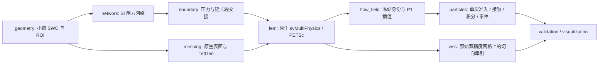

# 小鼠脑血管流场与微泡

这是独立的小鼠血管工程。**唯一日常开发与 Git 根目录就是本目录**，长期分支为 `dev/mouse-vessel-flow`。BraVa 是另一个项目。

**2026-10-23：按最新清理要求，保留以下独立算例的数据，共用一套当前程序。** ROI-only 是默认开发参考。2026-10-22 曾按当时指令删除另外四个算例在新工程中的副本；本次按最新要求，从保留的原件核对 SHA 后补回必要数据与配置，没有恢复重复执行源码。旧报告记录各自当时的状态。

先看[确认后删除报告](docs/CONFIRMED_CLEANUP_REPORT_ZH.md)、[前次工程清理报告](docs/CLEANUP_REPORT_ZH.md)、[直接 Git 开发方式](docs/GIT_WORKFLOW_ZH.md)和[最新结果图表与动画](results/current_review/index.html)。当前身份清单为 `configs/active_data_manifest.json`。原待确认清单中的 15 项已经删除，正式数据保留在本工程；另外 18 项共享或混合资料按原清单保留。

| 算例 | 正式轨迹 | O1 / O2 / O3 出流 | 接触支持静止 | 执行失败 |
|---|---:|---:|---:|---:|
| ROI-only（默认，0.5 ms） | 1500 | 787 / 61 / 467 | 185 | 0 |
| Best-feasible（0.5 ms） | 1500 | 0 / 133 / 1182 | 185 | 0 |
| Network-H0（1 ms） | 500 | 0 / 139 / 291 | 70 | 0 |

原始 2 mm/s 与 Stage-Q 保留各自冻结场和历史证据，不作为另一套日常源码。静止不等于出流；这次没有重新计算完整血管或正式微泡。

## 启动

已建立 `.venv`，没有复制或借用旧项目虚拟环境。以下程序不依赖 shell 当前目录：

```bash
cd /home/lzy/projects/new_mouse_vessel_flow
.venv/bin/mouse-flow list
.venv/bin/mouse-flow inspect --case roi_only
.venv/bin/mouse-flow analyze --case roi_only
# 每次使用一个不存在的新输出目录；不会重写正式结果。
.venv/bin/mouse-flow validate --case all --full-integrity --output validation/my_check
.venv/bin/mouse-flow visualize --output results/my_review
.venv/bin/python -m pytest tests -q
```

重建 Python 环境时，使用 Python 3.13.11 创建新 venv，然后 `python -m pip install -r requirements-lock.txt` 和 `python -m pip install -e .`。此工程采用带本地数据的 editable 安装；普通 wheel 不包含本地科研数据。

## 阅读与计算顺序

从 [main.py](mouse_vessel_flow/main.py) 开始：



- [geometry.py](mouse_vessel_flow/geometry.py)：原始 fMOST 样本、anchor 003274 与真实 ROI。当前必要几何实现位于 `geometry_tools/`；没有带入打印模具或支撑设计程序。
- [network.py](mouse_vessel_flow/network.py)、[boundary.py](mouse_vessel_flow/boundary.py)：完整阻力网络实现位于 `network_models/`，权威版本来自 `active_network_development`。各算例使用独立配置；仍需的网络基线输入保留。
- [meshing.py](mouse_vessel_flow/meshing.py)、[fem.py](mouse_vessel_flow/fem.py)：原生网格和 FEM 的接口；原稳态停止、checkpoint、线性与非线性验收逻辑在 `solver_support/`。
- [flow_field.py](mouse_vessel_flow/flow_field.py)：先验证冻结 SHA、点序、单元对应和边界身份，再构造原来的 `FrozenFEMField`。
- [particles/injection.py](mouse_vessel_flow/particles/injection.py) → [dynamics.py](mouse_vessel_flow/particles/dynamics.py) → [trajectories.py](mouse_vessel_flow/particles/trajectories.py)：固定源顺序、单次准入、有限尺寸阻力、接触与原 P9A1/P6.5 时间积分；不是点流线替代粒子。旧阶段名称仍可能是有效算法，完整对应表见报告。
- [wss.py](mouse_vessel_flow/wss.py)、[validation.py](mouse_vessel_flow/validation.py)、[visualization.py](mouse_vessel_flow/visualization.py)：只读核验、WSS 与结果展示。原流线/矢量/压力/WSS 渲染实现位于 `presentation/`。

源码只以 `mouse_vessel_flow/` 为运行权威。`inputs/reference/source_identity/` 中 ZIP 是显式身份校验的原始字节证据，**不会导入或执行**；用户已批准删除的 `archive/` 已移除。原始报告、日志和契约中的旧路径保持原文；当前入口使用各 `case.json` 的项目相对路径。

## 保持的科学约定

SWC 原始坐标/半径单位为 µm，CFD 与粒子计算采用 SI。表面重建的 Ultraliser 输入使用 `feed_radius = 0.91 × source_radius`，H5 第四列是直径；1D 阻力网络保留原半径，不能把两者混用。此 ROI 有 109 节点和 108 边，不代表所有网络都如此。

1D 模型使用 `R = 8 μ/π ∫ ds/r(s)^4` 与节点质量守恒；压力平移不改变流量。ROI-only 的等分是 0D 边界设计目标，实际 3D CFD 出口比例由结果决定，不能替换成恰好 1/3。

FEM 保留 P1/P1 + VMS、Newtonian `μ = 0.00345312 Pa·s`、`ρ = 1056 kg/m³`、原入口与压力边界、广义 α 时间积分及原 PETSc 参数。WSS 使用 `τ = (I−nnᵀ) μ(∇u+∇uᵀ)n`，在原始双精度网格上计算。插值沿用原粒子加载器，不自行改变其几何表示。

SonoVue 分布、D≤4 µm 条件分布、单次入口准入、固定来源顺序、3/6/12 s 观察扩展及各算例 dt 均保留。RBC 几何/运动和 LAMMPS bridge 属于独立研究组件；当前正式微泡动力学没有 RBC–微泡耦合。CPU 执行粒子动力学，C++ 加速几何查询；历史 CUDA FP64 诊断/EGL 渲染与真正的 PETSc GPU CFD 是不同用途。

## 后续建立新计算

`prepare-cfd --case roi_only --output 新目录` 只复制明确输入、保持求解参数并校验引用。`compute-cfd --directory 新目录 --build-json 外部构建记录.json` 才会调用保留的原生监控求解流程。新本地 solver/PETSc 有单独的文件身份，启动时强制核验安装清单和库文件。构建记录为 `/home/lzy/projects/new_vessel_flow_solvers/manifests/build.json`。原服务器二进制身份仍另行保留，不能混称。CPU/GPU 小管道试算通过；未完整重跑小鼠 CFD。见 [外部依赖](external/README.md)。

`compute-particles --case roi_only --ids 1 2 --output 新目录` 是明确的新积分入口，使用保存队列及新源码身份；本轮没有执行正式轨迹重算。新源对象可通过 `particles.injection.source_for_case()` 创建，再显式调用原 `generate()`；不会默认启动灌注或写入旧队列。

原流场展示可使用 `python -m mouse_vessel_flow.presentation.render_visualization --output 新目录 --stills-only` 或 `render_surface_fields`。这些渲染入口已迁入并检查导入/参数，本轮没有重新执行完整动画渲染。`presentation.prepare_streamlines` 是显式的新点诊断计算，不属于只读查看，也不是微泡生产。

本次没有启动新正式 CFD、微泡批次、网格加密、细档血管或 O2 敏感性任务，也没有访问计算服务器。旧工程及共享资源的最新处理结果以[确认后删除报告](docs/CONFIRMED_CLEANUP_REPORT_ZH.md)为准。
