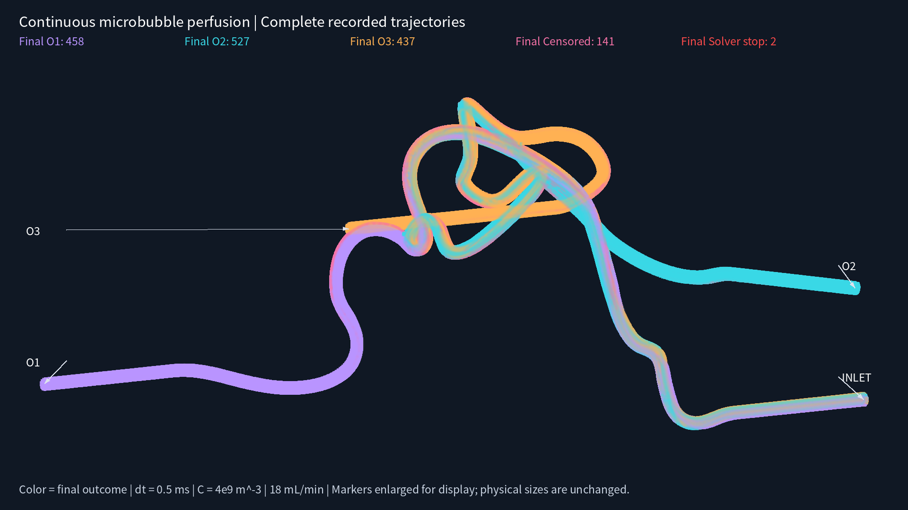
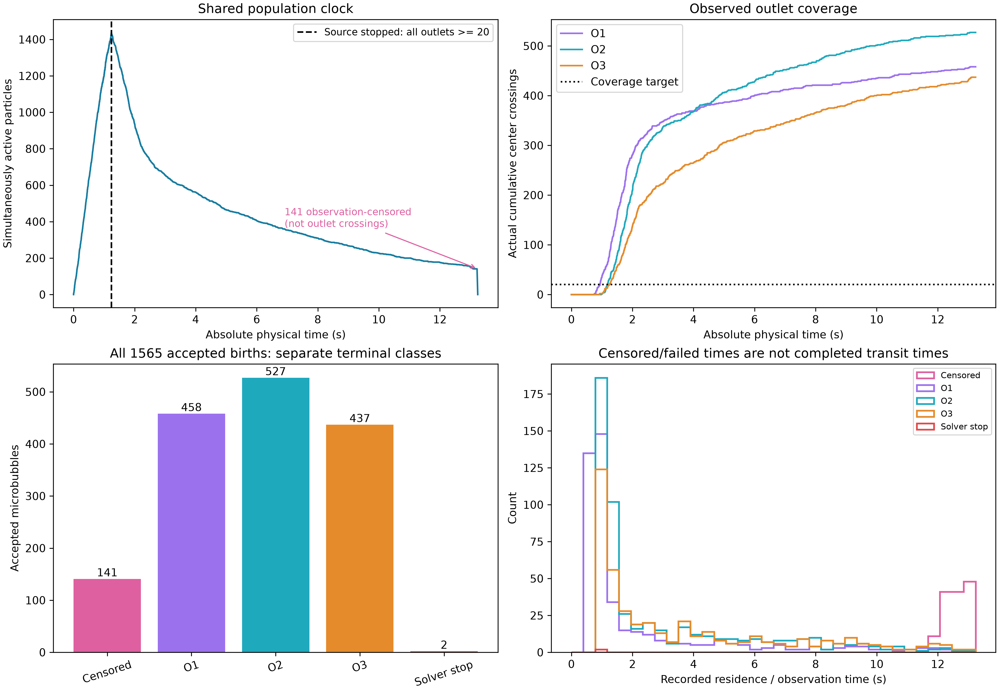
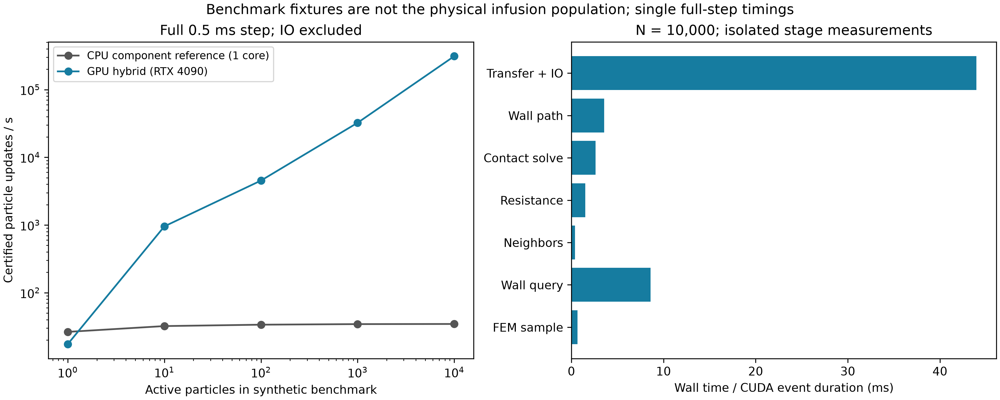

# BraVa 持续灌注、多微泡同时运动与 GPU 工作流验证报告

本报告对应 `realization_0000_contactfix`。没有启动 CFD，没有修改边界条件、几何、原始流场、旧粒径分布或原冻结动力学源码。原已取消独立批次保持停止。candidate 0/15 为同一物理血管的刚体打印姿态，不是两个 CFD 算例。

## 1. 通俗结论

已实现并运行共享物理时钟、持续 Poisson 灌注、同时存在的有限尺寸微泡、微泡间法向近场阻力与接触、GPU FEM/壁面查询及主要动力学。浓度 **4×10⁹ m⁻³**、入口 **18 mL/min**，理论源事件率 **1200/s**，名义 dt=**0.5 ms**。实际产生并接受 **1565** 个微泡，最大同时活跃 **1438** 个。在 **1.240815660 s** 三个出口均达到至少 20 次真实球心穿越后停止灌注，观察至 **13.240815660 s**。最终出口为 **458/527/437** 个；另有 **2** 个数值失败、**141** 个观察截止、**0** 个模型支持静止终止。它们没有被冒充为出口或生理堵塞。正式结果的全轨迹科学完整性标志为 **False**；程序完成和覆盖达到不等于每条轨迹都可信完成。

## 2. 输入、代码与单位

- 流场：`../cases/balanced_pressure_final/frozen_flow/steady_flow.vtu`，SHA256 `73228d094c253cec75dbb0030476b687171d0d0fef7816a845392dad220285dc`。
- 权威网格：`../mesh/SV_MESH/mesh-complete.mesh.vtu`；边界 `../mesh/SV_MESH/mesh-surfaces/`。按 GlobalNodeID 对应；使用规范 tetra 顶点顺序，避免文件内部顶点顺序不同导致错误梯度。
- 流场/几何使用 m、m/s、Pa；时间 s；μ=0.00345312 Pa·s、ρ=1056 kg/m³。动画坐标刚体转换到打印姿态 mm；没有改变动力学尺度。
- 入口 Q=3×10⁻⁷ m³/s=18 mL/min，C=4×10⁹ m⁻³=4000/mL，因此 λ=CQ=1200/s。C 是用户指定的数值模型浓度，不声称实测。
- 冻结流场压力边界 O1=556.9706555488448 Pa、O2=0 Pa、O3=17.13742715356202 Pa。出口积分流量约 1.0000027087688041e-7、9.996883070442674e-8、1.0003089841869293e-7 m³/s；未为微泡覆盖改变出口压力。
- 当前真实流场仍只有现有网格；此前内部截面通量偏差最高约入口 Q 的 2.49%，本轮没有重新验证 CFD 网格无关性，也没有消除这一限制。
- 生产代码 commit：`98d705f13babdfa0cba6c12331623292a588cb77`。开发分支 `dev/brava-population-gpu-20260929`，未推送远端。
- 生产契约 SHA256：`ff8abac2b4a0c5bf5afe986e3018bd0d566430e110b53237dc3548434de4c9c9`；来源 SHA256：`36ad95be1e01c35359e7f5b726a37652971dbb8074df31c9118fa017667118b2`。完整粒径合同、种子、环境、逐源码哈希在 `runs/realization_0000_contactfix/IDENTITY.json`。
- Python/Torch/CUDA：`3.12.14 (main, Sep  2 2026, 23:27:36) [GCC 15.3.0]` / `2.14.0+cu132` / `13.2`；GPU `NVIDIA GeForce RTX 4090`。GPU 与 NumPy 状态均 float64。编译没有 fast-math；动态核使用实际 tetra/finite-triangle BVH。
- 117 个原模块逐文件与基线 `94c644686092158d7f9618c00a6e30cbb10f7f35` 比较保持原字节：`validation/protected_legacy_sources.json`。新增模块不以 synthetic 标记绕过旧环境检查。

## 3. 实际算法与执行分工

源码目录：`/home/lzy/projects/ulm_particle_formal_p9a5/particle_3d/src/particle_3d/population_v1/`。Phase 1 的 25 个原模块审查及符号行号见 `reports/ARCHITECTURE_ZH.md`、`PHASE1_SOURCE_REVIEW.json`。

`environment.py` → `source.py` → `gpu_engine.py` / `engine.py` → `output.py` → `scripts/analyze_population.py` → `scripts/render_population.py`。`gpu_batch.py` 同批数值核处理不同 realization，但每个 realization 保留自己的出生时刻、时间网格和 RNG；不把不同实验中的泡放到同一碰撞群体。

源事件等待时间为 $\Delta t=-\ln(1-U)/\lambda$。粒径使用原 SonoVue **D≤4 μm 条件分布**，不是裁剪大泡。入口位置由真实 P1 正向流量 $\max(\mathbf{u}\cdot\mathbf{n}_{in},0)\,dA$ 加权。每个事件使用 seed / realization / event / random-role 寻址，只抽一次粒径、一次位置、检查一次。准入同时检查有限 WALL 和当前活跃球；拒绝后不重试、不换尺寸、没有 particle_id。出生精确切分全局时间步，不把每条轨迹从 age=0 同时播放。

球面间隙为 $h_{ij}=\lVert x_i-x_j\rVert-a_i-a_j$。V1 法向近场阻力是等大反向球对作用：

$$R_{eff}=\frac{a_i a_j}{a_i+a_j},\quad
\zeta=w(h/a_{ref})\frac{6\pi\mu R_{eff}^2}{h_{eff}},\quad
F_{ij}=-\zeta[(v_i-v_j)\cdot n]n.$$

原交接尺度为 $h_{lower}=\max(2\,nm,0.001a_{ref})$；$h_{eff}=\max(h,h_{lower})$ 只用于阻力分母，原几何 h 没有被裁剪。球对 $a_{ref}=\min(a_i,a_j)$；wall 用自身半径。χ≤0.01 全开启、χ≥0.05 关闭，中间使用 C1 cubic 权重。约束保证 $h\ge h_{lower}$，没有重叠后的任意位置推开。

阻力矩阵包括原 Stokes 自阻力、P6.5 法向修正、P9-A.1 平面近壁平移/转动及 FEM 仿射梯度 forcing。求解各接触连通组件的约束二次系统（$J U\ge0$），不把两个接触微泡强行设成零速。小组件使用原参考解法；大组件使用稀疏组件装配与矩阵自由 Schur 接触解，不创建整个人群的 dense 6N×6N。

GPU 实际承担：SoA 状态、FEM tetra walking/BVH recovery、速度/压力/G/curl/strain 插值、空间散列候选与精确球间隙、真实有限壁面 BVH/连续路径检查、孤立泡 6×6 阻力与多法向接触求解、位置/姿态推进。**稀有球对组件及困难有限边缘路径细分仍在 CPU 小子集上处理**；CPU 还执行源事件、准入、严格出口分类及写出。没有宣称全部接触都已 GPU 化。

不包含：远场多体流动相互作用、可变形壳、声学振荡、溶解/破裂/聚并、RBC、双向 CFD 反馈、球对切向润滑/摩擦。模型支持静止依据原 32 状态 rank/KKT 证据，终态即移除；不代表生理栓塞。

## 4. 按顺序实际执行的验证

Phase 1 审查 → Phase 2 CPU 时钟与原模块 → Phase 3 球对/组件 → Phase 4 灌注 → Phase 5 GPU FEM → Phase 6 GPU 状态/邻居 → Phase 7 GPU 动力学 → Phase 8 独立群体 batch → Phase 9 性能与生产。每个阶段的 README、脚本、日志、JSON 均保留。最终新增测试组 **26 passed**；日志 `logs/server/tests_contact_fallback.log`。本地无 Torch 的环境不能运行 GPU 测试；上述 GPU 测试实际在服务器 RTX 4090 执行。

|编号|对象|执行结果|判定范围与限制|数值附件|
|---|---|---|---|---|
|V01|入口流量与单位|已运行；PASS|真实四端口表面积分；Q=3e-7 m³/s；边界总通量平衡|`validation/server/phase4_real_inlet_statistics.json`|
|V02|Poisson 到达|已运行；PASS|独立未条件化 30,000 事件；不是用依赖覆盖停止的正式样本做固定窗检验|`validation/server/phase4_real_inlet_statistics.json`|
|V03|真实入口通量位置|已运行；PASS|实际 P1 正向通量积分、10 个累计通量分组及质心|`validation/server/phase4_real_inlet_statistics.json`|
|V04|冻结粒径分布|已运行；PASS|原 SonoVue D≤4 μm 条件分布；KS 检验及分布文件身份|`validation/server/phase4_source_statistics.json`|
|V05|单次准入/拒绝无重试|已运行；PASS|占用入口实验；拒绝没有 particle_id；一次 D/x/check|`validation/server/phase4_occupied_inlet.json`|
|V06|单泡与原权威积分器|已运行；PASS|真实入口 400 步及近壁 200 步；短窗口，非整条轨迹证明|`validation/server/phase7_real_gpu_dynamics.json`|
|V07|互不作用的多泡|已运行；PASS|同一物理时间分段下 CPU/GPU 独立结果一致；不声称不同 Euler 分段位级相等|`validation/server/phase7_engine_separated.json`|
|V08|球间正碰/斜碰|已运行；PASS|CPU/GPU 接触；dt/2/dt/4 约束检查；斜碰粗步轨迹误差明显|`validation/server/phase3_collision.json`|
|V09|真实壁面邻近/多约束|已运行；PASS|96 组阻力与接触，含冗余和相反法向；有限壁面查询/路径独立验证|`validation/server/phase7_gpu_resistance.json`|
|V10|出口/同时事件/守恒|已运行；PASS|第一次官方球心穿越、同刻移除；非完整球体离开条件|`validation/server/phase4_outlets.json`|
|V11|FEM GPU 插值|已运行；PASS|22,502 个内部/面/边/顶点/外部点；包含过期 hint|`validation/server/phase5_real_fem_gpu.json`|
|V12|邻居、稳定 ID、多 realization|已运行；PASS|10,000 球空间散列；精确球间隙；跨 realization 禁止相互作用|`validation/server/phase6_neighbors.json`|
|V13|调度确定性|已运行；PASS|CPU 1/4 workers 来源一致；GPU batch 2/4 来源和时钟一致|`validation/server/phase8_batch_gpu.json`|
|V14|局部接触组件扩展性|已运行；PASS|40 泡 39 接触链；稀疏/矩阵自由解与局部参考相符；不构造全局 6N²|`validation/server/phase3_sparse_chain.json`|
|V15|支持静止/移除|已运行；PASS|原 32 状态、rank=3、KKT 判据；CPU/GPU 三壁角落例，不作生理栓塞解释|`validation/server/phase7_stationary_gpu.json`|
|V16|共享时钟保护责任|已运行；PASS|极小步保护不误停旁观微泡；拒绝试步记录实际球对/壁面触发者|`validation/server/rejected_trial_owner_regression.json`|
|V17|实际近共线接触回退|已运行；PASS|实际失败历史32个状态，原GPU候选被正确丢弃；有效CPU回退恢复原解|`validation/server/actual_contact_fallback_regression.json`|

数值重点：

- 真实入口独立 30,000 源事件：实测率 1199.269680/s；Poisson KS p=0.501646，粒径 KS p=0.415136，入口通量分组 p=0.781512。未拒绝分布假设不等于证明概率定律正确；算法与分布身份另经源码检查。
- 22,502 点 GPU FEM：tetra 身份一致，速度最大误差约 1.11e-16 m/s、压力 9.09e-13 Pa，G/curl/strain 本测试误差 0；详细误差 `{'gradient_s_inv': 0.0, 'pressure_Pa': 9.094947017729282e-13, 'strain_s_inv': 0.0, 'velocity_m_s': 1.1102230246251565e-16, 'vorticity_s_inv': 0.0}`。
- 真实壁面 1000 点 nearest/gap/normal 与 CPU 一致；60 条路径首交接根误差 0，32 条直接 GPU 证明，28 条需细分/CPU有限壁面证明；没有以无限平面替代实际三角形。
- GPU 阻力/接触标准夹具实际误差：`{'omega_s_inv': 3.069544618483633e-11, 'relative_matrix': 3.1906009899286353e-16, 'relative_rhs': 7.874695908424214e-17, 'velocity_m_s': 1.8995222061946038e-16}`。另在真实失败点发现近共线接触问题并修复，实际回归结果见 V17；不能仅依赖标准夹具。
- 真实动力学短窗与未改旧积分器：入口 400 步、近壁 200 步的位置误差 0，速度误差约 1.39e-16/2.78e-17 m/s。这只是相同时间分段短窗 parity。
- **斜向碰撞仿射场的 dt/2/dt/4 实验显示明显轨迹时间离散敏感性**：粗/中档末位置距最细约 3.30e-4/1.93e-4 m。此项 PASS 指约束无穿透、稳定身份及细化对照完成，不能写成 dt=0.5 ms 精度验证通过。真实灌注没有额外跑时间步收敛研究。

## 5. 正式灌注结果与独立核查

|出口|实际穿越数|占全部接受出生比例|
|---|---:|---:|
|O1|458|29.265%|
|O2|527|33.674%|
|O3|437|27.923%|

源提议 1565；接受 1565；壁面拒绝 0；球对拒绝 0；其他拒绝 0。实际源/接受率为观察到的数量除以灌注时长，约 1261.267/s；与理论 1200/s 的区别是随机实现和依赖出口的停止规则，不能靠调源强制等于期望。

最终 active=0；实际 pair nearfield 进入事件 17、pair contact 进入事件 203、最大同时 pair contacts=5。这些是接触/近场集合从未激活到激活的事件计数，不是每个采样步重复计数，也不是人为添加碰撞。接触集合在 handoff 舍入尺度附近也可能反复切换，事件数不能当作独立弹性撞击次数；本模型本身是过阻尼约束动力学。涉及唯一近场球对 11 组、唯一接触球对 9 组。每次涉及的 IDs 和接触乘子/残差可在原 interaction ledger 核对。

独立审计 `analysis/realization_0000_contactfix/INDEPENDENT_AUDIT.json`：

- 每个 chunk 文件哈希及全部数值数组科学哈希逐一复算；三个压缩 JSONL 解压后哈希复算。源事件与终态一一核对，出生没有重试或越过灌注停止时间；再次按真实出口事件重建覆盖停止时刻。
- 保留 27272704 行接受状态。age 与 physical_time−birth 最大误差 0 s；分段位置与记录的 held velocity 最大差 3.16583e-16 m。
- 独立官方出口分类复核 1422 个出口末段，结果 True。
- CPU 有限三角形壁面独立复核 4647 个出生/终点/每轨迹最小 gap 状态，接受状态 gap 最大误差 0 m，独立最小 gap 1.99999396e-09 m；几何 roundoff 6.13034e-15 m。
- 原出生行 `wall_gap` 是准入保守下界，`tetra_id=-1` 表示尚未初始化搜索 hint；不能误当精确距离或网格外。派生 `analysis/.../tracks/` 在出生点单独用 CPU 补算精确 gap/tetra，原始数据不变。其余接受步均记录真实查询 gap；出生下界最大违约量 1.0842e-19 m。
- 另抽查 265 个实际群体状态，KD-tree 枚举所有距离≤2r_max+2 nm 的球对；最小近接触原始 gap 为 2.000000241791952e-09 m。它是独立抽查，不能冒充每一步全配对证明；每步连续路径的主计算证书仍在 ledger 中。

修复前后来源账本及 ID1131 后续运动的比较保存在 `analysis/realization_0000_contactfix/contact_fix_comparison.json`；只比较相同来源和已定位的程序差异，不将中止批次当作有效生产样本。

### 数值失败明确保留

|保护触发原因|条数|
|---|---:|
|ROUNDOFF_SCALE_STAGNATION_64_ACCEPTED_SUBSTEPS|2|

|ID|末点 tetra|最近 wall triangle|gap (m)|FEM speed (m/s)|独立 CPU 与记录速度最大差 (m/s)|接触秩|
|---:|---:|---:|---:|---:|---:|---|
|440|138584|42572|1.3630381e-05|0|0|[0]|
|1505|138584|42572|8.0260878e-06|0|0|[0]|

其中 2 条失败的最终 FEM 速度严格为零；详情保留末点 tetra、四个顶点速度、壁面三角形编号、gap、32 次 CPU 独立重算与 GPU 速度差。对于四节点速度全零的单元，这里确认的是冻结输入的线性插值为零，不等于证明连续流体在该体积内真实静止。其余失败涉及近壁极小步/进展保护时，按实际日志说明，不一概称为低速、接触支持或生理堵塞。失败终态移除是计算策略，可能影响其后的群体相互作用，因此 **有失败时不把整批当作完整物理输运统计**。出口覆盖数字是本数值实现的真实已记录穿越数。

停源依赖观察到的出口覆盖，12 秒之后尚在途为右删失；失败/删失 residence time 不是完成输运时间。没有将失败或删失剔除后重新归一化为“所有泡的出口概率”。

## 6. 性能和实际 CPU/GPU 分工

以下是实际 BraVa FEM 内精心选择的**无相互作用内部状态性能夹具**，每档一次完整 0.5 ms 已认证推进；不是正式灌注速度，不包含 IO。GPU 分阶段用预热后的 CUDA events；第一档完整一步有冷启动成本。CPU 基线是新组件包装调用原物理的单核实现，不是原七 worker 独立作业吞吐。

|N_active|CPU 墙钟 s|GPU 墙钟 s|GPU particle-updates/s|该单步 CPU/GPU 时间比|
|---:|---:|---:|---:|---:|
|1|0.0379151|0.0575089|17.3886|0.66×|
|10|0.311291|0.0104704|955.074|29.73×|
|100|2.96877|0.0220405|4537.11|134.70×|
|1000|29.1121|0.0308515|32413.3|943.62×|
|10000|289.82|0.0320599|311916|9039.96×|

N=10,000 峰值 Torch allocated=5.624 GiB（该进程累计峰值）；当时 nvidia-smi `66, 6826`。分阶段 FEM、wall、邻居、阻力装配、接触解、连续路径及输出时间见 `04_performance.png` 和 JSON。无相互作用夹具的 active pair physics 为 0，不把邻居构建时间称为碰撞求解性能；有碰撞的组件性能仅由碰撞测试/正式回退记录体现。

单独测量了 CPU 球对组件（无壁面、预热后五次测量取中位数）：

|粒子数|接触数|球对阻力装配 ms|接触几何 ms|耦合约束求解 ms|
|---:|---:|---:|---:|---:|
|2|1|0.5467|0.0895|0.5572|
|40|39|3.9744|0.6562|19.4867|

没有把这些 CPU 回退时间当成 GPU 球对计算。该补充分阶段测试与正式作业同时运行，主机竞争可能影响耗时。

16 组各 1 泡、各 20 步稀疏独立实验：逐组 1.504952s，batch 0.695022s，约 2.165×；末位置最大差 6.93889e-18m。每个 realization 的 clock/source/IDs 独立。单次计时不作为稳定吞吐置信区间。

正式作业总墙钟（含进程/环境初始化与最终关闭）约 **1769.335s**；其中积分及动态写出循环 **1758.144s**，接受 particle updates **26076932**，含日志/源/几何处理的平均 **14832.080 updates/s**；其中 **99.831568%** 的接受动力学更新由 GPU 实际求解，CPU 组件权威更新 43922 次。GPU 平均/峰值利用率 39.97/100.00%；显存均值/峰值 12001.5/23990.0 MiB；CPU 进程平均 104.64%（100%=一核）。压缩输出使用两线程；稀疏小群体及严格事件驱动意味着 GPU 不必持续满载。没有为提高利用率改变浓度/物理或制造额外 production realization。

以上 GPU 利用率、显存来自 `nvidia-smi --query-gpu`，是**整张设备**的采样，可能包含同期验证和渲染进程，不能独占归因于生产进程；CPU 百分比则是生产 PID 自身。逐接受更新的 GPU/CPU 分工由引擎内部计数确定，不由设备利用率推断。

## 7. 开发中发现的问题及保留记录

1. 初次生产发现旧单泡“64 个接受子步时间进展不足”被直接用于同步群体，造成没有触发细分的微泡被误判。`realization_0000` 已中止并保留，不能作为有效结果。中止发生在终态证据循环中，原输出关闭还因中断时非原子账本而报错；原文件仍在，不伪造完整 manifest。
2. 第一次修复覆盖了显式 handoff，还遗漏了拒绝试步导致的递归细分。`realization_0000_guardfix` 已中止保留，完整 FAILED_EXECUTION/manifest 记录该范围。
3. 最终修复给壁面、球对、FEM 端点拒绝逐项记录实际责任 ID，只有触发者会触发极小进展保护；无关微泡继续。同一原阈值保留，新增两项时钟回归测试。之后在实际失败位置发现接触秩解析问题，补充第三项回归后才重算正式结果。正式结果使用本报告列出的最终 commit，而不是前两次输出。
4. `realization_0000_final`（e62d654a6）在实际 ID1131 末点暴露 GPU 近共线接触容差差异：32 个历史状态最大速度差 2.633736141417612e-7 m/s。FEM 与真实 wall 查询一致；问题来自用普通 SVD epsilon 而不是 dual Gram 的 sqrt(epsilon) 分辨率识别秩，使容差被虚假小奇异值放大。该运行中止保留，不作为正式结果。新版本遇到这种秩不确定性明确回退原 CPU 正锥约束约简；实际历史回归恢复 CPU 原解，数值容差没有放宽。报告的正式 run/commit 是修复后的单独目录。
5. 更早的源统计夹具与 GPU 壁面脚本 console JSON bool 输出错误保留于验证日志；纠正测试/打印问题后真实数值结果有独立 JSON。曾将单体静止判据用于耦合球对的情况亦已限制为连续 32 次孤立求解；耦合静态球对不会被冒充为单体三壁支持静止。

## 8. 动画和数据读取

交付终检 `validation/server/final_delivery_qc.json`：数据一致性为 **True**；原流场/网格/边界哈希和实际生产源码身份一致；全部原始状态的半径相对出生值漂移 **0.0 m**，直径相对两倍半径误差 **0.0 m**，内部 tetra 身份有效。两个视频均实际解码计数为 576 帧、1920×1080、24 fps、24 秒，并保存视频 SHA256。此终检不改变两条数值失败和141条观察截止的科学分类。

- `candidate_0/OPEN_RESULTS.html`、`candidate_15/OPEN_RESULTS.html`：**同一真实物理群体**的两种刚体姿态；MP4 为 PHYSICAL_TIME，不做 age alignment。
- 动画沿用现有深蓝背景、半透明血管、终态颜色、固定视角；静态总览保留旁置端口标签。主图正交倍率测量为 1.30、marker 9.1px；投影边界检查保证不出画。文字全英文，记录来源和相机参数在各自 `data/render_manifest.json`。
- GPU 用 NVIDIA EGL 实际渲染；MP4 用已验证可用的 CPU libx264 两线程编码，不宣称本机不可用的 NVENC。
- `runs/realization_0000_contactfix/states/chunk_*.npz`：所有接受子步完整状态，包括 q/ω/原半径/身份；`state_offsets` 和 `state_time_s` 组织每个同时群体快照。
- `source.jsonl.gz`：每个提议及一次准入；`terminals.jsonl.gz`：出口/失败/静止/删失；`interaction_audit.jsonl.gz`：pair IDs、接触、CPU fallback、handoff、拒绝与责任者。
- `analysis/realization_0000_contactfix/trajectory_catalog.csv`、`population_timeline.csv`、`pair_interactions.csv`、`independent_outlet_checks.csv`、`independent_wall_checks.csv`、`failure_diagnostics.json` 提供审阅用摘要。所有数组使用 SI；catalog diameter_um 明确使用 μm。
- 任意绝对时刻的群体可由出生/终态筛选，再在逐接受端点之间沿 held velocity 线性重建。生存区间用 birth≤t<terminal；精确 terminal 点作为轨迹端点保留，之后不冻结在动画里。

## 9. 能支持的结论与限制

支持：新工作流实际使用所指定 BraVa FEM，源身份/单次准入/共享时间/出口计数/CPU-GPU 短窗及几何 parity 有代码、测试和数值证据；GPU 参与实际动力学而不只是渲染；各出口≥20 的停止条件实际达到；旧项目物理源码和流场没有改写。

不支持：真实血管完整时间步收敛、CFD 网格无关、所有失败轨迹的物理结局、含壳体/声学/变形/血细胞的真实生理预测。全批科学完整性标志为 false 时尤其不能宣称全部接受轨迹通过验证。正常终态、支持静止、失败与观察截止必须分别使用。

复现和原始路径见 `REPRODUCE.md`。本轮交付已有可执行模块、实际计算、验证、分析与动画；没有新增 CFD 任务。
