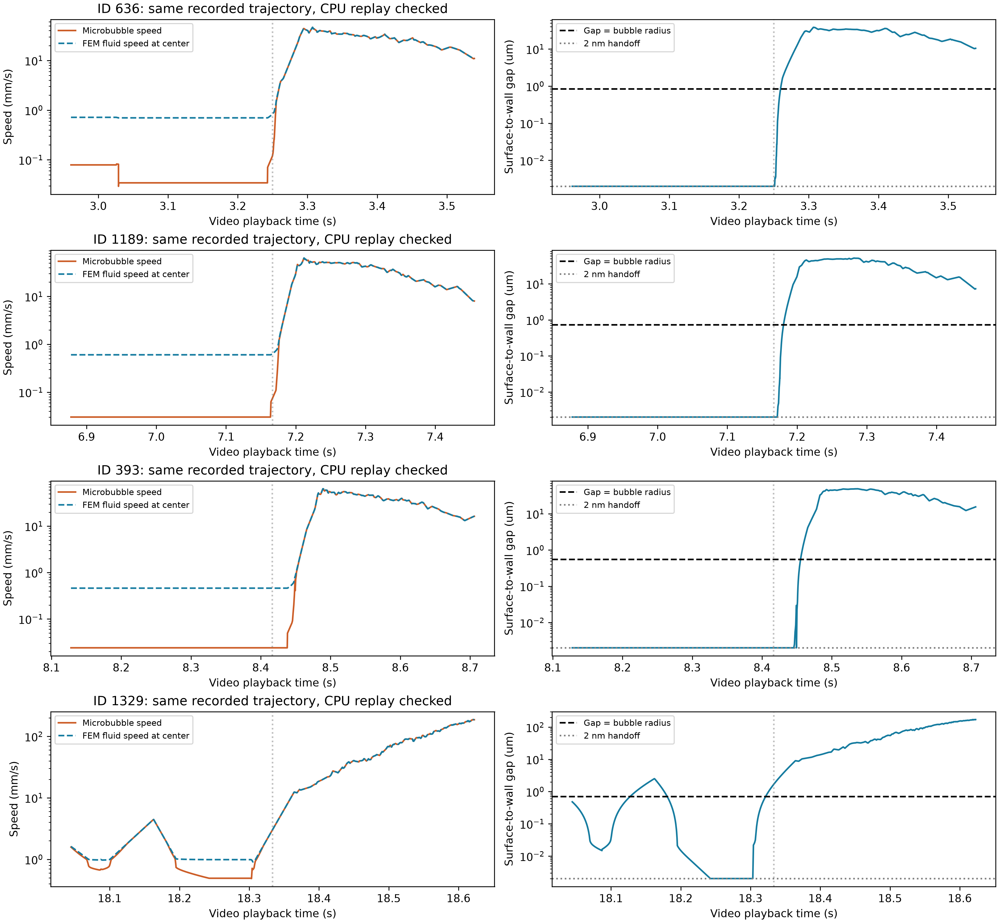

# 两个 BraVa 视频中“先慢后快”的原因核查

## 结论

读取的是 `realization_0000_contactfix` 的1565条轨迹，以及 candidate 0/15 的共同动画输入。用户定位为两个视频播放3秒以后、全血管。**已确认主要计算机制是近壁缓慢滑行 → 经过有限壁面面片边缘或其他离壁路径 → 间隙增加、近壁阻力减弱 → 进入更高速度流区。**固定帧率只显示这一过程中的少数时刻，让短时间的速度增长显得突然。

这不是仅凭动画猜测：逐接受端点、FEM 速度、壁面几何、相互作用账本和原 CPU 方程都有证据。但是，典型区域的冻结线性 FEM 场存在明显局部散度及指向壁面的速度分量，**不能将该过程直接称为已验证的真实生理加速**。CPU/GPU 一致只证明这些状态的实现一致，不能证明流场/几何/近壁模型本身精确。

## 1. 播放时间、数据及筛选

- 全片576帧、24fps；相邻帧恒定相隔约0.0230275055秒物理时间。以帧起始播放时刻计算，`t_physical = 0.5526601319 × t_video`。不是后半段换播放倍率。
- `scripts/analyze_population.py:63` 生成等距物理时刻；`:94` 按真实生存时间筛选，`:95` 用所有接受端点进行位置线性插值；`scripts/render_population.py:85` 固定24fps。两种姿态只是同一轨迹的刚体转换与投影。主图×1.30是恒定空间倍率。
- 动画一个帧间隔跨约46个名义0.5ms步，实际近壁步还可能更细。约0.05–0.07秒的物理速度变化，通常只有2–3个帧间隔。
- 扫描标准：取分界前后各3个帧间隔（各约69.08ms）的三维位移速率均值；前段<2mm/s、后段>10mm/s、后/前≥5倍；每个ID保留倍率最大的一个事件。这是明确筛选的显著样本，不是所有可能加速的总数，也不是瞬时加速度统计。
- 符合标准201条，其中179条在视频3秒以后。201条的慢速窗壁面间隙中位数均小于自身半径，快速窗中位数均大于半径。189条在整个轨迹中都没有微泡间近场记录，192条在加速窗没有该记录。因此微泡相互碰撞不能解释大部分已筛选事件；其余9条不能仅凭关联排除相互作用贡献。
- 本轮只读取保存状态、采样同一冻结场、在固定位置重解原CPU阻力/约束方程；没有重新积分轨迹或启动CFD。

## 2. 四个可核对的具体例子

以下是同一ID的两个真实接受步起点，速度单位mm/s，gap是**球表面到真实壁面**的距离，单位μm。不是球心到壁面的距离。保存的 `velocity[i+1]` 是在 `x[i]` 求得的前一段 held velocity，核对时已按这一语义对齐。

|ID|视频播放秒数：前 → 后|微泡速度 mm/s|同位置 FEM 流速 mm/s|壁面 gap μm|
|---:|---|---:|---:|---:|
|636|3.150 → 3.350|0.03435 → 34.34194|0.69974 → 34.34194|0.002000 → 33.957376|
|1189|7.067 → 7.267|0.03030 → 49.11377|0.60557 → 49.11377|0.002000 → 48.961549|
|393|8.317 → 8.517|0.02398 → 53.56372|0.46169 → 53.56372|0.002000 → 48.314083|
|1329|18.234 → 18.434|0.52173 → 31.40812|0.99034 → 31.40812|0.003010 → 23.627032|

四例共12个固定状态，原CPU函数重算与保存速度最大差为 **1.38778×10⁻¹⁷ m/s**。这些点没有球间相互作用；逐点记录含半径、坐标、单元和三角形ID、未加运动学约束的解、加约束后的解、接触法向、乘子及残差，见 `CPU_STATE_REPLAY.json`。

前三例慢速阶段经过三角形 **33200**，初期四面体为 **388769**。例如ID1189的慢速点位于SI坐标约 `(0.030043317, 0.005520087, 0.002142350) m`。ID636/1189/393分别在视频约 **3.251 / 7.172 / 8.445 s** 出现最近壁面特征 FACE→EDGE，边重心坐标的一项降到0，gap开始离开2nm交接尺度。并非瞬时、永久取消所有约束：边缘附近可短暂重新激活接触，随后继续离壁。详细状态在 `WALL_RELEASE_AND_FEM.json`。

第4例位于另一处壁面，涉及15831、15836等三角形，表明该机制并非只出现在同一位置。

## 3. 为什么离壁后能变快

当前是过阻尼有限尺寸球模型，每个状态解阻力与约束平衡：

$$\mathbf R(h)\,\mathbf U=\mathbf b_{flow}+\mathbf J^T\boldsymbol\lambda,\qquad \mathbf x_{k+1}=\mathbf x_k+\mathbf v_k\Delta t.$$

这里 $\mathbf U=(\mathbf v,\boldsymbol\omega)$，$h$ 是壁面间隙；没有用于模拟惯性加速的 $m\,d\mathbf v/dt$ 项。速度由当前位置的流场、近壁阻力和当前约束共同决定。

- 法向近壁阻力在启用区内具有 $6\pi\mu a^2/h_{eff}$ 形式，接近壁面时很强；同时有P9-A平面近壁切向/转动修正及局部速度梯度作用。
- 交接gap为 `max(2nm, 0.001a)`。达到这里仍可沿壁滑行，不能穿过壁面；它不是吸附、弹簧蓄能或粘住后“弹开”。
- 经过有限三角形的边缘后，最近几何特征和法向改变，运动可以逐渐离开壁面，实际gap增加。
- 平面近壁修正权重在 `h/a≤0.1` 为1，`0.1<h/a<1` 按三次函数连续减弱，在 `h/a≥1` 为0；法向近场修正也有明确作用范围。**不是某个播放时刻硬切速度倍率**。
- 远离这些局部相互作用且无球对作用时，平动速度回到当前FEM速度。上述四例的快速点微泡速度与同位置FEM速度一致。

近壁时，**单纯取消运动学约束并不会立即得到几十mm/s**：例如ID1189约0.03030mm/s，而同一状态未加硬约束的近壁阻力解约0.03035mm/s，几乎相同。真正的大幅变化来自离壁过程中的阻力状态变化，以及随后采样到的局部流速由约0.606增至49.114mm/s。因此不能只归因为“硬接触释放”。

代码证据：`population_v1/gpu_resistance.py:19`（法向近场阻力）、`:29`（平面近壁权重）、`:43`（梯度forcing）；`population_v1/gpu_engine.py:219`（实际求解）、`:292`（接受位置与速度写出）；原CPU对应 `planar_wall_hydrodynamics.py:80`、`particle9a_motion.py:30`，冻结场在 `field.py:51` 构造逐单元常梯度。完整根路径见末尾。

## 4. 明确存在的近壁数值风险

微泡实际读取的是冻结节点速度的四面体P1线性插值。典型单元388769的三个节点速度为0，第四节点速度约0.157682m/s，单元边长约138–238μm；上述微泡半径仅约0.55–0.84μm，gap为2nm。这种尺度关系本身不能代替收敛检查，但解释了为什么局部面片/梯度精度需要谨慎判断。

在ID1189慢速状态：

- FEM总速度约0.605573mm/s，其中**朝壁面**分量约0.602477mm/s，切向分量仅0.061157mm/s；近壁阻力和不可穿透约束强烈限制了这种向壁面运动。
- `div(u) = trace(G) = −827.429163 s⁻¹`，`||G||F = 831.681264 s⁻¹`，`|div(u)|/||G||F ≈ 0.994887`。精确不可压缩场应满足div(u)=0，故不能把这一局部插值视为已经精确满足不可压缩条件。
- 独立用四节点坐标/速度直接解线性系数，再用四个面的线性速度面积积分，两种方法均得到约−827.429163s⁻¹；并非只重复读取某个梯度变量名。
- 该单元净向外通量为−5.476646×10⁻¹⁰m³/s，约入口Q的−0.182555%。这是**一个单元**的局部通量不平衡；不等于全域边界的净流量误差，不能与全局守恒混为一谈。

因此可以确认“慢滑—经过面片边缘—离壁—采样较快流区”是当前代码和输入所给出的机制，也有明确的局部离散精度风险；尚不能定量分离其中多少来自真实曲面/流动，多少来自三角面几何、P1近壁速度和接触近似。本轮没有通过修改参数、平滑结果或追加CFD来让动画变顺。当前CPU复算也不是时间步或网格收敛证明。

## 5. 图与附件

左列：微泡速度与同位置FEM流速；右列：真实壁面gap。横轴为**视频播放秒数**；纵轴使用对数刻度以同时看清慢速和快速阶段。竖虚线是自动筛选的窗口中心，不是精确脱离事件。



- `speedup_diagnosis_all_candidates.csv`：201个筛选事件、前后gap/FEM/微泡速率及交互计数。
- `case_*_timeseries.csv`：四例逐接受步数据，含两个姿态的投影速率；分析主结论使用三维真实速率，不靠投影反推。
- `CPU_STATE_REPLAY.json`、`WALL_RELEASE_AND_FEM.json`：原CPU重算及真实边缘/局部散度核查。
- `SCAN_SUMMARY.json`、`DIAGNOSIS_SUMMARY.json`：筛选定义和汇总。
- `scan_acceleration.py`、`diagnose_acceleration.py`、`check_release_geometry.py`：可重跑的只读诊断。扫描脚本初次遇到“零个满足瞬时大跳变标准”时空表写出报错，原`scan.log`保留；已修正空表输出并完整重跑，结果在`scan_completed.log`。

## 6. 范围与复现

输入run：`/home/lzy/projects/brava_flow_roi_18mlmin/population_v1/runs/realization_0000_contactfix/`。

完整逐轨迹数据：`/home/lzy/projects/brava_flow_roi_18mlmin/population_v1/analysis/realization_0000_contactfix/tracks/`。

源码根：`/home/lzy/projects/ulm_particle_formal_p9a5/particle_3d/src/particle_3d/`。

流场SHA256：`73228d094c253cec75dbb0030476b687171d0d0fef7816a845392dad220285dc`；生产commit：`98d705f13babdfa0cba6c12331623292a588cb77`。

```bash
cd /home/lzy/projects/brava_flow_roi_18mlmin/population_v1/analysis/acceleration_diagnosis
export OMP_NUM_THREADS=1 OPENBLAS_NUM_THREADS=1 MKL_NUM_THREADS=1
/home/lzy/projects/temp_storage/ulm_particle_3d_particle0/.venv/bin/python -B scan_acceleration.py
/home/lzy/projects/temp_storage/ulm_particle_3d_particle0/.venv/bin/python -B diagnose_acceleration.py
/home/lzy/projects/temp_storage/ulm_particle_3d_particle0/.venv/bin/python -B check_release_geometry.py
/home/lzy/projects/temp_storage/ulm_particle_3d_particle0/.venv/bin/python -B write_explanation.py
```
