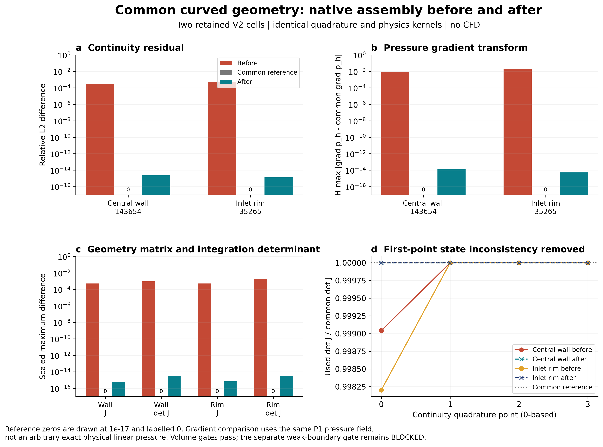
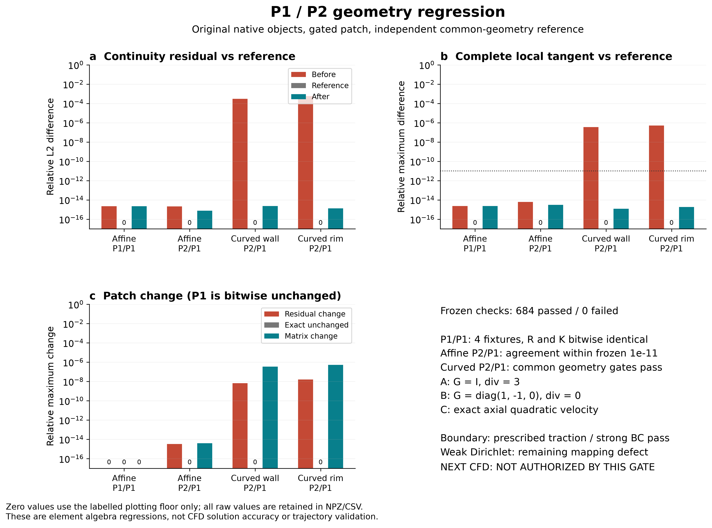
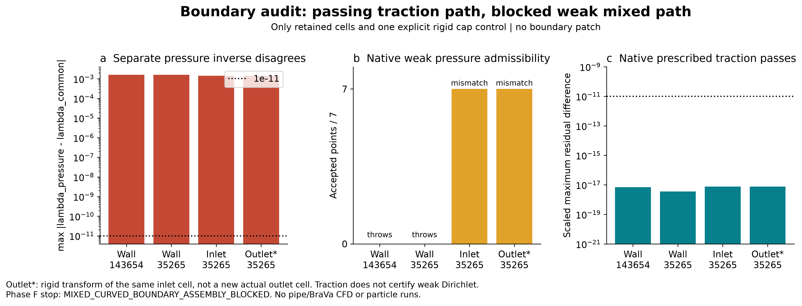

# Common curved-geometry mapping 修复与验证报告

2026-10-06。**体单元共同几何补丁通过；整体仍为 COMMON_GEOMETRY_FIX_NOT_EVALUABLE。** 最后边界 gate 发现独立的弱 Dirichlet 压力几何混用，并实际触发 native 异常，按 Phase F 停止。没有新 CFD、时间步、线性系统求解或粒子轨迹。

| 问题 | 结果 |
|---|---|
| blocker 是否稳定复现？ | YES。两原单元分别复现约0.0302553%和0.0567942%的连续性残差差异；仿射对照为舍入误差 |
| root cause 是否为 field basis / geometry basis 混用？ | YES，同时叠加共享 Jac/Kxi 覆盖和不适用于曲面物理导数的 lShpF 缓存 |
| patch 是否让 P1 pressure 使用 common curved TET10 geometry transform？ | YES，体装配两积分循环均通过逐点验证 |
| continuity 是否统一使用 common detJ/weight？ | YES，首点与后续点均一致 |
| stabilization metric 是否使用一致 geometry？ | YES，传入 Kxi 和实际 tauM 均核验；公式、系数与原生 mixed 开关不变 |
| central-wall 真实 cell 是否到预声明门槛？ | YES，体装配字段/导数/几何/残差/矩阵通过；边界另行 FAIL |
| inlet-rim 真实 cell 是否到预声明门槛？ | YES，同上；边界另行 FAIL |
| P1/P1 production path 是否保持不变？ | YES，四个新局部 P1 回归的 R/K 逐位相同，生产源码/binary 未改；不是重跑全域 CFD 的认证 |
| boundary mixed geometry 是否安全？ | NO。strong Dirichlet 和 prescribed traction/Cauchy 通过，weak Dirichlet 仍混用角点几何 |
| 是否允许下一轮跑一次 P2/P1 pipe GPU CFD？ | **NO，本轮完整 gate 未通过** |

## 1. 实际开发内容与身份

继续使用实际生产 retained source `c3f0bb892b765b718f61069ecd9726dbc6d177fd`，binary SHA `43cd7d7b9ae9bde91275982225c6bf084859141cdaf2ec1030e1b83c3b94691d`。没有拉取另一版本代替。所有构建/输出位于本轮独立目录；未安装补丁到 production。

最小 [patch](COMMON_GEOMETRY_PATCH.diff) 以 `SVMP_VALIDATION_COMMON_GEOMETRY` 显式编译宏门控，仅改变 mixed 3D TET10 分支。原生 quadrature、参考基函数、fluid physics kernels、PETSc assembly 及 P1 分支保留。共同几何 helper 计算 x/J/detJ/invJ/Kxi，并用同一 inverse 变换两种场的导数；Hessian 使用完整曲率 chain rule。体装配需要的 geometry 不再由 pressure TET4 gnn 重算或覆盖。

[构建身份](COMMON_GEOMETRY_PATCH_IDENTITY.json) 保存 source/diff/object/binary SHA、原编译/链接设置和复用对象清单。四种 native binary 为原 production objects 链接、仅观测 baseline、补丁无观测、补丁有观测；完整局部 R/K 对照证明观测代码不改变结果。未重写 FE library 或求解器。详细根因、正确数学语义和六问回答见 [源码根因报告](MIXED_CURVED_GEOMETRY_ROOT_CAUSE_ZH.md)；带行号的 exact-source 摘录见 [调用图](MIXED_CURVED_GEOMETRY_CALL_GRAPH.json)。

## 2. 测试门槛与体装配结果

[协议](COMMON_GEOMETRY_HARNESS_PROTOCOL.json) 在 patch 执行前冻结：字段/导数、残差/矩阵及几何缩放误差1e−11，位置/H为1e−12，确定性重复逐位相同。没有事后放宽。仅复用上一轮两个实际单元及各自 affine/curved 版本，不重新跑 A–D1、Poiseuille全域表示或生成网格。

本轮24个场/单元组合覆盖 P1/P1、affine P2/P1、curved P2/P1；包括 G=I、严格无散线性场、轴向二次速度、压力单独载荷及确定性一般节点状态。比较实际 native residual/tangent 与独立 NumPy 几何驱动的原生 kernel；连续性和零速度压力载荷另外直接积分弱形式。

| 原单元 | continuity 前相对L2差 | continuity 后相对L2差 | grad p_h 前缩放差 | grad p_h 后缩放差 |
|---|---:|---:|---:|---:|
| central wall 143654 | 0.000302552602 | 2.364e-15 | 0.00903056 | 1.29e-14 |
| inlet rim 35265 | 0.000567941616 | 1.32e-15 | 0.0183673 | 5.247e-15 |

这些差异衡量单元数学/实现一致性，**不是实际 CFD 解误差**。压力列使用一般角点压力场，比较同一 p_h 在 common geometry 下的正确梯度，缩放为 H·max绝对差。逐点 N/u/G/div/p/gradp、J/invJ/weight/metric、实际 tau 参数和完整 R/K 均保存在 [NPZ](COMMON_GEOMETRY_SAMPLES.npz) 与 [CSV](COMMON_GEOMETRY_METRICS.csv)。Jac/metric/场变换参数直接截取 native 调用；完整 J 由截获的参考坐标梯度重构，used-J 分支选择与实际截获 detJ 对照，未将重新计算的参考值冒充 native 内部直接存储。

**684项最终体装配检查通过。** P1四个组合的 R/K 最大绝对变化均为0，实际稳定化参数也保持。affine P2/P1 前后在门槛内一致。首次补丁的20项 Hessian 失败完整保留在 `ATTEMPT_01_*`；改用共同逆矩阵与中心化曲率后，在同一1e−11门槛下通过，未抹除失败或改变误差尺度。

## 3. 不能混淆的压力表示限制

P1 pressure 是参考坐标中的线性函数，曲面几何下不等于任意物理线性压力。本轮查看修复结果之前已在协议中说明：两单元 z 映射未弯曲，因此 `p=0.3+(z−z0)/H` 可被 P1 精确表示，作为非恒定物理压力的解析 gate，全部通过。

一般物理线性压力的角点插值保留表示误差。修复后，对目标 `(1,2,3)/H` 梯度的 H 缩放最大差分别约0.00903和0.01837；压力值最大差约0.00014377/0.00029605 Pa，前后未变。这是 p_h 与目标解析函数不同，**不是修复后几何梯度算错**。原压力梯度在错误仿射几何上反而看似等于目标梯度，不能以这种表面一致性否定正确的共同映射。

继承的 affine P2 二次精确性、CPU sampler 和138584唯一自由边结论仍有效；不扩大为任意曲面物理二次函数精确性，亦不声称138584的 rank≤1限制或历史微泡异常被修复。

## 4. Phase F：真实边界阻断

[边界审计](BOUNDARY_MIXED_GEOMETRY_AUDIT.json) 直接调用 native `set_bc_dir`、`set_bc_trac_l`、`set_bc_dir_wl` 和 `nn::get_nnx/gnnb`。覆盖两个 wall 面、原35265 inlet cap，以及该同一单元的刚体变换 outlet-oriented 对照；后者不是新选取的真实出口单元。

68项边界工程检查通过：TRI6与TET10限制映射、法向/位置/积分权重、六节点强Dirichlet及其余DOF保留、给定节点牵引积分、planar cap上完整解析Poiseuille Cauchy向量载荷。牵引 reference 与 native 使用同一积分规则，因此不冒称已完成边界积分阶数收敛。

但 weak Dirichlet 在求完 TET10 速度参考坐标后，又用 TET4/xql 独立反解压力，仍违反同一几何原则：

| 曲面对照 | 压力重心坐标最大差 | TET4压力反解可接受积分点 | 实际weak装配 |
|---|---:|---:|---|
| central_wall_wall_curved | 0.0015866397 | 0/7 | 抛出原生 shape-function 异常 |
| inlet_rim_wall_curved | 0.0015866397 | 0/7 | 抛出原生 shape-function 异常 |
| inlet_rim_inlet_cap_curved | 0.00140782277 | 7/7 | 完成但映射不一致 |
| inlet_rim_outlet_rigid_control_curved | 0.00140782277 | 7/7 | 完成但映射不一致 |

两曲面wall的7个压力反解点全部越过旧平面单元的可接受范围，实际 weak 装配抛出 `Error in computing shape functions`。cap 上压力反解能执行，却对应不同参考点，不能判为通过。原生速度反解位置/H误差也约1.45e−11至2.61e−11，高于本轮冻结1e−12，已明确列入失败 gate，没有修改原Newton容差来掩盖。

强Dirichlet与给定Cauchy牵引路径本身通过，说明阻断有明确适用范围；不能由此跳过用户的“若存在同类问题，MIXED_CURVED_BOUNDARY_ASSEMBLY_BLOCKED，停止”规则。未自动补丁边界或建议一次CFD绕过此门槛。

## 5. 资源、完整性与交付

服务器启动时 CPU配额7.68核、16个逻辑CPU可见，cgroup上限约42.1GiB，RTX4090空闲显存约15.1GiB；其它项目的GPU进程未改动。本轮仅单元CPU构建和测试，不为GPU利用率启动不在范围内的计算。每个阶段由项目监督器运行，1800s/阶段、进程树6GiB、cgroup nonreclaimable34GiB保护；没有修改cgroup、CUDA、PETSc或其它服务。

最终共 759 项工程检查通过，同时保留 10 项边界科学/语义 gate 失败，详见 [TEST_RESULTS](TEST_RESULTS.json)。初版失败计数不混入最终通过数。73项历史输入/交付哈希、2431项生产源码、原binary及4个PETSc/CUDA库逐项复核。所有自身任务已收尾、TASK移除；各次耗时、失败、采样内存和退出码见 [执行receipt](EXECUTION_RECEIPT.json)。receipt的计算耗时不包含阅读、开发、传输及人工图件检查。

三张PNG均300dpi，原始数据、图源、可重建patch和身份文件完整保存；[统一入口](OPEN_RESULTS.html)。本轮 commit 不push。原BraVa历史P1场、旧1565（141截止、2数值失败）、固定协议及兼容链接保持，新增 pipe/BraVa CFD、线性solve、trajectory、population均0。

## 唯一主建议

**COMMON_GEOMETRY_FIX_NOT_EVALUABLE**。体装配补丁在本轮native gate内验证通过，完整 native mixed curved 路线仍被 Phase F 边界语义阻断。测试通过不代表实际 P2 CFD、物理流场或微泡轨迹已验证；本轮不自动启动后续计算。
