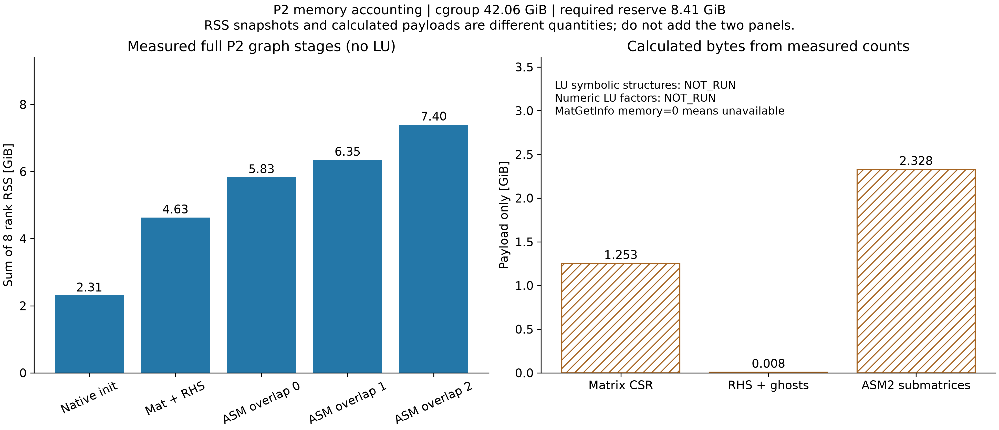
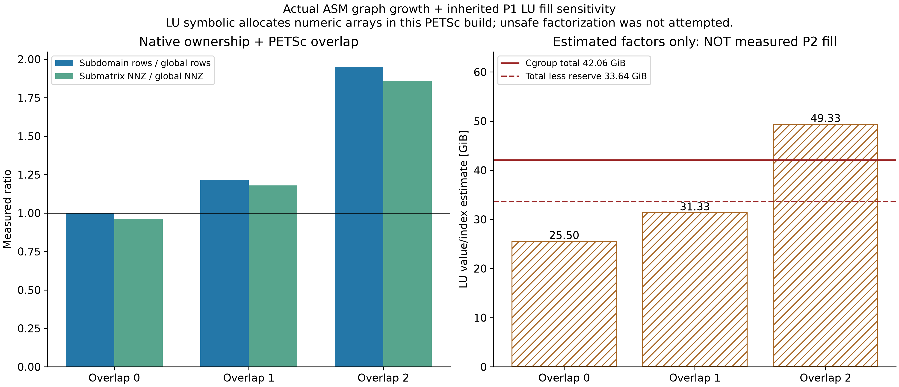
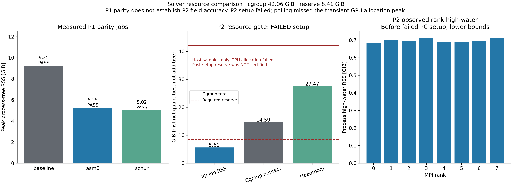

# P2/P1 线性代数与资源审查

**P2_PIPE_LINEAR_ALGEBRA_FEASIBLE = NO**。最终建议 **STOP_NATIVE_P2P1_ROUTE_RESOURCE_LIMIT**。本轮真实 P2 steady CFD 为0，不能评价 P2 场误差是否改善。原ASM/LU的主机风险已细化为实际结构与重叠计数，但P2填充仍未安全测得；所选低主机内存路线则在CUDA Schur临时工作区分配处实际失败。“NO”表示本轮没有建立可安全进入CFD的路线，不是所有实现的数学不可能性。

| 首页问题 | 结果 |
|---|---|
| 223,119 个额外 storage slots 是什么？ | 唯一 P2 边中点的人工压力槽；非独立压力基函数 |
| phantom slots 占多少 rows / NNZ / 内存？ | 223,119 行、36,344,511 标量结构项（32.51045%）；CSR 有效载荷约少 0.4070 GiB，非峰值实测节省 |
| 111.79M structural NNZ 的主要来源？ | 十节点单元邻接图采用全 4×4 块：6,987,082×16；保留数值零与受约束位置 |
| ASM overlap=2 实际重复多少？ | 子域合计行 2,024,020，全局行的 1.951201 倍；合计 NNZ 207,653,552，全局的 1.857477 倍 |
| LU symbolic/numeric fill 多少？ | P2 未安全测得。继承 P1 fill21.2544并使用本轮实测重叠图，因子 value/index 估计 49.325 GiB；非下界 |
| 两个候选与依据？ | overlap0+原LU减少重复；原生fieldsplit/full-Schur/selfp+GAMG避免整块LU。build无HYPRE/外部LU |
| P1 是否保持相同解？ | 通过候选：asm0, schur。PC配置、解差容差事前记录；矩阵hash身份规则的修正单列说明 |
| 完整 P2 单系统实际峰值？ | 5.610 GiB（监督采样，PC setup未完成，非完整峰值） |
| 是否有 ≥20% cgroup 安全余量？ | 未通过setup后认证（PC未完成）；失败前host采样余量 27.466 GiB，门槛 8.411 GiB；实际阻断为显存 |
| 实际运行完整 P2 pipe CFD？ | NO；停止原因 P2_LINEAR_SYSTEM_MEMORY_UNSAFE |
| actual P2 field 改善？ | NOT_RUN，禁止由内存/收敛推断 |
| 值得下一轮 BraVa pilot？ | NOT_EVALUABLE；本轮BraVa/trajectory/population/dt sweep均0 |

## A. 数学自由度与结构成本

详见 [存储审计](P2_DOF_STORAGE_AUDIT_ZH.md)、[机器计数](P2_DOF_STORAGE_AUDIT.json)和[compact reference](COMPACT_MIXED_GRAPH_STATS.json)。原生数学自由度814,201；规定速度122,523行；人工压力占位223,119行；剩余未约束数学行691,678。压力没有独立Dirichlet行，完整出口Cauchy traction确定压力参考。

`fs::thood_val_rc` 修改本地边压力残差/压力块，PETSc仍预分配整个十节点4×4图；全局装配保留结构零。compact参考是删除非数学分量后的图限制，而非更改速度/压力阶数。它仍有75,448,801个标量结构项；节点级块数不变，不再是统一4×4块。

仅凭结构项减少32.51%不能证明总进程峰值减少15%，尤其不能确定LU填充变化。真实首矩阵另测得61,418,086个数值非零、50,375,226个结构数值零；边压力行的全局对角为1–5（共享节点累加），其余行系数及RHS为0。因此未进行编号重构或production prototype。没有以删去边速度DOF、修改BC/稳定化/网格来省内存。

## B–C. 实测图、重叠与LU风险

完整冻结曲面TET10经原生read/distribute/initialize和PETSc preallocator构图，**零CFD时间步**。八rank所有权、ghost、diag/offdiag NNZ、Vec与Mat类型均直接观测，见 [图测量](P2_PETSC_GRAPH_MEASUREMENTS.json)及 [rank样本](P2_GRAPH_RANK_SAMPLES.json)。MatGetInfo.memory在此build返回0，表示接口未提供有效字节数，不是零内存；CSR payload为计数×值/索引宽度的计算值。scatter/PC内部精确字节未得，不伪装为实测。

Mat建立前后rank RSS为 2.307/4.631 GiB。该差包含原生数组、MPI/CUDA context及allocator行为，不等于纯Mat有效载荷。ASM0/1/2使用相同原生分区和PETSc MatIncreaseOverlap/MatCreateSubMatrices，逐级记录和销毁子矩阵，未做物理参数扫描。

安装版本PETSc3.25.5的 `MatLUFactorSymbolic_SeqAIJ` 会在symbolic内部为 `b->a` 分配数值数组，并动态增长填充存储，不能作为有明确上界的“只做symbolic”。未对P2调用原overlap2 LU。P1 overlap0的新实测rank0 fill为12.1683，其P2点估计见 [ASM0后置资源审计](ASM0_POST_PARITY_RESOURCE_SCREEN.json)；这仍不能给较大P2子域的动态symbolic分配提供上界，P2 ASM0 setup明确为NOT_RUN，而不是被宣称实测失败。P2 fill/因子NNZ仍为 **NOT_EVALUABLE_NUMERIC_LU_MEMORY**；49.8GiB旧值已由本轮实测重叠图更新为上表估计，但依然不是实测峰值或数学下界。

## D–E. 两个候选与P1回归

[候选计划](LINEAR_SOLVER_CANDIDATE_PLAN.json)先于试跑冻结。仍为8MPI、GPU Mat/Vec、原FGMRES及线性容差；候选只改变PC。Schur采用已有native velocity/pressure IS，PETSc标准 `selfp = A11 − A10 diag(A00)^−1 A01`；未自创压力算子。

原GPU第10步BIN通过global-node位置与VTU速度/压力对应核验，保留原Y/A时间积分历史，推进同一第11步。历史VTU坐标为float32，最初以float64阈值比较坐标失败；改为与原mesh逐值核对及VTU序列化精度精确往返，两者均通过，速度/压力始终逐值相同。该观测修正没有放宽科学容差。

| PC | wall s | peak RSS GiB | 总KSP迭代 | 非线性迭代 | 相对baseline最大u(m/s) / p(Pa)差 | parity |
|---|---:|---:|---:|---:|---:|---|
| baseline | 249.06 | 9.251 | 242 | 9 | 0 / 0 | True |
| asm0 | 99.01 | 5.246 | 1762 | 9 | 1.7e-16 / 7.11e-14 | True |
| schur | 1075.15 | 5.017 | 2268 | 9 | 1.51e-16 / 7.11e-14 | True |

Q、dp/dz、residual及rank/GPU峰值见 [完整parity](P1_LINEAR_SOLVER_PARITY.json)。这些是同一非稳态受控段的解等价回归，不是新的场精度认证。

原计划的首矩阵**字节哈希相同**检查确实失败，没有改写为通过。进一步完整读取PETSc二进制CSR：两候选的CSR结构和RHS逐值相同，矩阵差按行缩放为1.51/1.15个FP64 epsilon，与并行浮点装配舍入相容（未逐项追踪求和次序）。另立 [矩阵比较协议](MATRIX_COMPARISON_PROTOCOL.json) 要求结构/RHS一致且矩阵差≤128epsilon，实际远小于门槛，允许按用户的solver-tolerance/roundoff解等价原则判断；原始hash失败保留。没有调整CFD或线性/非线性容差。

初次RSS高水位观测调用PETSc接口时缺少初始化，产生观测告警；科学求解正常完成，基准峰值使用监督器，不能使用当时返回0的峰值。后续改为POSIX getrusage高水位，原告警/build身份和失败记录均保留。

## F–H. P2单系统及完整运行门

[P2资源结果](P2_LINEAR_SYSTEM_RESOURCE_RESULT.json)：P2_LINEAR_SYSTEM_MEMORY_UNSAFE。selected PC为 schur。所有运行有host cgroup非可回收内存上界、进程树RSS、GPU显存和时间监督；本轮发生了一次**非预期CUDA显存分配失败**，不能声称没有OOM。真实装配已完成；Schur selfp 的 `MatCreateSchurComplementPmat → MatProductSymbolic → cudaMalloc(dBuffer4)` 在PC setup阶段失败，尚未进入线性迭代。原host预估没有覆盖CUDA SpGEMM临时工作区；数秒GPU轮询没有赶在单次大分配前保护。这是本轮资源预检缺陷，已将未来同路径启动改为必须先有GPU工作区上界，缺失即拒绝执行；没有重试、没有修改系统PETSc。host cgroup的oom/oom_kill均为0；MPI launcher在停止清理中另出现PMIx segfault，保留原日志，不把它误认为最初原因。实际setup/solve、未完成/未运行项分开记录。低内存与KSP收敛本身不证明局部场精度。

原生 `Integrator::corrector_taylor_hood` 在完整冻结曲面网格上、零时间步/零装配/零线性求解的独立后处理调用失败：`[FE Exception] Invalid argument (Rank 0) /   Location: /workspace/formal_3D_flow_solver_FEM_SimVascular_lzy/sv1_3q/external/svMultiPhysics-reuse/Code/Source/solver/nn.cpp:723 in get_nnx() /   Message: Error in computing shape functions / `。该例与压力数值无关，初始零压力也触发几何反解。源码仍将物理边中点送入四角点压力几何的 `nn::get_nnx`，不属于已修补的体积分路径。没有修改该方法。它是完整CFD的独立输出/更新门槛；资源结论与该门槛分别记录。

显存失败时监督器采样的GPU总占用最大仅11,800 MiB，这不是瞬时峰值；CUDA大分配发生于两次采样之间。请求的dBuffer4字节数未被库日志输出，不能从该采样反推出所需显存。P2完整PC未建立、0次线性迭代，因而不能证明setup/solve后20%安全余量。

本轮未产生完整P2稳态场，五路场比较、误差向量分解与cross term全部 [NOT_RUN](P2_PIPE_FIELD_VALIDATION.json)。没有生成可误认为新科学结果的04/05图。CPU sampler与上一轮九项实现前提以冻结SHA回归继承；新输出门的结论单列，不改写旧报告。

## 资源与交付

当前CPU配额7.68核，cgroup总上限 42.05566 GiB；RTX4090与其它项目共享。raw memory.current含大量可回收file cache，因此同时记录raw、active/inactive file和保守nonreclaimable上界；安全余量为limit−nonreclaimable上界，不声称raw memory.current有20%空闲。没有清缓存或修改系统/cgroup/CUDA/PETSc/其它任务。

146 项本轮工程检查通过，不能替代科学场验证。所有自身监督任务已退出，TASK移除；[receipt](EXECUTION_RECEIPT.json)保留失败与停止原因。[输入SHA](INPUT_SHA256.json)、[结果身份](RESULT_IDENTITY.json)、[大文件身份](RUNTIME_ARTIFACTS.json)和300dpi图/原始数据可核查。只提交本轮文件与三个入口索引，不push。

原BraVa历史场、production代码/binary、旧1565（141观察截止、2数值失败）、新固定协议未运行身份均保持。

## 唯一主建议

**STOP_NATIVE_P2P1_ROUTE_RESOURCE_LIMIT**。
本轮唯一资源方向：更高内存服务器（也需明确满足Schur临时工作区的显存预算）；当前没有证据把compact结构节省等同于≥15%整作业峰值节省。不自动启动新计算。
