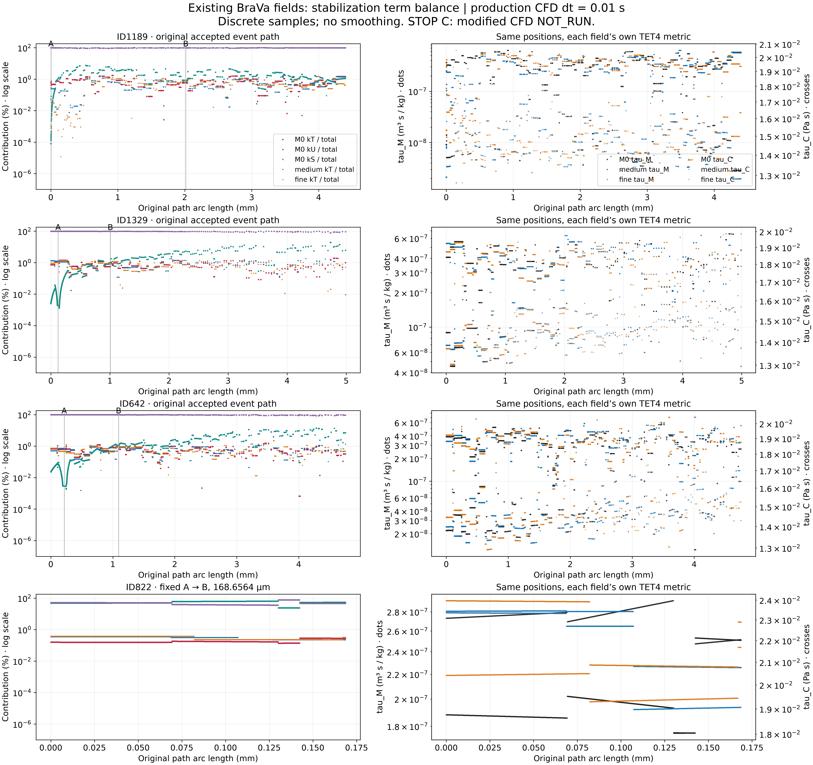
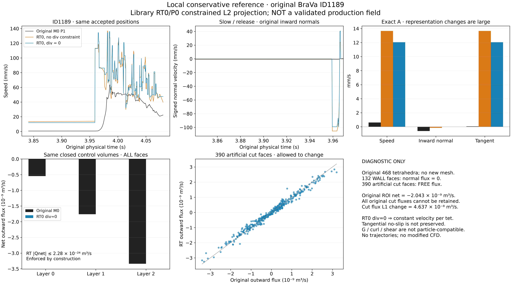

# 原 BraVa stabilization 与局部守恒根因审查

2026-10-06。结论：**STOP_C；新增 CFD=0、solver patch=0。** 当前算法确含人为 dt 的稳定化项，但本轮目标区域由空间项主导，**不支持将“dt 项主导 τ”列为优先根因**。局部连续性缺陷及 P1 近壁表示限制仍成立。RT 对照成功，但明显改变近壁速度，不能替换 production。

| 假设 | 证据 | 结果 | 是否值得继续 |
|---|---|---|---|
| 当前 dt-dependent stabilization 是主要嫌疑 | 实际 source + 271473 行局部 kT/kU/kS | HYPOTHESIS_NOT_SUPPORTED：1189 A fT=0.594476%；822 A/B=0.157972/0.280746% | NO：停止本轮 time-consistent patch 路线 |
| time-consistent VMS 改善解析 pipe | 未运行，Stop C 在先 | NOT_RUN | NOT_RUN |
| time-consistent VMS 改善 ID1189 local continuity | 未运行修改版 BraVa | NOT_RUN | NOT_RUN |
| time-consistent VMS 改善 ID822 spatial rise | 未运行修改版 BraVa，原固定线段证据保留 | NOT_RUN | NOT_RUN |
| RT/H(div) reference 改变1189 normal flow | 原468单元 RT0/P0 受约束投影 | DIAGNOSTIC_ONLY：A 法向−0.602477→约0 mm/s；速度0.605573→12.055098 | YES：诊断成立；NO：production 替代 |
| svMultiPhysics 已有可复用高阶 fluid path | 实际源码及固定 upstream 静态链条 | HIGHER_ORDER_FLUID_READY_TO_PROTOTYPE | READY：仅独立原型 |

## 结果身份与执行范围

[生产源码身份](PRODUCTION_SOURCE_IDENTITY.json)建立了实际 binary → retained exact source 的可信构建链：正式 binary SHA256 `43cd7d7b9ae9bde91275982225c6bf084859141cdaf2ec1030e1b83c3b94691d`；基础 source commit `c3f0bb892b765b718f61069ecd9726dbc6d177fd`；2431 个源文件逐项匹配。保留既有 svMultiPhysics/PETSc3.25.5/CUDA、8 MPI/RA 执行身份；本轮无需重新证明 GPU 已启用。

数据为原 M0 和既有 fixed PLC medium/fine frozen fields，复用上轮同世界坐标、接受态及公共 Gauss 路径。三份边界表面相同、既有 steady gate 已通过的事实沿用，不重做为新发现。原历史出口压力及入口策略均保留；未生成 mesh、重跑 medium/fine、运行 population、改 particle dt 或微泡物理。正式1565条旧轨迹仍包括141观察截止、2数值失败；不更名为固定灌注新结果。

服务器 actual preflight/执行 receipt 见 [资源](RESOURCES.json)、[执行计划](EXECUTION_PLAN.md)、[最终 receipt](EXECUTION_RECEIPT.json)。所有科学分析在服务器受监督运行；轻量 RT 依赖只安装在本目录 runtime/，系统和其它项目未修改。GPU CFD 被决策门跳过，未为了利用率启动无必要计算。原输入和上一轮结果另做最终 SHA 检查。测试只验证实现，不证明生理或完整流场准确性。

## 1. 真正审计到的 stabilization

完整公式、参数、generalized-alpha、细尺度 u'、PSPG 及 grad-div-like 项见 [STABILIZATION_AUDIT_ZH.md](STABILIZATION_AUDIT_ZH.md) 和 [机器源码审计](STABILIZATION_SOURCE_AUDIT.json)。当前 `τM=1/[rho sqrt(4/dt²+uᵀKu+36ν²K:K)]`，`τC=1/(τM trK)`；CFD dt=0.01 s。稳态不会消去 4/dt²。

这与 [Jia–Esmaily 2023](https://pmc.ncbi.nlm.nih.gov/articles/PMC10625993/) 讨论的传统时间尺度家族高度对应；不是其完整算法逐项相同，尤其 paper CI=3、production ctC=36。论文的 ω 是全域时间导数范数比，不是局部对流加速度。本次没有可核对的作者实现载荷，也没有测得全域 ω，离线只评估 ω→0 极限。

**本轮排除的是“目标区域 dt 时间项主导”这一具体机制，不是宣布所有 VMS/PSPG/ctC 空间离散均无责任。** 小局部份额不能证明非局部解响应严格为零，也不能代替一次实际受控 CFD；但已不足以通过用户规定的 Phase D 实质量级门槛。

## 2. 局部量级：不止平均值

[CSV](STABILIZATION_TERMS.csv)、[NPZ](STABILIZATION_TERMS.npz)、[JSON](STABILIZATION_TERMS.json) 共271473行，三场全部原接受态、原公共1/2/4阶 Gauss 样本、822固定线段1001点，以及388769/138584/822四单元的中心和真实四积分点。无失效行删除，当前 invalid=0。phase min/median/max 按原2阶 Gauss样本统计，另给弧长加权均值；各阶样本不混算加权分布。

| 固定事件点 | M0 时间份额 | medium 时间份额 | fine 时间份额 |
|---|---|---|---|
| 1189 A | 0.594476% | 0.279495% | 0.057574% |
| 1189 B | 0.583610% | 0.676497% | 0.757598% |
| 1329 A | 1.128159% | 1.262690% | 1.026580% |
| 1329 B | 0.556163% | 1.059492% | 0.828110% |
| 642 A | 0.622530% | 0.731021% | 0.463376% |
| 642 B | 0.638388% | 1.106952% | 0.995313% |
| 822 A | 0.157972% | 0.351453% | 0.381090% |
| 822 B | 0.280746% | 0.227446% | 0.323056% |

M0 1189 A：kT=4.0000e4，kU=5.49237，kS=6.68861e6 s⁻²；99.4054% 来自黏性/metric 项。τM=3.650674e−7 m³s/kg，τC=0.01453544 Pa·s。假设完全移除 kT，τM 只增加0.298570%，τC减少约0.29768%。M0 1189 release fT 范围0.398585–0.755056%，fast 为0.002642–1.800446%。

M0 822 A：对流/黏性份额48.1376%/51.7044%；B：53.9672%/45.7520%。四原单元 `402304→400899→59816→212669` 上 A→B 公共Gauss时间份额0.137038–0.285892%，移除时间项的 τM 增量最多0.143253%。同一空间增速仍为原36.228、medium4.507、fine16.858 mm/s；本轮没有生成改变这些数字的新 CFD。

全体保留行最大 fT=2.226443%，对应最大 τM 改变量=1.132162%。138584 全 WALL 零速单元另保留，其 kU=0；无论如何调整时间尺度，四个受零 Dirichlet 约束的 P1 节点仍只能表示全单元零速。它是独立表示问题，不会由“更守恒”自动恢复流动。

图01用对数尺度显示小份额，无平滑，右列叠加每个已有场的 τM/τC；这不是新 CFD 的 before/after。执行 **Stop C**，E1/E2 均 NOT_RUN；不产生02/03/04以免制造不存在的比较。详见 [决策门](DECISION_GATE.json)。

## 3. RT/H(div) 独立对照与不相容边界

[Selzer–Cirpka 2020](https://link.springer.com/content/pdf/10.1007/s10596-020-09969-y.pdf) 的 RTN0 方法支持四面体，并施加局部守恒和共享面法向连续。其 Darcy 水力梯度质心目标与本次 Navier–Stokes 速度 L2 投影不同，本次不宣称精确复现该论文优化问题。

使用成熟 **scikit-fem 12.0.2** 的 ElementTetRT0/P0、Piola 基函数、积分和稀疏装配，求 `min 1/2∫ROI |v_RT−u_M0|²`，约束每个单元 div(v)=0、真实 WALL 法向通量=0。没有手写 FE 库。原场连续 P1 速度已属 H(div)，不是地下水 `−K∇h_P1` 的共享面法向不连续问题；本次新增约束的核心是逐单元守恒。

ROI 沿用原468个四面体：132个真实 WALL面、390个人工截面；无入口/出口物理截面。原ROI净通量为−2.04344519e−9 m³/s，故“所有原截面通量不变”与“逐单元零散度”不能同时成立。本对照明确让人工截面自由，以速度L2目标决定其通量，没有静默配平；人工面通量L1改变量4.63725405e−8 m³/s。各面原/新值、面节点、法向、系数和原坐标全部保存在 [RT_REFERENCE.npz](RT_REFERENCE.npz)，另有 [VTK](RT_REFERENCE_DIAGNOSTIC.vtu)。

保留同一个0/1/2层闭合控制体，包含全部物理壁面与内部侧面：

| 层数 | 原Qnet m³/s | 原Qnet/throughput | RT Qnet m³/s | RT ratio |
|---|---|---|---|---|
| 0 | -5.47664644e-10 | -1.895615 | 7.75482e-26 | 5.346e-16 |
| 1 | -1.76282793e-09 | -1.120134 | -1.03398e-24 | -9.216e-16 |
| 2 | -3.33984292e-09 | -0.618377 | 2.27475e-24 | 4.298e-16 |

最大单元 |Qnet|=5.551e-25 m³/s，最大WALL面通量=1.388e-25 m³/s。这是约束实现达标，不是独立场精度测量。

| 原1189 A位置 | 原M0 P1 | 同RT0空间、无div约束 | RT0 div=0 |
|---|---|---|---|
| 速度 mm/s | 0.605573 | 13.657905 | 12.055098 |
| 向内壁法向 mm/s | −0.602477 | −0.146557 | ≈0 |
| 切向 mm/s | 0.061157 | 13.657118 | 12.055098 |

负的向内法向表示朝壁运动。相同RT0空间的对照表明，**表示空间变化本身已经造成主要速度变化**；加入零散度再改变方向，不能把两者合并归因于守恒修复。B点速度49.113771→41.375090→38.217737 mm/s；沿原路径还出现更大的跨单元速度跳变，图05完整保留，不删除尖峰。

RT0 的 `v=a+b x` 在 div v=0 时 b=0，即每个四面体内常速度；共享法向连续但切向可以跳变。某壁邻接单元常速度且壁通量0，则其所有点的该壁法向速度都为0，A 法向趋零部分是空间结构强制结果，并不证明真实近壁流向。无滑移切向、G/curl/shear 均不保持，因此 `RT_REFERENCE_NOT_PRODUCTION_FIELD=true`，本轮没有 RT 轨迹。

## 4. 根因证据的边界

**HYPOTHESIS_SUPPORTED：局部连续性缺陷是不可忽略的场风险。** 原1189 closed CV缺陷是上轮已有证据；本轮源审计解释了连续压力弱约束与非零 cell div 的相容性，RT显示强制守恒能显著改变法向及路径输入。由于投影空间、人工截面和切向壁条件也改变，不能据此确立“局部守恒是唯一/主要因果项”。

**SOURCE_CONFIRMED + 既有场证据：P1 仍有限制。** 388769 的三个wall节点为0，速度是对顶自由节点速度乘一个线性形函数，G为外积、至多rank1；近壁法向/切向分解和局部散度由该受限结构共同决定。138584所有节点wall=0更是精确零场。有限grad-div罚项不能创造额外速度DOF。P1 derivative 面间跳变是既有事实，但不能重新称为几十mm/s后段增速的唯一原因。

1189后段49–53 mm/s在三个已有解重复，1329/642后段趋势也仍有支持；离壁环境与G/shear的敏感性不因此消失。822固定空间增速不稳定的既有判断不变；没有证据通过修改particle dt、平滑速度或单个守恒指标修复上游问题。

## 5. 高阶能力与验证状态

[高阶静态审计](HIGHER_ORDER_CAPABILITY_AUDIT_ZH.md) 分类 **HIGHER_ORDER_FLUID_READY_TO_PROTOTYPE**：TET10/TET4 mixed reader→fluid assembly→pressure edge处理→PETSc→全节点输出/restart基础均存在。当前 sampler 只支持四节点 P1，必须保留高阶DOF并验证采样，不能导出后线性化冒充P2输入。任意阶 basis 基础不等于任意阶fluid可直接运行；P2/P1也不自动强守恒或使G连续。

[测试结果](TEST_RESULTS.json)覆盖binary/source、公式参数、真实native连接metric、参考原点、同单元重复、全部共点、RT常场/线性无散度/制造非守恒场、共享面、单元平衡、边界保持和不相容拒绝。测试通过仅为工程一致性。无匹配真实实验数据，**FLOW_FIELD_PHYSICALLY_VALIDATED=false；physiological validation=NOT_RUN**。

## 6. 八个交付问题的直接回答

1. **是否高度对应论文传统dt-dependent formulation？** 是，时间尺度家族 SOURCE_CONFIRMED；密度归一化、ctC及额外VMS项差异已列出。
2. **1189/822 的dt项是否主导？** 否。1189 A约0.594%，822 A/B约0.158/0.281%，空间项主导；按Stop C停止此优先假设。
3. **time-consistent VMS实际改善pipe了吗？** NOT_RUN。本轮没有实现或运行，不能声称改善/无改善。
4. **改版BraVa对1189 continuity、近壁流向、G/shear如何？** NOT_RUN。RT只作独立投影对照，不能冒充改版CFD。
5. **822固定空间急增有何改变？** 没有新CFD改变；已有36.228/4.507/16.858 mm/s证据保留，不赋予新因果结论。
6. **RT证明局部守恒是关键因素吗？** 支持其为重要敏感因素；不能确证为主因。RT去散度同时牺牲近壁表示和改变人工截面，其速度变化不能全归于守恒。
7. **已有可复用高阶fluid吗？** 是，HIGHER_ORDER_FLUID_READY_TO_PROTOTYPE；已有源码链，未完成P2/GPU/粒子输入验证。
8. **只推荐一个下一方向：** 复用现有 svMultiPhysics Taylor–Hood P2/P1 的受控解析场与高阶采样原型，先检验能否减小已知P1近壁表示限制。它是有明确代码基础的验证方向，不是保证有效的修复；本轮不自动启动。停止time-consistent参数尝试，不把RT0接入production，不同时开启其它路线。
