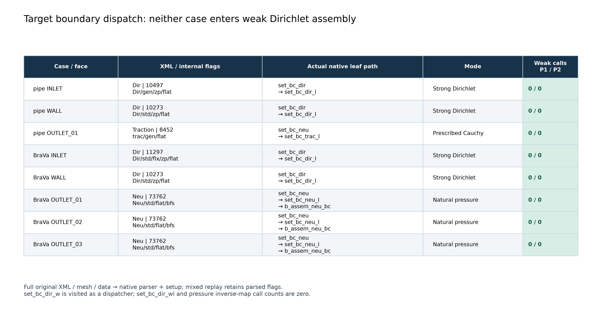
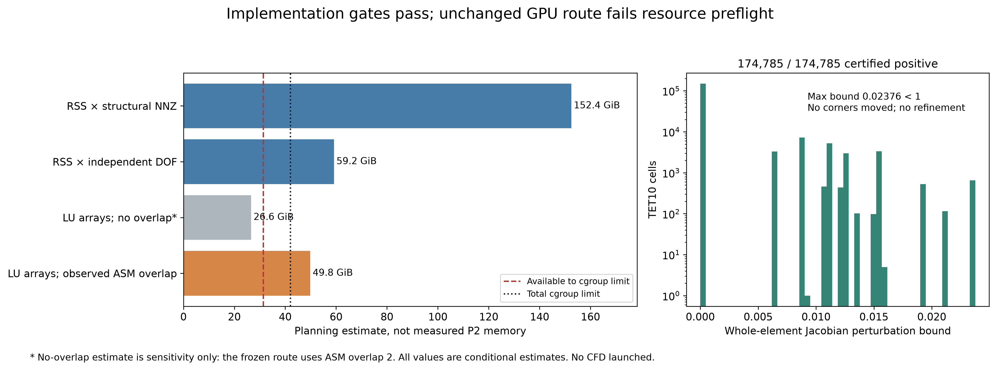

# 目标 BC 执行路径与条件性 P2/P1 pipe CFD 审查

2026-10-06。**Pipe 与历史 BraVa 的真实 BC 均不进入 weak Dirichlet 装配。九项实现前置条件通过，但固定 GPU 路线的内存预估超过当前 cgroup，按用户第9.3节停止于运行前。** 本轮没有启动 CFD，最终为 **P2_PIPE_NOT_EVALUABLE**。

| 问题 | 结果 |
|---|---|
| manufactured pipe 的真实 BC 是否调用 weak Dirichlet？ | **NO**。`set_bc_dir_wl` 实际调用0；通用dispatcher会被调用，但跳过所有目标BC |
| BraVa 的真实 BC 是否调用 weak Dirichlet？ | **NO**。五个边界实际weak装配调用均0 |
| strong Dir / traction / Neu 的native路径分别是什么？ | `set_bc_dir → set_bc_dir_l`；`set_bc_neu → set_bc_trac_l`；`set_bc_neu → set_bc_neu_l → b_assem_neu_bc → fluid::b_fluid` |
| common-curved volume patch 是否仍全部通过？ | **YES**。684项原生体装配结果、对象/源码/输入SHA完整继承复核；不是重新运行684项或重复根因研究 |
| 是否需要修 weak Dirichlet 才能运行pipe？ | **NO**。目标路径不使用它，本轮没有弱边界补丁 |
| 是否实际运行了一次P2/P1 pipe CFD？ | **NO**。资源预检阻断，不做OOM试跑；允许的一次CFD和工程重启额度均未使用 |
| P2 actual CFD在0.377µm是否改善？ | **NOT_EVALUABLE**，没有新实际P2场 |
| 149.195µm是否改善？ | **NOT_EVALUABLE** |
| 29.839/59.678µm discrete error如何变化？ | **NOT_EVALUABLE**，不能从插值证据推断实际离散解 |
| G/s/curl是否整体改善？ | **NOT_EVALUABLE** |
| 是否出现新的P2 solver/geometry/BC异常？ | 本轮BC与完整曲面网格检查未发现新异常；完整P2 solver未运行。资源预测失败不等于solver数值失败 |
| 下一步是否值得进入BraVa P2 pilot？ | **NOT_EVALUABLE**；尚无实际pipe科学比较证据 |

[可视化入口](OPEN_RESULTS.html) · [配置与完整XML字段](TARGET_BC_CONFIG_AUDIT.json) · [原生运行调用表](TARGET_BC_RUNTIME_DISPATCH.json) · [最终readiness](P2_PIPE_READINESS_GATE.json)。

## 1. 实际配置、原生调用和适用范围

读取并逐字节复制当前实际 pipe `production_workflow/manufactured_pipe/R1_GMSH_V2/cfd_gpu/run/solver.xml` 与历史 BraVa `cases/balanced_pressure_final/run/solver.xml`。副本位于本轮独立runtime目录，mesh只读链接原输入，入口数据和牵引文件复制并核对SHA；没有改BC或在原case写初始化文件。每个BC的完整XML字段、外部文件身份及原生内部bitmask均保存。

Harness链接实际production对象，以原生 `Parameters/read_files/read_eq/read_bc/distribute` 读取两套完整原网格和原BC数据，执行 `face_ini/bc_ini` 及三个边界dispatcher。没有time stepping、nonlinear iteration或全局linear solve；捕获接口的solve一旦被调用会直接报错。第二组逐边界重放继承这些实际parser创建的BC对象，保留全部type/weak/flux/perimeter flags，只将几何和节点数据维数局部化到同一个正定曲面TET10/TRI6 fixture。它证明mixed阶数不重定向dispatch；**不是完整BraVa P2网格或新边界数值精度认证**。

仅观测构建在原生入口增加call counters；无观测构建与有观测构建的profile输出及P2边界数值检查逐字节一致。具体原生叶函数在原输入P1和局部mixed P2 sweep中，每个适用face各进入一次；两组pressure TET4 inverse调用均0。`set_bc_dir_w`作为全局dispatcher有调用，**真正应用弱边界的`set_bc_dir_wl`没有调用**。

| case/face | native bitmask | flags | 路径 |
|---|---:|---|---|
| pipe INLET | 10497 | Dir/gen/zp/flat | strong Dirichlet + `igbc` |
| pipe WALL | 10273 | Dir/std/zp/flat | strong Dirichlet |
| pipe OUTLET_01 | 8452 | trac/gen/flat | prescribed vector traction |
| BraVa INLET | 11297 | Dir/std/flx/zp/flat | profile归一化后strong Dirichlet |
| BraVa WALL | 10273 | Dir/std/zp/flat | strong Dirichlet |
| BraVa OUTLET_01/02/03 | 73762 | Neu/std/flat/bfs | given-pressure natural boundary |

关键细节：`Weakly_applied`默认false，与P2阶数无关；`Impose_flux`只控制profile归一化。BraVa真实入口57个节点，22个共享周边节点清零，归一化profile的积分为1。**General BC在bc_ini提前返回**，因此pipe的`Zero_out_perimeter=true`不再额外修改gm；实际边缘由输入的解析节点值及wall强约束处理。把该flag一概解释成修改所有General数据是不准确的。

P2重放检查六个面速度节点，包括三个边中点，强约束误差0；压力槽与非约束节点变化0。三个Neu在曲面面几何上的规定压力残差与独立切向量叉积积分对照，最大缩放误差1.483e−16；零backflow系数下K为0。原strong/full-Cauchy的68项边界检查按哈希继承。详见 [静态审计](TARGET_BC_STATIC_DISPATCH_AUDIT_ZH.md)、[带源码行号调用图](TARGET_BC_STATIC_CALL_GRAPH.json)、两套 `*_MIXED_BOUNDARY_CHECKS.csv`。

两个目标分别归类为 `PIPE_TARGET_BC_SET_CLEAR_OF_WEAK_DIRICHLET` 和 `BRAVA_TARGET_BC_SET_CLEAR_OF_WEAK_DIRICHLET`。上一轮weak库缺陷及10项失败门槛原样保留，只是不属于这两套target BC的装配路径；不再用它自动阻止pipe。

## 2. 完整曲面网格与继承回归

本轮生成**唯一一套**完整曲面elevation：保留36,211个原角点、174,785个原tetra，223,119条唯一边产生259,330个速度节点；压力保持原角点P1。仅投影24,752个wall边中点到解析圆柱，cap保持平面。没有mesher、加密、移动角点或多个候选。

全174,785个单元满足正Jacobian充分证书：仿射基准det>0，参考四顶点上的 `||J0⁻¹(J−J0)||₂` 最大为 **0.0237576143 < 1**；J扰动为仿射函数，凸性与连续性给出整个reference tetra内正定结论，非仅Gauss点采样。最小corner det约1.55766e−14 m³。共享边中点ID、标签、边界角点拓扑、无重复坐标全部通过；wall节点最大径向误差3.253e−19m，cap误差0。新增四次Bernstein多项式凸包界覆盖全部TRI6壁面径向误差，低于原冻结50nm门槛；全壁面径向误差界1.77002e−12m，具体数值见 [完整QA](P2_CURVED_MESH_QA.json)。

先前143654/35265的曲面坐标被完整网格重新复现；P1/P1 R/K回归、体装配补丁、sampler原结果、历史P1实际场VTU与native checkpoint身份均不变。本轮额外的小型CPU二次采样回归通过，没有重新运行完整Poiseuille表示研究或RT/stabilization分析。

注意：先前exact-node P2 Poiseuille的roundoff结果针对**仿射中点几何**。不能在未计算时把它直接套到曲面P2插值；一般物理二次函数在曲面映射下未必属于reference P2空间。若实际场未生成，就不能声称0.377µm原9.76%的表示项已在实际CFD中消失。原生mixed开关还会关闭部分VMS项，虽然本轮保留原公式/系数，也不能把P1→P2描述为所有稳定化项完全相同。

## 3. 真正停止原因：固定GPU路线的运行前资源预测

服务器当前CPU配额7.68核、RTX4090总显存24,564MiB、预检空闲15,477MiB；cgroup总上限 **42.0557GiB**。预检nonreclaimable上界约10.6403GiB，余量约31.4154GiB。没有改其它项目、系统库、服务或cgroup。限制来自**主机内存规划**，不能用有空闲GPU显存来代替CPU ASM/LU的内存需求。

实际保留路线为8 MPI rank、PETSc CUDA矩阵/向量、ASM overlap2、子域CPU LU和既有RA重用策略。原pipe P1实测峰值进程树RSS约10.5255GiB；本轮直接从原拓扑计算结构图：

| 量 | P1 | P2 |
|---|---:|---:|
| 独立未知量 | 144,844 | 814,201 |
| 原生存储槽位 | 144,844 | 1,037,320 |
| 结构标量非零项 | 7,719,184 | 111,793,312 |

原生PETSc按4×4块预分配，pressure边槽的数值约束不删除这个结构图。P1计数与原solver日志完全相同，P2为 **14.48253倍**。原rank0 LU填充比21.2544，八个ASM子矩阵NNZ和/global NNZ比为1.87543。

| 规划模型 | P2估计 |
|---|---:|
| 原峰值RSS按结构NNZ扩展 | 152.44GiB |
| 原峰值RSS按独立DOF扩展 | 59.17GiB |
| 继承LU填充与实际ASM重复比，仅值/列号数组 | 49.80GiB |
| 特意去掉ASM overlap的敏感性对照，仅值/列号数组 | 26.55GiB |

**这些是有明确假设的预估，不是实测P2内存，也不是严格下界。** P2分区、fill和各rank峰值可能改变；RSS也包含共享映射。因此不据此声称“数学上至少需要49.8GiB”。26.55GiB对照故意省略了当前必用ASM overlap及其它内存项，不代表原路线可在该值运行；初版敏感性记录也保留，未删除较低估计。

对不改变现有求解路线的规划而言，包含实际重叠的模型和两种经验尺度估计均超过总cgroup或可用余量，故触发用户第9.3节“如果预测资源超过cgroup，运行前停止，不OOM试错”。不是自动增加scientific threshold，也不是用旧weak缺陷继续阻断。详见 [资源机器记录](P2_RESOURCE_PREFLIGHT.json)；没有用改预条件器、MPI数量或其它服务的方式扩大本轮。

`P2_PIPE_READINESS_GATE.json`中九项实现条件全部true，额外的用户规定资源预检为false，最终 **NOT_READY_FOR_P2P1_PIPE_GPU_CFD**。本轮未链接完整CFD入口binary，未启动P2求解、未测GPU CFD耗时或高阶CFD输出。只构建了parser/边界harness并链接先前已验证的体装配对象。

## 4. 测试、交付与未发生的计算

最终111项工程检查通过，见 [TEST_RESULTS](TEST_RESULTS.json)，继承结果与新执行检查分列。检查“正确阻止资源超预算启动”通过，不代表readiness或物理精度通过。初次harness编译缺少`all_fun.h`，已补全；该失败及全部重建/重放执行记录保留，不消耗或冒充一次CFD工程重启。

所有非CFD计算使用项目监督器，累计预算90分钟；每次有时间、RSS、nonreclaimable与OOM保护。13次监督作业全部退出；累计监督计算63.18s，1秒采样峰值进程树RSS约0.557GiB（不包含阅读、开发、传输及报告耗时）。失败/退出码、TASK清理状态见 [EXECUTION_RECEIPT](EXECUTION_RECEIPT.json)。报告、两张300dpi图、CSV/NPZ图源、完整曲面mesh及可复现源码保存本地/服务器；大体积runtime构建/网格不进入Git，具体保留位置和SHA见 [运行产物](RUNTIME_ARTIFACTS.json)。生产源码/binary、历史P1场、PETSc/CUDA哈希再次复核。

新增pipe CFD=0、BraVa CFD=0、trajectory=0、population=0。因此不生成虚构的actual P2 field validation、误差分解或近壁profile图。原0.377/149.195µm的P1表示限制与29.839/59.678µm的离散解误差结论仍是旧证据，新P2的对应指标全部NOT_EVALUABLE。没有做百分数相减，也没有以几何、局部实现或全局守恒证明轨迹精度。

历史18mL/min校准BraVa场身份、candidate0/15打印姿态关系、旧1565（141观察截止、2数值失败）及兼容链接均保留。本轮没有新BraVa边界设计；未来新设计仍遵循中心线阻力→出口压力。旧轨迹不改称新固定灌注协议结果。

## 唯一主建议

**P2P1_PIPE_RESULT_NOT_EVALUABLE**。
