# BraVa 近壁 CFD/FEM 全域审计报告

本轮范围：只读审计当前冻结流场，关联已有历史轨迹；不重算 CFD，不改速度、压力、网格、壁面、WSS 或微泡物理。下述“高值”“异常筛查”都不是自动的 CFD 不合格判据。

## 1. 通俗结论

当前证据支持“强异常局部集中”，不支持“整个 wall layer 普遍失效”。W0/W1/W2 分别有 101,073/98,526/83,714 个单元；η≥0.5 仅有 18/14/0 个，η≥0.1 有 660/3893/4757 个。全部正式壁面节点速度严格为零。388769 的强朝壁面速度被独立复现，且周围形成小簇；138584 是唯一的四节点全零单元，四角都在壁面上，体现 P1 近壁离散的局部局限。微泡访问会显著放大少数单元的影响，但并非所有加速都经过这些单元。没有发现节点错配、WSS 公式或单位错误的证据；这不能证明原 CFD 的物理精度。


## 2. 输入身份、单位和实际流程

`labelled_core_m.vtp → sv.meshing.TetGen → canonical mesh → svMultiPhysics fluid → frozen steady_flow.vtu → 原始节点 P1 插值 → population_v1`。

网格生成脚本 `brava_flow_roi_18mlmin/scripts/generate_mesh.py:7–17` 调用 SimVascular 2023-05-31 的 TetGen，目标边长 0.0002 m，**未设置边界层网格**。材料及边界来源 `cases/balanced_pressure_final/run/solver.xml:44–110`：恒定牛顿动力黏度 0.00345312 Pa·s，密度 1056 kg/m³；WALL 为无滑移 Dirichlet 0；入口为 flat、周缘置零且归一化到 −3×10⁻⁷ m³/s（外法向符号），即 18,000 μL/min。出口自然牵引压力参数依次为 O1=556.97065554884477 Pa、O2=0 Pa、O3=17.137427153562019 Pa。自然牵引参数不等于“所有出口节点压力强制等于该值”。

CFD 时间步为 0.01 s，非线性容差 10⁻¹⁰，GMRES/PETSc-Jacobi；这是已有结果的配置记录，本轮没有再次运行求解器或宣称重验求解器收敛。微泡生产使用的名义时间步为 0.0005 s，二者不能混淆。四节点速度/压力都是连续 P1；稳定化不可压缩有限元并不要求每个四面体的 trace(G) 严格为零。本审计不把非零散度自动判为错误。

本轮独立求解每个四面体的 3×3 梯度系统；原始冻结场没有经验流速替代或修改。已有 WSS 入口为 `vendor/flow_solver_support/wss_case.py:51–71` 的 `recover`。原粒子插值为 `particle_3d/field.py:49–57`；独立审计不读取旧梯度缓存。


网格节点 **135,852**；四面体 **692,313**；WALL 三角形 **101,074**。审计 NumPy 2.5.3、PyVista 0.49.0、VTK 9.7.1。Git 工作树基线 `51257fb4f`；历史 production 的实际版本与文件哈希保留在旧 `IDENTITY.json`。本轮源码逐文件 SHA 见交付清单；不把工作树基线当作所有旧生产文件的版本。

| input | SHA256 |
| --- | --- |
| mesh | e755a6ce04eca518fc02df5cd6139c98887e94617bdf9410d72f55b99f443c94 |
| flow | 73228d094c253cec75dbb0030476b687171d0d0fef7816a845392dad220285dc |
| INLET | 434687d5fd58a5c248ff15a71e33b1d134a95eda8191a787db4133e991b2ac31 |
| OUTLET_01 | 2df120afb352f1e03e8e9635e22bad5e5b003eb23ccb18c117e90772738174b9 |
| OUTLET_02 | c84aa19ac5e2902f01b76cd0b929f4c0dfca14ee0d6156a9a7be390908758977 |
| OUTLET_03 | 877fcd12143b0831f7f6496b3546e2a26b929dd7de9b35881e482b5e9c40d065 |
| WALL | f863a04b949328eda2326fcc8b8ed45a46ac422daab04e1358e94cd692e0fca1 |


单位全链路：坐标 m、速度 m/s、时间 s、压力 Pa、动力黏度 Pa·s、梯度及应变率 s⁻¹、通量 m³/s、WSS Pa。图中几何坐标换成 mm，只用于显示。

### 对应关系实际验证

- canonical GlobalNodeID=1…135852、GlobalElementID=1…692313；审计 tetra_id 与历史轨迹 tetra_id 都是 **0-based canonical row**。
- **冻结流场没有 GlobalNodeID 字段**，不能声称已经读到了该字段。实际核查了逐节点坐标精确相等、逐单元四个节点的无序集合精确相等；全部坐标唯一。局部顶点置换不影响 canonical 复算。
- WALL 及所有端口的 GlobalNodeID 坐标与体网格精确一致，GlobalElementID 确实指向拥有该三角面的唯一四面体。
- 外表面 101456 个面完全由官方 WALL/INLET/OUTLET_01/02/03 无重叠覆盖。端口身份来自官方文件及编号，不按空间位置或标签大小猜测。
- 全部单元体积正、canonical signed det 正，没有发现翻转/零体积或共面邻接超过两个体单元。此项不是近壁分辨率足够的证明。

端口位置与本轮独立通量积分：

| boundary | triangle_count | area_m2 | flow_outward_m3_s | mean_node_pressure_Pa | center_x_m | center_y_m | center_z_m |
| --- | --- | --- | --- | --- | --- | --- | --- |
| INLET | 90 | 1.11292e-06 | -3e-07 | 2717.12 | 0.0322414 | -0.053923 | -0.0175695 |
| OUTLET_01 | 90 | 1.05674e-06 | 1e-07 | 558.102 | 0.0264183 | 0.053923 | -0.00747694 |
| OUTLET_02 | 99 | 1.20676e-06 | 9.99688e-08 | 0.946115 | -0.0396453 | 0.0160035 | 0.0036055 |
| OUTLET_03 | 103 | 1.22238e-06 | 1.00031e-07 | 18.0426 | -0.0132546 | 0.053923 | 0.00975647 |
| WALL | 101074 | 0.00116685 | 0 | 881.068 | 0.0122812 | 0.00949511 | 0.00165828 |


独立边界净流量相对入口的绝对偏差为 8.82326e-17。整个冻结场节点压力范围 [0.4279851311076841, 2723.0421763240615] Pa，速度模长范围 [0.0, 0.5511151481609229] m/s。整体守恒不能替代局部精度评估。


## 3. 区域、公式及可复算数据

W0 是拥有正式 WALL 面的四面体；W1 是 W0 的共面邻居，排除 W0；W2 是 W1 的下一圈共面邻居，排除 W0/W1。三组互不重叠。另对**全部 692313 单元**计算重心到有限 WALL 三角形的最近欧氏距离，按 d/h_max 分成 [0,0.5)、[0.5,1)、[1,2)、[2,4)、[4,∞)。这些是审计集合，不是新增物理边界。

设 X 的行是 x₁−x₀、x₂−x₀、x₃−x₀，U 的行是相应节点速度差，独立求解：

\[
G=(X^{-1}U)^T,\quad \nabla p=X^{-1}\Delta p,\quad
\eta=\frac{|\operatorname{tr}G|}{\|G\|_F}.
\]

仅在分母恰好为零时将比值记录为 0，同时另存 `all_four_u_zero`；没有用大 epsilon 掩盖低速区域。应变率张量 D=(G+Gᵀ)/2，curl 按完整 G 的反对称部分计算。

每个面使用三个节点速度的算术均值，乘以向外的面积向量：

\[
Q_f=\bar{u}_f\cdot(n_f A_f),\qquad \sum_f Q_f=(\operatorname{tr}G)V.
\]

这对 P1 是精确面积分。两边相符只是散度定理的**离散实现恒等式**，绝不是“局部物理质量守恒通过”。

保存 h_max、h_min=3V/max(A_f)、等体积球直径、六条边长、最小内部二面角。形状指标 mean-ratio=12(3V)^(2/3)/Σl²，正四面体=1；scaled Jacobian 为各角 |det|/三边乘积的最小值，再乘 √2 归一化。另存有符号 det。未套用统一好坏阈值。

W0 每个 WALL 面沿面重心至第四节点的 10%、25%、50%、75% 取样，并单列四面体重心（恰好是该线段的 25%）。使用**朝管腔的法向**；u_n<0 表示朝壁面。多 WALL 面的单元逐面保存；层统计选其面积最大的 WALL 面，避免把一个单元重复计数。W1/W2 重心法向来自最近的有限壁面三角形，是局部诊断约定，边/角处可能不唯一。

核心计算实码（完整版本在 scripts/audit_field.py）：

```python
G = np.linalg.solve(X[:,1:]-X[:,:1], U[:,1:]-U[:,:1]).transpose(0,2,1)
div = np.trace(G, axis1=1, axis2=2)
eta = np.divide(abs(div), norm_G, out=np.zeros_like(div), where=norm_G!=0)
traction = mu * np.einsum('nij,nj->ni', G_owner + G_owner.transpose(0,2,1), n_out)
tangent = traction - np.einsum('ij,ij->i', traction, n_out)[:,None]*n_out
WSS = np.linalg.norm(tangent, axis=1)
```

## 4. Q1/Q2：单元比例和体积比例

以下阈值仅用于筛查优先级，**不是物理合格/不合格标准**。

| region | lower | total_count | flag_count | 数量占比_% | 体积占比_% | total_volume_m3 |
| --- | --- | --- | --- | --- | --- | --- |
| W0 | 0.5 | 101073 | 18 | 0.0178089 | 0.0197665 | 5.40584e-08 |
| W0 | 0.1 | 101073 | 660 | 0.652993 | 0.651937 | 5.40584e-08 |
| W1 | 0.5 | 98526 | 14 | 0.0142094 | 0.0106465 | 5.25664e-08 |
| W1 | 0.1 | 98526 | 3893 | 3.95124 | 2.9852 | 5.25664e-08 |
| W2 | 0.5 | 83714 | 0 | 0 | 0 | 4.78788e-08 |
| W2 | 0.1 | 83714 | 4757 | 5.68244 | 5.18092 | 4.78788e-08 |


距离分组（分母 h_max）：

| region | lower | total_count | flag_count | count_fraction | volume_fraction |
| --- | --- | --- | --- | --- | --- |
| d_over_hmax_0-0.5 | 0.5 | 233980 | 32 | 0.000136764 | 0.000128596 |
| d_over_hmax_0-0.5 | 0.1 | 233980 | 6374 | 0.0272416 | 0.0225757 |
| d_over_hmax_0.5-1 | 0.5 | 160255 | 39 | 0.000243362 | 0.000228821 |
| d_over_hmax_0.5-1 | 0.1 | 160255 | 13620 | 0.0849895 | 0.0781182 |
| d_over_hmax_1-2 | 0.5 | 235506 | 401 | 0.00170272 | 0.00140497 |
| d_over_hmax_1-2 | 0.1 | 235506 | 55943 | 0.237544 | 0.230162 |
| d_over_hmax_2-4 | 0.5 | 62572 | 1946 | 0.0311002 | 0.0303707 |
| d_over_hmax_2-4 | 0.1 | 62572 | 31930 | 0.510292 | 0.508303 |
| d_over_hmax_>=4 | 0.5 | 0 | 0 | 0 | 0 |
| d_over_hmax_>=4 | 0.1 | 0 | 0 | 0 | 0 |


主要分布（min/median/P90/P95/P99/max；SI 单位在 metric 列）：

| region | metric | min | median | P90 | P95 | P99 | max |
| --- | --- | --- | --- | --- | --- | --- | --- |
| W0 | abs_div_s_inv | 0 | 18.3913 | 62.4774 | 80.6995 | 115.977 | 1192.77 |
| W0 | eta_div | 0 | 0.0248378 | 0.0590552 | 0.0697864 | 0.0931485 | 0.994887 |
| W0 | G_norm_s_inv | 0 | 827.092 | 1549.1 | 1642.75 | 1859.93 | 3177.5 |
| W0 | speed_m_s | 0 | 0.0268698 | 0.0532025 | 0.0594917 | 0.0727012 | 0.106655 |
| W0 | abs_u_normal_m_s | 0 | 0.000629132 | 0.00216613 | 0.00283372 | 0.00424572 | 0.042849 |
| W0 | normal_fraction | 0 | 0.0248378 | 0.0590552 | 0.0697864 | 0.0931485 | 0.994887 |
| W0 | h_max_m | 0.000123351 | 0.000208426 | 0.000240803 | 0.000249382 | 0.000265113 | 0.000333155 |
| W0 | h_min_altitude_m | 4.646e-05 | 0.00011255 | 0.000130614 | 0.000135851 | 0.000145391 | 0.000181416 |
| W0 | mean_ratio_quality | 0.493183 | 0.904323 | 0.974145 | 0.984358 | 0.994857 | 0.999992 |
| W1 | abs_div_s_inv | 0.000164194 | 18.5154 | 71.5357 | 98.015 | 169.004 | 1852.27 |
| W1 | eta_div | 3.79093e-07 | 0.025426 | 0.0727225 | 0.092827 | 0.151068 | 0.884028 |
| W1 | G_norm_s_inv | 98.2905 | 807.962 | 1510.86 | 1599.39 | 1805.99 | 3807.71 |
| W1 | speed_m_s | 0.00568471 | 0.056404 | 0.110508 | 0.121574 | 0.141388 | 0.189938 |
| W1 | abs_u_normal_m_s | 2.54155e-08 | 0.0013267 | 0.0044866 | 0.00587744 | 0.00854121 | 0.0990133 |
| W1 | normal_fraction | 7.81239e-07 | 0.0248141 | 0.0595785 | 0.069858 | 0.0937346 | 0.982921 |
| W1 | h_max_m | 0.000153944 | 0.000225323 | 0.000252335 | 0.000260075 | 0.000274295 | 0.000333155 |
| W1 | h_min_altitude_m | 1.97284e-05 | 0.000105671 | 0.000125245 | 0.000130917 | 0.000141463 | 0.000187679 |
| W1 | mean_ratio_quality | 0.234513 | 0.824699 | 0.920156 | 0.938478 | 0.964228 | 0.995514 |
| W2 | abs_div_s_inv | 0.00115903 | 25.4223 | 86.3036 | 113.697 | 179.846 | 1352.83 |
| W2 | eta_div | 9.77532e-07 | 0.0367133 | 0.0859569 | 0.102876 | 0.145449 | 0.490894 |
| W2 | G_norm_s_inv | 114.482 | 793.843 | 1477.45 | 1560.81 | 1771.8 | 3365.79 |
| W2 | speed_m_s | 0.0102801 | 0.0876597 | 0.169027 | 0.184067 | 0.211384 | 0.276404 |
| W2 | abs_u_normal_m_s | 3.38835e-08 | 0.00209523 | 0.00701933 | 0.00912863 | 0.0132221 | 0.154113 |
| W2 | normal_fraction | 6.80056e-07 | 0.0256363 | 0.0606969 | 0.0715069 | 0.0953727 | 0.976589 |
| W2 | h_max_m | 0.000147607 | 0.000225957 | 0.00025349 | 0.000261203 | 0.000275766 | 0.000333155 |
| W2 | h_min_altitude_m | 1.99601e-05 | 0.000107662 | 0.000126065 | 0.000131275 | 0.000140048 | 0.000163384 |
| W2 | mean_ratio_quality | 0.253168 | 0.854075 | 0.932729 | 0.94936 | 0.973541 | 0.99846 |


## 5. Q3/Q4：位置和空间聚集性


W0–W2 的 η≥0.5 共 32 单元，形成 19 个共面连通簇。最大簇有 10 个单元，包含已知 388769 周边；强筛查单元对应的 WALL 面积占全部 WALL 的 0.018187%。中等阈值 η≥0.1 共 9310 单元，形成 7410 个簇，最大 135 单元。这说明强现象是局部小簇，中等偏差是分散于多个位置的区域性现象，不能称整个壁层普遍严重失效。

| family | cluster_id | cell_count | volume_m3 | wall_area_m2 | bbox_min_x_m | bbox_min_y_m | bbox_min_z_m | bbox_max_x_m | bbox_max_y_m | bbox_max_z_m | eta_max | eta_median | normal_fraction_max | normal_fraction_median |
| --- | --- | --- | --- | --- | --- | --- | --- | --- | --- | --- | --- | --- | --- | --- |
| eta_ge_0p5 | 0 | 10 | 5.36609e-12 | 8.03062e-08 | 0.0300164 | 0.0051993 | 0.00194918 | 0.0303031 | 0.00565878 | 0.00228416 | 0.994887 | 0.839808 | 0.994887 | 0.879182 |
| eta_ge_0p5 | 1 | 3 | 1.67516e-12 | 1.27579e-08 | -0.00776514 | 0.0269885 | 0.0148167 | -0.0075127 | 0.0272241 | 0.0150334 | 0.867825 | 0.834825 | 0.971276 | 0.867825 |
| eta_ge_0p5 | 2 | 2 | 1.56331e-12 | 2.72057e-08 | -0.00788124 | 0.0270182 | 0.0148695 | -0.00767971 | 0.0272458 | 0.0150387 | 0.925992 | 0.919809 | 0.925992 | 0.919809 |
| eta_ge_0p5 | 3 | 2 | 1.29818e-12 | 1.52926e-08 | -0.00794976 | 0.0272357 | 0.0151062 | -0.00776853 | 0.0274628 | 0.0152517 | 0.892313 | 0.724835 | 0.892313 | 0.863687 |
| eta_ge_0p5 | 4 | 1 | 5.06144e-13 | 0 | 0.0303385 | 0.00506759 | 0.00210783 | 0.0304999 | 0.00524111 | 0.00230605 | 0.528916 | 0.528916 | 0.312935 | 0.312935 |
| eta_ge_0p5 | 5 | 1 | 1.58458e-13 | 0 | 0.0310016 | 0.00506956 | 0.00118502 | 0.0311869 | 0.00522182 | 0.00134718 | 0.670955 | 0.670955 | 0.0384289 | 0.0384289 |
| eta_ge_0p5 | 6 | 1 | 7.57149e-13 | 1.54505e-08 | -0.00796163 | 0.0272357 | 0.0149119 | -0.00777036 | 0.0273586 | 0.0151335 | 0.928554 | 0.928554 | 0.928554 | 0.928554 |
| eta_ge_0p5 | 7 | 1 | 1.06595e-13 | 0 | 0.0304947 | 0.00477248 | 0.00200623 | 0.0306435 | 0.00488165 | 0.00221473 | 0.608343 | 0.608343 | 0.0608223 | 0.0608223 |
| eta_ge_0p5 | 8 | 1 | 6.83763e-13 | 1.17666e-08 | 0.0300534 | 0.00538638 | 0.00155598 | 0.0302064 | 0.00554974 | 0.00175154 | 0.515845 | 0.515845 | 0.515845 | 0.515845 |
| eta_ge_0p5 | 9 | 1 | 7.03298e-13 | 1.01488e-08 | 0.0300701 | 0.005463 | 0.00170543 | 0.030294 | 0.00564194 | 0.0018487 | 0.689434 | 0.689434 | 0.689434 | 0.689434 |
| eta_ge_0p5 | 10 | 1 | 6.34148e-13 | 0 | 0.0307802 | 0.00474375 | 0.00201344 | 0.0309214 | 0.00493571 | 0.00223125 | 0.518957 | 0.518957 | 0.115156 | 0.115156 |
| eta_ge_0p5 | 11 | 1 | 1.48856e-13 | 0 | 0.031122 | 0.0050099 | 0.00129742 | 0.0313042 | 0.00506956 | 0.00147814 | 0.580741 | 0.580741 | 0.201263 | 0.201263 |


全部簇、三维包围盒、单元体积、壁面覆盖面积、关联单元/三角面 ID 均另存。`spatial_octants.csv` 按实际包围盒八分区统计空间分布；不是未经核实的解剖分区。


## 6. Q5/Q6：尺寸和网格质量是否解释异常

| region | x | y | spearman |
| --- | --- | --- | --- |
| W0 | eta_div | h_max_m | 0.00035246 |
| W0 | eta_div | mean_ratio_quality | 0.052002 |
| W0 | eta_div | min_dihedral_deg | 0.0417693 |
| W0 | eta_div | normal_fraction | 1 |
| W1 | eta_div | h_max_m | 0.131949 |
| W1 | eta_div | mean_ratio_quality | -0.201877 |
| W1 | eta_div | min_dihedral_deg | -0.172253 |
| W1 | eta_div | normal_fraction | 0.0761527 |
| W2 | eta_div | h_max_m | 0.101738 |
| W2 | eta_div | mean_ratio_quality | -0.100999 |
| W2 | eta_div | min_dihedral_deg | -0.0352319 |
| W2 | eta_div | normal_fraction | 0.0630475 |


W0 中 η 与 h_max 的 Spearman 系数 0.000352，与 mean-ratio 为 0.052002，没有强单调关联。W1/W2 有弱相关，也不足以给出因果结论。388769 的 mean-ratio=0.871011、最小二面角=50.198°、h_max=237.565 μm，并非明显扁塌坏单元；但约 0.2 mm 的无边界层 P1 网格仍不能自动保证微米级微泡附近的梯度可靠。壁面相邻面最大法向转角与 η 的整体 Spearman 为 -0.267899，不支持简单地以角度越大越异常作诊断。

| region | metric | min | median | P95 | max |
| --- | --- | --- | --- | --- | --- |
| all | interior_vertex_speed_m_s | 0 | 0.107479 | 0.237964 | 0.426618 |
| all | interior_vertex_height_m | 7.47656e-05 | 0.000134141 | 0.000188926 | 0.000258205 |
| all | wall_face_node_speed_max_m_s | 0 | 0 | 0 | 0 |
| all | max_adjacent_wall_normal_angle_deg | 0.710916 | 11.8223 | 14.7218 | 67.4831 |
| all | hmax_m | 0.000123351 | 0.000208427 | 0.000249383 | 0.000333155 |
| eta_ge_0p1 | interior_vertex_speed_m_s | 0.0101507 | 0.11506 | 0.218301 | 0.332789 |
| eta_ge_0p1 | interior_vertex_height_m | 7.47656e-05 | 0.000136979 | 0.000194657 | 0.000232175 |
| eta_ge_0p1 | wall_face_node_speed_max_m_s | 0 | 0 | 0 | 0 |
| eta_ge_0p1 | max_adjacent_wall_normal_angle_deg | 1.70579 | 10.9728 | 45.9535 | 67.4831 |
| eta_ge_0p1 | hmax_m | 0.000152317 | 0.000212386 | 0.000254729 | 0.000285487 |
| eta_ge_0p5 | interior_vertex_speed_m_s | 0.0576927 | 0.101898 | 0.254054 | 0.28494 |
| eta_ge_0p5 | interior_vertex_height_m | 0.000100423 | 0.00014338 | 0.000198916 | 0.000207896 |
| eta_ge_0p5 | wall_face_node_speed_max_m_s | 0 | 0 | 0 | 0 |
| eta_ge_0p5 | max_adjacent_wall_normal_angle_deg | 21.9175 | 54.3231 | 66.3188 | 67.4831 |
| eta_ge_0p5 | hmax_m | 0.000172401 | 0.000228341 | 0.000253866 | 0.000262337 |


## 7. Q7/Q8/Q9：朝壁面流动、无滑移和 P1 特殊结构


全部 50581 WALL 节点速度 max/median/P95/P99 均为 0 m/s，非零个数为 0；空的 `validation/nonzero_wall_nodes.json` 是实际检查结果。所有 101074 WALL 面的三个节点严格零速；其中 52990 个面的第四节点速度 >0.1 m/s。0.1 m/s 只是描述性筛选阈值，不是‘过快’判据。


对三壁面节点全零的 P1 单元，令 n 为 inward、H 为第四节点到壁面平面的高度，则：

\[
u(x)=\frac{d_{plane}(x)}{H}u_{opp},\quad G=\frac{u_{opp}\otimes n}{H},\quad
\operatorname{div}u=\frac{u_{opp}\cdot n}{H},\quad \eta=\frac{|u_{opp}\cdot n|}{|u_{opp}|}.
\]

因此 W0 中 η 和 normal_fraction 几乎完全相等是**同一 P1 结构的代数关系**，不能当作两个独立证据。第四节点高速可以是正常切向剪切；真正值得关注的是它的方向、局部面通量和邻域。


W0 中法向占比≥0.5 的单元共 18 个，全部 18 个朝向壁面。并非大量壁面单元均主要朝壁面。η 与 normal_fraction 的最大差 7e-16。原始每面/每取样点速度、符号、高度与法向均已保存，W1/W2 不套用上述秩一恒等式。


## 8. Q10：388769 独立复算

| tetra_id | layer | div_s_inv | G_norm_s_inv | eta_div | u_normal_m_s | normal_fraction | volume_m3 | Q_net_m3_s | d_wall_m |
| --- | --- | --- | --- | --- | --- | --- | --- | --- | --- |
| 388769 | 0 | -827.429 | 831.681 | 0.994887 | -0.0392189 | 0.994887 | 6.61887e-13 | -5.47665e-10 | 4.73985e-05 |


GlobalNodeID=[12599, 16650, 12597, 58606]；节点速度模长=[0.0, 0.0, 0.0, 0.15768161810011852] m/s；节点压力=[1029.0699980599168, 1032.767423999604, 1037.3056082093894, 1034.933809874234] Pa。散度 −827.429163466 s⁻¹、η=0.994887343 符合指定回归值。重心位置（mm）=[30.12050269  5.49020269  2.13404378]。它是极端筛查值，不代表普通 W0 单元；但并非孤立单体尖峰，邻居也有高值：

| tetra_id | layer | eta_div | div_s_inv | speed_m_s | pressure_Pa | d_wall_m |
| --- | --- | --- | --- | --- | --- | --- |
| 516695 | 0 | 0.801461 | -640.424 | 0.0394204 | 1037.55 | 4.93328e-05 |
| 215518 | 0 | 0.973994 | -829.676 | 0.0394204 | 1033.6 | 4.62774e-05 |
| 627283 | 1 | 0.340827 | -410.791 | 0.0985893 | 1030.64 | 0.000101393 |


## 9. Q11：138584 全零单元


全 692313 单元只有 **1** 个四节点全零单元，零速度连通分量大小为 **1**。其四个 GlobalNodeID=[18692, 18691, 16114, 16115]，全部属于正式 WALL；拥有两个 WALL 面、另两个面连到有流速的体单元。不是拓扑孤岛、连续大零速斑块或本次发现的节点映射错误。

节点压力=[270.4512006041095, 278.3928694591074, 276.2760860866045, 274.10955307483334] Pa，|∇p|=67788.3 Pa/m，体积=5.76986e-13 m³、重心到 WALL=26.208934 μm。连续 P1 无滑移把四角速度全部约束为零，单元内部于是处处零；这里 η=0 不代表可信的低风险。该结构是独立的近壁离散风险，原样保留并单独标记，未填充邻居速度。

| tetra_id | layer | eta_div | speed_m_s | pressure_Pa | d_wall_m |
| --- | --- | --- | --- | --- | --- |
| 578387 | 1 | 0.834825 | 0.0160156 | 276.417 | 5.11003e-05 |
| 145555 | 1 | 0.132089 | 0.0336714 | 273.526 | 6.54797e-05 |


## 10. 压力、WSS 和数值恒等式


逐单元四面通量与 div×V 的最大绝对差为 4.37663e-24 m³/s；用 Σ|Q_face| 归一化后最大差 3.89873e-15。

由原始 G、μ、外法向计算切向黏性牵引后，与已有 `WSS_raw_Pa` 按**canonical 三节点集合+owner**对应，最大差 2.66454e-15 Pa，RMS 2.78498e-16 Pa。对比的是原始三角面值，不是显示用面积平均节点值。两种程序一致只排除了相应实现/映射分歧，不构成独立物理 WSS 验证。

P1 压力在共面上共享三个节点，面上的压力连续；允许单元压力梯度跳变。邻单元 |∇p_a−∇p_b| 的 median/P95/P99/max=[1088.4040378642394, 6741.970244679259, 12795.477982621698, 215052.05121227884] Pa/m。保存了最大的 2000 个邻接压力变化，但未定义没有物理依据的压力 FAIL 阈值。


## 11. Q12：真实微泡访问和加速/失败关联


完整读取历史 1565 条轨迹、26,078,497 个去重后接受时刻状态，访问 579,782 个体单元，其中 W0–W2 201,598 个。所有状态位置的重心坐标检查均落在所记录 canonical 单元内（1e−8 容差），无无效 ID。η>0.1 的状态 1,707,405（6.5472%），η>0.5 的状态 412,869（1.5832%）。注意这里按用户问题用严格 >；全域筛查表用 ≥。

| layer | eta_strictly_greater_than | all_cell_count | all_flag_fraction | visited_cell_count | visited_flag_fraction | particle_state_count | flag_state_count | flag_state_fraction | residence_s | flag_residence_fraction |
| --- | --- | --- | --- | --- | --- | --- | --- | --- | --- | --- |
| W0 | 0.1 | 101073 | 0.00652993 | 59802 | 0.00590281 | 17774269 | 477356 | 0.0268566 | 4264.03 | 0.0210848 |
| W0 | 0.5 | 101073 | 0.000178089 | 59802 | 0.000300993 | 17774269 | 387393 | 0.0217952 | 4264.03 | 0.0165626 |
| W1 | 0.1 | 98526 | 0.0395124 | 73477 | 0.0412238 | 1866348 | 76960 | 0.0412356 | 416.139 | 0.038234 |
| W1 | 0.5 | 98526 | 0.000142094 | 73477 | 0.000136097 | 1866348 | 1136 | 0.000608675 | 416.139 | 0.000481293 |
| W2 | 0.1 | 83714 | 0.0568244 | 68319 | 0.0593539 | 1444181 | 74398 | 0.0515157 | 305.648 | 0.0517062 |
| W2 | 0.5 | 83714 | 0 | 68319 | 0 | 1444181 | 0 | 0 | 305.648 | 0 |


直接回答Q12：W0被访问单元中高η比例0.03010%，高于全部W0的0.01781%，且18个高η W0均被访问。重复状态加权则升到2.1795%，驻留时间近似加权为1.6563%，说明少数区域会被反复采样；W1的访问单元比例没有同样升高，不能把该偏向推广到所有近壁层。


“访问单元集合”与“重复状态计数/停留时间”必须分别解读。若一个单元因慢运动或自适应子步被反复记录，状态权重会很大。`residence_s_start_cell_assignment` 把每段已接受时间间隔归给其起点所在单元；路径可能跨多个单元，因此这是明确的端点归属近似，不是沿线精确分段驻留积分。


201 个既有加速候选中，±0.06908 s 时间窗内有 58 个经过 η>0.5 单元，加速判定时刻有 36 个位于该类单元。这里的加速关联采用全体体单元的η，不仅限W0–W2；具体onset单元ID已保存，可与all_cells.csv按ID联接。其余案例不能沿用 388769 的诊断。两个 numerical failure（440、1505）都终止在 138584，该单元 η=0，必须通过全零场检查捕获。

| status | outlet | particle_count | median_residence_s | median_fraction_time_eta_gt_0p5 | ever_eta_gt_0p5_count |
| --- | --- | --- | --- | --- | --- |
| EXITED | OUTLET_01 | 458 | 0.958564 | 0.00142556 | 447 |
| EXITED | OUTLET_02 | 527 | 1.45553 | 0.00169582 | 506 |
| EXITED | OUTLET_03 | 437 | 2.09008 | 0.000662837 | 430 |
| OBSERVATION_CENSORED | NONE | 141 | 12.6502 | 7.11243e-05 | 120 |
| SOLVER_FAILURE | NONE | 2 | 0.874461 | 0.0610646 | 2 |


观察到驻留时长与 η>0.5 区域时间占比的 Spearman=-0.614517，是负相关，不支持笼统的‘高 η 必然导致更长驻留’。出口分组、轨迹路线、删失以及旧实验的 outcome-dependent 停灌均构成混杂因素；这些表不能给出因果或校正后的出口概率。


## 12. 已执行验证、限制及交付索引

| 检查 | 执行状态 | 证据/限制 |
| --- | --- | --- |
| 原始身份与编号 | 已运行 | 全部输入 SHA；坐标、连接、官方面 owner 一致 |
| P1 梯度独立复算 | 已运行 | 692313 单元，与实际粒子采样器重建 G 最大差 2.76e-12 s^-1 |
| 散度定理 | 已运行 | 精确 P1 面积分；仅算法恒等式 |
| 有限 WALL 距离 | 已运行 | 全域 VTK CPU 与 RTX4090 CUDA 交叉核对，最大差 9.83e-18 m |
| 质量指标基准 | 已运行 | 正四面体 mean-ratio 和 normalized scaled Jacobian 均为 1 |
| 全部近壁样本/连通簇 | 已运行 | 每个 WALL 面的五类取样、W0/W1/W2 与距离带 |
| 两项指定回归 | 已运行 | 388769 强法向；138584 单一全零单元 |
| 已有 WSS 对应 | 已运行 | 原始面片场同离散输入的一致性 |
| 历史轨迹关联 | 已运行 | 全部1565条；不重积分 |
| 网格收敛/重新求解CFD | 未运行 | 用户明确禁止；无新增物理精度证明 |


最近三角形 ID 有 32435 个 CPU/GPU 差异，距离仍一致；共享边/顶点允许等距多面。W1/W2 并列最近面的法向选择最大可改变0.82/0.87的法向占比，分别有9/23个单元跨过0.5筛查线。因此W1/W2的法向簇需要保留这种方向不确定性，不能像W0自有壁面法向那样解释。完整敏感性：`{"W1": {"max_abs_fraction_change": 0.8222928135842585, "count_crossing_screen_0p5": 9}, "W2": {"max_abs_fraction_change": 0.8700598526254733, "count_crossing_screen_0p5": 23}, "W0": "Own WALL face normal; unaffected by nearest-triangle ties"}`。W0 使用自己的正式 WALL 面，不受最近三角形并列选择影响。


本轮结论边界：未发现输入映射、无滑移节点或现有 WSS 实现不一致的证据；确认存在少量强朝壁面离散单元以及一个全零速度单元。它们可影响部分微泡轨迹，不能自动解释所有慢后变快现象，也不能由 CPU/GPU parity 推导为真实血流行为。没有修改 CFD、微泡物理、MB–MB 模型或 SonoVue 分布。

主要附件：

- `wall_adjacent_cells.csv`：每个 W0/W1/W2 单元四节点 ID、坐标、速度、压力、六边长和全部指标。
- `all_cells.csv`：整个体网格的指标；`recomputed_arrays.npz`：完整 G、D、curl、grad p、连接与邻接原始精度数组。
- `wall_nodes.csv`、`wall_face_structure.csv`、`wall_sample_metrics.csv`：无滑移、第四节点及每面五类样本。
- `layer_distributions.csv`、`layer_tiers.csv`、`correlations.csv`、`spatial_octants.csv`。
- `anomaly_clusters.csv`、`cluster_cells.csv`、`cluster_wall_triangles.csv`；中等阈值有相应 `moderate_eta_*` 文件。
- `worst_cells.csv` 与 `flagged_cell_neighbors.csv`：严重筛查单元及其所有共面邻居；`pressure_neighbor_extremes.csv`。
- `known_regression_388769.json`、`known_regression_138584.json`。
- `particle_overlap.csv`、`particle_exposure.csv`、`particle_layer_exposure.csv`、`acceleration_overlap.csv`、`outcome_associations.csv`。
- `wall_layers_audit.vtu`、`wall_audit.vtp`：审计派生数据，可在 ParaView 独立查看，原始输入未被改动。
- `figures/01…12*.png/.pdf`：12 张 300 dpi 科学图，原始单元值/面值，无平滑。图号和说明见下。
- `validation/`：原始失败日志、修正后的完整执行日志、输入不变性、独立核对和轨迹哈希。早期诊断脚本的依赖、整数类型和日志序列化错误保留；以 `audit_field_completed.log`、`particle_overlap_final.log` 为成功执行记录，不能把失败尝试当通过。

复现命令见 `README.md`。全部新文件限定在本审计目录及相邻固定协议目录，旧 production 未被覆盖。


### 图 1

Disjoint face-neighbor layers. Visible faces of selected tetrahedra; original cell values, no smoothing. Geometry: mm.

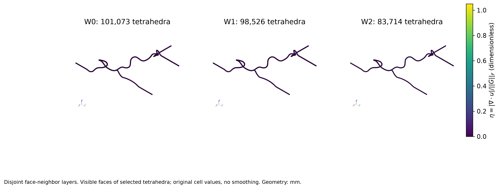


### 图 2

Each WALL triangle inherits its owning tetrahedron. Normal fraction is evaluated INSIDE, not on zero-velocity WALL nodes. Geometry: mm.

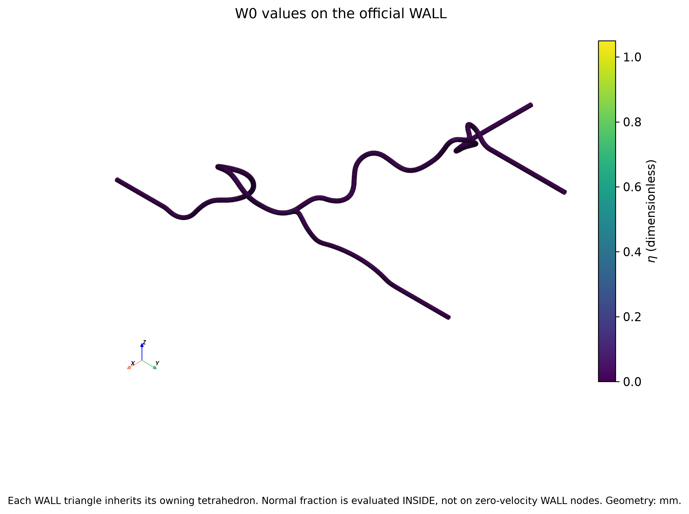


### 图 3

Each WALL triangle inherits its owning tetrahedron. Normal fraction is evaluated INSIDE, not on zero-velocity WALL nodes. Geometry: mm.

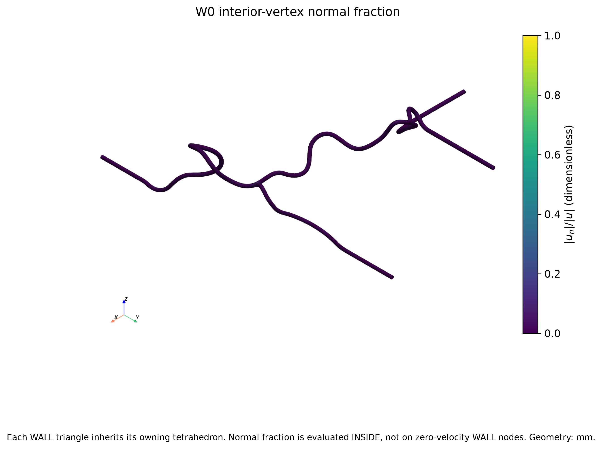


### 图 4

All cells in ECDF; positive |div| in logarithmic histogram. Exact-zero counts W0/W1/W2: [1, 0, 0]

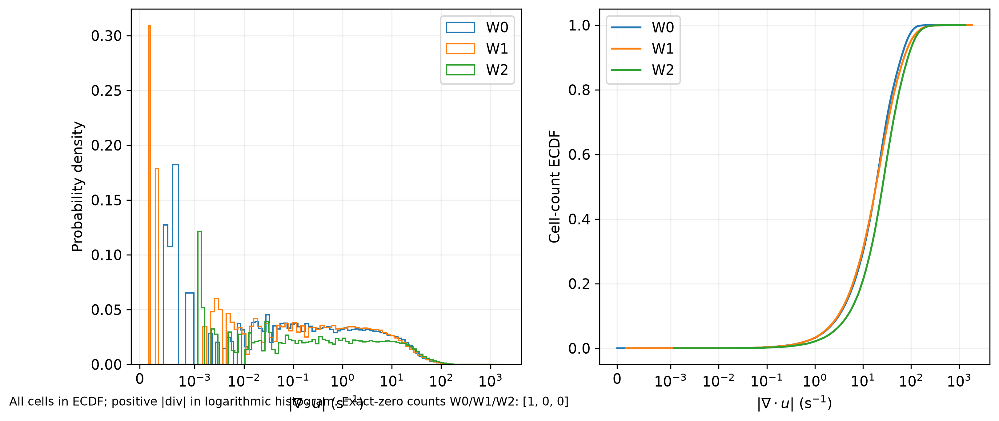


### 图 5

All cells of each layer included; count weighted. Screening thresholds are not physical CFD acceptance criteria.

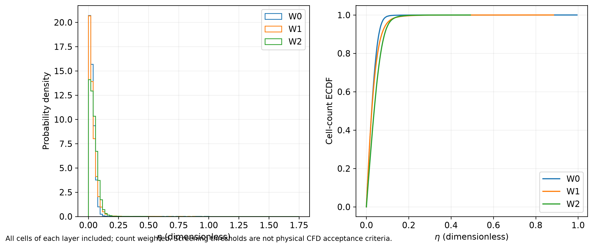


### 图 6

Every cell contributes; hexagons summarize density, no random point selection. W0 normals use largest owned WALL face.

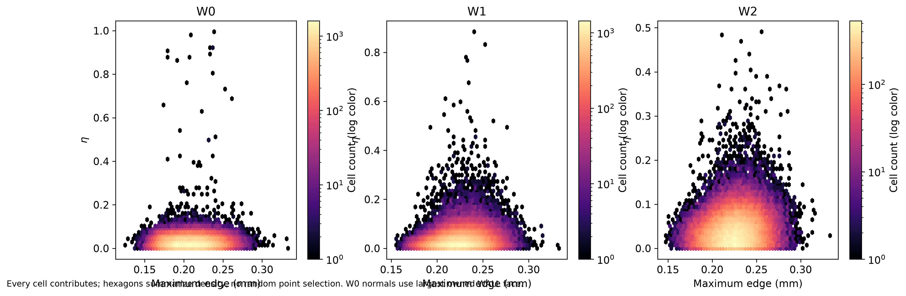


### 图 7

Every cell contributes; hexagons summarize density, no random point selection. W0 normals use largest owned WALL face.

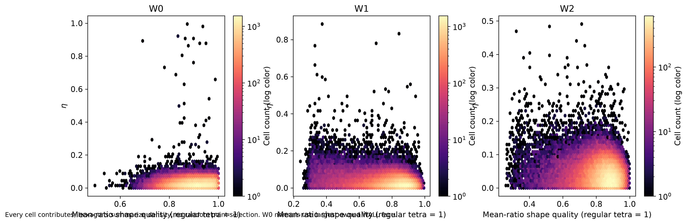


### 图 8

Every cell contributes; hexagons summarize density, no random point selection. W0 normals use largest owned WALL face.

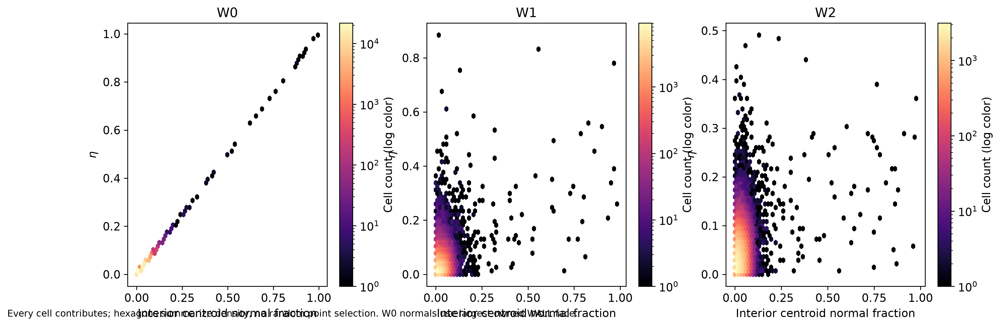


### 图 9

Largest component by cell count within W0-W2, eta >= 0.5. This is a screening cluster, not a diagnosed physical defect. Geometry: mm.

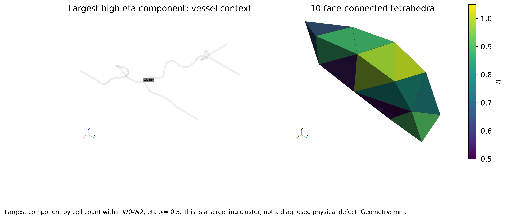


### 图 10

Red edges: target tetra. Green: connected all-four-node-zero patch (figure 11 only). No geometry or field alteration. Geometry: mm.

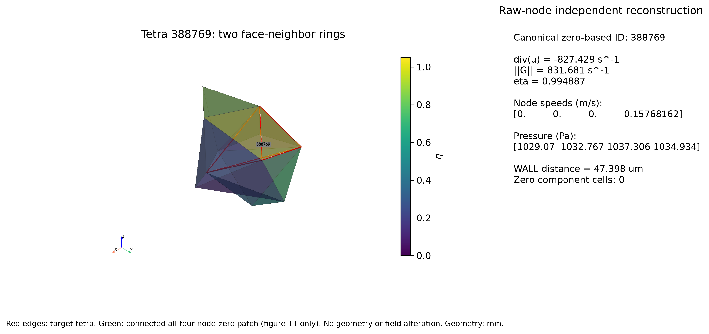


### 图 11

Red edges: target tetra. Green: connected all-four-node-zero patch (figure 11 only). No geometry or field alteration. Geometry: mm.

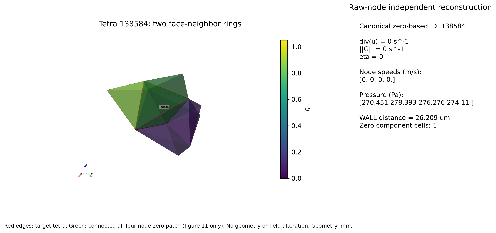


### 图 12

Historical realization_0000_contactfix only. Accepted-time state counts are not time weights; adaptive steps can inflate counts.

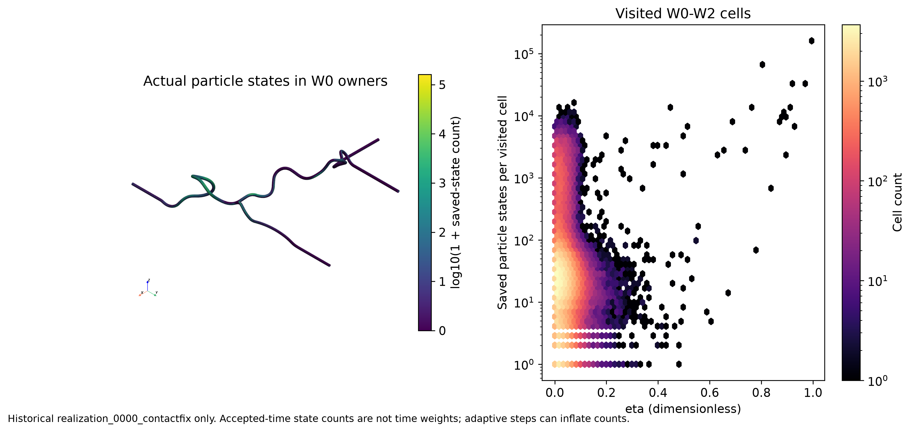
