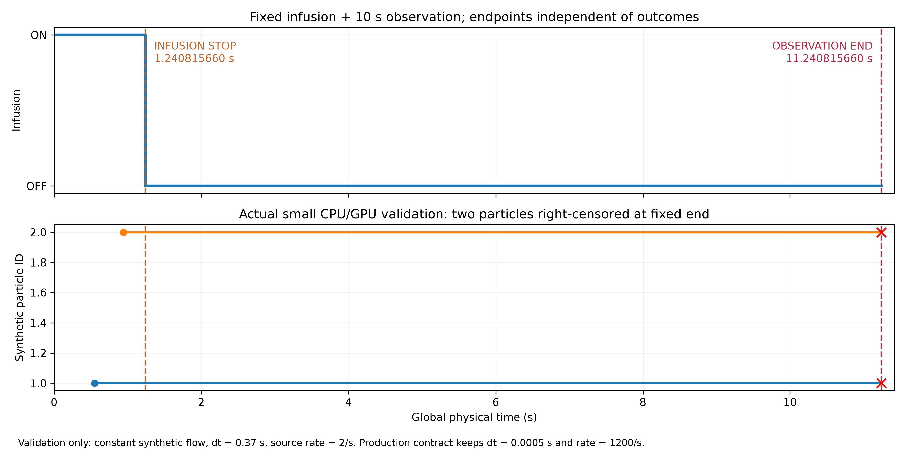
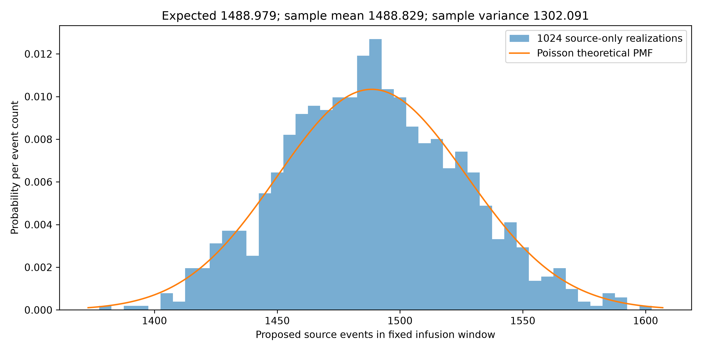

# 固定灌注与停灌后10秒观察：开发与验证报告

正式协议为 **FIXED_WINDOW_POPULATION_EXPERIMENT_V1**。以后所有由当前统一生产入口启动的 realization，都使用合同规定的固定输入时间窗，不再根据出口数量决定停灌时刻。此次仅小规模验证、真实源事件重放和零源 CLI 检查，没有启动正式大批量粒子实验或任何 CFD。

## 1. 已冻结的参数

|参数|正式值|
|---|---:|
|T_infusion|1.240815660 s|
|T_observation，明确指停灌之后|10.0 s|
|T_end|11.240815660 s|
|浓度 C|4e+09 m⁻³|
|入口 Q|3e-07 m³/s = 18 mL/min|
|λ=CQ|1200 s⁻¹|
|E[N_source]=λT_infusion|1488.978792000|
|生产名义 dt|0.0005000 s = 0.5 ms|
|默认 master_seed|2026092909|
|默认 realization_id|0|
|flow SHA256|`73228d094c253cec75dbb0030476b687171d0d0fef7816a845392dad220285dc`|
|SonoVue source distribution SHA256|`5c0842d6e6c149e129519615257537fa53a95fb19214adda9105346a9185b429`|

本轮检查发现旧正式配置只有 coverage stop，没有显式固定灌注时长。因此采用用户指定的前次实际时长 **1.240815660 s（9位小数）** 作为新的输入参数。旧实际停灌为 1.2408156603855842 s；不把那次出口覆盖过程再运行一遍去决定新 T_infusion。新合同的终点按十进制定义求和后转为 float64；积分器必须到达这一约定值，不多走一个 dt。

合同 `FIXED_WINDOW_POPULATION_EXPERIMENT_V1.json` 显式包含 stopping_policy、outcome_dependent_stop=false、right_censor_policy=ACTIVE_AT_T_END、源分布哈希及流场哈希。允许通过统一入口改变 seed/realization/C/dt/backend；修改后的实际参数写入每次新 run 的 resolved contract，时间不由 shell 参数覆盖。

## 2. 实际代码更改

源目录：`/home/lzy/projects/ulm_particle_formal_p9a5/particle_3d/src/particle_3d/population_v1/`。

- `run.py`：原先实际出口覆盖触发停止和“池为空就提前结束”均已从当前生产入口移除；兼容模块只转发到新入口，旧 --minimum-exits、--post-infusion、--fixed-infusion 参数被拒绝。
- `run_fixed_window_population.py:main`：唯一正式入口，强制读合同、检查与 runtime flow/source 身份一致，只允许新目录，保存实际合同、源哈希、源码逐文件哈希、设备信息和 previous/current protocol。
- `fixed_window.py:run_fixed_window`：下一个时刻只取 nominal tick、下一个合法源事件、T_infusion、T_end 的最小值；下游终止/出口计数不参与该选择。池为空也把全球时钟推进到固定端点。
- `fixed_window.py:censor_remaining`：恰好 T_end 后保存仍活动的微泡原始最后位置/速度/单元/壁面间隙和现时几何的 pair 状态，记录 RIGHT_CENSORED_OBSERVATION_END，再从活动池移除，不继续积分或接到出口。
- `fixed_window.py:FixedWindowOutput`：另存 `source_proposals.jsonl.gz`，保留原有带准入结果的 `source.jsonl.gz`；所有终态增加互斥 terminal_category。
- `scripts/launch_production.py`：不再带旧阈值或12秒时长，改为指定正式合同，默认目录改成 `realization_0000_fixedwindow`。

核心时序：

```python
birth = row['birth_time_s'] if row is not None and row['birth_time_s'] < tin else float('inf')
target = min(tick if engine.pool.n else float('inf'), birth, tin if source_on else end, end)
engine.advance(float(target))
if source_on and target == tin:
    source.stop(tin)
# 仅 birth < tin 才进入 admission；最终 engine.time == end 后执行 censor_remaining。
```

出生严格属于 **[0,T_infusion)**。预先抽到的未来 mark 不是已实现的事件；恰好发生于 T_infusion 的 mark 被排除，不算 rejection。源事件不取整到网格时刻。

**源提议与准入结果不同：** event-addressed RNG 使 arrival/直径/位置/朝向等源提议不依赖下游轨迹；但旧有 finite-size/pair admission 仍可能因为入口附近的活动微泡不同而接受/拒绝不同。要求“源过程不受 downstream 控制”不等于要求“改变 downstream 后准入决定也完全相同”。测试分别保存这两项，未修改准入或 MB–MB 模型。

终态类别为 EXITED_O1/O2/O3、MODEL_SUPPORTED_STATIONARY_TERMINATION、NUMERICAL_FAILURE、RIGHT_CENSORED_OBSERVATION_END；底层原状态名作为记录保留，writer 增加规范化 category。恒等式为 accepted = exits + supported stationary + numerical failure + right-censored。右删失不计作错误、出口或完成轨迹，不剔除它后把出口分数冒充总体概率。

最后速度是前一个已接受积分区间的 held velocity，不在终点偷偷重算/外推新速度。pair 状态使用最后位置重新查询精确球几何和原 V1 阈值，避免误用上一段开始时刻的 pair 集合。空列表表示此刻无活动近场 pair，并非漏填字段。

## 3. 实际完成的验证

|要求|实际执行与结果|证据|
|---|---|---|
|A 提前覆盖不改变停灌|调度 fixture 三出口各20次在 0.056605767 s 达成，继续提议至固定 T_infusion；实际提议 1538|validation/server/A_B.json|
|B 无结果依赖|“三个出口都很快覆盖”与“只有一个出口有流出”使用同源，同一半开时间窗内源提议逐字节一致|A_B.json；此项是调度 fixture，不是新流场求解|
|C 固定终点删失|实际 CPU 及 CUDA 合成常速场各有2泡保留到终点，均在 11.240815660 s 右删失，记录完整末态|C_D_E_H.json / F.json|
|D 精确切分|小验证 dt=0.37 s，不能整除停灌/终点，仍精确达到两个规定时刻，没有多走一步|C_D_E_H.json；生产仍 dt=0.0005 s|
|E 无停灌后出生|已实现的所有 birth<T_infusion；专门把首事件设为恰好停灌，事件数=0，空池仍走到固定终点|E_boundary.json|
|F CPU/GPU与batch可复现|实际 CPU/CUDA 2泡验证的源提议与准入 ledger 位相同；输出 chunk 1/1000一致，位置最大差 0 m；另 source marks 的 batch 1/17/256、批内逆序调度恢复 event-ID 次序后逐字节相同|F.json / F_mark_batches.json|
|G 固定窗Poisson统计|1024个 **arrival-only** realization，无粒子积分，mean=1488.829102，variance=1302.091000，理论均值/方差=1488.978792|G.json / G_source_only_counts.csv|
|H 互斥终态及计数|actual=accepted+rejected；accepted=全部互斥终态。测试中2 accepted=2 censored；另检验6类名称互斥和旧CLI参数拒绝|C_D_E_H.json / H_categories_CLI_guard.json|
|真实源定义重放|正式 BraVa flow/source/seed 下提议 1565 个，最后出生 1.240689648743 s；与历史同种子源 mark 一致。未运行准入或轨迹|validation/real_source_only/|
|真实环境空源CLI|真实环境、CUDA后端、验证用 C=0，没有活动泡，仍精确经过停灌和观察终点；完整合同/manifest/时间线已保存|validation/empty_real_environment_fixedwindow_current/|

统计检验的判据在测试代码中设为6个标准误：均值 z=-0.124137，方差 z=-2.838196。样本方差比理论低约 12.55%，本样本通过的是这个明确的宽判据，不能称方差已精确等于理论值。arrival-only 用真实 ARRIVAL role 与 poisson_interval，不包含直径/位置准入或1024次动力学；完整 mark 的一致性由 F 和真实源重放另行检查。

CPU/GPU 一致性只说明同一离散场与模型的执行一致，**不证明 CFD 物理正确**。metadata 的 no_numerical_failure_reported 仅表示该次运行没有记录数值失败；cfd_physical_accuracy_validated_by_protocol=false 明确排除物理正确性声明。

旧 production 的1565个接受泡、141个旧删失及2次数值失败没有迁移成新实验结果；没有回填新停止规则或缩短旧动画。

## 4. 图与保存的验证 run





`validation/small_synthetic_runs/run0/1/2` 是实际测试的2泡 CPU、CUDA、CUDA不同输出chunk副本；保存 IDENTITY、MANIFEST、提议/准入/终态 ledger 和接受时间状态。它们是明确标识的合成验证，不能作为 BraVa 正式生产结果。真实环境 CLI 是零浓度验证，亦不能替代含微泡正式运行。

## 5. 后续统一运行方式（本轮未启动）

服务器：

```bash
cd /workspace/brava_flow_roi_18mlmin_20260928/population_v1
export PYTHONPATH="$PWD/source/particle_3d/src"
export OMP_NUM_THREADS=1 OPENBLAS_NUM_THREADS=1 MKL_NUM_THREADS=1
env/bin/python -m particle_3d.population_v1.run_fixed_window_population \
  --environment data/environment.json \
  --contract fixed_window_protocol/FIXED_WINDOW_POPULATION_EXPERIMENT_V1.json \
  --output runs/realization_0001_fixedwindow \
  --backend cuda --realization-id 1 --git-commit ACTUAL_CODE_COMMIT
```

每次选择新的目录及 realization_id；时间来自同一正式合同。代码不自动提交大批量 realization。若要在本地CPU运行，使用相同模块、`data/environment.local.json` 和 `--backend cpu`，Python 环境需要项目既有依赖。

验证命令：

```bash
FIXED_VALIDATION_DIR="$PWD/fixed_window_protocol/validation/server" \
  env/bin/python -m pytest -q source/particle_3d/tests/population_v1/test_fixed_window.py
env/bin/python fixed_window_protocol/validate_real_source.py
```

本地实际代码与服务器源码同步，具体版本及新源码 SHA 见交付清单。旧入口的只读存档在 `migration/legacy_coverage_run.py.txt` 和 `migration/legacy_launcher.py.txt`；它们不是当前可运行生产入口。历史重现应使用历史记录的完整代码 commit，而不是把旧阈值重新加入当前协议。
