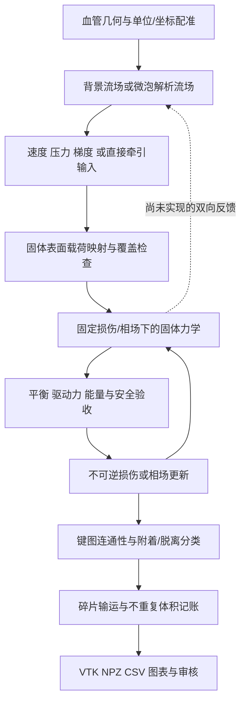
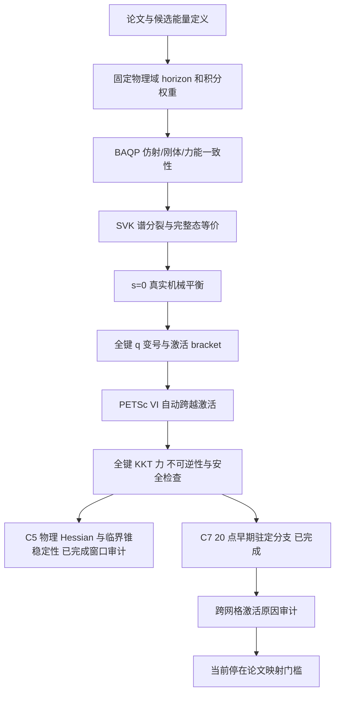

# clot 血栓项目：工作流、开发进度与公式来源总览

> 文档日期：2026-10-04（Europe/Zurich）。这是基于本地源码、配置、保存状态和审核报告整理的项目交接文档。本次只整理文档，没有重跑科学计算、修改模型或解除已有停止门槛。
>
> **当前最重要的结论：C5 的激活点和已审计早期正相场分支稳定；C7 已建立连续 20 个接受的正相场驻定态，但未评估稳定性；空间收敛及激活阈值客观性尚未建立。最新网格依赖审计停在论文—代码映射门槛，根因仍为 INCONCLUSIVE。**

## 目录

1. [项目目标、工作区与证据规则](#sec01)
2. [完整工作流与代码架构](#sec02)
3. [开发阶段与完成情况](#sec03)
4. [当前 C3/C5/C7 数值基线](#sec04)
5. [符号、单位与时间尺度](#sec05)
6. [流体输入与流固载荷公式](#sec06)
7. [早期 NOSB-PD 力学与能量审计](#sec07)
8. [经验损伤、侵蚀、碎片与输运](#sec08)
9. [机械平衡与 ADR](#sec09)
10. [当前 BAQP／SVK 谱分裂／AT1 公式](#sec10)
11. [KKT、PETSc VI 与 reduced phase pool](#sec11)
12. [涉及的数学命题与稳定性判据](#sec12)
13. [原论文、候选模型与已知公式歧义](#sec13)
14. [空间诊断公式及尚未完成的审计](#sec14)
15. [代码、数据与报告导航](#sec15)
16. [运行环境、资源、测试与复现规则](#sec16)
17. [当前阻塞与后续工作边界](#sec17)
18. [文献、源码和原始证据索引](#sec18)

<a id="sec01"></a>

## 1. 项目目标、工作区与证据规则

### 1.1 目标及当前实际范围

最终研究目标是建立可解释、可复核的血栓力学—损伤—断裂—脱离—输运计算链，并在合适阶段接入真实流场和血管几何。BraVa 血管、流场及微泡相关工作提供上游背景，但当前 clot 工程仍是独立的研究开发项目。

目前应区分以下层次：

| 层次               | 已有内容                                                   | 尚不能据此声称                                     |
| ------------------ | ---------------------------------------------------------- | -------------------------------------------------- |
| 上游 BraVa         | 本地保存血管几何和稳态流场身份、单位及质量检查信息         | 已完成血栓阻塞反馈或微泡解析声流                   |
| 早期 clot 原型     | 输入流场/牵引、NOSB-PD、经验损伤、连通性、碎片输运和可视化 | 血栓断裂参数经过实验标定                           |
| 机械平衡／能量审计 | ADR、独立小问题求根、固定坐标损伤增能的机制定位            | 旧侵蚀模型已建立热力学耗散性                       |
| 当前 PFPD 候选     | BAQP、SVK 谱分裂、AT1 能量、不可逆 VI、C5/C7 驻定分支      | 已精确复现整篇 PFPD 论文，或已完成网格客观性验证   |
| 最终应用           | 真实 clot 材料、真实声流、断裂与流场反馈是研究方向         | 已实现或验证真实超声溶栓、临床清除率、双向 CFD–PD |

### 1.2 当前工作区身份

- Git 根：`/home/lzy/projects/temp_storage/clot_clearance_github_sync_20260930`。
- clot 子项目：`/home/lzy/projects/temp_storage/clot_clearance_github_sync_20260930/clot_clearance`。
- 当前 HEAD：`f0e891686b9b107510ab3292aa27ce83638b3339`。
- 历史原始工作区：`/home/lzy/projects/clot_clearance`。旧 README 中的命令常指向这里；阅读当前结果应优先使用上述子项目。
- 本地存在大量 HEAD 之外的新增源码和科学证据。**HEAD 不是整个当前研究状态的完整快照**；同时需要读取各阶段 PRE/POST manifest、源码 SHA256、CONFIG、STATE 和 SUMMARY。
- 上游 BraVa 参考：[几何身份](references/brava_geometry_reference.json)、[流场身份](references/brava_active_flow_reference.json)。这些是归档引用，不代表本次重新运行上游算例。

### 1.3 证据分级

本文把“来源”分成四类：**论文原式**、**已有软件算法**、**项目候选或经验假设**、**从当前公式直接得到的代数推导**。模型假设、数值验收容差和数学定理不能混称。

`VERIFIED` 总是带范围：例如 affine 验证不等于自由节点平衡；KKT 驻定不等于稳定；有限审计点稳定不等于整个连续载荷区间的证明；软件测试通过不等于真实血栓物理标定。

文献已读与公式无歧义也不同。Miehe 全文已补齐，但保存了印刷公式一致性问题；PFPD 原文已直接核对，但整体映射仍为 `AMBIGUOUS`。

 <a id="sec02"></a>

## 2. 完整工作流与代码架构

### 2.1 面向最终应用的流程



图中的整条链曾由**经验损伤的强制失效演示**跑通。当前 AT1/PFPD 候选尚未接回流场、侵蚀、碎片输运或真实 BraVa 几何，不能把不同模型的成功阶段拼成一条已经验证的 PFPD 血栓清除链。

### 2.2 当前主线的验证流程



### 2.3 主要模块及责任

| 模块                                                                       | 责任                                           | 当前使用位置                                          |
| -------------------------------------------------------------------------- | ---------------------------------------------- | ----------------------------------------------------- |
| `pd_clot/geometry.py`                                                    | 早期 cell-centered 粒子、体积、表面及邻域      | 旧流场驱动原型；不能直接替代 corrected nodal geometry |
| `pd_clot/mechanics.py`                                                   | NOSB-PD、Neo-Hookean、非仿射稳定化             | 旧损伤/侵蚀路线                                       |
| `pd_clot/streaming.py`                                                   | Poiseuille、牵引、CSV/VTK 导入                 | 原型流场接口                                          |
| `fragment_topology.py`、`fragment_mechanics.py`、`fragment_fluid.py` | 连通性、低秩延续、输运                         | 强制碎裂软件验证                                      |
| `pd_clot/regularization/`                                                | coupon 能量尺度、统一流场、能量账本、侵蚀、ADR | 旧模型的改进与问题定位                                |
| `pd_clot/pfpd_candidate/`                                                | BAQP、核归一化、SVK 谱分裂、AT1、VI            | 当前隔离候选主线                                      |
| `scripts/spatial_audit_v2.py`                                            | corrected C3/C5/C7 几何与守恒积分              | 当前网格家族的来源                                    |
| `scripts/c5_activation_audit.py`                                         | 真实完整态激活搜索、全键 q                     | C5 激活及后续共用定义                                 |
| `scripts/petsc_vi_audit.py`                                              | PETSc 映射、Jacobian 检查、C5 回归             | RSLS 求解器验证                                       |
| `scripts/c5_stability_audit.py`                                          | 物理能量 Hessian、Schur、临界锥                | C5 稳定性证据                                         |
| `scripts/c7_early_branch.py`、`c7_reduced_vi.py`                       | 自动 phase pool、C7 激活和 continuation        | C7 驻定分支                                           |
| `scripts/c7_spatial_evidence.py`                                         | 激活位置、方向、参与体积、Jv 核对              | C7 空间证据；不计算稳定性 Hessian                     |

<a id="sec03"></a>

## 3. 开发阶段与完成情况

按研究逻辑排列。旧阶段结论保留原适用范围；后续新增证据不覆盖历史失败记录。

| 阶段                | 做了什么、得到什么                                                               | 状态与剩余问题                                                                                      | 主要证据                                                                                                                                                                                           |
| ------------------- | -------------------------------------------------------------------------------- | --------------------------------------------------------------------------------------------------- | -------------------------------------------------------------------------------------------------------------------------------------------------------------------------------------------------- |
| 初始直管 NOSB-PD    | 384 粒子、12,804 键、8 个损伤宏步；载荷、变形、损伤和输出链完成                  | 轻度损伤，无真实断键或脱离；18 项早期测试通过                                                       | [原型报告](REPORT_ZH.md)                                                                                                                                                                            |
| 强制碎裂与输运      | 360 粒子、25,000 代表循环；11,054 条实际断键；连通分量、脱离、运动及清除记账跑通 | `D_break=0.25` 的未标定演示；最终清除账本占比 43.333%，不是临床再通率                             | [碎裂报告](FRAGMENTATION_REPORT_ZH.md)                                                                                                                                                              |
| 能量尺度正则化      | `D_break=1`；以 coupon 匹配演示 Gc；同源 u/p/grad u；18 组网格、周期及参数比较 | 主算例无断键/脱落；整体`NOT CONVERGED`；coupon 标定不是通用断裂能证明                             | [正则化报告](REGULARIZATION_REPORT_ZH.md)                                                                                                                                                           |
| STREAMING_EROSION   | 将循环损伤改为独立慢曝光时间的末端拉伸应变率律；0.1 s 三档慢步                   | 首个 2 ms 窗口未充分平衡；发现固定坐标损伤后储能增加                                                | [侵蚀报告](verification/streaming_erosion_v1/REVIEW_STREAMING_EROSION.md)                                                                                                                           |
| 机械平衡与 ADR      | pre-relax 后再开始侵蚀；小问题 ADR/SciPy 对照；41 个平衡态、35 次损伤跳变复核    | 当前算例机械平衡和慢步比较通过；能量耗散仍未建立                                                    | [ADR 完成报告](verification/mechanical_equilibrium_v1/adr_completion/REVIEW_MECHANICAL_EQUILIBRIUM.md)                                                                                              |
| 损伤增能机制审计    | 固定 x 回放全部 35 次跳变，分离软化、重构、稳定化贡献                            | 定位为权重改变 F 的重构增能压过软化收益；不是病态 K 或稳定化增能的简单解释                          | [能量审计](verification/damage_energy_audit_v1/REVIEW_DAMAGE_ENERGY_AUDIT.md)                                                                                                                       |
| PFPD/BAQP 基础候选  | 独立实现固定状态 BAQP、g/h、核归一化；与固定版本作者源码比对                     | 力学部分可验证；原文 AT1 与 Eq.(3.25) 的演化歧义保留                                                | [PFPD 候选报告](verification/pfpd_candidate_v1/REVIEW_PFPD_CANDIDATE_V1.md)                                                                                                                         |
| AT1 一致候选        | 用户选定线性裂纹能与不可逆受约束最小化；单键及 fixed-x 验证通过                  | 原交替耦合加载—卸载—重载未完成，遗留 3 项失败                                                     | [AT1 演化报告](verification/pfpd_at1_evolution_v1/REVIEW_PFPD_AT1_EVOLUTION_V1.md)                                                                                                                  |
| Miehe 全文补充      | 原文全文、公式和小型代数核对完成                                                 | 修正“全文未取得”的历史状态；没有消除 PFPD 原文歧义，也未修复旧耦合失败                            | [全文审查](verification/pfpd_at1_evolution_v1/miehe_fulltext_addendum_20261002/MIEHE_FULLTEXT_REVIEW.md)                                                                                            |
| C3 耦合／分支稳定性 | 区分旧 fixed-point 条件分支放大与真实局部曲率；发现可行负曲率                    | 约 1.93 不是已确认的普通映射谱半径；小试件近 1% 应变出现非光滑稳定性变化                            | [耦合审计](verification/pfpd_at1_coupling_stability_audit_v1/REVIEW_COUPLING_STABILITY_AUDIT.md)、[分支追踪](verification/pfpd_at1_branch_stability_tracking_v1/REVIEW_BRANCH_STABILITY_TRACKING.md) |
| 空间离散 V1         | 识别点包围盒与积分材料体积不一致                                                 | 在几何定义硬门停止，未将旧 full-voxel 结果冒作固定域网格序列                                        | [V1 报告](verification/pfpd_at1_spatial_discretization_audit_v1/REVIEW_SPATIAL_DISCRETIZATION_AUDIT.md)                                                                                             |
| 空间离散 V2         | corrected 0.25 mm 边界节点立方体；C3/C5/C7 体积/表面权重守恒、完整态力学核对     | C3 稳定性回归通过；当时 C5/C7 触发纯拉伸域门槛，尚不能比较稳定性                                    | [V2 报告](verification/pfpd_at1_spatial_discretization_audit_v2/REVIEW_SPATIAL_DISCRETIZATION_AUDIT_V2.md)                                                                                          |
| SVK 谱分裂          | 引入已有核对的 Green 应变正负谱分裂；s=0 恢复完整 SVK；允许混合拉压              | C5/C7 完整态平衡通过；当时 C5 仍有 projected solver 停滞                                            | [谱分裂报告](verification/pfpd_at1_spectral_split_v1/REVIEW_SPECTRAL_SPLIT_V1.md)                                                                                                                   |
| C5 激活／驻定审计   | 激活 bracket；显式活动集在旧失败的同一载荷找回合法正根                           | 原障碍分类为`PROJECTED_SOLVER_ACTIVE_SET_STAGNATION`，不是根不存在                                | [C5 激活报告](verification/pfpd_at1_c5_activation_stationarity_audit_v1/REVIEW_C5_ACTIVATION_STATIONARITY.md)                                                                                       |
| PETSc VI            | 不输入已知活动键，从合法历史态自动恢复 7 个 C5 根；Jv 和求解器映射通过           | RSLS 为已验证候选；SSLS 两点对照并非全部成功；不产生稳定性结论                                      | [PETSc 报告](verification/pfpd_at1_petsc_vi_solver_v1/REVIEW_PETSC_VI_SOLVER_V1.md)                                                                                                                 |
| C5 稳定性           | 15 个审计态，包括弱激活点与 13 个正相场态；物理 Hessian、Schur 和能量方向核对    | 已审计态稳定；至 max(s)=0.105282593434 未找到第一次失稳                                             | [C5 稳定性报告](verification/pfpd_at1_c5_stability_v1/REVIEW_C5_STABILITY_V1.md)                                                                                                                    |
| C7 早期分支         | 真实 s=0 平衡 bracket；自动 reduced pool；20 个顺序接受的正相场态                | 驻定分支存在，max(s)=0.044188650755；稳定性未评估，空间收敛未建立                                   | [C7 报告](verification/pfpd_at1_c7_early_branch_v1/REVIEW_C7_EARLY_BRANCH_V1.md)                                                                                                                    |
| 激活网格依赖审计    | 重新读本地 PFPD 原文；完成逐式映射及历史哈希、夹持 DOF 核对                      | `STOPPED_AT_PAPER_MAPPING_GATE`；没有执行后续共同应变、affine、profile、support 或 clamp 控制实验 | [最新停止报告](verification/pfpd_at1_activation_mesh_dependence_audit_v1/REVIEW_ACTIVATION_MESH_DEPENDENCE_V1.md)                                                                                   |

当前进度不宜压缩成一个百分比：求解器、离散几何、局部稳定性、材料标定和 CFD 耦合属于不同验收维度。

<a id="sec04"></a>

## 4. 当前 C3/C5/C7 数值基线

### 4.1 当前候选中冻结的物理量

| 参数            |                               当前值 | 含义                                                |
| --------------- | -----------------------------------: | --------------------------------------------------- |
| 立方体边长 L    |                              0.25 mm | corrected boundary-node 试件                        |
| 物理 horizon δ |                           0.25125 mm | 所有网格固定；不是按 h 固定比例缩小                 |
| 剪切模量 μ_s   |                              1000 Pa | 数值试件材料                                        |
| 体积模量 K_bulk |                 666.6666666666666 Pa | λ≈0，ν=0；与旧近不可压 Neo-Hookean 参数不同      |
| Gc_demo         |          1.26884390625×10⁻⁵ J/m² | 演示值，按仿射 1% 激活设计；不是血栓实验标定        |
| 核              | quadratic，ω(ρ)=(1−ρ)²，0≤ρ<1 | 无隐藏 surface correction                           |
| c0              |                                  1/4 | 从同一核的积分比值取得                              |
| Yc              |                         0.1010025 Pa | Gc/(2c0δ)                                          |
| g(s)            |                             (1−s)² | 正能量退化                                          |
| h(s)            |                    1，限当前低损伤域 | 不改变运动学重构                                    |
| sc              |                                 0.95 | 相场安全上界；达到该门限不接受为当前 early-phase 解 |
| 相场驱动        |                               Y=Ψ⁺ | SVK 谱分裂正部分                                    |

来源：[冻结配置](verification/pfpd_at1_evolution_v1/provenance/PREDECLARED_CONFIG.json)、[C7 物理记录](verification/pfpd_at1_c7_early_branch_v1/provenance/PHYSICS_FROZEN.json)。

### 4.2 几何与分支结果

| 项目              |                                    corrected C3 |             corrected C5 |             corrected C7 |
| ----------------- | ----------------------------------------------: | -----------------------: | -----------------------: |
| 粒子数            |                                              27 |                      125 |                      343 |
| 自由机械 DOF      |                                              27 |                      225 |                      735 |
| 无向键／phase DOF |                                             185 |                    5,392 |                   46,059 |
| h（mm）           |                                           0.125 |                   0.0625 |             0.0416666667 |
| δ/h              |                                            2.01 |                     4.02 |                     6.03 |
| 仿射局部激活应变  |                                         约 0.01 |                  约 0.01 |                  约 0.01 |
| 真实平衡激活位置  |                                         约 0.01 |        0.004497390736212 |     约 0.003137607455254 |
| 初始激活键数      |                                         185/185 |                   2/5392 |                  2/46059 |
| 初始活动位置      |                全键开启；负曲率见证另有空间集中 | 加载轴附近、上下夹持关联 | 加载轴附近、上下夹持关联 |
| 稳定性证据        | 历史区间 [0.0099921875,0.01] 附近出现可行负曲率 |          15 个审计态稳定 |                   未评估 |

仿射列仅用于完整材料与局部阈值基准。C5/C7 的仿射场通常不是其自由节点的平衡解，不能用仿射阈值取代真实平衡阈值。

### 4.3 C5 的最新证据

- 激活 bracket：`[0.004497343750, 0.004497421875]`，宽 `7.8125e-8`；弱点诊断应变 `0.004497390736212`。
- 首个已验证正根：ε=`0.004498390736212`，max(s)=`0.000585374862705`。
- 弱激活点：归一化 λ_min(Hxx)=`0.0338400871`，λ_min(S)=`0.00212248883`；临界锥可行性与方向能量检查通过。
- 最后审计点：ε=`0.004697390736212`，max(s)=`0.105282593434`；因首次跨过预定 max(s)=0.10 窗口边界停止。
- `FIRST_STABILITY_LOSS=NOT_FOUND_IN_WINDOW`。这不是“永远稳定”，也不是整个连续载荷区间的解析证明。

### 4.4 C7 的最新证据

| 指标                     | 数值或状态                                                  |
| ------------------------ | ----------------------------------------------------------- |
| 真实激活 bracket         | [0.0031375732421875, 0.00313763427734375]                   |
| bracket 宽度             | 6.103515625×10⁻⁸                                         |
| 弱集合诊断位置           | 0.003137607455254；属于弱集合容差定位，不替代有符号 bracket |
| 自动发现的首激活键       | 40174、44110；不是求解器硬编码输入                          |
| 首激活比例               | 4.34225667×10⁻⁵，即 0.00434226%                          |
| 初始／最大 phase pool    | 1218 / 1218；C7 实际扩池 0 次                               |
| Reduced 系统大小         | 735+1218=1953 DOF                                           |
| 首正根 ε                | 0.003137634277344                                           |
| 首正根归一化力残差       | 1.431281502×10⁻¹⁵                                       |
| 首正根全键 projected KKT | 9.672792013×10⁻¹⁴                                       |
| 首正根 max(s)            | 2.056733739×10⁻⁵                                         |
| 顺序接受正相场态         | 20                                                          |
| 末态 ε                  | 0.003197634277344                                           |
| 末态 max(s)              | 0.044188650755                                              |
| 末态加权平均 s           | 7.075004689×10⁻⁶                                         |
| 末态活动键数             | 2，仍是同一对键                                             |
| 停止原因                 | `20_ACCEPTED_POSITIVE_STATES`                             |
| 稳定性                   | `NOT_ASSESSED`                                            |

C7 接受态覆盖全 46,059 键 KKT、不可逆性及原安全条件。首次求解没有把未来正根作为初值。上述力残差是无量纲归一化量，不是牛顿。

来源：[C7 SUMMARY](verification/pfpd_at1_c7_early_branch_v1/SUMMARY.json)、[分支记录](verification/pfpd_at1_c7_early_branch_v1/branch/ALL.json)。

### 4.5 C5→C7 的变化及尚未解释的问题

| 指标                     |             C5 |             C7 |
| ------------------------ | -------------: | -------------: |
| 激活诊断状态名义反力应力 | 5.638438206 Pa | 2.947494683 Pa |
| 激活键中点距最近 clamp   |      31.25 μm |  20.833333 μm |
| d_act/h                  |            0.5 |            0.5 |
| d_act/δ                 | 0.124378109453 | 0.082918739635 |
| 初期 Δmax(s)/Δε 割线  |    584.7038763 |    765.7792286 |
| 初期加权平均相场割线     |   0.8817313594 |   0.1226082159 |

激活应变变化约 `−0.001359783281`，相对 C5 为 `−30.23494%`，因此标签为 `SHIFTING`。两级都位于首个离散夹持键层，位置类型 `CONSISTENT` 不代表收敛。

上述割线来自各自最初两个接受正根，并非激活点精确导数。上下两个热点合并后的 RMS 较大，不能解释成单个过程区宽度。来源：[响应比较](verification/pfpd_at1_c7_early_branch_v1/C5_C7_RESPONSE_COMPARISON.json)、[历史位置复核](verification/pfpd_at1_activation_mesh_dependence_audit_v1/HISTORICAL_ACTIVATION_FACTS.json)。

<a id="sec05"></a>

## 5. 符号、单位与时间尺度

### 5.1 统一记号

| 记号                           | 含义                                         | 单位或范围                             |
| ------------------------------ | -------------------------------------------- | -------------------------------------- |
| X_i、x_i、u_i=x_i−X_i         | 参考位置、当前位置、位移                     | m                                      |
| ξ_ij=X_j−X_i、η_ij=x_j−x_i | 参考／当前键向量                             | m                                      |
| h_mesh、δ                     | 粒子间距、非局部 horizon                     | m                                      |
| V_i、A_f                       | 参考体积、表面面积权重                       | m³、m²                               |
| K_i                            | 形状张量                                     | 量纲随 ω 的幅值约定；不是材料体积模量 |
| K_bulk、μ_s、λ               | 体积模量、剪切模量、Lamé 参数               | Pa                                     |
| F、J=det F、E                  | 变形梯度、体积比、Green 应变                 | 无量纲                                 |
| Ψ、Y、Yc、q                   | 能量密度、驱动、临界驱动、相场导数密度       | Pa=J/m³                               |
| W_b                            | BAQP 无向键积分权重                          | m³；不是能量密度 W(F)                 |
| Gc                             | 断裂能参数                                   | J/m²                                  |
| D_b                            | 旧损伤／侵蚀状态                             | [0,1]                                  |
| a_b                            | 本文为避免混淆而使用的旧 bond integrity 记号 | 常为 1−D_b；原代码常写 g              |
| s_b                            | 当前 PFPD 键相场                             | 当前接受域 0≤s_b<sc                   |
| g(s)、h_kin(s)                 | 能量退化、运动学退化                         | 无量纲；h_kin 不等于网格 h_mesh        |
| d_i、D_pf                      | 从键相场聚合的粒子显示量                     | 后处理变量，不是另一个动力学自由度     |
| μ_f、p、u_f、σ_f             | 流体黏度、压力、速度、应力                   | Pa·s、Pa、m/s、Pa                     |

**不要混用**：旧 `g=1−D` 与 PFPD `g(s)=(1−s)²`；旧演示 `Gc_demo=0.01 J/m²` 与当前 AT1 的 `1.2688e-5 J/m²`；旧 near-incompressible NH 与当前 ν=0 SVK；C7 求解器 Jacobian 与稳定性物理 Hessian。

### 5.2 四种时钟

1. **机械积分时间 t_mech**：早期显式动力学真实积分的数值时间。
2. **代表循环数 N**：经验 cycle-jump 的计数；N/f_carrier 是换算元数据，不是已验证治疗时间。
3. **侵蚀曝光时间 t_exp**：独立慢时间，平衡门槛通过后才推进损伤。
4. **ADR 伪时间 τ**：用于求静力平衡的迭代参数，不是物理时间，虚拟阻尼不是血栓黏度。

当前 C5/C7 位移控制分支使用工程应变 ε 作为加载参数；没有据此定义物理加载速率。

<a id="sec06"></a>

## 6. 流体输入与流固载荷公式

### F01：流体应力、牵引与粒子力

对牛顿流体，采用固体外法向 n_s：

$$
\boldsymbol\sigma_f=-p\mathbf I+\mu_f\left(\nabla\mathbf u_f+\nabla\mathbf u_f^T\right),\qquad
\mathbf t_s=\boldsymbol\sigma_f\mathbf n_s,\qquad
\mathbf f_i^{\mathrm{ext}}=\sum_{f\to i}A_f\mathbf t_f.
$$

正压力对应向内牵引。切向量可写为

$$
\mathbf t_\tau=(\mathbf I-\mathbf n_s\otimes\mathbf n_s)\mathbf t_s.
$$

来源：Karmakar 等 [R1] Eq.(26)、(28)；代码 [streaming.py](pd_clot/streaming.py)、[统一流场](pd_clot/regularization/flow.py)。早期版本使用参考面 dead load；后续暴露面使用当前位置和邻域估计法向，但面积仍为离散代理。这不是完整、守恒的移动界面双向 FSI。

### F02：直管 Poiseuille 基准

$$
u_z(r)=\frac{2Q}{\pi R^2}\left(1-\frac{r^2}{R^2}\right),\qquad
-\frac{\mathrm dp}{\mathrm dz}=\frac{8\mu_fQ}{\pi R^4}.
$$

这是解析输入基准，项目没有为此重新求解 Navier–Stokes。旧直管采用 R=1.25 mm、长度 6 mm、Q=18 mL/min。BraVa 归档同样记录 Q=3×10⁻⁷ m³/s，但两个几何/流场不能因此等同。

### F03：制造的局部无散流场

令 r=x−x_b，向量势

$$
\mathbf A=\left(0,-U_\star\ell\exp[-\|\mathbf r\|^2/(2\ell^2)],0\right),
\quad \mathbf u_{\mathrm{loc}}=\nabla\times\mathbf A,
\quad \nabla\cdot\mathbf u_{\mathrm{loc}}=0.
$$

再乘规定时间因子并叠加 Poiseuille 背景。散度为零来自 curl 的恒等式；**不意味着该规定 u、p 联合满足无外加体力的 Navier–Stokes 方程**。该场是制造解／软件输入，不是已求得的声波、微泡振荡或空化解。

来源：项目 [ManufacturedStreamingProvider](pd_clot/regularization/flow.py)。这种 Gaussian 势、幅值和慢周期是项目假设，不是 [R1] 给出的微泡模型。

### F04：导入契约

- 直接牵引 CSV：`x,y,z,tx,ty,tz`；单位 m、Pa。
- 体场 CSV：`x,y,z,ux,uy,uz,p`；单位 m、m/s、Pa。
- 线性四面体 VTU/VTK：通常使用 `Velocity`、`Pressure` 数组；依据原单元插值并计算 P1 梯度。
- 直接牵引点 VTP：通常使用 `traction_Pa`。

必须核对坐标配准、单位、压力基准、法向和覆盖。域外点拒绝，不用最近邻静默外推。单独表面速度通常不足以恢复三维 ∇u。当前接口主要面向静态快照；真实流场时序和双向反馈未完成。

<a id="sec07"></a>

## 7. 早期 NOSB-PD 力学与能量审计

### F05：活动权重、形状张量与非局部变形梯度

为区别当前 PFPD 相场，以下用 a_ij 表示旧键完整性：

$$
\mathbf K_i=\sum_{j\in\mathcal H_i}\omega_{ij}a_{ij}
\boldsymbol\xi_{ij}\otimes\boldsymbol\xi_{ij}V_j,
\qquad
\mathbf A_i=\sum_j\omega_{ij}a_{ij}
\boldsymbol\eta_{ij}\otimes\boldsymbol\xi_{ij}V_j,
\qquad \mathbf F_i=\mathbf A_i\mathbf K_i^{-1}.
$$

损伤会同时改变分子和 K。原始 correspondence 思想见 Silling 等 [R2] §18，及 [R1] Eq.(4)–(8)；当前具体权重和退化选择来自 [mechanics.py](pd_clot/mechanics.py)、[fragment_mechanics.py](pd_clot/fragment_mechanics.py)。

### F06：旧可压 Neo-Hookean 能量与应力

$$
\lambda=K_{\mathrm{bulk}}-\frac23\mu_s,\qquad J=\det\mathbf F>0,
$$

$$
\Psi_{\mathrm{NH}}(\mathbf F)=\frac{\mu_s}{2}(\mathbf F:\mathbf F-3)
-\mu_s\ln J+\frac\lambda2(\ln J)^2,
$$

$$
\mathbf P=\mu_s(\mathbf F-\mathbf F^{-T})+\lambda\ln J\,\mathbf F^{-T}.
$$

旧原型采用 μ_s=1000 Pa、K_bulk=50000 Pa。它不是 [R1] 的 generalized Ogden 标定。模型与单位见 [MODEL_ASSUMPTIONS.md](MODEL_ASSUMPTIONS.md)。

### F07：旧退化能量与非仿射稳定化

$$
r_i=\frac{\sum_j a_{ij}V_j}{\sum_jV_j},\qquad
\mathbf z_{ij}=\boldsymbol\eta_{ij}-\mathbf F_i\boldsymbol\xi_{ij},
$$

$$
U=\sum_iV_i\left[r_i\Psi_{\mathrm{NH}}(\mathbf F_i)+H_i\right],\qquad
H_i=\frac{\alpha\mu_s r_i}{2\operatorname{tr}\mathbf K_i}
\sum_j\omega_{ij}a_{ij}V_j\|\mathbf z_{ij}\|^2.
$$

r_i 的平均不含 ω，而 K/F 的积分含 ω；不能把两者混成同一个“损伤权重”。α=3 为旧开发值。稳定化与 [R3] 的非仿射二次能量思想相关，但当前 r_i、tr(K_i) 和具体系数不是照搬论文的通用稳定性定理。

固定 a 时，由能量求力，内部力满足成对反作用；旧 correspondence 部分为

$$
\mathbf f_{ij}^{\mathrm{corr}}=V_iV_j\omega_{ij}a_{ij}
\left[r_i\mathbf P_i\mathbf K_i^{-1}+r_j\mathbf P_j\mathbf K_j^{-1}\right]
\boldsymbol\xi_{ij},\qquad\mathbf f_{ji}=-\mathbf f_{ij}.
$$

稳定化力另由 H 的位移变分得到。固定损伤的力—能一致性不保证改变损伤时耗散非负。

### F08：固定坐标、改变权重时 F 的精确增量恒等式

在 K_0、K_1 可逆且 x 不变时：

$$
\boxed{\mathbf F_1-\mathbf F_0=
\left[\sum_j\omega_{ij}(a_{1,ij}-a_{0,ij})V_j
(\boldsymbol\eta_{ij}-\mathbf F_0\boldsymbol\xi_{ij})\otimes\boldsymbol\xi_{ij}\right]
\mathbf K_1^{-1}.}
$$

推导只需将 A_1−F_0K_1 展开，并用 A_0=F_0K_0。由此可见：**固定粒子位置不等于固定重构变形梯度**。仿射残差为零，或全部权重同比例缩放且保持满秩时，F 才保持不变。

来源：项目独立代数推导；[能量审计第 4 节](verification/damage_energy_audit_v1/REVIEW_DAMAGE_ENERGY_AUDIT.md)、[恒等式复核](verification/damage_energy_audit_v1/comparisons/RECONSTRUCTION_IDENTITY.json)。35 个实际状态的最大分量误差约 2.89×10⁻¹⁵。

### F09：固定 x 损伤储能差的精确拆分

约定 ΔU=U_before−U_after，正数才表示释放：

$$
\Delta U=\sum_i\left[
V_i(r_{0,i}-r_{1,i})\Psi_{0,i}
+V_ir_{1,i}(\Psi_{0,i}-\Psi_{1,i})
+U^{\mathrm{stab}}_{0,i}-U^{\mathrm{stab}}_{1,i}\right].
$$

三项依次为 softening、reconstruction、stabilization。原 35 次实际跳变均为总增能：重构项的负贡献超过另外两项的正贡献。K 仍满秩、最大条件数约 2.69，不能归因为简单秩损失。

热力学共轭驱动力应检查

$$
Y_b^{\mathrm{thermo}}=-\frac{\partial U}{\partial D_b}\Big|_x.
$$

仅有 D 不减不能保证 Y·Ḋ≥0。这个结果是转向完整离散能量与 AT1 候选的重要动机，但当前新候选没有被自动回接到旧侵蚀模型。

<a id="sec08"></a>

## 8. 经验损伤、侵蚀、碎片与输运

### F10：旧经验循环损伤

令 stretch=|η|/|ξ|，代表周期内半极差为 Q_b：

$$
Q_b=\frac{\max_t\mathrm{stretch}_b-\min_t\mathrm{stretch}_b}{2},\qquad
\Delta D_b=\Delta N\,C_D\left\langle\frac{Q_b}{Q_{\mathrm{ref}}}-1\right\rangle_+^{m_D},
\qquad D_b^{n+1}=\min(1,D_b^n+\Delta D_b).
$$

这是项目经验假设，不来自 [R1] 的超声/疲劳定律。旧强制碎裂例在 D_break=0.25 提前令有效完整性为零；因此 broken bond 的原始 D 可以小于 1。正则化新例强制 D_break=1，不能混用两组图解释断裂比例。

### F11：coupon 标定的循环能量代理

$$
V_b^{\mathrm{quad}}=\omega_{ij}V_iV_j\left(\frac1{S_i}+\frac1{S_j}\right),
\quad S_i=\sum_j\omega_{ij}V_j,\quad\sum_bV_b^{\mathrm{quad}}=\sum_iV_i,
$$

$$
W_{b,\mathrm{cyc}}=\frac12E_YQ_b^2V_b^{\mathrm{quad}},\quad
W_{b,\mathrm{crit}}=\psi_{\mathrm{crit}}V_b^{\mathrm{quad}},\quad
\Delta D_b=\Delta N C_E\left\langle\frac{W_{b,\mathrm{cyc}}}{W_{b,\mathrm{crit}}}-\theta_E\right\rangle_+^{m_E}.
$$

ψcrit 由指定 coupon 数值标定，不是 NOSB 自由能唯一的逐键分解。换网格、材料、Gc 或损伤参数时必须核对标定身份。来源：[energy.py](pd_clot/regularization/energy.py)、[coupon.py](pd_clot/regularization/coupon.py)、[damage.py](pd_clot/regularization/damage.py)。

### F12：独立慢时间侵蚀律

$$
\epsilon_b^+=\max\left(\frac{|\boldsymbol\eta_b|}{|\boldsymbol\xi_b|}-1,0\right),\qquad
\dot D_b=C_t\left\langle\frac{\epsilon_b^+}{\epsilon_{\mathrm{ref}}}-\theta_t\right\rangle_+^{m_t},
$$

$$
D_b^{n+1}=\min\left(1,D_b^n+\Delta t_{\mathrm{exp}}\dot D_b\right).
$$

驱动是完成力学阶段后的末端拉伸应变，不是周期幅值。开发参数为 C_t=0.01 s⁻¹、m_t=1、ε_ref=10⁻⁴、θ_t=0。Bajd–Serša [R4] 仅为变形与时间退化关系的参考，没有移植其细胞模型或实验参数。该侵蚀律尚未建立与完整离散自由能一致的耗散证明。

### F13：连通性、质量与清除账本

活动键构成无向图。含固定锚点的分量为 attached，其余为 detached：

$$
V_C=\sum_{i\in C}V_i,\quad M_C=\sum_{i\in C}\rho_sV_i,\quad
\mathbf x_C=\frac{\sum_{i\in C}V_i\mathbf x_i}{V_C}.
$$

fragment ID 按分裂谱系继承。清除量按材料粒子 ID 去重，首次穿越诊断平面的粒子体积只计一次；穿越后粒子仍保留。清除体积不是溶解体积，也不是临床疗效。

低秩碎片曾采用内禀支撑延续：若支撑基 U 有 r=1 或 2 列，令 B=F_supported U，C=BᵀB，J_r=√det C，使用

$$
\Psi_r=\frac{\mu_s}{2}(\operatorname{tr}\mathbf C-r)-\mu_s\ln J_r+
\frac\lambda2(\ln J_r)^2.
$$

这属于项目数值近似，未验证为真实三维血栓碎片本构；当前 PFPD early branch 没有采用该低秩路径。详见 [FRAGMENTATION_MODEL.md](FRAGMENTATION_MODEL.md)。

### F14：输运代理

旧粒子松弛为

$$
\dot{\mathbf v}=\frac{\mathbf u_f-\mathbf v}{\tau_h},\qquad
\mathbf v(t+\Delta t)=\mathbf u_f+[\mathbf v(t)-\mathbf u_f]e^{-\Delta t/\tau_h}
$$

（一步内冻结 u_f）。可选等效球分量阻力采用

$$
d_C=(6V_C/\pi)^{1/3},\qquad Re=\frac{\rho_f d_C|\mathbf u_f-\mathbf v_C|}{\mu_f},
$$

$$
\beta=3\pi\mu_fd_C(1+0.15Re^{0.687})\quad(Re<1000),\qquad
\mathbf F_D=\beta(\mathbf u_f-\mathbf v_C).
$$

高 Re 使用 Cd=0.44 的球形代理。来源：[transport.py](pd_clot/regularization/transport.py) 与 OpenFOAM 原始实现 [R5]。未包含不规则碎片精确水动力、力矩、碎片碰撞或血管接触。

<a id="sec09"></a>

## 9. 机械平衡与 ADR

### F15：总力残量

$$
\mathbf R_{\mathrm{free}}(x)=\mathbf f_{\mathrm{int,free}}(x)+\mathbf f_{\mathrm{ext,free}}(x)=0.
$$

固定自由度从未知量和残量中剔除。旧侵蚀输入可能依赖当前位置，因此参考切线须包含外力对位置的变化。当前位移控制 cube 没有外部流场牵引，反力在固定边界计算。

### F16：虚拟质量与阻尼更新

Kilic–Madenci [R6] Eq.(11)–(14)、(18)–(19) 对应当前离散形式：

$$
v_i^{n+1/2}=\frac{(2-c_n\Delta\tau)v_i^{n-1/2}+2\Delta\tau R_i^n/\Lambda_i}{2+c_n\Delta\tau},
\qquad u_i^{n+1}=u_i^n+\Delta\tau v_i^{n+1/2},
$$

$$
\Lambda_i\ge\frac{\Delta\tau^2}{4}\sum_j|K_{ij}^{\mathrm{tan}}|,
\qquad \mathbf K^{\mathrm{tan}}=-\frac{\partial\mathbf R}{\partial\mathbf x},
$$

$$
k_i^n=-\frac{R_i^n/\Lambda_i-R_i^{n-1}/\Lambda_i}{\Delta\tau v_i^{n-1/2}},\qquad
c_n=2\sqrt{\frac{\sum_i(u_i^n)^2k_i^n}{\sum_i(u_i^n)^2}}.
$$

零速度分量不作除零。初始半步 v^{1/2}=ΔτR⁰/(2Λ)。当前还依据 Madenci–Oterkus 作者附录 [R7] 使用非正商 c=0，以及 Δτ=1 下 c>2 时取 1.9 的保护分支；不是对负商取绝对值。

旧 erosion ADR 行和安全系数为 1.1；后续 AT1 冻结配置为 1.5。二者来自不同阶段配置，不能把任一值写成论文普适常数。虚拟质量/伪动能不是实际质量/物理动能。

来源：[METHOD_AUDIT](verification/mechanical_equilibrium_v1/adr_completion/METHOD_AUDIT.md)、[保护分支补充](verification/mechanical_equilibrium_v1/adr_completion/DAMPING_GUARD_ADDENDUM.md)、[equilibrium_adr.py](pd_clot/regularization/equilibrium_adr.py)。

### 9.1 不同阶段的平衡验收不能混用

- 旧 erosion ADR：free 相对总力≤10⁻⁴，driver drift≤1%，伪动能/储能≤10⁻⁶，连续检查通过。
- 当前 AT1 驻定科学门槛：归一化力≤10⁻⁹，projected KKT≤10⁻⁸，并检查固定边界、不可逆、正 J 和安全域。
- PETSc 内部终止容差与上述科学验收不同；软件 `success`、`ftol`、`xtol` 不能单独构成接受理由。

<a id="sec10"></a>

## 10. 当前 BAQP／SVK 谱分裂／AT1 公式

### F17：corrected nodal quadrature

每个方向 n 个边界节点，h_mesh=L/(n−1)。一维端点权重 h/2、内部 h，三维取张量积：

$$
V_i=w_{i_x}^{(1D)}w_{i_y}^{(1D)}w_{i_z}^{(1D)},\quad
\sum_iV_i=L^3,\quad \sum_{f\in\mathrm{top}}A_f=\sum_{f\in\mathrm{bottom}}A_f=L^2.
$$

内部／面／棱／角点分别为 h³、h³/2、h³/4、h³/8。当前 V=1.5625×10⁻¹¹ m³，A_top=A_bottom=6.25×10⁻⁸ m²。

旧 27 点 full-voxel 体积为 0.375³ mm³，而点包围盒为 0.25³ mm³，体积比 3.375。旧、新 C3 必须分开引用。来源：[空间 V2](verification/pfpd_at1_spatial_discretization_audit_v2/REVIEW_SPATIAL_DISCRETIZATION_AUDIT_V2.md)。

### F18：核归一化与无向键权重

$$
\omega_{0,i}=\sum_{j\in\mathcal H_i}\omega_{ij}V_j,\qquad
\bar\omega_b=\frac{\omega_{ij}}2\left(\frac1{\omega_{0,i}}+\frac1{\omega_{0,j}}\right),
\qquad W_b=2\bar\omega_bV_iV_j.
$$

有向双积分合并成无向键后需要因子 2。核整体乘正的常数，在 wbar、c0 比值及相应重构中抵消；“未把原始 ω 的幅值单独归一到 1”不等于漏掉核归一化。

来源：[R8] Eq.(2.13)–(2.15)，[kernel.py](pd_clot/pfpd_candidate/kernel.py)、[pair_weights](pd_clot/pfpd_candidate/adr_adapter_at1.py)。截断归一化已实现，但不自动证明实际有限试件的边界响应客观。

### F19：BAQP 键关联重构

$$
\bar{\mathbf F}_i=\left(\sum_j\omega_{ij}h_{\mathrm{kin}}(s_{ij})\boldsymbol\eta_{ij}\otimes\boldsymbol\xi_{ij}V_j\right)\mathbf K_i^{-1},
$$

$$
\mathbf F_b^{\mathrm{avg}}=\frac{\bar{\mathbf F}_i+\bar{\mathbf F}_j}{2},\qquad
\widetilde{\mathbf F}_b=\mathbf F_b^{\mathrm{avg}}+
\frac{(\boldsymbol\eta_b-\mathbf F_b^{\mathrm{avg}}\boldsymbol\xi_b)\otimes\boldsymbol\xi_b}{|\boldsymbol\xi_b|^2}.
$$

当前 h_kin=1，所以固定 x 时 Ftilde 不依赖 s。键向满足 Ftilde_b ξ_b=η_b。来源：[R8] Eq.(2.10)–(2.11)、(3.13)–(3.14)，[baqp.py](pd_clot/pfpd_candidate/baqp.py)。

### F20：BAQP 力态及平方分母说明

$$
\mathbf B_{ij}=\omega_{ij}h_{\mathrm{kin}}(s_{ij})\mathbf K_i^{-1}\boldsymbol\xi_{ij},\qquad
\mathbf Z_i=\sum_j\bar\omega_b\widetilde{\mathbf P}_b
\left(\mathbf I-\frac{\boldsymbol\xi_b\otimes\boldsymbol\xi_b}{|\boldsymbol\xi_b|^2}\right)V_j,
$$

$$
\mathbf t_{ij}=\bar\omega_b\widetilde{\mathbf P}_b\frac{\boldsymbol\xi_b}{|\boldsymbol\xi_b|^2}
+\mathbf Z_i\mathbf B_{ij},\qquad
\mathbf f_i=\sum_jV_iV_j(\mathbf t_{ij}-\mathbf t_{ji}).
$$

原文 Eq.(2.19) 打印分母存在 r/r² 问题。候选使用作者固定版本 Peridynamics.jl 的 r² 形式，并通过独立力—能差分与作者实现对照；**不是声称逐字执行存在量纲问题的印刷式**。见 [公式审计](verification/pfpd_candidate_v1/resources/PFPD_EQUATION_AUDIT.md)、[R9]。这一力式依据不能消除 phase evolution 的另一个歧义。

### F21：SVK 与 Green 应变谱分裂

$$
\mathbf E=\frac12(\mathbf F^T\mathbf F-\mathbf I),\quad
\mathbf E=\sum_ae_a\mathbf n_a\otimes\mathbf n_a,\quad
\mathbf E_\pm=\sum_a\langle e_a\rangle_\pm\mathbf n_a\otimes\mathbf n_a,
$$

其中 ⟨x⟩_+=max(x,0)，⟨x⟩_−=min(x,0)。

$$
\Psi_\pm=\frac\lambda2\langle\operatorname{tr}\mathbf E\rangle_\pm^2+\mu_s\mathbf E_\pm:\mathbf E_\pm,
\qquad
\mathbf S_\pm=\lambda\langle\operatorname{tr}\mathbf E\rangle_\pm\mathbf I+2\mu_s\mathbf E_\pm.
$$

$$
\boxed{\Psi(\mathbf F,s)=g(s)\Psi_+(\mathbf F)+\Psi_-(\mathbf F)},\qquad
\mathbf P=\mathbf F\,[g(s)\mathbf S_++\mathbf S_-],\qquad Y=\Psi_+.
$$

在 s=0 时恢复完整 SVK：Ψ=λ(tr E)²/2+μ_s E:E。当前参数 λ≈0，但实现和验证包含一般允许的 λ，不能只靠 λ=0 特例解释代码正确性。

来源：[svk_spectral_split.py](pd_clot/pfpd_candidate/svk_spectral_split.py)、[谱分裂验证](verification/pfpd_at1_spectral_split_v1/REVIEW_SPECTRAL_SPLIT_V1.md)、Miehe [R10] 的分裂思想与 PhaseFieldX 固定代码 [R11] 的代数核对。**这里是对 Green 应变/SVK 的当前候选选择，不等于 Miehe 小应变 FEM 模型的全套移植。**

### F22：c0、Yc 与 AT1 裂纹能

$$
c_0=\frac{\int_0^1\omega(\rho\delta)\rho^3\,\mathrm d\rho}
{2\int_0^1\omega(\rho\delta)\rho^2\,\mathrm d\rho},\qquad
Y_c=\frac{G_c}{2c_0\delta},\qquad
E_{\mathrm{crack}}=\sum_bW_b\frac{G_c}{c_0\delta}s_b=\sum_b2W_bY_cs_b.
$$

常核、线性核、二次核对应 c0=3/8、3/10、1/4。来源：[R8] Eq.(3.5)–(3.8)、(3.18)、(3.59)，[normalization.py](pd_clot/pfpd_candidate/normalization.py)。

此 c0 来自无限域、平面完全断裂键的 Griffith 能量归一化；不是对所有有限离散损伤图案的面积或宽度证明。

### F23：当前位移控制总能量及固定 x 更新

固定边界位移后，候选能量是

$$
\boxed{\mathcal E(x,s)=\sum_bW_b\left[(1-s_b)^2\Psi_b^+(x)+\Psi_b^-(x)+2Y_cs_b\right].}
$$

无外加流体牵引或体力势参与当前 cube 稳定性计算。若未来添加保守载荷，总势还需减外力势；若载荷非保守，则不能直接照搬当前能量稳定性判据。

固定 x、h_kin=1，有

$$
q_b=\frac1{W_b}\frac{\partial\mathcal E}{\partial s_b}=-2(1-s_b)Y_b+2Y_c,
\qquad\frac1{W_b}\frac{\partial^2\mathcal E}{\partial s_b^2}=2Y_b\ge0.
$$

处女态的无上界截断解析试值为

$$
s_b^{\mathrm{trial}}=\begin{cases}0,&Y_b\le Y_c,\\1-Y_c/Y_b,&Y_b>Y_c,\end{cases}
\qquad s_b^{\mathrm{new}}=\max(s_b^{\mathrm{old}},s_b^{\mathrm{trial}}).
$$

Y=0 明确取试值 0，不计算 0/0。当前代码到 sc 会触发高损伤门，不把截断到 sc 当作可继续的正式物理分支。

来源：[at1_evolution.py](pd_clot/pfpd_candidate/at1_evolution.py)、[coupling_stability_audit.py](pd_clot/pfpd_candidate/coupling_stability_audit.py)、[q_fields](scripts/c5_activation_audit.py)。该解析 fixed-x 最小化已验证；x/s 联合问题仍可能非凸。

### F24：仿射 1% 阈值的含义

对当前 ν=0、单轴仿射 F=diag(1,1,1+ε)：

$$
E_{zz}=\epsilon+\frac{\epsilon^2}{2},\qquad
Y_{\mathrm{aff}}=\mu_s\left(\epsilon+\frac{\epsilon^2}{2}\right)^2.
$$

ε=0.01 时得到 Y=0.1010025 Pa，恰等于设计 Yc。该结果与 C3/C5/C7 均匀仿射局部材料测量一致。它不限制非仿射机械平衡产生的局部最大 Ψ⁺，故与 C5/C7 更早激活并不矛盾。

<a id="sec11"></a>

## 11. KKT、PETSc VI 与 reduced phase pool

### F25：不可逆约束与 KKT

第 n+1 个接受载荷采用上一接受载荷的相场下界：

$$
\ell_b=s_b^n\le s_b\le s_c,\qquad
q_b\begin{cases}\ge0,&s_b=\ell_b,\\=0,&\ell_b<s_b<s_c,\\\le0,&s_b=s_c.\end{cases}
$$

定义正缩放 D_b^scale=max(Y_b,Yc)，全键投影残量为

$$
r_{s,b}=s_b-\operatorname{clip}\left(s_b-\frac{q_b}{D_b^{\mathrm{scale}}},\ell_b,s_c\right),
\qquad \|r_s\|_\infty\le10^{-8}.
$$

机械科学验收采用

$$
r_F=\frac{\|\mathbf f_{\mathrm{free}}\|_2}{F_{\mathrm{scale}}}\le10^{-9},
\qquad F_{\mathrm{scale}}=4.2822421875\times10^{-6}\ \mathrm N.
$$

因此表中的 `force_residual` 无量纲。相场类别判定另外沿用 s_tol=10⁻⁸、q_tol=10⁻⁷；weak-set 容差与正式 projected KKT=10⁻⁸ 不相同。

KKT 是局部极小值的必要一阶条件，不能单独证明稳定或全局最小。

### F26：PETSc raw residual 与能量梯度的区别

PETSc 接收自由坐标与相场的 raw residual：

$$
\mathcal R(z)=\begin{bmatrix}\mathbf f_{\mathrm{free}}/F_{\mathrm{scale}}\\q/D^{\mathrm{scale}}\end{bmatrix},
\qquad z=\begin{bmatrix}(x_{\mathrm{free}}-X_{\mathrm{free}})/L_s\\s\end{bmatrix}.
$$

相场部分不预先 clip，让 VI 算法自己处理 bounds。物理能量梯度则是 ∇_xE=−f_free、∇_sE=Wq；符号、积分权重及缩放均与 raw residual 不同。**不能把 dR/dz 直接当作物理能量 Hessian。**

正式配置：PETSc/petsc4py 3.25.3；`vinewtonrsls`；backtracking；`PREONLY + LU/MUMPS`；SNES atol/rtol=10⁻¹²、stol=10⁻¹⁴、max_it=30。原样保留，不通过调参制造匹配。

来源：[petsc_vi_candidate.py](pd_clot/pfpd_candidate/petsc_vi_candidate.py)、[PETSc 审计](verification/pfpd_at1_petsc_vi_solver_v1/REVIEW_PETSC_VI_SOLVER_V1.md)、官方算法说明 [R12]。在线文档可能显示更高版本，不能用其版本号替换归档实际运行版本。

### 11.1 C7 reduced phase pool

求解候选池包含上一正相场／weak 集合，以及预测状态 q_scaled≤10⁻³ 的键和共享任一端点的一环邻键。池外变量精确固定在上一接受态的下界。

每次求解后仍重算**全部 46,059 键**：池外若 q_scaled<−10⁻⁸，就加入违例键及其一环邻键后重解；扩池上限和池大小限制预先声明，池超过总键数 25% 停止。

池是计算优化，不是物理假设或手工裂纹路径。其有效性依赖全键 KKT 检查；没有这些检查，不能把缩减系统的收敛当作完整系统的解。

- 在两个 C5 回归点，从空池发现池外违例并扩到 426 键，各一次扩池，恢复完整 RSLS 根。
- C7 池为 1218 键，0 次扩池；首 weak 点 10 方向×3 档步长 Jv 最大相对误差约 1.9363×10⁻⁵，门槛 5×10⁻⁵。
- 使用 sparse AIJ/CSR；未分配 46,059² 相场稠密矩阵或 46,794² 总矩阵。

### 11.2 Continuation 的下界与初值

每一步只使用上一**接受载荷**的位形及相场下界。C7 从 bracket 下端真实 s=0 平衡出发，首正根用零相场初值；后续步长从 10⁻⁶ 起，满足预声明连续容易收敛条件后才升到 2×10⁻⁶、5×10⁻⁶。

旧 staggered 路线在内迭代中移动不可逆下界；单调 VI 分支采用上一接受载荷下界。比较这两种算法时不能忽略这个区别，也不能把已知未来正根当作自动求解的初值。

<a id="sec12"></a>

## 12. 涉及的数学命题与稳定性判据

本节给出实际用到的命题、条件与应用范围。这里的代数推导不声称是新的数学定理。

### T01：满秩重构的仿射完整性

若 η_ij=F_macro ξ_ij，使用相同权重构造 A_i、K_i，且 K_i 可逆，则 A_i=F_macro K_i，从而 F_i=F_macro。BAQP 修正残差为零，Ftilde_b 也等于 F_macro。

这是 F05/F19 的直接代数结论，对正权重截断邻域同样成立，只要保持满秩。它证明的是**给定仿射运动的重构完整性**，不证明该运动满足当前边界条件下的离散平衡、反力收敛或一般非仿射场精度。

### T02：正缩放不改变激活符号

若 W_b>0、D_b^scale>0，则

$$
\operatorname{sign}(W_bq_b)=\operatorname{sign}(q_b)=\operatorname{sign}(q_b/D_b^{\mathrm{scale}}).
$$

故 s=0 时激活由 Ψ⁺ 穿过 Yc 决定；PETSc 的正残差缩放不会直接改变精确解处的 q 符号。有限容差、未平衡位形和分类容差仍须独立检查。

### T03：固定 x 的 AT1 凸性与其限度

由 F23，∂²e_b/∂s_b²=2Y_b≥0。Y_b>0 时单键能量严格凸，受区间约束的最小点由解析试值和 bounds 给出；Y_b=0 时裂纹线性项使下界为最小点。

但 x 与 s 的交叉块可使联合 Hessian 不定。逐块最小化有解、每个子步能量下降，都不能推出联合驻点稳定或交替算法收敛。

### T04：一阶驻定与临界锥上的二阶条件

对当前线性边界／相场箱约束集合 K，在驻点 z* 定义可行切锥 T_K 及临界锥

$$
\mathcal C(z_*)=\{d\in T_K(z_*):\nabla\mathcal E(z_*)^Td=0\}.
$$

强下界 q>0 的相场分量，在临界方向必须 ds=0；弱下界 q≈0 允许 ds≥0；内部允许双符号；上界条件相反。机械固定自由度没有扰动。

对沿相关可行方向二次可微的能量，Taylor 展开给出

$$
\mathcal E(z_*+\alpha d)-\mathcal E(z_*)=
\alpha\nabla\mathcal E(z_*)^Td+\frac{\alpha^2}{2}d^THd+o(\alpha^2).
$$

因此临界锥内的可行负曲率方向能给出局部不稳定见证；合适正则性下，对所有非零临界方向严格正曲率是严格局部极小的充分条件。只有若干随机方向为正不能证明稳定；非临界方向的一阶正增能也不能被二阶负曲率简单覆盖。

来源：标准受约束最优化的 Taylor/临界锥推导；项目 [分支稳定性报告](verification/pfpd_at1_branch_stability_tracking_v1/REVIEW_BRANCH_STABILITY_TRACKING.md) 和 [C5 报告](verification/pfpd_at1_c5_stability_v1/REVIEW_C5_STABILITY_V1.md) 给出实际离散实现与可行性检查。谱零面可能使普通 Hessian 不适用，需检查方向切换或单侧曲率。

### T05：Schur 补正定判据

在可动变量空间写

$$
H=\begin{bmatrix}H_{xx}&H_{xs}\\H_{sx}&H_{ss}\end{bmatrix},\qquad
S=H_{ss}-H_{sx}H_{xx}^{-1}H_{xs}.
$$

若 H 对称、Hxx 正定，则 **H 正定当且仅当 S 正定**。给定相场方向 p，最有利的机械松弛是

$$
u_*=-H_{xx}^{-1}H_{xs}p,\qquad
\begin{bmatrix}u_*\\p\end{bmatrix}^{T}H
\begin{bmatrix}u_*\\p\end{bmatrix}=p^TSp.
$$

由配方或合同分解即可证明。来源：Gallier [R13] Proposition 2.2；代码用 Cholesky 解线性方程，不显式形成逆矩阵。

C5 审计中可动相场块仅 m=2，Hxx 为 225×225；S 无约束正定足以支持其子集临界锥上的正性。若 S 不定，还必须找满足相场单侧约束的负方向。Schur 特征值不是按完整 [u,p] 范数归一后的总 Hessian 特征值，不能混作同一个数字。

### T06：固定 x 的相场块是对角，不等于没有间接耦合

在当前 h_kin=1、固定 x 与 W_b 时，

$$
(H_{ss})_{bc}=2W_b\Psi_b^+\delta_{bc}.
$$

没有直接 neighboring-phase 梯度块；但 Hxs、Hsx 和位移松弛会产生间接相场耦合。这个对角结构不证明损伤一定收缩到零宽度，也不能直接证明漏了论文所需正则项。越过 h_kin(s)=1 的域后，需要重新审计 s 对重构的依赖。

### T07：交替映射的谱半径只在可微分支上适用

对可微 fixed-point 映射 s^{k+1}=Φ(s^k)，局部吸引性常以 ρ(DΦ)<1 判断。若两个子问题在固定活动分支上光滑且局部可唯一消元，可形式上推得

$$
D\Phi=H_{ss}^{-1}H_{sx}H_{xx}^{-1}H_{xs}.
$$

这是依赖可微性、可逆块和固定约束分支的隐函数推导。旧 AT1 内迭代有不可逆分支切换，约 1.93 的结果只能称为**条件冻结分支特征值**；项目已明确将实际普通谱半径标成 `UNRESOLVED`。不能把它当成普适发散定理或当前 PETSc 分支的失稳证据。

### 12.1 数值稳定性审计还需要什么

C5 的结论同时使用了：驻定门槛、三档差分、原始 Hessian 非对称误差、交叉块互易性、解析 Hss 对照、临界锥可行性及独立能量方向核对。微小能量差采用原代码运算的扩展精度诊断，未改变正式求解能量。

谱分裂在零主应变附近具有非光滑二阶行为。C5 已核对相关零面键属于 s=0 强下界、临界方向 ds=0，且完整 SVK 在该限制上恢复光滑。**此项证据不能自动外推给未审计的 C7 状态。**

<a id="sec13"></a>

## 13. 原论文、候选模型与已知公式歧义

### 13.1 PFPD 显式梯度项是否缺失

[R8] Eq.(3.2) 先给出经典相场能量中的梯度项，随后 Eq.(3.3) 令长度为 δ，并在转入键关联形式时明确去除该显式梯度项。Eq.(3.4)–(3.8) 的裂纹能逐键局部可分。

因此当前 fixed-x Hss 对角的事实与这一低损伤域结构相符。**没有找到必须存在、却未实现的 phase gradient、邻键 phase difference 或 normalization 项。** 不能从另一篇经典相场论文的梯度项反推本 PFPD 实现遗漏了同样的项。

### 13.2 原文完整退化与当前谱分裂的差别

原文打印的能量／应力是 g(s)Ψ0、g(s)P0，当前是 g(s)Ψ⁺+Ψ⁻ 及相应应力。令 Ψ0=Ψ⁺+Ψ⁻：

$$
e_{\mathrm{candidate}}-e_{\mathrm{printed}}=[1-g(s)]\Psi^-.
$$

s=0 时能量值相同，但相场导数一般仍相差 2Ψ⁻；s>0、Ψ⁻>0 时能量也不相同。原文 Eq.(3.19) 指定拉伸驱动，却未在打印总能量／应力式中明确当前代码的对应替换。

当前谱分裂是此前明确选择并验证的候选扩展，不能因此称为新发现的软件缺陷；但也不能把完整论文映射标成 EXACT。

### 13.3 PFPD Eq.(3.25) 与 AT1 驻值不相容

打印式给出

$$
s_{\mathrm{paper}}=\min\left(1,\frac{\mathcal Y}{\mathcal Y+Y_c}\right),\qquad
\mathcal Y(t)=\max_{t'\le t}Y(t').
$$

而 Eq.(3.8)/(3.17) 的 AT1 线性裂纹能给出 F23 的 max(0,1−Yc/Y)。以 Y=Yc、旧 s=0 为例，二者为 1/2 与 0；将 1/2 代入当前 AT1 导数得到 q=Yc>0，不满足内部驻值。

若仅把线性项 2Yc·s 改为 2Yc·s²，会得到 Y/(Y+2Yc)，仍不是 Y/(Y+Yc)。后者对应二次项系数为 Yc。函数形式和系数都必须核对。

来源：[PFPD 原始审计](verification/pfpd_candidate_v1/resources/PFPD_EQUATION_AUDIT.md)、[Miehe 全文补充](verification/pfpd_at1_evolution_v1/miehe_fulltext_addendum_20261002/MIEHE_FULLTEXT_REVIEW.md)、[最新逐项映射](verification/pfpd_at1_activation_mesh_dependence_audit_v1/references/PFPD_PHASE_FORMULATION_MAPPING.md)。

### 13.4 Miehe 2010：借用了什么，没有移植什么

原文 Eq.(7) 的裂纹密度是

$$
\gamma(d,\nabla d)=\frac{d^2}{2\ell}+\frac\ell2|\nabla d|^2.
$$

其相场方程 Eq.(41) 为

$$
\frac{g_c}{\ell}(d-\ell^2\Delta d)=2(1-d)\mathcal H.
$$

这是二次局部裂纹项的模型；它的小应变 FEM、历史场算子分裂、残余刚度和可选黏性，不等于当前有限变形 SVK/AT1/PD。项目只按已声明范围借鉴分裂思想及代数 oracle。

用户提供全文后，项目在 PDF 原图中核对了 Box 1、Eq.(55)/(60) 的历史能量负号与 Eq.(41)/(47) 驻值的符号不一致，以及黏性系数的时间因子问题；标为 `UNRESOLVED_IN_SUPPLIED_PDF`。将历史能量改成正号能恢复所需方程是项目代数推导，**不是查证的作者勘误，也没有据此修改 solver**。

### 13.5 最新停止门槛的准确含义

最新任务要求论文映射 VERIFIED/EQUIVALENT 后才能继续网格诊断，并规定 phase energy 与实现不一致时停止。因此该任务记录：

```text
PFPD_PAPER_PHASE_MAPPING: AMBIGUOUS
DIRECT_PHASE_REGULARIZATION: ABSENT_BY_THEORY
ROOT_CAUSE_PRIMARY: INCONCLUSIVE
AUDIT_STATUS: STOPPED_AT_PAPER_MAPPING_GATE
```

这不等于 `MISSING_TERM`，没有依据输出 `PHASE_FORMULATION_INCOMPLETE`。两级历史结果使用同一候选，已知候选／原文差异不能直接解释 C5→C7 的网格偏移。当前待审核的是后续诊断的规范范围，不是要求盲目修模型。

<a id="sec14"></a>

## 14. 空间诊断公式及尚未完成的审计

以下除明确标注“已有”的几何／后处理定义外，是**最新任务要求但尚未完成的诊断计划**。文档整理不等于执行这些数值试验。

### F27：同应变驱动和应变放大

要求在 corrected C3/C5/C7 的 ε=0.0020、0.0025、0.0030，比较真实 s=0 平衡与 exact affine oracle：

$$
A_{\Psi,b}=\frac{\Psi_{b,\mathrm{eq}}^+}{\Psi_{b,\mathrm{aff}}^+},\qquad
A_{E,b}=\frac{\max_a\langle e_{a,b}^{\mathrm{eq}}\rangle_+}{\max_a\langle e_{a}^{\mathrm{aff}}\rangle_+}.
$$

分母必须大于预先声明的安全阈值，否则记未定义。affine 均匀性指标为 CV(Ψ⁺)=std(Ψ⁺)/mean(Ψ⁺)；完整报告还需最小、最大、分位数及位置。

### F28：非仿射位移

$$
\mathbf u_i^{\mathrm{na}}=\mathbf u_i^{\mathrm{eq}}-\mathbf u_i^{\mathrm{aff}},\quad
u_{\max}^{\mathrm{na}}=\max_i\|\mathbf u_i^{\mathrm{na}}\|,\quad
u_{\mathrm{RMS}}^{\mathrm{na}}=\sqrt{\frac1N\sum_i\|\mathbf u_i^{\mathrm{na}}\|^2}.
$$

还应分 z 层报告轴向差值和侧向位移，特别是首个 clamp 内层。若改用体积加权 RMS，应单独声明，不能静默替换定义。

### F29：边界距离与双坐标缩放（距离定义已有）

对于参考键中点 m_b=(X_i+X_j)/2、居中立方体：

$$
d_{\mathrm{top}}=L/2-m_z,\quad d_{\mathrm{bottom}}=L/2+m_z,\quad
d_{\mathrm{clamp}}=L/2-|m_z|,
$$

$$
d_{\mathrm{side}}=L/2-\max(|m_x|,|m_y|),\qquad
\xi_h=d_{\mathrm{clamp}}/h_{\mathrm{mesh}},\qquad \xi_\delta=d_{\mathrm{clamp}}/\delta.
$$

已有 C5/C7 首激活 d/h≈1/2；它是层位置证据，不是 profile collapse 或边界伪影的充分证据。profile 应分别统计全键及轴向键 |n_z|≥0.95，避免方向平均掩盖热点。

### F30：profile collapse 判据（未执行）

使用同一组 bin edges、共同有数据范围和固定插值网格，对规范化 profile p 比较

$$
\operatorname{RMSE}_{5,7}=\sqrt{\frac1M\sum_{k=1}^M[p_5(\xi_k)-p_7(\xi_k)]^2}.
$$

最新任务指定：至少两个共同应变同时满足 RMSE(d/h)<0.5 RMSE(d/δ)，才支持 grid-layer scaling；反向小于一半才支持 physical/horizon scaling，否则 mixed/inconclusive。这是预声明的诊断分类规则，不是数学收敛定理。目前没有这些 RMSE 数值。

### F31：support 与 driver 的关联（未执行）

候选指标包括邻居数、family 体积、shape 条件数和

$$
f_i^{\mathrm{support}}=\frac{\sum_{j\in\mathcal H_i}V_j}{4\pi\delta^3/3}.
$$

需明确是否排除自身、是否核加权；上述式是未加核的采样 family 体积诊断。当前 δ≈L，试件没有完整球支持的 bulk 点。与 A_psi 的 Spearman 相关只表示关联，不能单独确认因果。

### F32：加权损伤与裂纹能面积诊断

$$
D_{\mathrm{weighted}}=\frac{\sum_bW_bs_b}{\sum_bW_b},\qquad
A_{\mathrm{energy}}=\frac{E_{\mathrm{crack}}}{G_{c,\mathrm{demo}}}.
$$

前者无量纲，后者单位 m²。后者应称 **equivalent crack-energy area diagnostic**，没有几何裂纹验证时不能直接称物理裂纹面积。

C7 分支已保存逐态 weighted mean s；但最新要求的 matched max(s)≈0.01/0.02/0.04 跨 C5/C7 专项比较尚未执行。旧“相同激活偏移配对”不等于“匹配相同 max(s)”比较。

### F33：热点质心、展宽与等效参与体积

在选定键集合及权重 w_b=W_b a_b^amp 下：

$$
\bar{\mathbf m}=\frac{\sum_bw_b\mathbf m_b}{\sum_bw_b},\quad
R_{\mathrm{RMS}}=\sqrt{\frac{\sum_bw_b\|\mathbf m_b-\bar{\mathbf m}\|^2}{\sum_bw_b}}.
$$

这里 a_b^amp 是后处理幅值（激活集可取 1，phase 图可取 s），不是旧完整性。对粒子聚合量 a_i，已有定义

$$
V_{\mathrm{eff}}=\frac{(\sum_iV_ia_i)^2}{\sum_iV_ia_i^2}.
$$

它是参与体积代理，不是裂纹宽度。新审计要求按 m_z>0 和 m_z<0 分开计算上下热点的质心、RMS、厚度和包围盒。单个活动键中点集合的 RMS 可以为零，但其端点支撑范围非零；应同时报告定义，不能把零中点 RMS 当成零物理过程区宽度。

### 14.1 条件式 clamp 控制（未运行）

只有“affine 无热点”且“平衡热点集中首 clamp 层”同时成立后，才允许在 C5/C7、ε=0.0030、s=0 做轴向位移不变、释放夹持侧向运动并去除刚体模态的诊断。

实际基线 clamp 是上下最外层粒子的 xyz 全约束。任何轴向-only 控制都必须标为 `DIAGNOSTIC_ONLY`，不成为生产替换，不生成新的断裂分支。当前论文门槛未通过，故控制未运行。

<a id="sec15"></a>

## 15. 代码、数据与报告导航

### 15.1 建议阅读顺序

1. 本文第 3–4 节，先理解发展路径和当前基线。
2. [最新停止报告](verification/pfpd_at1_activation_mesh_dependence_audit_v1/REVIEW_ACTIVATION_MESH_DEPENDENCE_V1.md)及[原文映射](verification/pfpd_at1_activation_mesh_dependence_audit_v1/references/PFPD_PHASE_FORMULATION_MAPPING.md)。
3. [C7 驻定分支](verification/pfpd_at1_c7_early_branch_v1/REVIEW_C7_EARLY_BRANCH_V1.md)和[C5 稳定性](verification/pfpd_at1_c5_stability_v1/REVIEW_C5_STABILITY_V1.md)。
4. [PETSc](verification/pfpd_at1_petsc_vi_solver_v1/REVIEW_PETSC_VI_SOLVER_V1.md)、[谱分裂](verification/pfpd_at1_spectral_split_v1/REVIEW_SPECTRAL_SPLIT_V1.md)、[corrected 几何](verification/pfpd_at1_spatial_discretization_audit_v2/REVIEW_SPATIAL_DISCRETIZATION_AUDIT_V2.md)。
5. 若研究旧侵蚀为何暂停，读取[损伤能量审计](verification/damage_energy_audit_v1/REVIEW_DAMAGE_ENERGY_AUDIT.md)，而不是仅看损伤动画。

### 15.2 目录约定

| 目录／文件                                            | 使用方式                                                                   |
| ----------------------------------------------------- | -------------------------------------------------------------------------- |
| `pd_clot/`                                          | 模型及运行接口；其中多个候选并存，不能仅凭同名 damage 变量认作同一物理模型 |
| `configs/`                                          | 早期流场／侵蚀运行配置                                                     |
| `verification/<task>/provenance/`                   | 用户任务、预声明策略、版本、哈希、日志                                     |
| `verification/<task>/`                              | gates、状态解释、测试记录、审核报告；不是生产参数数据库                    |
| `results/<task>/`                                   | 保存的数值数据和图，部分旧目录是符号链接                                   |
| `STATE.npz`、`PETSC_STATE.npz`                    | x、s、lower、向量、pool 等具体状态；需连同其配置和哈希阅读                 |
| `SUMMARY.json`、`ALL.json`                        | 机器可读汇总；必须注意任务日期和模型范围                                   |
| `PRE_RUN_MANIFEST.json`、`POST_RUN_MANIFEST.json` | 原有文件保护和阶段封存，不等于单一 Git commit                              |
| `visualization/`                                    | 历史交互图、MP4、GIF、PNG/PDF；观看前先核对所属模型                        |

当前最有用的图入口：[C7 8 组图](results/pfpd_at1_c7_early_branch_v1/figures/)、[C5 稳定性报告中的图链接](verification/pfpd_at1_c5_stability_v1/REVIEW_C5_STABILITY_V1.md)。最新网格审计图目录只有硬门停止说明，没有数值图；不能补画假定结果。

### 15.3 机器可读的当前状态来源

- [C5 SUMMARY](verification/pfpd_at1_c5_stability_v1/SUMMARY.json)。
- [C7 SUMMARY](verification/pfpd_at1_c7_early_branch_v1/SUMMARY.json)。
- [最新 SUMMARY](verification/pfpd_at1_activation_mesh_dependence_audit_v1/SUMMARY.json)。
- [最新 HARD_STOP](verification/pfpd_at1_activation_mesh_dependence_audit_v1/HARD_STOP.json)。
- [相场耦合结构](verification/pfpd_at1_activation_mesh_dependence_audit_v1/PHASE_COUPLING_STRUCTURE.json)。
- [夹持自由度](verification/pfpd_at1_activation_mesh_dependence_audit_v1/CLAMP_DOF_AUDIT.json)。
- [最新保护检查](verification/pfpd_at1_activation_mesh_dependence_audit_v1/PRESERVATION_CHECK.json)。

<a id="sec16"></a>

## 16. 运行环境、资源、测试与复现规则

### 16.1 环境分工

| 环境／资源                | 记录                                                                                                           |
| ------------------------- | -------------------------------------------------------------------------------------------------------------- |
| 一般项目 Python           | `/home/lzy/projects/computation_examples/_shared/python_environment/bin/python`；NumPy/SciPy/Numba/VTK 等    |
| PETSc Python              | `/home/lzy/.cache/codex-dolfinx-env/bin/python`；PETSc/petsc4py 3.25.3、MPICH、MUMPS                         |
| 隔离导入依赖              | `verification/pfpd_at1_petsc_vi_solver_v1/external/python_deps`；未修改 system Python                        |
| 构建                      | CMake/CTest 包装 Python/Numba，不是新增 SimVascular C++ PD solver                                              |
| 最近资源检测              | 12 physical / 24 logical CPU，RAM 约 7.62 GiB                                                                  |
| C7 正式求解               | PETSc 1 rank、6 个独立位移导数列 worker；每进程 BLAS/OMP/MKL 单线程                                            |
| C7 科学阶段累计 wall time | 4546.593 s；求解与 Jacobian gates 的阶段 wall 相加，不是 CPU core-seconds                                      |
| C7 RAM                    | 观察到进程树峰值 2.873 GiB；监测从宽扫中段开始，非全程严格峰值                                                 |
| GPU                       | RTX 4060 可见，Numba CUDA 驱动可访问；缺可用且经验证的批量后端，CuPy 二进制依赖下载失败；未用 GPU 产生科学结果 |
| 最新网格审计 GPU          | `GPU_NOT_USED_BY_DESIGN`；未重试安装                                                                         |

C7 全 46,059 键已组装 F 的 constitutive+q CPU 批处理，2 次预热后 10 次运行中位数约 62.853 ms；不含 F 组装，不能当成完整平衡求解时间。1/2/4 MPI rank 的历史对照中 1 rank 最快，正式分支因此采用单 rank；该少量 benchmark 不构成普遍性能定律。

### 16.2 最新测试基线

最新实际保存的起始和结束全量测试均为：**412 passed / 3 known failed / 0 skipped**。本次文档整理没有再运行测试。

原有三项失败均在 [test_pfpd_at1_staggered.py](tests/test_pfpd_at1_staggered.py)：

1. `test_saved_coupled_mechanics_phase_and_energy_all_converged`
2. `test_coupled_no_bond_heals_on_unload_and_reload`
3. `test_extra_stagger_iterations_change_no_accepted_state_materially`

它们记录原始 AT1 staggered 路线未完成整条加载—卸载—重载以及额外迭代验证。后续 PETSc/C5/C7 通过不应靠删除、xfail 或放宽旧测试来抹去历史失败。最近审计已逐项核对 ID、消息与 traceback 完全一致。

较早的 18、26、48、78、112、130 等通过数属于当时测试集合，不是当前测试状态。原型成功与当前基线有 3 个已知失败可以同时成立。

### 16.3 安全的只读状态查询

从当前 clot 子项目执行以下命令只读取摘要，不启动求解：

```bash
cd /home/lzy/projects/temp_storage/clot_clearance_github_sync_20260930/clot_clearance
python - <<'PY'
import json
from pathlib import Path
tasks = [
    'pfpd_at1_c5_stability_v1',
    'pfpd_at1_c7_early_branch_v1',
    'pfpd_at1_activation_mesh_dependence_audit_v1',
]
for task in tasks:
    data = json.loads((Path('verification') / task / 'SUMMARY.json').read_text())
    print(task)
    print(json.dumps(data['status'], indent=2, ensure_ascii=False))
PY
```

若未来需要测试，应使用新缓存／构建目录，避免写入旧审计 provenance：

```bash
export CLOT_PY=/home/lzy/projects/computation_examples/_shared/python_environment/bin/python
export PYTHONDONTWRITEBYTECODE=1
export OPENBLAS_NUM_THREADS=1 OMP_NUM_THREADS=1 MKL_NUM_THREADS=1 NUMBA_NUM_THREADS=1
export NUMBA_CACHE_DIR="$PWD/build_handoff_check/numba"
export MPLCONFIGDIR="$PWD/build_handoff_check/mpl"
"$CLOT_PY" -m pytest tests -q -p no:cacheprovider
```

该命令列为复现说明，本次未执行；预期保留上述 3 个已知失败。科学脚本可能使用硬编码审计输出目录，不能直接重跑已有 campaign 或以重生成报告覆盖已封存数据。

### 16.4 后续任务应沿用的证据流程

1. 记录仓库、HEAD、未跟踪文件及 PRE manifest；保留全部历史结果和既有失败。
2. 先冻结物理量、几何、边界、容差、加载表、资源和停止条件。
3. 先过文献／公式门，再过几何、本构、残差／Jacobian 门，再运行依赖它们的实验。
4. 复用已有数据时核对 mesh、physics、BC、strain、phase/lower、previous-state 和相关源码哈希；文件名相同不是缓存有效的充分条件。
5. 每个接受态立即保存 checkpoint；失败态和拒绝原因保留，不拼接成成功分支。
6. 全量测试通常仅在开始和结束各一次，开发中 targeted；不重跑与本轮问题无关的旧 campaign。
7. 独立后处理检查、图表审阅、报告与 POST manifest 完成后停止，等待阶段审核。

<a id="sec17"></a>

## 17. 当前阻塞与后续工作边界

### 17.1 目前可肯定的事情

- 旧侵蚀路线的固定坐标损伤增能，在已审计状态上有明确重构机制证据。
- 当前候选的 corrected geometry、BAQP 固定状态力学和 SVK 谱分裂有独立检查。
- C5/C7 的实际激活均基于机械平衡和全键 q；不是 cheap predictor。
- C5 首激活后存在已审计稳定正相场分支。
- C7 自动 reduced pool/RSLS 能找到 20 个连续接受正相场驻定态。
- C5/C7 首激活均跟随第一离散夹持键层，但激活应变相差约 30.2%。

### 17.2 尚未解决的事情

| 问题                                    | 当前状态                                                |
| --------------------------------------- | ------------------------------------------------------- |
| 整体 PFPD 原文与候选等价性              | AMBIGUOUS；裂纹能／归一化对应，谱分裂及演化规范需要区分 |
| 网格偏移的主要原因                      | INCONCLUSIVE；没有完成共同应变和控制诊断                |
| 固定物理／horizon 层厚还是网格层效应    | 未完成 profile collapse                                 |
| support truncation 与 driver 的量化关联 | 未完成本轮专项比较                                      |
| 释放 clamp 侧向自由度的影响             | NOT_TESTED                                              |
| matched early damage 的物理支持比较     | 未完成最新任务要求的专项比较                            |
| C7 稳定性                               | NOT_ASSESSED                                            |
| C9                                      | NOT_RUN                                                 |
| 空间／稳定性收敛                        | NOT_ESTABLISHED                                         |
| 真实 clot Gc、本构、疲劳／侵蚀速率      | 未标定                                                  |
| 真实声流及双向 CFD–PD                  | 尚未集成验证                                            |

### 17.3 下一步的决策顺序

当前先审核：后续是否以已授权的 AT1+SVK 谱分裂候选为规范，将论文等价性核对限定为明确对应的裂纹能、核归一化和耦合结构。该决定应显式记录，不能默默把 `AMBIGUOUS` 改为 `VERIFIED`。

只有门槛处理后，才按已提出顺序做共同应变平衡／affine 对照、双坐标 profile、support 关联、条件式 clamp 控制及匹配损伤水平的空间测度。即使这些诊断仍不能唯一归因，也允许保留 `INCONCLUSIVE`。

本次整理没有授权或执行：surface correction、修改 phase regularization、替换 clamp、C7 Hessian/critical cone、C9、Ogden、黏性、真实 Gc 标定、侵蚀回接或 CFD 新计算。

<a id="sec18"></a>

## 18. 文献、源码和原始证据索引

下面列出公式来源和实际使用范围。DOI/官方网站用于身份和方法定位；部分网页本次访问受限时，依据项目已归档全文或用户提供 PDF，不声称重新取得网上全文。

| 编号 | 来源                                                                                                                                                                                                                                                                        | 本项目使用范围及定位                                                                                                                                                                           |
| ---- | --------------------------------------------------------------------------------------------------------------------------------------------------------------------------------------------------------------------------------------------------------------------------- | ---------------------------------------------------------------------------------------------------------------------------------------------------------------------------------------------- |
| R1   | Karmakar, Burgreen & Antaki (2026),*Peridynamics coupled computational fluid dynamics as a paradigm for simulating problems involving fracture of thrombi under fluid flow: Demonstration in aspiration thrombectomy*. [DOI](https://doi.org/10.1016/j.apples.2026.100347) | 形状张量／correspondence Eq.(4)–(8)，稳定化讨论 Eq.(9)–(11)，牵引 Eq.(26)/(28)，Ogden Eq.(33) 为未实现对照；[项目映射](references/PAPER_READING.md)。研究对象为抽吸取栓，不是超声疲劳参数来源 |
| R2   | Silling et al. (2007),*Peridynamic States and Constitutive Modeling*. [DOI](https://doi.org/10.1007/s10659-007-9125-1)                                                                                                                                                     | state-based correspondence 原理、§18 Eq.(134)–(142)；阅读与获取限制见[文献审计](verification/damage_energy_audit_v1/literature/LITERATURE_REVIEW.md)                                          |
| R3   | Silling (2017),*Stability of peridynamic correspondence material models and their particle discretizations*. [期刊 DOI](https://doi.org/10.1016/j.cma.2017.03.043)；同题官方报告 [SAND2016-6710](https://www.osti.gov/servlets/purl/1457611)                                | 非仿射稳定化及其限制；项目按报告页码核对，不把报告公式号冒充期刊终版公式号；不提供任意损伤更新耗散证明                                                                                         |
| R4   | Bajd & Serša (2013)，项目归档的血栓退化研究[原文入口](https://pmc.ncbi.nlm.nih.gov/articles/PMC3870808/)                                                                                                                                                                    | 仅作为变形／时间相关侵蚀的背景，当前 C_t、指数和应变尺度为项目未标定假设；[采用范围](verification/streaming_erosion_v1/REVIEW_STREAMING_EROSION.md)                                             |
| R5   | OpenFOAM Foundation,[Schiller–Naumann 原始源码](https://cpp.openfoam.org/v12/SchillerNaumann_8C_source.html)                                                                                                                                                                | 等效球 Re 修正公式；不等于实际碎片流固求解                                                                                                                                                     |
| R6   | Kilic & Madenci (2010),*An adaptive dynamic relaxation method for quasi-static simulations using the peridynamic theory*. [DOI](https://doi.org/10.1016/j.tafmec.2010.08.001)                                                                                              | §2.1、印刷 pp.196–197、Eq.(11)–(14)/(18)–(19)；实际适配见 ADR METHOD_AUDIT                                                                                                                 |
| R7   | Madenci & Oterkus (2014),*Peridynamic Theory and Its Applications*，作者 Fortran 附录。[Springer 官方补充入口](https://extras.springer.com/?query=978-1-4614-8464-6)                                                                                                       | ADR 非正 Rayleigh 商及 c 上限保护；项目保存原文件、SHA 和行号                                                                                                                                  |
| R8   | Partmann, Wieners, Ortiz & Weinberg (2026),*Phase-Field Peridynamics*. [arXiv v1](https://arxiv.org/abs/2604.09215v1)、[HTML](https://arxiv.org/html/2604.09215v1)                                                                                                          | BAQP、bond phase、AT1 裂纹能、g/h、c0；本地 PDF p.5–9、14、19 是关键位置；整体公式歧义详见第 13 节                                                                                            |
| R9   | 作者[Peridynamics.jl](https://github.com/kaipartmann/Peridynamics.jl/tree/b6e86563845a83b5cb06c805af19a817bde6b106)，commit `b6e86563845a83b5cb06c805af19a817bde6b106`，MIT                                                                                                | RKCMaterial 的 BAQP/C1 路径；平方分母、Fbar/Ftilde、总能量和节点力 oracle；不是完整 PFPD 演化的实现证明                                                                                        |
| R10  | Miehe, Hofacker & Welschinger (2010),*A phase field model for rate-independent crack propagation: Robust algorithmic implementation based on operator splits*. [DOI](https://doi.org/10.1016/j.cma.2010.04.011)                                                            | 谱分裂、不可逆及算子分裂背景；原文 AT2 型局部项、FEM/小应变、历史场与当前候选不同；全文补充保留符号问题                                                                                        |
| R11  | [PhaseFieldX 固定版本](https://github.com/CastillonMiguel/phasefieldx/tree/a9714c122497f8829860efc68d776e4324d48eca)，commit `a9714c122497f8829860efc68d776e4324d48eca`                                                                                                    | 只执行／核对选定代数函数，独立张量 oracle；未移植 FEM solver 或 AT2 历史场                                                                                                                     |
| R12  | [PETSc SNESVINEWTONRSLS](https://petsc.org/release/manualpages/SNES/SNESVINEWTONRSLS/)、[SSLS](https://petsc.org/release/manualpages/SNES/SNESVINEWTONSSLS/)；Benson & Munson (2006), *Flexible complementarity solvers for large-scale applications*                       | VI active-set/Newton 算法；本机实际版本固定为 3.25.3，独立科学验收另做                                                                                                                         |
| R13  | Jean Gallier (2019),*The Schur Complement and Symmetric Positive Semidefinite (and Definite) Matrices*. [作者讲义](https://www.cis.upenn.edu/~jean/schur-comp.pdf)                                                                                                         | Proposition 2.2，Hxx 与 Schur 补正定等价关系；用于 C5 局部曲率解释                                                                                                                             |
| R14  | Littlewood et al.,*The Peridigm Meshfree Peridynamics Code*. [DOI](https://doi.org/10.1007/s42102-023-00100-0)；[固定源码](https://github.com/peridigm/peridigm/tree/f25c4928e850b2aa0012bc5d3b8b1ec5c78c8903)                                                              | 2023 在线／2024 卷期；correspondence、边界与准静态残量设计参考；没有整体引入 Peridigm/Trilinos；BSD-3-Clause                                                                                   |
| R15  | Rausch et al. (2021),*Hyper-viscoelastic damage modeling of whole blood clot under large deformation*. [DOI](https://doi.org/10.1007/s10237-021-01467-z)、[NSF 全文](https://par.nsf.gov/servlets/purl/10317555)                                                            | 完整能量、内部变量、非局部场的对照，Eq.(11)/(13)；未移植 Ogden、黏弹性、梯度项或材料参数                                                                                                       |
| R16  | [SciPy least_squares](https://docs.scipy.org/doc/scipy/reference/generated/scipy.optimize.least_squares.html)、[Cholesky](https://docs.scipy.org/doc/scipy/reference/generated/scipy.linalg.cho_factor.html)                                                                  | 独立小问题求根、导数验证、线性消元；软件算法不构成物理模型来源                                                                                                                                 |
| R17  | [tjhei/cracks 固定版本](https://github.com/tjhei/cracks/tree/342678db32e1736b3f1eae601f55322907f584c9)，`paper-2015`，GPL-2.0-or-later；[项目 PDAS 笔记](verification/pfpd_at1_petsc_vi_solver_v1/references/PFM_CRACKS_PDAS_NOTES.md)                                      | 不可逆活动集与残量停止逻辑参考；未将 FE 框架移植至当前 PD                                                                                                                                      |
| R18  | [newfrac/fenicsx-fracture 固定版本](https://github.com/newfrac/fenicsx-fracture/tree/f5e112dca19f664bf7ff345209ff4678d09df58d)                                                                                                                                               | AT1、上下界和交替求解方法参考；不是当前 branch solver，也没有借其算例宣称本项目通过                                                                                                            |

### 18.1 用户提供的本地原文

| 文件                                                                                                                       | 已有身份信息与使用说明                                                                                             |
| -------------------------------------------------------------------------------------------------------------------------- | ------------------------------------------------------------------------------------------------------------------ |
| `/home/lzy/projects/1-s2.0-S2666496826000567-main.pdf`                                                                   | R1，12 页；本次再次核对首页标题、作者和用途                                                                        |
| `/home/lzy/projects/An adaptive dynamic relaxation method for quasi-static simulations using the peridynamic theory.pdf` | R6；完整身份和关键公式核对保存在 ADR`resources/PAPER_IDENTITY.json`                                              |
| `/home/lzy/projects/1-s2.0-S0045782510001283-main.pdf`                                                                   | R10，14 页；SHA256`9fa6625138ee7a5ed073f5f7bbeaae887f078a4a4be848e3e9a8771f3b77bdb1`                             |
| `/home/lzy/projects/2604.09215v1.pdf`                                                                                    | R8，30 页；SHA256`a77d29c88bd45bbd1cba78f1e823c09a9157b3be436b5eb6b3855c97a260a157`；本地封面日期 April 13, 2026 |

本次在线 PFPD HTML 显示的日期与本地 PDF 封面不同，文档没有将二者声称为字节一致版本。关键原式定位以用户给定的本地 PDF 和归档身份为准。文献原件不随本次文档改写或复制。

### 18.2 交接时必须保留的结论边界

**激活 ≠ 断裂；驻定 ≠ 稳定；稳定审计点 ≠ 全分支证明；C5/C7 位置相似 ≠ 网格收敛；键计数比例 ≠ 物理裂纹比例；历史碎片演示 ≠ 当前 PFPD 清除能力；论文读完 ≠ 全部公式无歧义。**

本文用于理解和接续现有工作。后续实际科学决策应回到对应状态、公式、配置和阶段审核记录，而不是只依赖总览中的标签。
