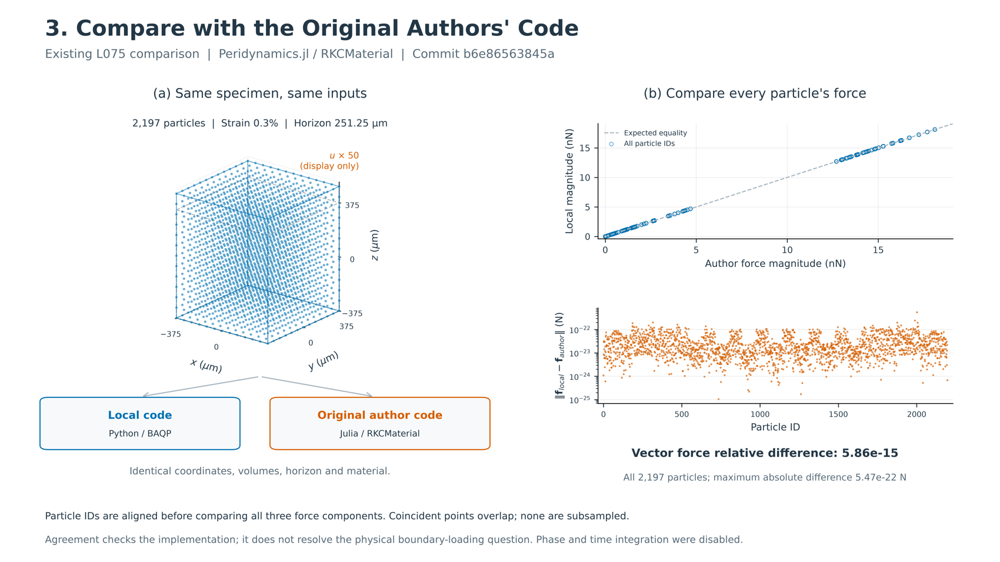

# 3. Compare with the Original Authors' Code

Two data-backed schematics address the supplied slide points: **the same numerical specimen evaluated by both codes**, and **force compared on every particle**. Outputs comprise two individual figures and one 16:9 combined figure in PDF, SVG and 600-dpi PNG, plus a self-contained interactive 3D force comparison. All figure text is English. The broader publication-figure collection remains paused.

[Combined PNG](output/figures/author_code_comparison_two_points.png) · [Combined PDF](output/figures/author_code_comparison_two_points.pdf) · [Editable SVG](output/figures/author_code_comparison_two_points.svg) · [Interactive 3D comparison](output/figures/particle_force_comparison_interactive.html)



## Individual figures

| Supplied point | Figure | Evidence |
|---|---|---|
| Same test clot run in both codes | [PNG](output/figures/01_same_specimen_two_codes.png) / [PDF](output/figures/01_same_specimen_two_codes.pdf) / [SVG](output/figures/01_same_specimen_two_codes.svg) | All 2,197 particles shown in 3D; exported reference coordinates, deformed coordinates and nodal volumes match the local arrays exactly. |
| Force on every particle compared | [PNG](output/figures/02_every_particle_force_comparison.png) / [PDF](output/figures/02_every_particle_force_comparison.pdf) / [SVG](output/figures/02_every_particle_force_comparison.svg) | All 2,197 particle IDs and 6,591 force components retained; magnitude parity and full-vector differences are both shown. |

The numerical specimen is **L075**, a 750 µm cube with 62.5 µm spacing, interaction horizon 251.25 µm and engineering strain 0.003. The three-dimensional figures use every particle, with displacement magnified 50 times for display and explicitly labeled. Gray dashed outlines show the original boundary. The two clouds in the input figure depict the verified common input state; they are not independently solved displacement predictions. Geometry is a numerical coupon, not an anatomical clot reconstruction.

## Which author code was used

The archived comparison invoked the existing **Peridynamics.jl / RKCMaterial** package at the fixed commit:

`b6e86563845a83b5cb06c805af19a817bde6b106`

The wrapper uses `RKCMaterial(kernel=quadratic_kernel, model=SaintVenantKirchhoff(), monomial=:C1, epsilon=0)`, with the same horizon, nodal volumes, quadratic influence kernel and frozen material μ = 1000 Pa, bulk = 666.6666666666666 Pa (λ = 0). The local kernel defaults and geometry construction are retained as read-only provenance.

This was an **intact affine evaluation**, with phase disabled. The archived wrapper constructs a `VelocityVerlet` object to initialize storage, then calls the force-density calculation; it never calls `submit!` or performs time integration. This plotting task **does not rerun either implementation**. It reads the saved outputs and recomputes only comparison statistics.

## Matching the inputs and particle IDs

The plotting loader checks exact array equality between the local saved state and the author's CSV inputs for:

- Reference particle coordinates X.
- Prescribed deformed coordinates x.
- Nodal volumes V.

It separately checks equality of the saved horizon, shear modulus and bulk modulus. All six checks pass. The shared deformation includes the bottom-fixing translation used by the archived L075 run. For visualization only, `x_display = X + 50*(x − X)`.

Author rows are mapped back to original particle IDs using `julia_ids.csv`. The file uses one-based IDs; the loader subtracts one, checks that the IDs form a complete permutation, and scatters force rows into that ordering. It does not rely on file rows happening to share the same order.

The author output `julia_force.csv` contains **nodal forces in newtons**, because the saved Julia wrapper multiplies `storage.b_int` by `system.volume` before export. Force density is not compared directly with the local nodal force.

## What the force figures show

The parity plot contains one point per particle, comparing the magnitudes of the two force vectors in nanonewtons. Identical or nearly identical values overlap; no points are removed. The dashed line is the expected equality line, not a fit.

Magnitude agreement alone could conceal a direction mismatch. Therefore, the second plot shows the actual complete-vector difference for every particle:

\[
e_i=\|\mathbf f_i^{local}-\mathbf f_i^{author}\|_2.
\]

Its vertical axis is in newtons on a logarithmic scale. Every saved difference is positive, so no artificial floor is inserted. There is no archived per-particle absolute tolerance; no arbitrary threshold line is invented for this plot.

The aggregate statistic uses the full three-component field:

\[
e_{relative}=\frac{\sqrt{\sum_i\|\mathbf f_i^{local}-\mathbf f_i^{author}\|_2^2}}
{\sqrt{\sum_i\|\mathbf f_i^{local}\|_2^2}}.
\]

It is not an average of per-particle relative errors. This avoids dividing by individual near-zero force vectors.

| Quantity | Reproduced result |
|---|---:|
| Particles compared | 2,197 |
| Force components compared | 6,591 |
| Full-field relative force difference | 5.861129936374264e−15 |
| Maximum per-particle absolute vector difference | 5.470516166108728e−22 N |
| Maximum local particle-force magnitude | 1.8108292410298127e−8 N |
| Particle ID with largest absolute difference | 2002 |
| Geometrically full-family core | 27 particles |
| Core relative force difference | 2.3221767616914647e−14 |

The full-field and core relative differences reproduce the existing `COMPARISON.json` statistics. They support numerical agreement with the pinned author implementation in this state. They do **not** establish correct physical boundary traction, mesh convergence, fracture behavior or physical clot rupture. The latest finite-domain root cause remains `INCONCLUSIVE`. Geometrically full families do not imply a closed multi-hop force-dependency stencil.

## Interactive view

Open [particle_force_comparison_interactive.html](output/figures/particle_force_comparison_interactive.html) in a browser, rotate the three-dimensional cloud and hover over any particle to inspect:

- Original particle ID.
- Local force (fx, fy, fz), in N.
- Author force (fx, fy, fz), in N.
- Absolute vector difference, in N.
- Actual, unmagnified z coordinate.

Buttons switch the coloring between local axial force, author axial force and full-vector difference. Both axial-force views use exactly the same symmetric color range; the difference view uses its own explicitly labeled N scale. Positions use the same declared 50× displacement magnification as the static figures. The HTML bundles its plotting library and requires no plotting server.

## Sources and reproducibility

All source paths are relative to `clot_clearance/`:

- `verification/pfpd_baqp_finite_domain_boundary_consistency_v1/L075/AFFINE_STATE.npz`: local coordinates, volumes, force vectors and core mask.
- `verification/pfpd_baqp_finite_domain_boundary_consistency_v1/L075/SUMMARY.json`: case geometry and frozen material.
- `verification/pfpd_baqp_finite_domain_boundary_consistency_v1/author_L075/COMPARISON.json`: archived package identity, pinned commit, statistics and evaluation scope.
- The same `author_L075/` directory: `input_X.csv`, `input_x.csv`, `input_volume.csv`, `input_parameters.csv`, `julia_ids.csv`, `julia_force.csv`, `RUN.log`.
- `scripts/finite_domain_author_oracle.py` and `scripts/finite_domain_author_oracle.jl`: existing comparison, ID remapping and force-density-to-force conversion, read without execution.
- `pd_clot/pfpd_candidate/kernel.py` and `pd_clot/pfpd_candidate/boundary_force_diagnostics.py`: local kernel and specimen construction, read-only provenance.
- `verification/pfpd_baqp_finite_domain_boundary_consistency_v1/SUMMARY.json`: current interpretation limit.

[Source and validation manifest](output/manifests/SOURCE_AND_VALIDATION.json) records exact input checks, selected-source SHA256 hashes, ID mapping, force definitions and statistics. Source hashes must remain unchanged after generation. No old manifest, production model, test assertion or scientific result is modified.

Exported data:

- [All per-particle inputs, force vectors and differences](output/tables/all_particle_force_comparisons.csv)
- [Exact input identity checks](output/tables/common_input_identity.csv)
- [Comparison metrics](output/tables/comparison_metrics.csv)

To reproduce from the `clot_clearance/` root, using the existing NumPy/Matplotlib/Pillow/Plotly environment:

```bash
OPENBLAS_NUM_THREADS=1 OMP_NUM_THREADS=1 PYTHONDONTWRITEBYTECODE=1 \
MPLCONFIGDIR=/tmp/clot_author_schematics_mpl_20261005 \
/home/lzy/projects/computation_examples/_shared/python_environment/bin/python -B \
analysis/author_code_comparison_schematics/make_schematics.py
```

Files ending `_preview.png` are reduced viewing copies; unsuffixed PNG files are the 600-dpi originals.

## English captions

**Combined figure.** Comparison of the local BAQP implementation with the pinned Peridynamics.jl RKCMaterial implementation for the existing L075 intact affine state. (a) The same coordinates, nodal volumes, horizon and material are supplied to both codes; the displayed three-dimensional displacement is magnified 50 times. (b) Force magnitudes and complete-vector differences are compared for every particle after aligning IDs. The full-field relative force difference is 5.86 × 10⁻¹⁵, with maximum per-particle absolute difference 5.47 × 10⁻²² N. This agreement verifies the cross-implementation correspondence for the saved state, not the physical interpretation of the finite-domain loading.

**Same specimen in both codes.** The two three-dimensional clouds depict the exactly matching input state for the local Python code and pinned author Julia package. All 2,197 particles are retained, with 0.3% actual engineering strain and displacement magnified 50 times for display. The reference coordinates, deformed coordinates and nodal-volume arrays match exactly, and horizon and material parameters are shared. These are prescribed affine inputs rather than independent equilibrium solutions or anatomical clot geometries.

**Force on every particle.** Force-magnitude parity is supplemented by complete-vector differences for all 2,197 particle IDs, encompassing 6,591 components. Magnitudes are shown in nN and absolute vector differences in N; coincident points overlap without subsampling. The aggregate relative error uses the Euclidean norm of the entire force field, rather than dividing by individual near-zero forces. Agreement with the author implementation does not by itself resolve the physical boundary-condition question.
