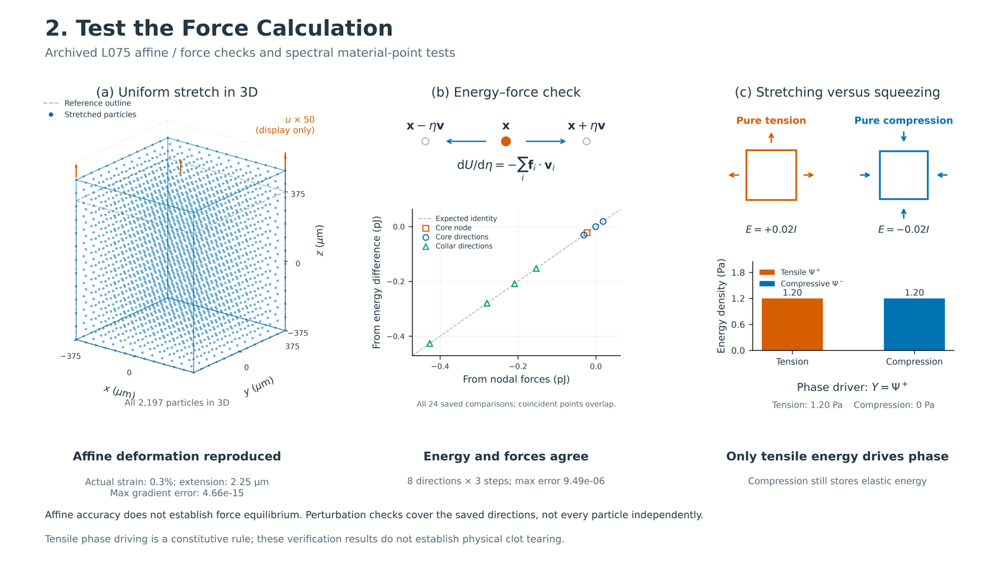

# 2. Test the Force Calculation — data-backed schematics

Three schematics correspond to the supplied slide bullets. The deliverable includes three separate figures and one 16:9 combined figure, each in PDF, SVG and 600-dpi PNG. The uniform-stretch panel now uses a full three-dimensional view, and an offline interactive 3D version supports rotation and actual/display displacement switching. Figure text and captions are English. The earlier full publication-figure collection remains paused.

[Interactive 3D uniform stretch](output/figures/01_uniform_stretch_interactive.html) · [Combined PNG](output/figures/force_calculation_three_points.png) · [Combined PDF](output/figures/force_calculation_three_points.pdf) · [Editable SVG](output/figures/force_calculation_three_points.svg)



## Individual figures and correspondence

| Original point | Figure | What the archived evidence supports |
|---|---|---|
| Stretch evenly → deformation measured exactly | [Uniform stretch PNG](output/figures/01_uniform_stretch.png) / [PDF](output/figures/01_uniform_stretch.pdf) / [SVG](output/figures/01_uniform_stretch.svg) | The existing L075 affine deformation gradient is reconstructed to floating-point accuracy. |
| Nudge each particle → forces match stored energy | [Energy–force check PNG](output/figures/02_energy_force_consistency.png) / [PDF](output/figures/02_energy_force_consistency.pdf) / [SVG](output/figures/02_energy_force_consistency.svg) | The saved eight perturbation directions, each at three step sizes, agree with the directional energy derivative. This is not an exhaustive independent perturbation of every particle coordinate. |
| Stretching vs squeezing → only stretching tears the clot | [Spectral split PNG](output/figures/03_tension_compression_split.png) / [PDF](output/figures/03_tension_compression_split.pdf) / [SVG](output/figures/03_tension_compression_split.svg) | The tensile spectral energy drives phase; pure compression retains elastic energy and has zero tensile driver. These checks do not establish physical clot tearing. |

## Data and display choices

### Uniform stretch

The archived L075 specimen has 2,197 particles, side length 750 µm and spacing 62.5 µm. Its prescribed deformation is

\[
F=\operatorname{diag}(1,1,1.003),\qquad
x=FX+(0,0,\epsilon L/2)^T,\qquad \epsilon=0.003.
\]

The translation fixes the bottom plane. The actual end-to-end extension is **2.25 µm**. The figure displays all **2,197 particles in three-dimensional space**, with no slicing or particle subsampling. The gray dashed box denotes the reference boundary; the blue points and outline depict the deformed configuration. Projection may overlap or occlude some markers. No points are invented or interpolated.

Because the actual displacement is small relative to the specimen, displayed deformed positions are

\[
x_{display}=X+50(x-X).
\]

The figure explicitly labels the **50× displacement magnification**; its displayed vertical coordinates are not the unmagnified deformed coordinates. Reference coordinates and actual displacements remain in the exported table. Blue filled dots show all magnified three-dimensional positions, and the gray dashed outline shows the original specimen boundary. The orange arrow indicates the loading direction; its length is not a measured force.

The [interactive HTML](output/figures/01_uniform_stretch_interactive.html) is self-contained and can be opened in a browser without an external plotting server. Drag to rotate, scroll to zoom, and use the buttons to switch between **actual displacement ×1** and **display displacement ×50**. Hovering on a particle shows its ID, displayed coordinates, actual z coordinate and actual axial displacement. The data are the same archived 2,197-particle state; no intermediate simulation states are generated.

The maximum componentwise difference between the saved particle reconstruction `Fbar` and prescribed `F` is **4.6629367034256575e−15**. The independently archived bond reconstruction `Ftilde` has the same maximum error. The figure's gradient-error label refers to `Fbar`. Accurate affine kinematics does **not** establish force equilibrium under surface-only loading: the latest finite-domain root cause remains `INCONCLUSIVE`.

### Energy and force

All 24 entries in the existing `FIRST_VARIATION.json` are plotted, without selecting only the best step. Their comparison is

\[
\frac{U(x+\eta v)-U(x-\eta v)}{2\eta}
\quad\text{versus}\quad
-\sum_i f_i\cdot v_i.
\]

There is one core-node direction, three core-region directions and four collar-region directions. Each uses the existing step sizes **1e−4, 3e−5 and 1e−5**. Since η is dimensionless and v has length units, both plotted quantities have energy units; the axes convert joules to picojoules.

The largest archived relative error among all 24 comparisons is **9.490911081173342e−6**. The original gate, extracted from `fd_probe` in the existing audit source, is **min(error across three steps) < 2e−5 for each direction**. All 24 entries also happen to lie below that threshold. The original error normalization is preserved, including its small reference-energy floor. The dashed line is the theoretical equality line, not a fitted result. Nearly coincident points overlap at this scale.

The three position symbols above the chart explain a perturbation and are explicitly schematic; they do not depict newly computed particle trajectories or claim a particular archived particle ID. No new derivative evaluations or mechanics solves are run.

### Tensile and compressive energy

The figure selects existing **hydrostatic tension and compression material-point cases** with μ = 1000 Pa and λ = 0, matching the frozen candidate material. Their Green strains are

\[
E_{tension}=+0.02I,\qquad E_{compression}=-0.02I.
\]

These are Green-strain values, not exactly ±2% engineering strain. The small deformation glyphs use the corresponding principal stretches \(\sqrt{1+2E_{aa}}\), directly reconstructed from the existing input definition. Gray dotted outlines denote the unit reference cell. The arrows indicate tension or compression; they do not encode measured forces. These are material-point illustration glyphs, not new specimen simulations.

| Archived material-point case | Tensile energy Ψ⁺ (Pa) | Compressive energy Ψ⁻ (Pa) | Phase driver Y = Ψ⁺ (Pa) |
|---|---:|---:|---:|
| Hydrostatic tension | 1.2000000000000022 | 0 | 1.2000000000000022 |
| Hydrostatic compression | 0 | 1.2000000000000022 | 0 |

The implemented candidate rule is

\[
\Psi(F,s)=(1-s)^2\Psi^+(F)+\Psi^-(F),\qquad Y=\Psi^+(F).
\]

This means the compressive energy is retained, rather than treating compression as zero stored energy. Mixed or shear states can contain tensile spectral energy and therefore are not covered by a blanket “compression cannot cause damage” statement. A separate existing BAQP uniform-compression fixture at \(F=0.99I\) records zero driver and zero phase increase; that distinct fixture is checked for consistency but is **not** substituted for the ±0.02I material-point bars. Physical rupture, instability and calibrated clot failure are not assessed by these figures.

## Exact sources

All paths below are relative to `clot_clearance/`:

- `verification/pfpd_baqp_finite_domain_boundary_consistency_v1/L075/AFFINE_STATE.npz`: actual `X`, `x`, `Fbar`.
- `verification/pfpd_baqp_finite_domain_boundary_consistency_v1/L075/SUMMARY.json`: affine strain, geometry, material, reconstruction-error statistics.
- `verification/pfpd_baqp_finite_domain_boundary_consistency_v1/FIRST_VARIATION.json`: all archived directional energy–force comparisons.
- `scripts/finite_domain_boundary_audit.py`: historical perturbation definition, normalization and acceptance threshold; inspected without importing or running the audit.
- `verification/pfpd_at1_spectral_split_v1/constitutive/VERIFICATION.json`: spectral energies for the two archived material-point cases.
- `scripts/spectral_split_audit.py`: existing `tensor_cases()` input definitions; only this small NumPy input function is extracted using AST, without importing or executing the audit pipeline.
- `pd_clot/pfpd_candidate/svk_spectral_split.py`: implemented energy degradation and phase-driver definition, read-only source provenance.
- `verification/pfpd_at1_spectral_split_v1/constitutive/BAQP_SMALL_FIXTURES.json`: independent saved pure-compression no-phase-increase check.
- `verification/pfpd_at1_evolution_v1/provenance/PREDECLARED_CONFIG.json`: frozen material.
- `verification/pfpd_baqp_finite_domain_boundary_consistency_v1/SUMMARY.json`: current finite-domain interpretation limit.

The older spectral audit is used only for still-applicable constitutive tests, not for its superseded C5/C7 branch status.

## Traceability and validation

The [source/validation manifest](output/manifests/SOURCE_AND_VALIDATION.json) records SHA256 values, display transformations, actual numerical results and all rendered text. Selected source files are checked before and after generation; all must be unchanged.

Exported plotting tables:

- [All 2,197 particles: actual and displayed 3D coordinates](output/tables/affine_particles_3d.csv)
- [All 24 energy–force comparisons](output/tables/energy_force_all_probes.csv)
- [Spectral material-point cases](output/tables/spectral_material_point_cases.csv)

The script checks the affine map including its translation, matches the saved `Fbar` maximum error exactly, preserves all 24 directional checks, cross-checks the two existing spectral energies algebraically, checks source hashes and verifies PNG resolution and English figure text. These are extraction and artifact checks; no scientific campaigns, new physics, production changes, test-assertion edits or historical-manifest edits are made. All four final figures receive visual review. Files ending `_preview.png` are viewing derivatives; the unsuffixed PNGs are the 600-dpi originals.

## Reproduce

From `clot_clearance/`, use the existing Python environment with NumPy, Matplotlib, Pillow and Plotly:

```bash
OPENBLAS_NUM_THREADS=1 OMP_NUM_THREADS=1 PYTHONDONTWRITEBYTECODE=1 \
MPLCONFIGDIR=/tmp/clot_force_schematic_mpl_20261005 \
/home/lzy/projects/computation_examples/_shared/python_environment/bin/python -B \
analysis/force_calculation_schematics/make_schematics.py
```

## English captions

**Combined figure.** Verification of deformation reconstruction, energy–force consistency and tensile/compressive energy splitting in the current numerical candidate. (a) The full three-dimensional archived L075 particle cloud has 0.3% engineering strain and 2.25 µm end extension; the displayed displacement is magnified 50 times, while the reported reconstruction error uses the original data. (b) All eight archived perturbation directions at three step sizes compare energy differences with nodal-force work, supporting the first-variation consistency of the implemented discrete energy. (c) Existing hydrostatic material-point tests show that pure tension supplies the active spectral energy, whereas pure compression stores inactive elastic energy. These verifications do not establish affine force equilibrium or physical clot rupture.

**Uniform stretch.** All 2,197 particles of the archived L075 specimen are shown in three-dimensional space, together with a dashed reference-boundary outline. Displacements are magnified 50 times for visibility; the physical engineering strain remains 0.003. The maximum componentwise reconstruction error in Fbar is 4.66 × 10⁻¹⁵. This tests kinematic reproduction rather than the force equilibrium of the affine state.

**Energy–force consistency.** Existing centered energy-difference estimates are compared with the negative nodal-force work along eight saved perturbation directions. Each direction has three saved step sizes, and all 24 comparisons are displayed, with nearly coincident markers overlapping. The maximum archived relative error is 9.49 × 10⁻⁶; the historical per-direction acceptance threshold is 2 × 10⁻⁵. The perturbation glyphs are schematic, and the data do not represent an exhaustive per-particle coordinate test.

**Tensile/compressive split.** Archived hydrostatic material-point tests with Green strain ±0.02I have equal total energy density but allocate it to different spectral components. The tensile case has Ψ⁺ = 1.20 Pa, whereas the compressive case has Ψ⁻ = 1.20 Pa and Ψ⁺ = 0. The candidate phase driver is Y = Ψ⁺, while compressive elastic energy is retained. This constitutive distinction is not evidence of physical clot tearing or a universal rule for mixed loading.

## Three-dimensional revision

The user requested a three-dimensional uniform-stretch visualization. Both the standalone figure and panel (a) of the combined figure now use all archived particles. The former `affine_midplane.csv` is retained only as a historical export from the earlier 2D version and is no longer used by the current figures. The full 3D table supersedes it for this visualization. The interactive version uses the same positions and magnification convention.
