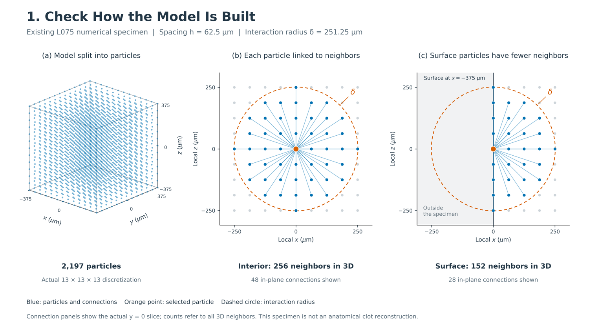

# Model-construction schematics from real project data

This deliverable replaces the active plotting task at the user's request. The broader publication-figure collection is paused. These schematics address the three supplied points: a model represented by particles, connections within a particle's neighborhood, and fewer neighbors at a surface.

[Combined PNG](output/figures/model_build_three_points.png) · [Combined PDF](output/figures/model_build_three_points.pdf) · [Editable vector SVG](output/figures/model_build_three_points.svg)



## Individual figures

| Supplied point | Figure | Actual content |
|---|---|---|
| Clot split into particles | [PNG](output/figures/01_particle_discretization.png) / [PDF](output/figures/01_particle_discretization.pdf) / [SVG](output/figures/01_particle_discretization.svg) | All 2,197 archived L075 particles; 13 × 13 × 13 lattice |
| Each particle linked to neighbors | [PNG](output/figures/02_interior_neighborhood.png) / [PDF](output/figures/02_interior_neighborhood.pdf) / [SVG](output/figures/02_interior_neighborhood.svg) | Center particle ID 1098; 256 three-dimensional neighbors; all 48 real connections in the y = 0 plane shown |
| Surface particles have fewer neighbors | [PNG](output/figures/03_surface_neighborhood.png) / [PDF](output/figures/03_surface_neighborhood.pdf) / [SVG](output/figures/03_surface_neighborhood.svg) | Face-center particle ID 84; 152 three-dimensional neighbors; all 28 real connections in the y = 0 plane shown |

## What the figures represent

The source is the existing **L075 numerical coupon**, with side length 750 µm, spacing 62.5 µm and interaction radius δ = 251.25 µm. This case was selected because it contains both a geometrically complete interior family and a truncated surface family. The schematic uses its archived coordinates; no anatomical clot contour is invented.

The selected interior particle is at (0, 0, 0) µm and the surface particle is at (−375, 0, 0) µm. The surface particle has 40.625% fewer neighbors than this interior particle. These are counts for the selected positions in this specimen, not universal surface or clot properties. A full geometric family does not establish closure of the complete BAQP force-dependency stencil.

The orange point is the selected particle. Blue points and lines are real particles and their in-plane connections; gray points are real particles outside that selected neighborhood. The dashed circle is the interaction sphere's intersection with the displayed plane. The shaded region in the surface panel lies outside the specimen; no particles or links are fabricated there. Local x/z coordinates subtract the selected particle's position; the actual slice is y = 0 in both panels. Collinear connections can overlap visually. Three-dimensional counts include neighbors outside the displayed plane and exclude the selected particle itself.

The cube outline connects the actual extrema. All 2,197 particles are rendered in the three-dimensional panel, although projection and occlusion can overlap their marks. Particle marker sizes are graphical symbols, not physical particle radii. The supplied phrase “Clot split into particles” is rendered as “Model split into particles” to reflect the numerical specimen used by the current candidate.

## Sources and extraction

Paths below are relative to the `clot_clearance/` project root:

- `results/pfpd_baqp_finite_domain_boundary_consistency_v1/tables/L075_particles.csv`: IDs, coordinates, archived neighbor counts, full-family flags.
- `verification/pfpd_baqp_finite_domain_boundary_consistency_v1/L075/SUMMARY.json`: geometry, spacing, horizon, particle and bond totals.
- `pd_clot/pfpd_candidate/boundary_force_diagnostics.py`: existing `make_cube` geometric neighbor rule, inspected read-only.

Only lightweight geometric extraction is performed: `cKDTree.query_pairs(delta)` on the archived coordinates. It reproduces **all 2,197 archived neighbor counts** and the **196,064 archived unordered bonds** exactly. No force, phase, equilibrium, activation or stability calculation is run.

The [source and validation manifest](output/manifests/SOURCE_AND_VALIDATION.json) records source SHA256 hashes, selected IDs and exact coordinates, counts, display transforms, figure text and validation outcomes. Source hashes are checked before and after generation and must remain unchanged. Extracted [particles](output/tables/particles.csv), [selected particles](output/tables/selected_particles.csv) and [selected neighbor links](output/tables/selected_neighbor_links.csv) preserve the plotted data.

## Reproduction

From the `clot_clearance/` root, using Python with NumPy, SciPy, Matplotlib and Pillow:

```bash
OPENBLAS_NUM_THREADS=1 OMP_NUM_THREADS=1 PYTHONDONTWRITEBYTECODE=1 \
MPLCONFIGDIR=/tmp/clot_schematic_mpl_20261005 \
/home/lzy/projects/computation_examples/_shared/python_environment/bin/python -B \
analysis/model_build_schematics/make_schematics.py
```

The script writes three individual schematics and one 16:9 combined figure, each as PDF, SVG and 600-dpi PNG. Files ending `_preview.png` are smaller viewing derivatives and are not the publication originals. All figure text is English.

## English caption

**Particle discretization and finite neighborhoods in the existing L075 numerical specimen.** (a) All 2,197 particles of the archived 13 × 13 × 13 discretization are shown. (b) An interior particle has 256 neighbors within the 251.25 µm interaction radius; the actual y = 0 section contains the 48 displayed connections. (c) The corresponding face-center particle has 152 three-dimensional neighbors and 28 connections in the same plane because part of its interaction sphere lies outside the specimen. The surface-to-interior difference illustrates geometric family truncation in this numerical coupon; it is not an anatomical clot reconstruction or a fracture prediction.
