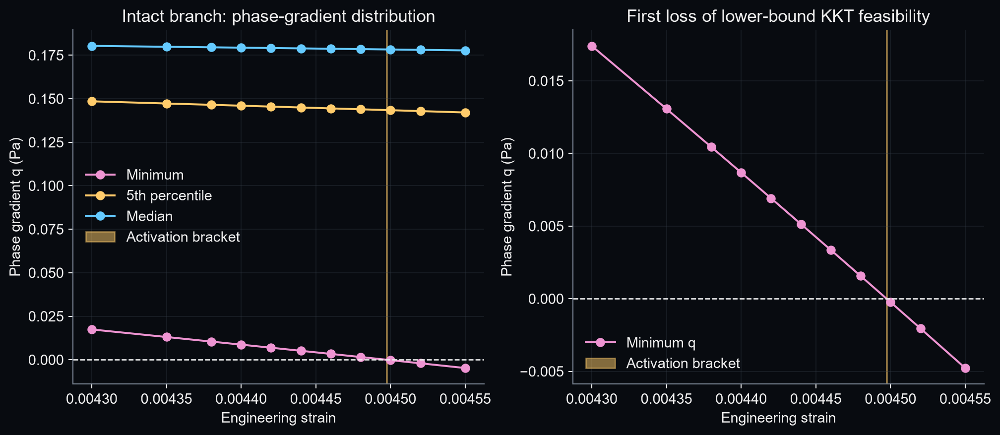
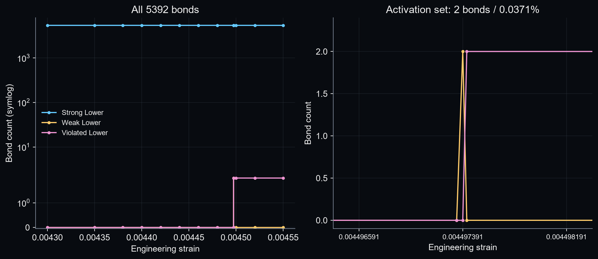
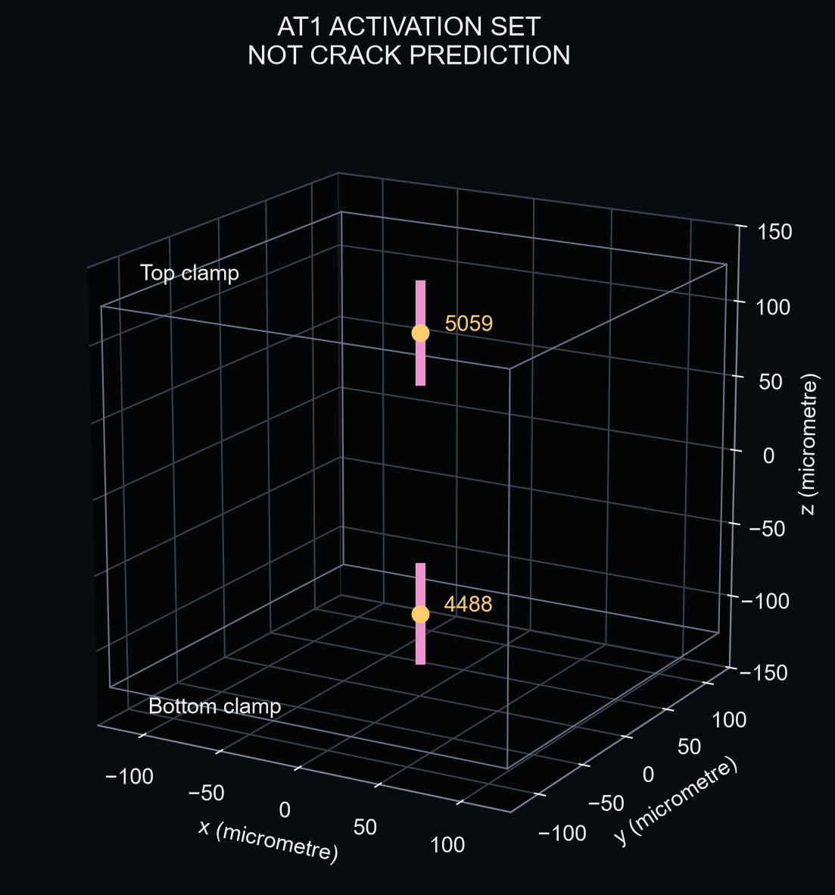
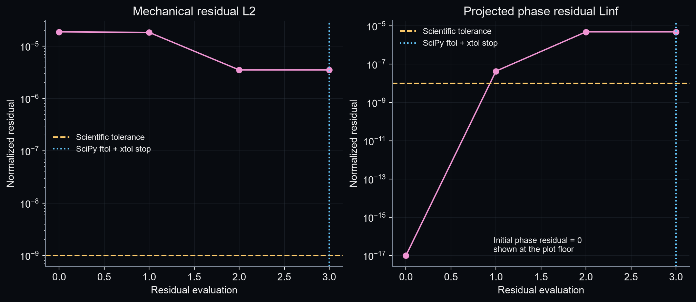
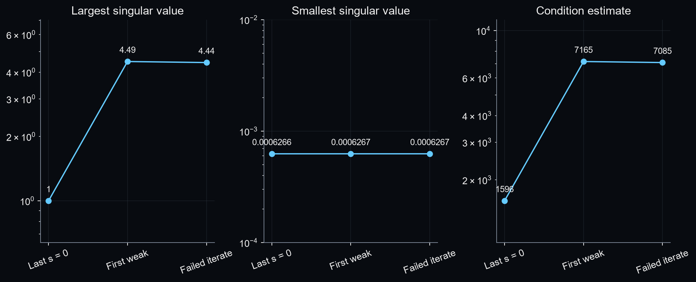
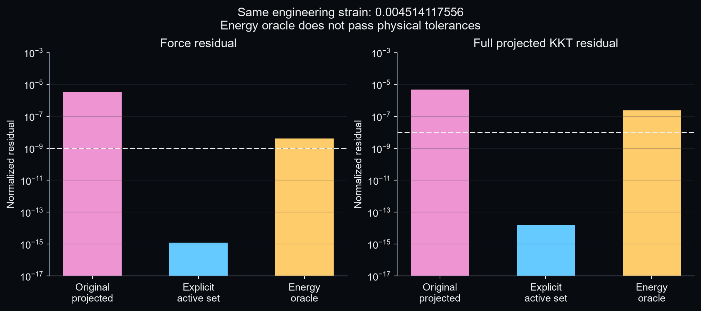
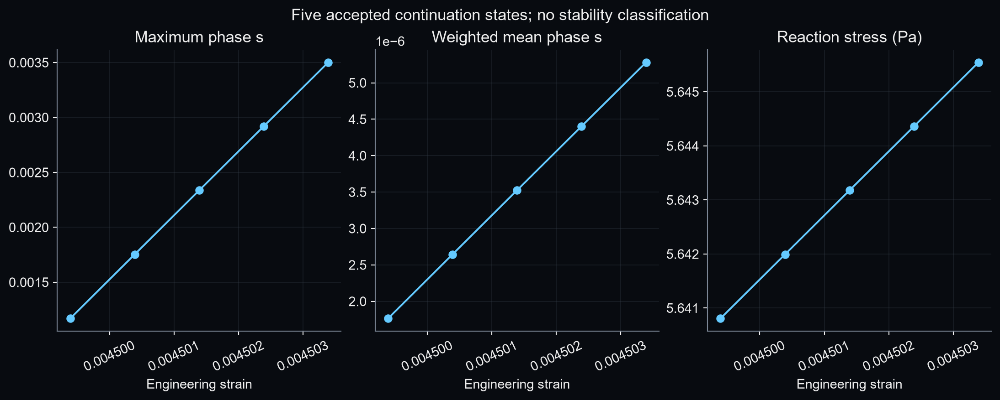

# C5 activation stationarity 审核报告

结论：在审计邻域内找到了通过原 force、KKT、inactive inequality、bounds、irreversibility 和 safety 检查的正相场 stationary roots；原失败载荷也直接找到合法根。五个固定小步长 continuation states 提供了独立邻近载荷支持，C5_COUPLED_STATIONARITY = RESOLVED。此结论只解决 stationary root 的存在性，未评估稳定性。

Repository：`/home/lzy/projects/temp_storage/clot_clearance_github_sync_20260930`；HEAD：`f0e891686b9b107510ab3292aa27ce83638b3339`。新增内容只在审计脚本、诊断 wrapper、测试和本轮结果目录。Production、历史结果、既有测试均未修改。

## 1. 上一轮到底卡在哪里

上一轮已经验证谱分裂和 C5 完整态混合拉压平衡。困难出现在相场开始增大时：ε≈0.004514117556 的 projected-KKT + dogbox/lsmr 求解器返回 ftol/xtol success，但 force≈3.52e−6、KKT≈4.90e−6，没有达到 1e−9 / 1e−8。

本轮先重新读取 last accepted `C5_W_004` 和三次失败结果 `C5_A_001/C5_W_005/C5_P_005`。能量、force、KKT、q 和 Ψ+ 均按预声明门槛复现。归档没有独立 Ψ+ 数组的旧 coupled state，以旧 q_scaled 和 s 的明确公式反解 Ψ+，再与重新评价比较；这不是额外的构成 oracle。证据在 `reproduction/ALL.json`。

## 2. 什么是 phase activation

s=0 表示当前完整相场；s 开始增大称为 AT1 activation。这个词只说明某些内部变量开始偏离下界，不能直接解释为裂纹形状、裂纹传播或失稳。本轮首先定位的是 lower-bound KKT activation bracket，不是 fracture stability bracket。

## 3. 什么是 q

在既有 AT1 定义中，q=−2(1−s)Ψ+ + 2Yc，是相场增加一个小量时的能量变化方向，已去掉正的 BAQP 权重。s=0 时 q=2(Yc−Ψ+)。若 q>0，增加 s 会先提高能量，下界可满足 KKT；q≈0 是候选激活；q<0 表示保持 s=0 已不满足下界不等式。

原缩放 D_b=max(Ψ+_b,Yc)，q_scaled=q/D。weak tolerance 沿用 1e−7，故每根键的有量纲 q_active_tol=1e−7 D_b；s_tol=1e−8。最终 projected KKT tolerance 仍为 1e−8，force tolerance 仍为 1e−9。没有按结果改变容差。

## 4. 为什么先检查 s=0 branch

关闭 phase updates 后，只要求力学平衡，再计算 q，就能把“完整态何时失去相场下界可行性”与“通用 coupled optimizer 是否能处理投影分支”分开。先执行指定 11 个载荷，再局部二分，未进行 0–1% 高密扫描。每个点复用原固定相场 ADR 和正式 spectral Ψ+；所有被使用的 intact states 均通过原力、边界、正 J 和 safety 检查。

## 5. activation bracket

下端 εL=0.004497343750，min(q)=4.237364858e-06 Pa；上端 εU=0.004497421875，min(q)=-2.808218823e-06 Pa。区间宽度 7.812500000e-08，局部二分 8 层，达到 ≤1e−7。

为了审计 first weak state，在此有效区间内用 SciPy brentq 对“已平衡的 min(q)”做标量定位，得到 ε≈0.004497390736212，min(q)=-1.351697e-14 Pa，2 根 weak bonds。它只是补充弱分支诊断点，不替代前述有符号两端区间。`activation/BRACKET.json` 保存每步收缩；每点 q percentiles、q<0 IDs、weak IDs、max(Y/Yc) 和完整数组均归档。



## 6. 多少 bonds 首先激活

最先激活 2 / 5392 根键，比例 0.037091988%。最后 strong-lower endpoint 为 5392 strong；weak point 为 5390 strong + 2 weak；第一个上端点为 5390 strong + 2 violated。候选集合是少数局部键，非整层、非大量同步激活。A1:q<0、A2:q_scaled≤1e−7、A3:前两集合加共享端点且 q_scaled≤1e−3 的近阈值键，三者实际都选中同两根键；不是三套不同的独立集合证据。



## 7. activation 在哪里

键 ID 4488、5059，reference midpoint 分别为 (0,0,−93.75) µm 与 (0,0,93.75) µm，方向均为 z 轴。它们分别连接中心轴附近的夹持节点与内侧相邻节点；中点到最近夹持面 31.25 µm，到侧面 125 µm。弱点 Ψ+≈Yc=0.1010025 Pa。

空间分类为 LOCALIZED，准确含义是“两个夹持面附近的离散激活位置”。这既不是 crack prediction，也不是局部化失稳判据。三个选定状态的 IDs、orientation、midpoints、Ψ+、q 见 `activation/SPATIAL.json`。



## 8. projected KKT 为什么可能难解

令 t=s−q/D，r_s=s−clip(t,lower,sc)。当 t<lower 时 r_s=s−lower，dr_s=ds；当 lower<t<sc 时 r_s=q/D，dr_s=dq/D−q·dD/D²；当 t>sc 时 r_s=s−sc，dr_s=ds。dq=2Ψ+ ds−2(1−s)dΨ+；dD 在 Ψ+>Yc 时为 dΨ+，在 Ψ+<Yc 时为零。在 clip 的交界不能声称唯一普通导数；旧代码 exact tie 采用 interior-map 分支，保持未改。

| 状态 | lower-clipped | interior-map | upper-clipped | near kink ≤1e−7 |
| --- | --- | --- | --- | --- |
| A_last_accepted | 5392 | 0 | 0 | 0 |
| B_first_weak | 5390 | 2 | 0 | 2 |
| C_failed_coupled | 5390 | 2 | 0 | 0 |

每根键的 clip branch、到最近 switching surface 的距离、局部导数分支及 phase diagonal 保存到 `projected_map/`。激活点只有两个 near kinks，因此“大规模同步 residual kink”假设不受数据支持。

原 nonlinear solver 只复跑一次，初值严格采用归档 `C5_P_005/z_initial`，所有数值参数与 residual 不变。用可恢复 wrapper 记录 SciPy 原调用返回值：status=4，nfev=5，njev=4，cost=3.01784716e-11，optimality=1.94554245e-05，||Jᵀr||∞=1.94554245e-05。

最后一步 Δcost=0.0、step norm=0.0，xtol threshold=7.837194e-13，因此 ftol/xtol 同时触发；这两个停止条件本来就不保证本项目的 force/KKT 验收。[SciPy least_squares 文档](https://docs.scipy.org/doc/scipy/reference/generated/scipy.optimize.least_squares.html) 分别定义成本变化、步长和梯度停止条件。

额外只在最后 frozen iterate 重放一次既有线性求解与 SciPy dogleg_step，未重跑 nonlinear solver：重放步长 2.050956e-10，无约束线性候选步长 6.725033e-04，有 1 个已在 lower bound 的分量收到负向线性建议。具体 IDs、线性残差、边界信息在 `original_solver/FROZEN_LINEAR_STEP_REPLAY.json`。重放得到很小但非零的步长，未精确复现记录中的零步长；重新构造的有限差分算子及近零边界梯度会有数值敏感性。因此它只支持 bound-constrained step 受限的局部解释，不能据此断言唯一内部根因或 SciPy 库的普遍 bug。



## 9. Jacobian conditioning

仅审计 residual Jacobian，没有稳定性 Hessian 或 critical cone。存储 225 个 displacement columns 与 phase 对角/交叉块，约 29.5 MB，不建立 5392×5392 dense phase matrix。mechanical/Y 对 displacement 用原 mechanics/split 的中心差分，phase-only 与交叉块按已有能量梯度链式求导；与未改的 V2 Jv 做四方向对照，并验证伴随关系。reduced Jacobian 再以三档 epsilon 做独立 residual 有限差分，最大相对误差约 7.64e−7。

| 状态 | σmax | σmin | condition | 机械块 condition |
| --- | --- | --- | --- | --- |
| A_last_accepted | 1.0000027 | 0.00062655633 | 1596.0299 | 27.3339 |
| B_first_weak | 4.4898974 | 0.00062668379 | 7164.5342 | 27.3299 |
| C_failed_coupled | 4.440156 | 0.00062670164 | 7084.96 | 27.3272 |

使用成熟 [SciPy svds](https://docs.scipy.org/doc/scipy/reference/generated/scipy.sparse.linalg.svds.html)：最大奇异值直接求，最小值通过 compact Jacobian 的块逆求最大奇异值后倒数；225×225 块分解使用 SciPy LU，仅作线性诊断，未实现 nonlinear Newton。两端奇异向量均回代原 Jacobian/transpose 验证，残差远低于预声明 1e−6。

没有数值秩亏证据。WELL_CONDITIONED 标签是相对于预声明 condition≥1e8 的严重病态筛查阈值；并不表示条件数接近 1 或尺度已最优。failed iterate 的机械梯度贡献 ||Jxᵀrx||₂≈5.412546e-08，phase 贡献≈3.075760e-05，后者明显更大。row/column norms 的逐项数组和分位数已保存，不能只凭 block residual 大小推断优化权重。

| 状态 | 原 condition | 仅 row-normalized Jacobian condition |
| --- | --- | --- |
| A_last_accepted | 1596.03 | 11.8873 |
| B_first_weak | 7164.53 | 13.1469 |
| C_failed_coupled | 7084.96 | 13.1401 |

row normalization 只做 frozen Jacobian 诊断，没有改正式 residual，也没有用新的 scaling 宣布求解成功。数据支持尺度有差异；仅凭它不能把 ROOT_CAUSE 唯一归为 scaling。



## 10. explicit active-set reduced solve

inactive bonds 精确固定 s_I=previous accepted lower；未知量为 225 个 displacement variables 与候选 active phase variables，初始共 227 个未知量。方程为原 F_free/force_floor=0 与 q_A/Yc=0。q_A/Yc 是平滑 active 等式的诊断归一化；最终验收仍调用原 q/max(Ψ+,Yc) projected KKT，并额外检查全部 inactive inequalities。

真正 nonlinear solve 使用 SciPy least_squares 的 trf/exact；没有自写 Newton、line search 或 trust region。wrapper 只负责 active IDs、变量映射、固定 inactive 值、最多 10 次一致性更新。加入规则 q_I/D<−1e−8；移除规则 active 回到 lower 且 q_A/D>1e−8。规则与全部变化均保存。实际合法根沿用同两根 active bonds，未触发额外更新；这不影响完整 inactive 检查。

初猜只调用一次原 AT1 law，未改 irreversibility 下界。各 reduced run 保存 `SUMMARY.json/STATE.npz/ITERATIONS.json/HISTORY.json`。这套 wrapper 明确为 diagnostic，未替换原 branch solver。

## 11. 是否找到合法 stationary root

是。首次正相场根位于 ε=0.004498390736，max(s)=0.000585374863，active size=2，force=5.652677e-15，KKT=2.416828e-14，inactive violation=0。

| 载荷 | force | KKT | max s | active size | 结果 |
| --- | --- | --- | --- | --- | --- |
| 0.004498390736 | 5.6527e-15 | 2.4168e-14 | 0.0005853749 | 2 | VALID |
| 0.004499390736 | 1.8527e-15 | 2.7997e-14 | 0.001170079 | 2 | VALID |
| 0.004502390736 | 2.0142e-15 | 2.6578e-14 | 0.002920178 | 2 | VALID |
| 0.004507390736 | 1.4065e-15 | 6.1743e-14 | 0.005823718 | 2 | VALID |
| 0.004517390736 | 1.8267e-15 | 4.3458e-14 | 0.01158155 | 2 | VALID |
| 0.004547390736 | 1.2575e-15 | 3.4975e-14 | 0.02847272 | 2 | VALID |
| 0.004514117556 | 1.2621e-15 | 1.6057e-14 | 0.009704082 | 2 | VALID |

尤其在原失败的**同一应变** ε=0.004514117556，explicit active-set 得到 force=1.262082e-15、KKT=1.605660e-14，active size=2。因此不是通过调整 load step 宣布成功。

每个合法根同时通过 active q equality、inactive q inequality、0≤s<sc、逐键 irreversibility、严格固定边界、finite positive J 和原 safety 检查。相邻五个 continuation points 固定 Δε=1e−6，依次使用前一 accepted s 作为不可逆下界，全部合法；额外 root-existence queries 只覆盖 εactivation+[1,2,5,10,20,50]×1e−6。重复载荷复用已验收邻点，未扩展到 0.009。





## 12. independent complementarity/energy oracle

Fischer–Burmeister 未启用：explicit active-set 与相邻 continuation 已决定本轮 root-existence 问题，故 COMPLEMENTARITY_ORACLE=NOT_NEEDED。环境没有 petsc4py，也没有安装大型 PETSc stack。

由于 reduced root 与原 projected solve 在同一载荷的验收结论不同，额外执行**一次**原能量 Π 的 L-BFGS-B constrained monolithic reference，初值仍是原失败初值，而非把已知根喂给 minimizer。结果：NOT_PHYSICALLY_CONVERGED；optimizer message：CONVERGENCE: RELATIVE REDUCTION OF F <= FACTR*EPSMCH。force=4.101449e-09，KKT=2.420453e-07；相对 reduced root 的 max phase difference=1.447430e-08。若优化器 success 但未过完整门槛，同样不能接受。这里没有曲率审计，不声称已证明 local minimum。

## 13. 当前 root cause 分类

HYPOTHESIS A 获得支持：原 projected/bound-constrained 求解过程停滞，而同载荷平滑 active-set equations 有合法根。clip map 在 activation 确实非光滑，但只有两个局部 weak bonds；不支持“大规模同步激活导致退化”的叙述。

HYPOTHESIS B 的尺度差异被观察到，但没有通过改变 scaling 的 root 对照单独确证它为根因。HYPOTHESIS C 在已审计邻域不受支持：正 s roots 跨相邻固定载荷持续存在。HYPOTHESIS D 没有数值秩亏证据。更精细的 solver 内部根因仍需后续正式方法评估，不能把此次局部成功当成生产算法已修复。

```text
C5_ACTIVATION_AUDIT: COMPLETE
S0_KKT_ACTIVATION: BRACKETED
ACTIVATION_SET: LOCALIZED
PROJECTED_KKT_MAP: NONSMOOTH_ACTIVE_SET_TRANSITION
RESIDUAL_JACOBIAN: WELL_CONDITIONED
EXPLICIT_ACTIVE_SET_ROOT: FOUND
COMPLEMENTARITY_ORACLE: NOT_NEEDED
ROOT_CAUSE: PROJECTED_SOLVER_ACTIVE_SET_STAGNATION
C5_COUPLED_STATIONARITY: RESOLVED
C5_STABILITY: NOT ASSESSED THIS ROUND
C7_COUPLED: NOT RUN
PRODUCTION: UNCHANGED
```

## 14. tests

Baseline 一次：331 passed / 3 known failed / 0 skipped。Final 一次：350 passed / 3 known failed / 0 skipped。原三项 failure ID、message、traceback 与上一轮及本轮 baseline 完全一致，未 xfail、skip 或修改原测试。

- `tests.test_pfpd_at1_staggered::test_saved_coupled_mechanics_phase_and_energy_all_converged`
- `tests.test_pfpd_at1_staggered::test_coupled_no_bond_heals_on_unload_and_reload`
- `tests.test_pfpd_at1_staggered::test_extra_stagger_iterations_change_no_accepted_state_materially`

新增测试覆盖 q、分类、bracket 收缩、projection piecewise derivative、reduced assembly、inactive 精确固定、漏 active 的完整 KKT 拒绝、确定性更新、FD Jacobian、谱残差验证、optimizer 停止与物理验收区分、positive roots、irreversibility prefix 和同载荷对照。未重复 spectral oracle/random F/compression/shear/C3 Hessian/C7 campaign；既有检查只随开始和结束的完整测试运行。

保全：22326 个原有文件和 385 个符号链接逐项检查，changed=0、missing=0。Production modified=0；historical modified=0；existing tests modified=0。`provenance/PRE_RUN_MANIFEST.json`、`POST_RUN_MANIFEST.json`、`PRESERVATION_CHECK.json` 及全部测试日志归档。

## 15. CPU/GPU 使用

CPU 为 i7-13700HX，环境可见 12 physical / 24 logical cores；串行大 C5 solve，max_workers=1，至少保留 2 physical cores 和 20% RAM；BLAS/OMP/MKL=1，Numba 线程上限配置 10。本轮实际算子是 NumPy/SciPy CPU，未把线程配置当成 parallel-kernel 加速证明。

GPU 为 RTX 4060 Laptop 8 GB；无可直接使用的已验证 CuPy/JAX/Torch backend，未使用 GPU、未安装大 stack、未跑 GPU benchmark，加速比 N/A。

记录的 intact solves 共 33 个，累计 247.31 s；原 solver 一次 15.66 s；reduced solves 累计 459.07 s；三点 Jacobian/conditioning 累计 18.85 s。intact 进程峰值 RSS 317.2 MiB。上述是相应调用计时，不是假定的全任务 CPU 时间或并行加速比；原始硬件和分项计时见 `provenance/`。

## 16. 唯一下一步

人工审核后，单独评估适合正式 stationary tracking 的 active-set / variational-inequality 方法，以本轮同载荷 roots、inactive inequality 和不可逆 continuation prefix 为基准。保留原物理模型与 force/KKT 门槛，先形成可审查的正式求解方法验证，再决定是否接回空间稳定性审计。本轮不替换 production，不运行 C5 stability Hessian、C7 coupled branch 或任何新物理任务；到此停止。
