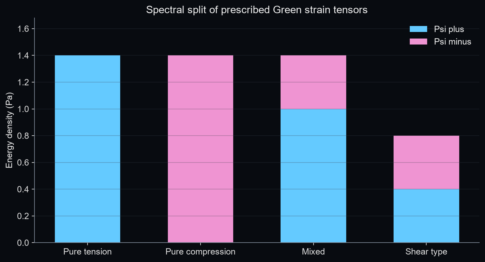
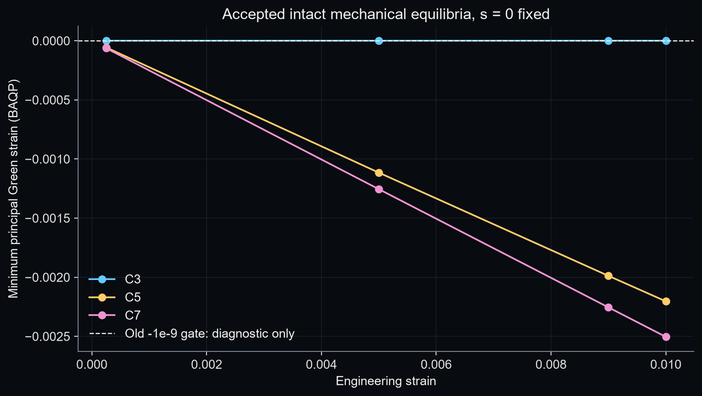
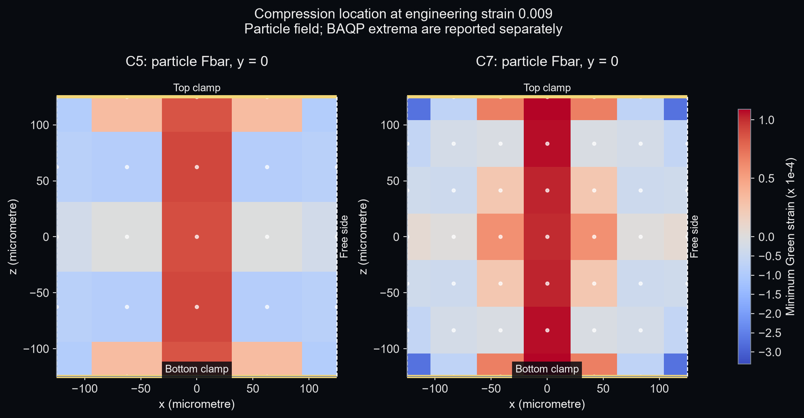
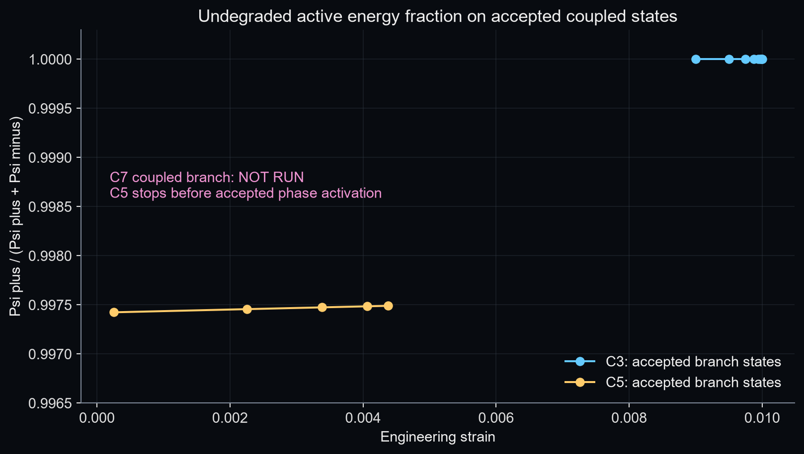
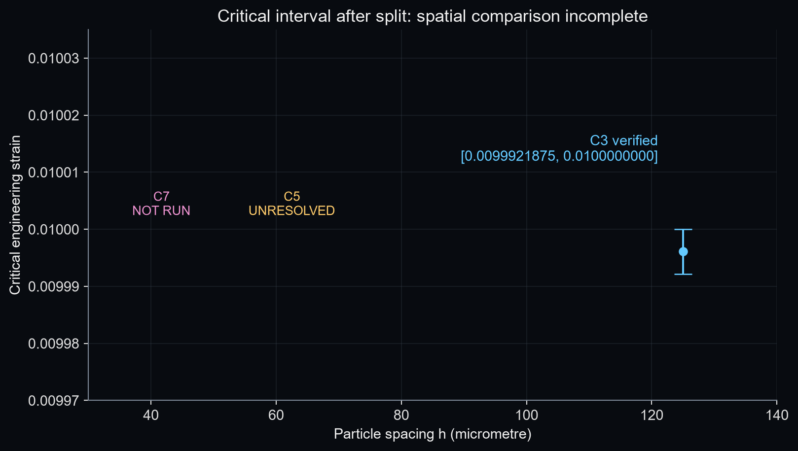
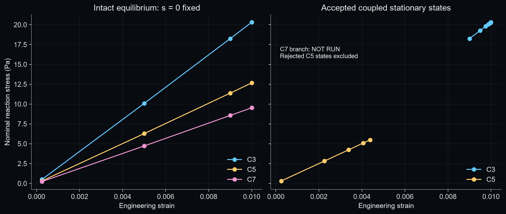

# PFPD_AT1_SPECTRAL_SPLIT_V1 审核报告

结论：Q1 为是，C3/C5/C7 共 12 个固定相场完整态全部达到原力平衡要求。Q2 部分通过：C3 临界区间完全复现；C5 在相场激活前已有合法 stationary states，但首次激活附近的 coupled solve 未通过 force/KKT；C7 按 gate 停止重型分支和稳定性计算。空间离散稳定性审计仍未完成。

Repository：`/home/lzy/projects/temp_storage/clot_clearance_github_sync_20260930`；项目目录：`/home/lzy/projects/temp_storage/clot_clearance_github_sync_20260930/clot_clearance`；HEAD：`f0e891686b9b107510ab3292aa27ce83638b3339`。本轮仅增加独立候选模块、审计脚本、测试和新输出目录，没有提交或替换 production。

## 1. 为什么 old pure-tension gate 不再合适

全局拉伸边界不保证每个 BAQP 局部 Green 张量三个主值均非负。旧候选把最小主值低于 −1e-9 的 trial 整体拒绝，阻止了细离散中的混合拉压完整态平衡。新候选按张量谱分解保留压缩弹性能，只退化拉伸能量，所以负主值可以作为合法诊断。旧 candidate 和旧测试的硬门槛保持原样，−1e-9 仍用于本报告负比例统计，不是新物理拒绝条件。

## 2. 使用了哪篇论文/开源实现

- [PhaseFieldX theory](https://phasefieldx.readthedocs.io/en/stable/theory/phase_field_fracture/main.html) 与 [energy-splitting example](https://phasefieldx.readthedocs.io/en/stable/auto_examples/Elasticity/plot_theory_anisotropic.html) 提供 Miehe spectral / Amor vol-dev 公式对照。实际源码固定 [a9714c122497f8829860efc68d776e4324d48eca](https://github.com/CastillonMiguel/phasefieldx/tree/a9714c122497f8829860efc68d776e4324d48eca)，MIT，`ORACLE_USED`。
- [Miehe et al. 2010](https://doi.org/10.1016/j.cma.2010.04.011)：仅采用拉压分裂概念；本轮未取到论文全文，公式以用户指定内容与 PhaseFieldX 可读源码核对。未引入 AT2、history field、残余刚度或谱平滑。
- [Rahimi & Moutsanidis 2022](https://doi.org/10.1016/j.cma.2022.115191)：全文未获得。只检查 [Stony Brook 文献元数据](https://researchconnect.stonybrook.edu/en/publications/a-smoothed-particle-hydrodynamics-approach-for-phase-field-modeli/)，不从摘要补写 Green/SVK 应力公式。
- [Nardi invariant split](https://github.com/deborahnardi/phase-field-invariant-split/tree/dadd9deae360d54807180d6ad6346e8bb9939636)：固定 `dadd9deae360d54807180d6ad6346e8bb9939636`，MIT。阅读 README、LICENSE 和 `src/getSpectralConstitutiveTensor.cpp`；例程依赖 Element/Solid/material/PETSc 及自定义张量工具，不是可直接编译的独立函数。本轮仅源码参考，`ORACLE_NOT_NEEDED`，未移植或声称数值对照通过。

PhaseFieldX oracle 只执行固定源码中的五个张量代数函数，以 NumPy 替代 UFL 标量/张量运算，以输入 E 替代 epsilon(u)；谱绝对值独立使用 scipy.linalg.sqrtm(E@E)。这不是完整 UFL 特征分解验证，更不是 finite-strain FEM solver equivalence。原源码、许可、SHA 和逐例结果见 `references/`；没有 vendor FEM solver。Amor 只保留 tensor 对照表，没有第二套候选 campaign。

## 3. spectral split 是什么

E = (FᵀF − I)/2 = Q diag(e) Qᵀ；E± = Q diag(max/min(e,0)) Qᵀ。

注意体积项用的是 max/min(tr(E),0)，不是 tr(E±)。

Ψ± = λ〈tr E〉±²/2 + μ tr(E±²)；S± = λ〈tr E〉±I + 2μE±。

Ψ(F,s) = (1−s)²Ψ+ + Ψ−；S(F,s) = (1−s)²S+ + S−；P = FS。

AT1 的 Y = Ψ+，q = −2(1−s)Ψ+ + 2Yc。仍采用原 AT1 irreversibility、sc=0.95、h=1、c0=0.25、delta=0.25125 mm、Gc_demo=1.26884390625e-5 J/m²、Yc=0.1010025 Pa。原材料 μ=1000 Pa、bulk=666.6666666666666 Pa、λ=0；用于构成验证的额外 bulk=2300 Pa 仅是非零 λ 测试输入，不用于 cube 计算。

新增 `pd_clot/pfpd_candidate/svk_spectral_split.py` 提供全部要求 API。审计通过串行、可恢复的 constitutive callback 复用原 BAQP 装配，外层 g=1，避免重复退化；原 state.W0 在该候选中只是 Ψ+ 的兼容别名。能量和力来自已正确分裂、退化的 Ψ/P。旧 BAQP/ADR/branch/KKT/HVP/cone/localization 源码未修改。该 scoped callback 不是线程安全生产接口，本轮始终串行调用。

## 4. 为什么 s=0 时 intact mechanics 不变

E=E++E−，谱正负部分正交，且 〈tr E〉+²+〈tr E〉−²=(tr E)²，因此 Ψ++Ψ−=Ψ0、S++S−=S0。g(0)=1，于是 P=F(S++S−)=P0。

128 个 deterministic、det(F)>0 的随机 F 同时比较 energy/S/P，最大归一化误差 2.621136e-15，通过 2e-12 门槛。此后 s=0 ADR 复用原 SVK 力回调；最终状态另用新 split 重新评价并诊断，不改变完整态问题。

## 5. constitutive verification

8 类 Green 张量包括 pure tension/compression、mixed、shear、hydrostatic tension/compression、repeated eigenvalues、near-zero；分别用原材料和非零 λ 材料验证。

| 检查 | 最大误差 | 门槛 |
| --- | --- | --- |
| Ψ 分解 | 4.163336e-16 | 2e-12 |
| S 分解 | 3.555796e-16 | 2e-12 |
| 能量方向导数 | 1.783158e-08 | 5e-6 |
| s=0 invariance | 2.621136e-15 | 2e-12 |
| PhaseFieldX tensor oracle | 1.776357e-16 | 2e-8 |

离开 switching surface 的导数对照使用 1e-5、3e-6、1e-6 三档 epsilon，并覆盖 s=0 和 s=0.37。误差归一化分母及逐次值保存在 `constitutive/VERIFICATION.json`；导数误差以方向导数/应力范数尺度归一，oracle 对接近零分量用 max(norm,1)，不夸称全部是相对误差。

switching state 只记录单侧诊断，不把切线不光滑当成实现错误。重复主值的特征基旋转不改变重构张量。微型 BAQP pure compression fixture 的 Ψ+ 和相场增量为零；simple shear 的 Ψ+、Ψ− 均正。未另跑大型压缩、刚体全矩阵或旧校准 campaign。



## 6. C3/C5/C7 intact mixed-strain equilibrium

L=0.25 mm boundary-node cube，V=1.5625e-11 m³，A=6.25e-8 m²，delta 固定。C3/C5/C7 分别为 27/125/343 粒子及 185/5392/46059 键。本轮只跑指定四个 intact 应变，s=0 固定，无 phase updates。全部 12 状态通过原 ADR criteria、force≤1e-9、固定边界严格相等、finite/positive J 与现有 safety 检查。

| 层级 | 应变 | 力残差 | 应力 Pa | 弹性能 J | 最小 BAQP Green | 负粒子/负键 % | Ψ+ 比例 |
| --- | --- | --- | --- | --- | --- | --- | --- |
| C3 | 0.00025 | 1.041e-16 | 0.5001875 | 9.768067e-16 | -1.626313e-19 | 0.000 / 0.000 | 1.000000000 |
| C3 | 0.00500 | 4.277e-17 | 10.07512 | 3.925806e-13 | -2.602124e-18 | 0.000 / 0.000 | 1.000000000 |
| C3 | 0.00900 | 8.775e-16 | 18.24373 | 1.277041e-12 | -3.469454e-18 | 0.000 / 0.000 | 1.000000000 |
| C3 | 0.01000 | 1.608e-16 | 20.301 | 1.578164e-12 | -6.938903e-18 | 0.000 / 0.000 | 1.000000000 |
| C5 | 0.00025 | 1.254e-15 | 0.3109972 | 6.073233e-16 | -5.641967e-05 | 80.000 / 73.164 | 0.997424332 |
| C5 | 0.00500 | 4.778e-15 | 6.274326 | 2.443451e-13 | -1.115405e-03 | 80.000 / 74.499 | 0.997500429 |
| C5 | 0.00900 | 1.400e-15 | 11.3764 | 7.955470e-13 | -1.988069e-03 | 80.000 / 74.499 | 0.997562597 |
| C5 | 0.01000 | 8.461e-16 | 12.66341 | 9.833521e-13 | -2.203509e-03 | 80.000 / 74.499 | 0.997577872 |
| C7 | 0.00025 | 6.234e-16 | 0.2333931 | 4.557637e-16 | -6.290136e-05 | 54.810 / 63.697 | 0.994770505 |
| C7 | 0.00500 | 1.228e-15 | 4.71588 | 1.835556e-13 | -1.255089e-03 | 53.644 / 64.079 | 0.994904447 |
| C7 | 0.00900 | 7.961e-16 | 8.561497 | 5.981356e-13 | -2.254634e-03 | 53.644 / 63.888 | 0.995014043 |
| C7 | 0.01000 | 7.392e-16 | 9.533048 | 7.394939e-13 | -2.503880e-03 | 53.644 / 63.888 | 0.995040996 |

| 层级 | 应变 | 最大位移 µm | 最大偏离 affine µm | 最小 J |
| --- | --- | --- | --- | --- |
| C3 | 0.00025 | 0.0625 | 3.55357e-15 | 1.000250000 |
| C3 | 0.00500 | 1.25 | 3.49409e-15 | 1.005000000 |
| C3 | 0.00900 | 2.25 | 3.17639e-15 | 1.009000000 |
| C3 | 0.01000 | 2.5 | 2.11761e-15 | 1.010000000 |
| C5 | 0.00025 | 0.0625 | 0.0191513 | 0.999948627 |
| C5 | 0.00500 | 1.25 | 0.382252 | 0.998984335 |
| C5 | 0.00900 | 2.25 | 0.686878 | 0.998189711 |
| C5 | 0.01000 | 2.5 | 0.762871 | 0.997993545 |
| C7 | 0.00025 | 0.0625 | 0.0228135 | 0.999942774 |
| C7 | 0.00500 | 1.25 | 0.455242 | 0.998857225 |
| C7 | 0.00900 | 2.25 | 0.817871 | 0.997945748 |
| C7 | 0.01000 | 2.5 | 0.908311 | 0.997718273 |

表中 force 是原归一化指标；详细反力、绝对力残差与能量见 `equilibrium/C*/.../SUMMARY.json`，每点完整状态和 ADR 历史同目录保存。



## 7. C5/C7 原 blocker 是否解除

原 `PURE_TENSION_DOMAIN_VIOLATION` 已在新候选解除。C5/C7 完整态可以在负局部主应变下达到平衡，`MIXED_STRAIN_EQUILIBRIUM_CONFIRMED`。这不等于 coupled phase stationarity 或 mesh objectivity 已通过。旧候选仍拒绝同类 mixed trial；新增回归测试明确验证新旧行为差别。

## 8. 负 principal strain 在哪里、多大

以下为应变 0.009 的 accepted intact equilibrium；坐标和距离均为 reference configuration。Particle 使用 Fbar，BAQP 使用 bond-associated Ftilde，两者不能混为同一个应变场。键中点仅用于 BAQP 空间定位，不能把一个键的最小主值直接称为该中点处唯一连续应变值。

| 层级 | 场 | 最小主值 | 位置 x,y,z µm | 到 clamp µm | 到侧面 µm |
| --- | --- | --- | --- | --- | --- |
| C5 | particle Fbar | -1.1983170e-04 | -125.000, 125.000, -125.000 | 0.000 | 0.000 |
| C5 | BAQP Ftilde | -1.9880691e-03 | 0.000, 0.000, 0.000 | 125.000 | 125.000 |
| C7 | particle Fbar | -3.3176851e-04 | -125.000, -125.000, -125.000 | 0.000 | 0.000 |
| C7 | BAQP Ftilde | -2.2546339e-03 | 0.000, 0.000, 20.833 | 104.167 | 125.000 |

| 层级 | 粒子组 | 数量 | 最小主值 | 负比例 % |
| --- | --- | --- | --- | --- |
| C5 | near_top | 25 | -1.198317e-04 | 80.000 |
| C5 | near_bottom | 25 | -1.198317e-04 | 80.000 |
| C5 | lateral | 80 | -1.198317e-04 | 85.000 |
| C5 | interior_like | 27 | -8.857360e-05 | 88.889 |
| C7 | near_top | 49 | -3.317685e-04 | 81.633 |
| C7 | near_bottom | 49 | -3.317685e-04 | 81.633 |
| C7 | lateral | 168 | -3.317685e-04 | 61.905 |
| C7 | interior_like | 125 | -3.899843e-05 | 38.400 |

| 层级 | 场 | min | p5 | p50 | p95 | max |
| --- | --- | --- | --- | --- | --- | --- |
| C5 | particle | -1.198317e-04 | -1.198317e-04 | -2.924203e-05 | 3.827345e-05 | 9.111571e-05 |
| C5 | bond | -1.988069e-03 | -6.248559e-04 | -3.316560e-05 | 6.424023e-05 | 9.037658e-05 |
| C7 | particle | -3.317685e-04 | -2.966226e-04 | -1.234988e-05 | 6.634376e-05 | 1.089617e-04 |
| C7 | bond | -2.254634e-03 | -7.180664e-04 | -3.710754e-05 | 7.999381e-05 | 1.089617e-04 |

clamp 和侧面组在棱边可重叠，比例分母是各组自己的粒子数。C5 的最负 particle 位于 clamp/侧面交界，但最负 BAQP 位于内部键中点；C7 同样需要区分两种场。负应变既不限于表面，也不是 damage 指标。各完整态均保存九档 percentiles 和 raw<0 比例；正文采用 −1e-9 排除浮点零附近符号噪声。



## 9. Psi+ / Psi- 如何分布

能量比例按原 BAQP 体积权重求和，即 ΣwΨ+ / Σw(Ψ++Ψ−)。这是未退化弹性成分比例，不以含 crack energy 的总势能作分母。每个 accepted coupled state 和 intact equilibrium 均保存 total_Psi_plus_J、total_Psi_minus_J 和两种比例。

应变 0.01：C5 负粒子比例 80%、负键比例约 74.50%，但 Ψ− 仅约 0.2422%；C7 两个负比例约 53.64% 和 63.89%，但 Ψ− 仅约 0.4959%。因此负主应变出现频率不能替代压缩能量权重。C3 的压缩分量仅浮点量级。

下图只用 accepted coupled states；C5 仅画到相场激活前，C7 不以完整态冒充 coupled branch。完整态的四个载荷能量比例见第 6 节。



## 10. C3 old stability 是否复现

C3 完整复现 [0.0099921875, 0.01]，宽度 7.8125e-6。两端 energy 最大相对差 3.330669e-16，reaction 最大相对差 2.220446e-16；pure-tension driver 对照也通过 2e-12。Ψ− 在该分支为浮点零量级。

最后稳定点为 185 条 strong lower-active 键；0.01 端为 185 条 weak lower 键，力和 KKT 均合格。复用原 critical cone 得到可行负曲率 witness，三档 epsilon 曲率为 [-0.025275867724065613, -0.025275867713662487, -0.025275867803094584]，物理可行探针也通过。没有用正的随机方向样本证明稳定。

复用原 V2 HVP 的 C3 dense 对照最大相对误差 1.9165873e-5，小于原 5e-5 门槛；本轮没有预生成 C5/C7 dense Hessian。

## 11. C5/C7 branch/stability 是否建立

C5 在 intact strain=0.005 时 max(Ψ+)/Yc 已约 1.237，因此相场激活明显低于原 0.009 窗口，按用户允许向低应变扩展。低载荷比例估计仅用于选采样点，不能替代临界区间。

复用原 branch solver：C3 使用原 dense Jacobian，C5 沿用 V2 matrix-free residual Jacobian 与 dogbox/lsmr。force=1e-9、KKT=1e-8、ftol/xtol/gtol=1e-13 以及曲率门槛均未调节。保留三次初值尝试的失败记录：

| 初值 | 应变 | force | KKT | 优化器停止 | 物理验收 |
| --- | --- | --- | --- | --- | --- |
| 原位移 predictor | 0.00225705878 | 2.854884e-07 | 3.556667e-11 | `xtol` termination condition is satisfied. | REJECTED |
| 固定相场 ADR | 0.00451411756 | 6.812907e-05 | 5.294871e-05 | `xtol` termination condition is satisfied. | REJECTED |
| ADR + 一次现有 AT1 predictor | 0.00451411756 | 3.517258e-06 | 4.898260e-06 | Both `ftol` and `xtol` termination conditions are satisfied. | REJECTED |

第二次以原 ADR 在前一载荷 phase 固定时生成力平衡初值；第三次额外调用一次现有 AT1 constrained update，仅作为合法初猜，前一 accepted phase 的不可逆下界保持不变。没有另写分支求解器、KKT、stagger iteration、phase history，未提交任何被拒绝状态的 damage。

C5 最后一个 accepted coupled stationary state 位于 ε=0.004378694029，force=1.679399e-15，KKT=0.000000e+00，max(s)=0.000000e+00；全为 strong lower active。它尚未接受曲率分类，不能写成 STABLE。

首次激活附近 ε=0.004514117556 的最后一次求解仍为 force=3.517258e-06、KKT=4.898260e-06。优化器 ftol/xtol 终止不等于 stationary。该状态只归档诊断，不进入 accepted branch 图、临界锥或模态结论。

拒绝态的四个 residual-Jacobian 方向/伴随检查记录于 `comparisons/C5_ACTIVATION_LINEARIZATION_DIAGNOSTIC.json`（forward 最大相对误差约 2.59e-7，伴随归一化误差约 5.12e-10），没有证据把障碍直接称为 Jacobian bug；这些局部检查也不证明 solver 一定收敛。

C5 没有 accepted weak/interior threshold state，因此其 heavy stability 未运行，临界区间为 null，科学状态 UNRESOLVED。C7 只保留四个已通过的完整态诊断，coupled branch/HVP/cone/mode 全部 NOT_RUN。脚本内细级 operator/block adapter 尚未在 C5/C7 可接受激活态执行，不能标为已验证。

## 12. spatial consistency 是否终于可判断

目前不能判断稳定性区间、onset reaction 或临界模态的空间一致性。C3 有有效区间，C5/C7 没有；不插值、不填零、不把 onset 采样估计当临界应变。



可判断的是 intact equilibrium reaction 对离散仍明显敏感：ε=0.01 时 C3/C5/C7 为 20.301、12.6634、9.53305 Pa。它们均是真实固定相场平衡反力，不是 affine 非平衡反力；这也不是 fracture onset 一致性结论。三个级别不足以据此宣称收敛阶或 mesh objectivity。



## 13. CPU/GPU 使用情况和实际加速

CPU：Intel i7-13700HX，环境可见 12 physical / 24 logical cores；保留至少两核，NUMBA_NUM_THREADS=10，BLAS/OMP/MKL=1。CPU NumPy batched eigh 与现有 NumPy BAQP 是 canonical backend。当前 BAQP/spectral 路径没有 Numba parallel kernel，不把线程环境配置误称成已获得并行加速。Python 3.13.11，NumPy 2.5.3，SciPy 1.18.1，Numba 0.67.0。

GPU：RTX 4060 Laptop，8188 MiB；CUDA UMD 13.4，numba.cuda available，nvcc 与 CuPy/JAX/Torch 不在环境中。没有为本轮安装大 CUDA stack 或新写 GPU eigensolver，GPU backend 未使用，CPU/GPU benchmark 未做，加速比 N/A。没有数据声称 GPU 已测得不划算；准确原因是没有可直接复用并验证的批量线代 backend。

| 层级 | intact 秒 | stationary 秒 | 初值 ADR 秒 | intact 进程峰值 RSS MiB |
| --- | --- | --- | --- | --- |
| C3 | 0.304 | 3.141 | 0.000 | 227.8 |
| C5 | 28.357 | 146.802 | 62.300 | 235.5 |
| C7 | 771.562 | 0.000 | 0.000 | 290.9 |

这些是实际调用 wall time；stationary 时间不含后续 C3 Hessian/cone 审计，RSS 为 intact 运行进程累计峰值，不是各状态独占内存，也不把 artifact 时间跨度当 CPU 时间。硬件原始输出保存在 `provenance/HARDWARE.json`。C7 stability 没有启动。

## 14. tests

开始 full suite 一次：291 passed / 3 failed；结束 full suite 一次：331 passed / 3 failed。新增 40 项测试全部通过；无 skip/xfail 或新 failure。开发中只执行 constitutive/domain/equilibrium/branch 定向组，没有重复运行旧完整审计 campaign。

3 个原有失败的 ID、message、traceback 与本轮 baseline、前一 V2 final 完全一致：

- `tests.test_pfpd_at1_staggered::test_saved_coupled_mechanics_phase_and_energy_all_converged`
- `tests.test_pfpd_at1_staggered::test_coupled_no_bond_heals_on_unload_and_reload`
- `tests.test_pfpd_at1_staggered::test_extra_stagger_iterations_change_no_accepted_state_materially`

`tests/BASELINE.log`、`FINAL.log`、JUnit XML、`TEST_SUMMARY.json` 保存全部证据。

SHA256 保全校验覆盖本轮开始前 20989 个文件和 353 个符号链接，包括既有未跟踪结果；changed=0、missing=0。Production files modified=0；historical files modified=0。旧配置、Gc、L、delta、sc、材料及旧 pure-tension gate 未改。新增文件清单和 SHA 见 `provenance/NEW_SOURCE_FILES.json`。

`PREDECLARED_CONFIG.json` 保留从 V2 复制的少量旧说明字段；本轮实际覆盖关系、C3/C5 Jacobian 后端及 domain policy 在 `EFFECTIVE_CONFIG_NOTES.json` 明确列出，原数值容差不变。

## 15. scientific status

```text
SVK_SPECTRAL_SPLIT: VERIFIED
OPEN_SOURCE_REFERENCE: USED
INTACT_S0_EQUIVALENCE: VERIFIED
PURE_TENSION_HARD_GATE: REMOVED_FOR_NEW_CANDIDATE_ONLY
C5_INTACT_EQUILIBRIUM: VERIFIED
C7_INTACT_EQUILIBRIUM: VERIFIED
MIXED_STRAIN_STATES: ADMITTED
AT1_DRIVER: PSI_PLUS
C3_STABILITY_REGRESSION: PASSED
C5_STABILITY: UNRESOLVED
C7_STABILITY: NOT_RUN
SPATIAL_DISCRETIZATION_AUDIT: RESUMED_BUT_INCOMPLETE
PRODUCTION MODEL: UNCHANGED
PHYSICAL_CLOT_CALIBRATION: NOT PERFORMED
```

图仅生成六组 PNG/PDF，目录 `results/pfpd_at1_spectral_split_v1/figures/`。新模块及已通过 gates 的数值验证已完成；空间离散稳定性结论仍缺 C5/C7 有效 coupled endpoints。

## 16. 唯一下一步

人工审核后，只开展 C5 首次 AT1 active-set transition 的 stationary termination 审计：在同一已归档 ε≈0.004514117556 邻域解释为何 ftol/xtol 终止而 force/KKT 不达标，并确认怎样在原物理参数及验收门槛下获得合法 stationary state。现有局部 Jacobian 检查通过，不能预设根因。未通过该 gate 前不启动 C7 stability，也不进入任何新的材料、耦合或 post-instability 分支任务。本轮到此停止，等待人工审核。
