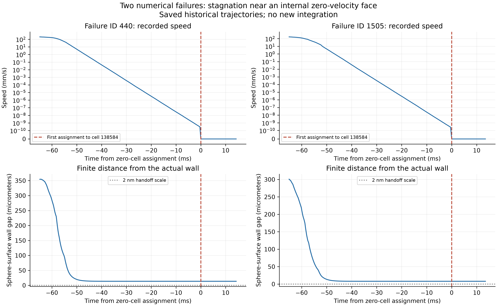
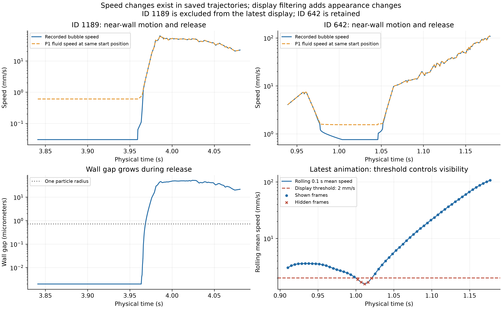

# BraVa 微泡失败与速度急变：原因复核

2026-09-29。对象仅为旧正式结果 `realization_0000_contactfix`：1565 条接受轨迹，1422 条实际出口穿越、141 条观察截止、2 条数值失败。当前固定时间协议尚无正式大批量结果，不能用它解释或重命名这批旧结果。

本次重读全部 1565 条已存轨迹，独立重建指定位置的 P1 速度及重心坐标，核对当前四视角显示掩码，并检查实际推进/保护代码。只生成本目录诊断文件和图件，没有积分新轨迹、求解 CFD、修改流场或生产源码。

## 1. 两条失败：局部零速离散结构 → 渐近停滞 → 数值保护终止

|粒子 ID|终止物理时间 s|首次归入单元 138584 的时间 s|末态球表面到壁面距离 μm|末态接触秩|
|---:|---:|---:|---:|---:|
|440|1.207636924|1.193376972|13.630381|0|
|1505|2.100027542|2.086500000|8.026088|0|

**确定的上游原因是网格拓扑、P1 插值和无滑移约束组合产生的局部零速结构。** 单元 138584 的四个节点都属于正式 WALL，四个节点速度均为零。P1 速度是节点速度的线性加权，因此整个单元必为零速；已有全域审计确认它是 692313 个四面体中唯一这样的单元。单元体积为正、并与其他体单元连接，不能简单归因为翻转网格或拓扑孤岛。

本次原始轨迹复核进一步细化了“进入全零单元”的说法：两泡之前都处在相邻单元 **578387**，并渐近逼近二者共享的内部零速面。578387 在此面上的三个节点速度为零，第四节点速度约 64.0623 mm/s，局部速度梯度的非零特征值为 −443.471477 s⁻¹。在该单元、无其他作用时，P1 线性场使朝共享面的运动呈指数衰减，对应约 2.255 ms 的局部衰减时间尺度。这里的衰减是冻结离散场的性质，不是已验证的真实流体滞留。

末点距该共享面仅约 4.1–4.8×10⁻¹⁶ m，是浮点精度量级。相对于 138584 的最小重心坐标为 −4.37×10⁻¹² 和 −5.13×10⁻¹²，均在代码约 5.38×10⁻¹² 的包含容差内。CPU/GPU 定位规则在多个容差包含单元之间取较小规范 ID，因而最终记录为 138584。**没有证据显示发生了宏观穿面跳跃或穿壁。** 即使继续使用相邻单元求值，末点流速也只有约 2.2–2.5×10⁻¹³ m/s；改变定位容差不能消除上游零速面的渐近停滞。

归入零速单元后，两条轨迹分别保存 82、71 个严格零速度样本，坐标不再变化，最终触发 `ROUNDOFF_SCALE_STAGNATION_64_ACCEPTED_SUBSTEPS`。保护检测按 provider 调用间隔执行，因此记录的零速样本数不必恰好等于 64。

原 CPU 32 状态支持复核的接触秩为 0，且壁面间隙远大于 2 nm 的交接尺度，故不满足“接触支持静止”。`SOLVER_FAILURE / INTEGRATION_SAFETY_STOP_UNSUPPORTED` 是当前合同的正确失败分类；这里不是线性方程求解器崩溃，也不能称为泡被壁面吸附、真实堵塞或成功完成。降低停滞阈值、延长时间或强制推离零速区域不能作为物理修复。

证据：[本次逐项复核](failure_details.json)、[原失败诊断](../realization_0000_contactfix/failure_diagnostics.json)、[全零单元审计](../../cfd_wall_audit/known_regression_138584.json)。



## 2. “先慢后快”：已有轨迹中存在真实的数值速度变化

已有审计使用固定筛选规则：分界前后各约 69.08 ms，前窗平均速度 <2 mm/s、后窗 >10 mm/s、倍率 ≥5，每个粒子保留最大倍率事件，得到 **201** 个候选。它是特定规则的样本集合，不是所有异常轨迹的普查或物理错误率。

这些候选的慢速窗壁面间隙中位数均小于自身半径，快速窗均大于半径；192 个加速窗没有微泡间近场记录。已复核典型路径为：

**近壁缓慢滑行 → 有限面片边缘或其他离壁路径 → 间隙增大、近壁阻力减弱 → 进入更快的冻结流区。**

当前模型是过阻尼阻力/约束平衡，速度由当前位置的 FEM 场、梯度、壁面阻力及接触状态决定，没有惯性储能再释放的运动方程。壁面修正权重在间隙/半径从 0.1 到 1 时连续减弱；典型快速状态已恢复为同位置 FEM 速度。不能把大幅增长只归因于一个“取消硬接触”的开关。

例如 ID1189 的既有状态复核中，泡速由 0.03030 增至 49.11377 mm/s，壁面间隙由 0.002 增至 48.961549 μm；同位置 FEM 速度由 0.60557 增至 49.11377 mm/s。慢速状态解除硬约束后的阻力解仍只有约 0.03035 mm/s，说明后续背景流速与阻力状态的共同变化才是大倍率增长的直接原因。典型 12 状态的原 CPU 复算与保存速度最大差约 1.39×10⁻¹⁷ m/s，此项是既有复核，不是本次新增积分。

但其中存在明确的近壁 CFD 风险。典型单元 388769 的 div(u)≈−827.43 s⁻¹，|div(u)|/||G||≈0.995；ID1189 慢速位置的 FEM 速度约 0.606 mm/s，其中朝壁面分量约 0.602 mm/s。当前离散场把泡强烈带向壁面，近壁约束又限制其法向运动，离壁后则快速采样到另一流区。该链路可解释计算现象，但不能直接证明真实血管中会出现同样的加速。

201 个候选中，只有 **58** 个在对应窗口访问了 η>0.5 的单元。不能用 388769 的结论解释其余所有候选，也不能把这 58 条逐条判成已证实的物理错误。全局边界守恒、CPU/GPU 一致和原始 WSS 重算一致均不解决局部精度问题。

证据：[既有加速机制报告](../acceleration_diagnosis/ACCELERATION_EXPLANATION_ZH.md)、[近壁全域审计](../../cfd_wall_audit/WALL_CFD_AUDIT_REPORT_ZH.md)。

## 3. 最新动画还有一层“显示突然性”

旧加速报告讨论的是 576 帧全程动画，其物理帧间隔约 23.03 ms；最新大字号四视角只显示 0–1.2 s，共 262 帧，物理帧间隔约 **4.598 ms**。不能把旧视频“3 秒后”的时间定位套到最新视频。

本次完全复现了最新动画的可见性掩码：仍存活、未被整条排除、且当前时刻前后各 0.05 s 的时间加权三维平均速度 ≥2 mm/s。只统计相邻两帧都存活的情况，得到 **117 次隐藏→显示、425 次显示→隐藏，共涉及 359 个粒子**。这些是掩码切换次数，不是物理跳跃次数，已排除帧间出生或死亡造成的首次出现/消失。

201 个旧筛选候选中，有 8 个事件中心落在最新 0–1.2 s 窗口；其中 ID48、292 已被整条排除，其余 ID38、170、223、338、433、642 仍在显示候选中。这里沿用旧筛选窗口，没有将最新动画重新筛出的事件冒充原统计。

例如保留的 ID642，旧窗口均速由 1.026 增至 17.643 mm/s，间隙中位数由约 0.002 增至 7.585 μm；最新掩码在约 1.02529 s 重新显示它。低速运动的一段被隐藏，而恢复显示时已接近离壁加速，视觉上可能更像“突然冲出”。未经过 η>0.5 的加速窗口也仍可能因正常模型机制、其他离散误差或显示筛选而显得异常。

证据：[显示复核与逐事件列表](display_review.json)。筛选只改变显示；原始坐标、速度、终态和出口计数均保持不变。



## 4. 时间积分风险仍未排除，但不应先断言 dt 是主因

本次重新扫描了全部 1565 条已保存轨迹，排除出生行的不同速度语义后，重现了旧结果：没有轨迹出现同时满足“相邻求值速度增加 >5 mm/s 且超过前速两倍”的一步增长。该结论只针对这个联合阈值，不等于没有较小突变、方向变化或时间离散误差。

最大单步增量为 ID822 在物理时间 0.651 s 的 **36.2280 mm/s**，由 337.3128 增至 373.5408 mm/s，增幅约 **10.74%**；相邻求值间隔 0.5 ms，位移约 168.656 μm，单元从 402304 变为 212669，壁面 gap 约 236 μm。两端保存泡速均与同位置 P1 流速一致，分量差约机器精度。这个案例属于较快区域中的空间采样变化，不能用“近壁接触解除”解释；也不能仅凭一致性判断其物理变化准确。

源码采用分段保持速度推进 `x_next=x+v*dt`，在几何/球对证书或端点检查失败时细分。该细分不是通用的局部截断误差控制，尚无本 BraVa 真实场的完整时间步收敛证据。P1 速度在共有面连续，但梯度逐单元变化；近壁模型显式使用梯度和最近有限面片法向，因此单元跨越或几何特征切换的影响需要局部回放及收敛试验量化。当前代码检查只能确认这种敏感性来源，不能给每次加速分配误差比例。

证据：[一步速度增量](largest_step_increments.json)、[最大增量的场采样复核](largest_increment_context.json)。

## 5. 优先处理顺序

1. **优先改善 CFD 近壁离散。** 在新版本算例中消除四角全为壁面节点的全零速度单元，针对 138584/578387 和 388769 邻域评估网格拓扑、曲面分辨率、局部速度方向和质量通量，并做局部加密/边界层及网格收敛对照。现有网格脚本目标边长 0.2 mm，明确未配置边界层。SimVascular 官方提供[边界层与局部网格选项](https://simvascular.github.io/documentation/meshing.html)；这些只是可用手段，不保证启用后自动消除问题。不要求 CFD 直接解析每个 2 nm 间隙，关键是背景流场与所用近壁近似的适用性。
2. **再分离微泡积分和近壁模型误差。** 固定同一输入场与来源，对代表状态/轨迹比较 0.5、0.25、0.125 ms；同时记录泡速、同位置 FEM 速度、梯度、间隙、面片特征、接触秩及实际子步。单步 CPU/GPU 对照不能替代此试验。涉及球对作用时必须保留相关群体状态。
3. **保留失败，补充可解释诊断。** 可在未来实现中增加“全零场/内部零速面停滞”的原因标签，仍归数值失败；不用强制推离、补速、邻居填充或重分类为成功来掩盖它。
4. **将显示用于解释。** 现有正式样式和筛选保持原样；如后续需要，另作保留慢速泡、标注 ID/速度/gap 的诊断视图，帮助辨认重现与实际加速。显示优化不替代科学结果修复。

以上是后续验证路线，本次没有执行新 CFD、时间步试验或生产批次。

## 6. 身份、复现与范围

- 正式流场 SHA256：`73228d094c253cec75dbb0030476b687171d0d0fef7816a845392dad220285dc`。
- 历史 run 的 24 个 population 源文件哈希与当前比较，仅 `run.py` 不同；新协议另增的文件不在旧身份清单内。该比较不冒充对所有外部物理依赖的全量验证。
- [review.py](review.py) 保存本次复核与图件生成代码；[INPUT_HASHES.json](INPUT_HASHES.json) 记录 1575 个读取输入的哈希，并在结束时再次确认未变。
- [SUMMARY.json](SUMMARY.json) 为机器可读摘要；图件有 300 dpi PNG 和 PDF；[OPEN_RESULTS.html](OPEN_RESULTS.html) 为阅读入口。
- 没有将 141 条观察截止当失败，也没有将出流或显示保留的轨迹全部标为物理正确。正式 run 的 `scientific_integrity_pass=false` 继续保留。

复现命令（仅后处理，会重写本目录派生文件）：

```bash
/home/lzy/projects/computation_examples/_shared/python_environment/bin/python -B /home/lzy/projects/computation_examples/brava_flow_roi_18mlmin/population_v1/analysis/failure_speed_review_20260929/review.py
```
