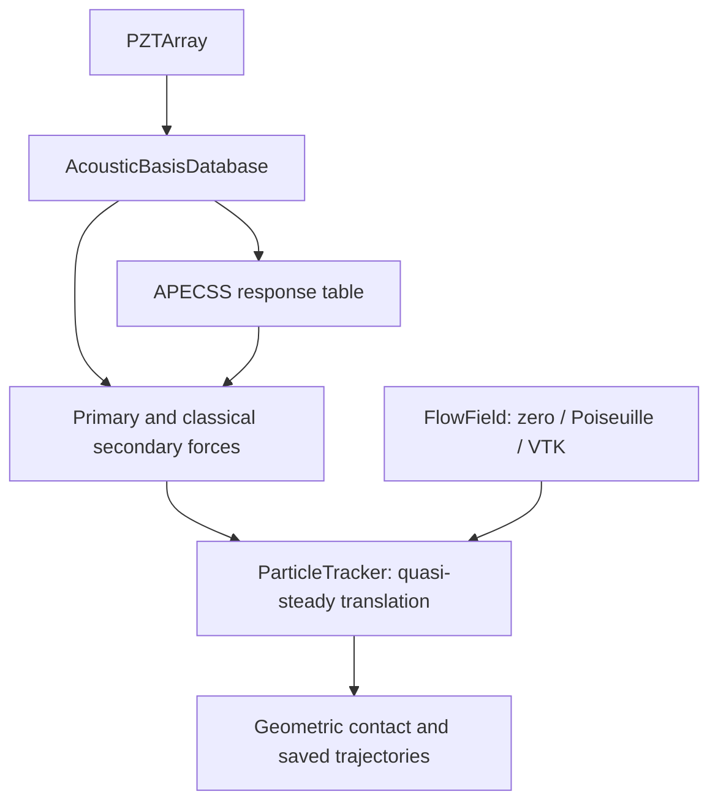

# Current model map

| Module | Role | Acceptance / scope |
|---|---|---|
| control/pzt.py | Amplitude/phase/enable controls | Controls combine a cached basis without rerunning propagation |
| acoustics/basis.py, kwave_backend.py | Linear complex pressure and gradient | Identity checks and direct-superposition comparison; grid differences reported |
| bubbles/apecss.py | Unmodified offline APECSS RPAR/Marmottant wrapper | Table generation and independent validation only |
| bubbles/adaptive_table.py | Deterministic cached adaptive response | Existing bounded validated cells and independent holdouts; no experimental shell calibration |
| bubbles/forces.py primary_bjerknes | −½ Re[V1 conj(gradP)] | Full-cycle quadrature cross-check |
| bubbles/forces.py ClassicalFarFieldBjerknes | Reciprocal unregularized monopole correlation | Phase, d⁻², P², zero-response acceptance; near-field approximation warned |
| bubbles/auto_backend.py | Measured CPU/GPU selection and fallback | Server-specific benchmark; same force equation |
| bubbles/validity.py PairPhysicsRegime | FAR_FIELD / TRANSITION / NEAR_CONTACT / CONTACT | Configurable warnings informed by Stage 2.5; never force clipping |
| bubbles/contact.py | cKDTree or brute candidate search; original constraints | Deterministic exact filtering and unchanged geometric resolution |
| bubbles/tracker.py | Slow-time Stokes + FlowField RK trajectories | No production history model or translation ODE; geometry and response guards |
| flow/fields.py | Zero, Poiseuille and VTK velocity(x,t) | Synthetic analytic/VTU trajectory comparison; no patient CFD validation |
| validation/gates.py | Six scoped, hashed prerequisite gates | Admission is not experimental or near-contact certification |
| validation/history_force_sensitivity/ | Independent prescribed-radius reference | Averaging, added mass and history separately measured; no production dependency |
| validation/deprecated/zhang2011/ | Logical evidence archive | DEPRECATED_AS_DEVELOPMENT_REFERENCE; archived tests excluded from CI |
| validation/doinikov_*.py, references/ | Historical Stage 2/2.5 studies | Retained for evidence; not N-body production requirements |
| bubbles/response.py, LegacyRegularizedBjerknes | Original Stage 1 surrogate | Compatibility/regression only; DEMO status retained |

Production architecture:

Reference studies have no arrow into the tracker. See [Methods](METHODS_MODEL_DESCRIPTION.md), [provenance](PHYSICS_PROVENANCE.md) and [Stage 3 report](STAGE3_VALIDATION_REPORT.md).
