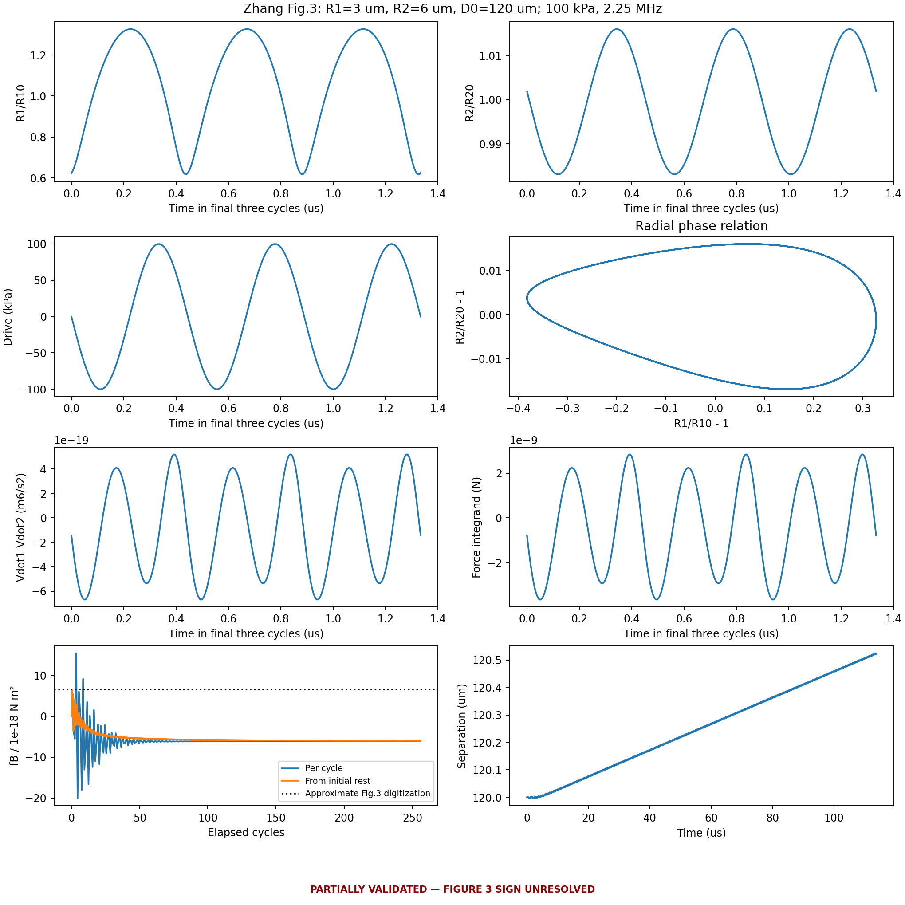
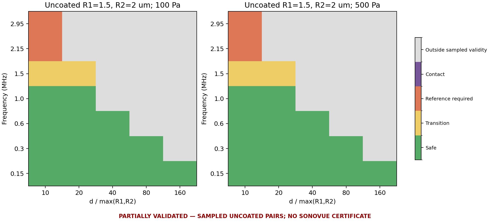
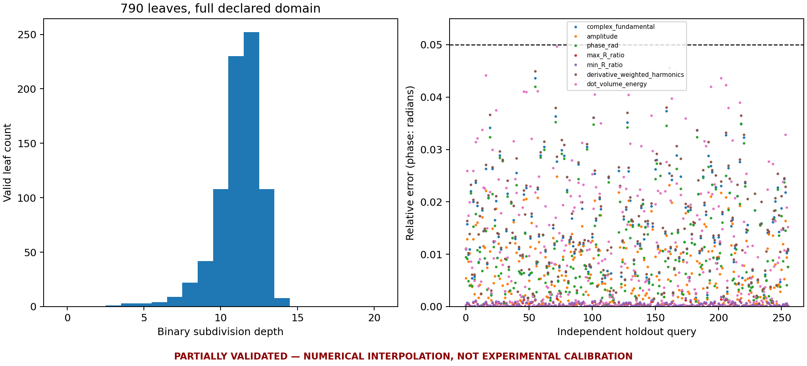

# Stage 2.5 — Pair-Physics Closure and Aggregation Validation Unlock

报告日期：2026-10-02 Europe/Berlin；算例时间戳采用 UTC（2026-10-01）。
工程：`/workspace/mevo_acoustic_microbubbles`；本地：`/home/lzy/projects/computation_examples/mevo_acoustic_microbubbles`。
分支：`stage2.5-pair-physics`。本报告的 PASS 均附适用范围，不将软件检查等同于物理校准。

## 1. Executive summary

**Stage 2.5 部分成功；聚集验证没有解锁。** 本轮基于现有工程实际实现并运行了独立 Zhang 参考、248 个三模型比较算例、自适应 APECSS 数据库、27 点平移误差图及接触候选搜索基准。

Zhang Fig.3 的负相关来自径向解中的 `Vdot1 × Vdot2`，不是最终力矢量的符号变换。
独立实现和 Stage2 实现高度一致，但均未复现论文的 120 µm 正值，因此正式保留 **UNRESOLVED**。
没有修改压力、壳参数、符号或平均窗口来制造 PASS。

自适应数据库在预先声明的 **R0=1.6–1.96 µm、f=2.3–2.7 MHz、P=5–40 kPa** 区域达到 production 插值验收：
12,902 个树节点、790 个有效叶单元、体积覆盖率 100%，256 个独立新留出点无超差、无拒绝。
这是对固定文献参数假设下 APECSS 数值响应的插值检查；不能替代 SonoVue 实验校准或覆盖 1 MHz / 50–100 kPa 的 Lazarus 条件。

| 验收项 | 结论及范围 |
|---|---|
| A 基线回归 | PASS：20,514 个 Stage1/2 结果文件无变化，迁移位置差 0 m |
| B/C Zhang 取证与独立实现 | 取证交付完成；Fig.3 UNRESOLVED，非物理 PASS |
| D 三模型比较 | 完成 248 个解；形式不可压缩远场收敛，有限声速差异保留 |
| E 适用范围图 | 已实现实测误差分类，仅证实抽样的无壳双泡点 |
| F 自适应数据库 | PASS_EMPIRICAL_DOMAIN：目标数值区域 production profile |
| G 缓存与恢复 | PASS：21,981 个缓存键完整，每键一次尝试；树恢复新增 APECSS 调用 0 |
| H 平移误差图 | 完成 27 点，固体壳 20 周期条件；不外推到脂质壳 20 ms |
| I 溯源 | 输入、方程、环境、源文件哈希、运行日志、失败数据均保留 |
| J 软件 | 63 tests passed，ruff 通过，详细日志见 SOFTWARE_CHECKS.json |
| K/L/M 下游聚集、圆管、扫频 | NOT_RUN_GATE，无 force-demo 覆盖 |

## 2. Stage 2 baseline retained

`stage1-demo-baseline` 保持 `fc3fac0e6fe7f0a57bd90812800714a97fff94a5`；
`stage2-validated-physics` 保持 `6d659c395007a87741d997364867c9a5b7e9cdbe`。
APECSS C 求解器、k-Wave、primary force、原有接触投影和声学基底没有重写。

实际回归重新读取 Stage1 的 18,377 个结果文件及 Stage2 的 2,137 个结果文件：零缺失、零哈希变化。
1 MHz / 2 MHz 基底重新组合相对已保存 direct 场的 L2 误差分别为 `9.7825511900e-8` / `1.5624885447e-7`，与基线一致；没有重算基底。
150 泡、10 ms 迁移重复运行：保存时刻全部一致，全部位置最大差 **0 m**。
两网格诊断原有的压力/梯度差异继续保留，不能称已证明网格无关。

测试保留了实际 APECSS wrapper、SonoVue 参数出处、Eq.63、primary cycle average、NumPy/CuPy 力一致性、声学 smoke、VTK 插值及旧响应表保护。
APECSS 官方 reference 比较沿用已验证且哈希未变的 Stage2 证据；本轮没有伪称重新执行整套上游官方例程。
新测试覆盖独立残差、量纲、符号、缓存并发去重与恢复、实测表误差、CPU/GPU 批查询、门禁、缺失 GPU、OOM、非法输入。

证据：[REGRESSION_STATE.json](../results/stage2_5/audit/REGRESSION_STATE.json)、[SOFTWARE_CHECKS.json](../results/stage2_5/audit/SOFTWARE_CHECKS.json)。
BraVa CFD、旧 1565 条 contactfix 结果、新灌注协议身份、兼容链接以及已停止的任务均未改动或重启。

## 3. Zhang Figure 3 forensic audit

逐项账本：[ZHANG_FIG3_PARAMETER_LEDGER.md](../validation/zhang2011_forensic/ZHANG_FIG3_PARAMETER_LEDGER.md)。
区分了论文方程、正文、图注、假设和推断；尤其是 `χ≤1 N/m` 并未给出 Fig.3 专属值，`χ=1 N/m` 是本次明确声明的取值。
初始距离是中心距，使用 SI 半径；不把壳黏度 Pa·s 与表面黏度 kg/s 混用。

Fig.3 C 点：R10=3 µm、R20=6 µm、D0=120 µm、100 kPa、2.25 MHz。
论文图像约为 `+6.6e-18 N m²`；双实现给出 56–64 周期 `−6.143989e-18`，248–256 周期 `−6.131573e-18`。
相对约 6.6 的图像读数差约 193%；这个数字包含取图近似，不是原作者数据。

保存了完整页面、裁图、像素标定、8 个数字化点及 ±2 pixel 的图像读取不确定度（约 ±0.22e-18 N m²）。
`ZHANG_FIG3_FAILED_CASE.h5` 含全部 t、半径/速度、体积/体积导数、中心距、压力、散射/耦合项、加速度、瞬时力积分量、逐周期及累计平均。
径向相关已为负；后续矢量方向和距离平方换算并未翻转符号。

原始 HDF5：[失败算例](../results/stage2_5/zhang_forensic/20261001T213201667396Z/ZHANG_FIG3_FAILED_CASE.h5)。
详细结论：[ZHANG_FIG3_DISCREPANCY_REPORT.md](../validation/zhang2011_forensic/ZHANG_FIG3_DISCREPANCY_REPORT.md)。

## 4. Sign/phase convention audit

项目用 `Re[P exp(+iωt)]`；论文和 APECSS 的 `−Pa sin(ωt)` 对应压力相量 `+iPa`。
保留谐波相位转换 `i^(−h)`，任意局部压力相位给第 h 次谐波乘 `exp(ihθ)`。
`e12=(x2−x1)/d`；论文 Eq.11 下文明确正系数表示吸引。
`ρ〈Vdot1 Vdot2〉/(4π)` 单位是 **N m²**，Fig.3 纵轴是该有量纲系数的标度，并非力 N 或无量纲力。

整体平移周期信号时间零点、或反射坐标，均保持吸引/排斥的物理解读。
从静止突然切换 sin/cos 驱动却不改变初态，会改变瞬态，不能用这个操作证明周期平均必须相同。
`tests/test_zhang_dimensions.py` 检查径向、平移、壳及力系数各项量纲；primary force 原表达式保持不变。
见 [PHASE_AND_SIGN_CONVENTIONS.md](PHASE_AND_SIGN_CONVENTIONS.md)。

## 5. Minimal independent Zhang implementation

[references/zhang2011_minimal.py](../references/zhang2011_minimal.py) 单独转录 Eqs.3/4/7/8 的四个二阶残差和 Eq.9 壳压力。
不依赖 production bubble class、APECSS 或 pair-force 实现；先形成残差再求加速度，使用 float64 / SciPy DOP853。
`rtol=2e-10`、SI 状态尺度 atol、每周期最大步 T/96、每周期输出 128 点；C 点积分 256 周期，其余矩阵点 64 周期。
随机非平衡状态残差比较及七个完整轨迹比较同时进行。

与 Stage2 加速度矩阵实现相比，最大相对半径差小于 `6e-12`，中心位置差小于 `1.5e-18 m`。
这排除了两种实现之间的多类转录/装配差异；两者仍共享论文与建模解释，不能因此宣称论文曲线或实验已复现。

## 6. Zhang reproduction matrix

完整 [ZHANG_REPRODUCTION_MATRIX.csv](../results/stage2_5/zhang_forensic/20261001T213201667396Z/ZHANG_REPRODUCTION_MATRIX.csv) 有 7 个算例 × 2 实现，含窗口、容差、文献预期及未提供的数值字段。
下表为独立实现，单位 `1e-18 N m²`：

| 点 | 文献预期 | 计算 | 状态 |
|---|---|---:|---|
| A：4/6 µm，50 µm | 吸引 | +11.7199 | PASS_SIGN_ONLY |
| B：3/6 µm，50 µm | 排斥 | −12.8367 | PASS_SIGN_ONLY |
| C：3/6 µm，120 µm | 吸引，约 +6.6 | −6.13157 | FAIL_SIGN |
| D：3/6 µm，70 µm | 吸引 | −9.80444 | FAIL_SIGN |
| E：2.20 MHz | 无该点明确预期 | −16.2294 | UNSPECIFIED_IN_PAPER |
| F：2.9/1.5 µm，共振附近 | 吸引 | +1.20173 | PASS_SIGN_ONLY |
| 1 kPa 诊断 | 非论文 100 kPa 条件 | +0.00052525 | UNSPECIFIED_IN_PAPER |

附加小信号调查：独立残差线性化在 120 µm 为 `+5.248832e-18`；100 Pa 的真实非线性解按 P² 标度后为 `+5.248786e-18`。
二者一致，但零点约在 70 µm，论文图像约在 60 µm，30 µm 幅值也明显不符。
这提示“未声明的小信号处理”值得调查，**没有证明作者采用了该处理，也没有修复 Fig.3**。
第一周期正值不能被选择为解决方案：它同时把 50 µm 的论文排斥点算成正值。

## 7. Doinikov reference status

保留 Stage2 的 Doinikov–Bouakaz 2015 N=2、无壳球形泡有限 Legendre 系统参考及其阶数收敛证据。
本轮再次检索 APS supplement、DOI 重定向、作者候选站点、HAL 和公共 archive。
APS 直接端点返回 401，重定向页面的 supplement 区域要求认证；HAL/所查 archive 未返回资源，作者候选地址超时。
证据：[literature_retrieval/RETRIEVAL.json](../results/stage2_5/audit/literature_retrieval/RETRIEVAL.json)。
结论是**本次未取得作者 Mathematica 文件**，并非“没有公开代码”。没有联系作者或绕过访问限制。

无壳参考不能验证脂质壳 Fig.3，也未被逐对求和包装成严格 N-body 模型。
近接触时的球形假设、形变、润滑、黏附、融合仍未验证。

## 8. Asymptotic three-model comparison

所有比较采用同样的无壳 R1=1.5 µm / R2=2 µm、ρ=998、µ=0.001、σ=0.072、p0=101300、γ=1.4。
Zhang 的 χ、壳黏度、壳厚设为 0；Doinikov 只将其驱动 Gaussian envelope 替换为声明的连续波输入，未改径向或平移方程。
这属于共同边界条件比较，不能称复现了 Doinikov 原文的 Gaussian pulse。

主体：2 个高阶模型 × 5 个间距比 × 5 个频率 × 2 个压力 × 2 个声速 = 200 个实际积分。
压力为 100 / 500 Pa，d/maxR 为 10/20/40/80/160；频率 0.15/0.3/0.6/2.15/2.95 MHz。
扩展 48 例增加物理声速下 1/1.5 MHz，以及共振附近 d/maxR=320/640 的形式远场。
Classical 是同条件孤立线性响应的解析领先阶。

分别保存 Eq.11 的耦合体积导数相关系数，以及由完整 ODE 加速度恢复的“孤立附加质量动量率减显式阻力”的相互作用力。
第二个量不是把同一个 Eq.11 再算一遍；非常弱远场下的动量残差有消减误差，两个量不混淆。

在形式 `c=1e9 m/s` 下，0.3 MHz / 100 Pa，系数误差随 d/maxR=10→160 从约 0.304% 降至 0.0191%，两模型一致。
主体数据拟合误差对 R/d 的幂率：Zhang 约 0.944–1.028，Doinikov 约 0.944–1.028；没有预设幂率。
近共振收敛较慢：2.15 MHz 在 d/maxR=160/320/640 时约 6.57%/3.26%/1.63%；2.95 MHz 约 8.65%/4.36%/2.18%。

`c=1e9` 仅用于隔离形式不可压缩极限，绝不是水。
真实 c=1482 时，两个参考的有限声速径向阻尼形式不同，且增大距离会越过 `kd≤0.3` 的准静态范围；这些点不能用于生产认证。
原始曲线、符号图、拟合及全部行见 [pair_asymptotics/STATE.json](../results/stage2_5/pair_asymptotics/STATE.json)；
方法见 [asymptotic_pair_consistency](../validation/asymptotic_pair_consistency/README.md)。

## 9. Pair validity regime map

`PairPhysicsRegimeMap` 用**两模型、两种误差量**及符号决定分类：≤5% 为安全，5–20% 为过渡，>20% 或错误符号需参考模型。
5%/20% 是项目精度预算；区域位置来自计算，未使用 epsilon 改写力。
另检查 kd≤0.3、径向偏离≤2%、距离变化≤1%。接触是几何分类，不是模型已验证。

物理声速下 70 个不同抽样参数点：28 安全、4 过渡、4 需参考、34 超出范围。
仅对已抽样的半径、压力、频率、距离、声速和 shell model 返回证据分类；未采样间隔不做未经检验的插值。
当前 uniform-drive 图不适用于任意空间压力/相位差，更不适用于不同壳定律。

Classical production kernel 保留。tracker 每个接受步输出各类 pair fraction，整体另报 `invalid_pair_fraction` 和 `PHYSICS_VALIDITY_WARNING`。
默认 invalid 阈值 0、transition 阈值 0.05，可配置；缺少匹配实测证据记作 outside，不能因旧几何规则通过而声称 validated aggregation。
汇总注明评价次数加权包含 RK stages；已有接受时间权重统计继续保留，避免混为同一种平均。

## 10. Adaptive response database

`AdaptiveResponseTableBuilder` 使用 8 corners 和 9 个内部点（中心、两个对角四分点、六个轴向四分点），按实际谐波曲率选择二分方向。
每个误差量独立满足阈值：复基波、幅度、相位、max/min R/R0、导数加权谐波范数、〈Vdot²〉。
strict/production/exploratory 分别为 2/5/10% 相对误差；相位分别为 0.02/0.05/0.10 **radian**，不称“相位百分比”。
本轮实际大表验收运行 production；另外两种 profile 是可选配置，未宣称各自完整算例已通过。

保留改进过程，均未修改底层 APECSS 科学响应：

| 运行 | 节点/有效覆盖 | 独立留出点 | 结论 |
|---|---|---|---|
| 初始最长边细化，12k 预算 | 11,998 / 80.2734% | 128 点，1 超差、17 拒绝 | FAILED_INDEPENDENT_HOLDOUT；整表 rejection sidecar 禁用 |
| 实测曲率细化，12k 预算 | 11,996 / 98.7427% | 新 128 点，0 超差、1 拒绝 | PARTIAL_DOMAIN |
| 复用第二轮，扩展预算 24k / depth20 | 12,902 / 100% | 新 256 点，0 超差、0 拒绝 | PASS_EMPIRICAL_DOMAIN |

扩展只新增 866 个 APECSS 调用，另外 40 点命中缓存；复用已有树的 11,996 点。
256 点最终留出集 seed=20261004，与用于构建/历史失败调查的点集分开。

| 最终留出误差量 | 最大值 |
|---|---:|
| 复基波 | 4.3663% |
| 基波幅度 | 2.4814% |
| 相位 | 0.0420064 rad |
| max R/R0 | 0.1577% |
| min R/R0 | 0.2002% |
| 导数加权谐波 | 4.4911% |
| 〈Vdot²〉 | 4.9650% |

所有节点保留 48 周期、舍弃前 40 周期、后两周期一致性、极值、壁面 Mach、8 次谐波及未解析能量、退出状态和保留周期内 buckling/rupture 标记。
完整原始波形另以无损 gzip 保存；压缩前后逐字节验证，记录原文件 SHA256。buckling/rupture 标记的时间范围明确是最后 8 周期，不冒充全历史指标。
有物理/数值失败、预算耗尽、深度耗尽或留出点失败的单元被显式拒绝。

缓存键包括模型、全部物理与数值输入、APECSS commit、可执行文件哈希和分析 schema。
每键 flock、原子发布和 fsync；已完成但未发布的 attempt 可恢复；失败键不自动重算，缺失/篡改 payload 报错。
实际审计 21,981 个 COMPLETE 键、每键 1 次 attempt，2,753,114,510 bytes 的 cycles 数据哈希全部通过。
树恢复检查新增 APECSS 调用 0；并发重复键测试也仅调用一次 solver。

有效表：[adaptive_response.h5](../results/stage2_5/response_table/20261001T220715485503Z/adaptive_response.h5)。
σinit=0.036 N/m 假设、Tu Fig.4 近似数字化及固定水介质沿用 Stage2；此处不重新拟合。
100% 指叶单元分区体积覆盖，误差证据来自有限采样，**不是对连续域误差上界的数学证明**。

## 11. Translation approximation map

R0=1.5/2/3 µm × P=5/40/150 kPa × f=1/2.5/4 MHz，共 27 点；复用 9 个完全同参数 Stage2 结果，新增 18 个。
对同一 full-reference 的周期平均 primary force 比较生产式 Stokes 准稳态位移与 Doinikov–Dayton 完整平移。
壳为文献 **15 nm 固体壳**，驱动 20 周期，无脉冲后观察；不能称为 SonoVue 脂质壳图。

≤5% 安全、5–20% approximate、>20% reference required：分别为 **1、7、19** 个点。
R=2 µm、150 kPa 的 1/2.5/4 MHz 相对位移误差分别为 0.7024% / 5.6437% / 10.4423%。
弱压力下参考净位移可能接近零，启动振荡影响相对误差；所有有符号位移和绝对误差都保存，不能只看很大的百分数或仅用 Reynolds number 分类。
`TranslationValidityMap` 拒绝未测 shell、频率、压力、半径和脉冲周期数。
见 [translation_map/STATE.json](../results/stage2_5/translation_map/STATE.json) 和 [方法说明](../validation/translation_error_map/README.md)。

## 12. Lazarus gate result

[PHYSICS_GATES.json](../results/stage2_5/audit/PHYSICS_GATES.json) 已实际生成；`ValidationGateManager` 检查状态、适用 scope 和证据 SHA256。

| 门禁 | 对拟议 Lazarus / SonoVue 聚集的结论 |
|---|---|
| G1 | 关闭：Fig.3 unresolved；未证明 coated 50–100 kPa 生产域完全避开不确定区域 |
| G2 | 只有抽样无壳弱场图 PASS；没有把它扩展成 Lazarus 条件的证书 |
| G3 | focused table 数值范围 PASS；不涵盖 1 MHz / 50–100 kPa，独立 paper model 尚未验证 |

门禁在加载声学基底、创建轨迹之前拒绝非线性下游运行，并保存 GATE_DECISION。
门禁 PASS 仅代表准入，不能覆盖后续实测 validity 状态。
`--force-demo` 软件路径和永久 metadata/水印已测试，但本轮未使用它启动任何下游模拟。

## 13. Lazarus paper reproduction if unlocked

**NOT_RUN_GATE**。[lazarus_paper/STATE.json](../results/stage2_5/lazarus_paper/STATE.json)。
沿用原文提取与模型审计；本轮没有实现完成的 `LazarusPaperModel` 或声称存在可运行的 paper-reproduction solver。
没有生成 50/75/100 kPa、20 ms 的聚集轨迹、指数拟合或统计 ensemble。
未来该模型必须独立采用文献的几何、相互作用、阻力、附加质量及 contact/rearrangement；若论文近场公式越界，另标 `PAPER_MODEL_OUTSIDE_MODERN_VALIDITY`。

## 14. SonoVue clustering model if unlocked

**NOT_RUN_GATE**。[lazarus_sonovue/STATE.json](../results/stage2_5/lazarus_sonovue/STATE.json)。
现有 production transport 增加了 adaptive backend 和实测范围监测，但没有把它重命名成已验证的 `SonoVueClusteringModel`。
没有将 paper mode、BR14 例子或固体壳平移结果当作 SonoVue 聚集结果。
接触依旧只是非穿透数值约束，不等于黏附、融合或物理聚集键。

## 15. Validated cylinder if unlocked

**NOT_RUN_GATE**。[cylinder/STATE.json](../results/stage2_5/cylinder/STATE.json)。
没有新增 validated 4-PZT 圆管演示；本轮重复的 Stage1 迁移只是确定性回归，始终是 legacy demo。
未来圆管需要自身配置的响应范围、平移、pair 和 Lazarus 证据；迁移/聚类指标必须随有效性比例一起报告。

## 16. Frequency sweep if unlocked

**NOT_RUN_GATE**。[frequency_sweep/STATE.json](../results/stage2_5/frequency_sweep/STATE.json)。
没有生成 1/1.5/2/2.5/3 MHz 新扫频图或“最优频率”。1.5 MHz 的本轮双泡参考算例不等于圆管声学扫频。
已有 1/2 MHz basis 保留且复用；未为相位改变重算 PDE。

## 17. CPU/GPU performance

本轮 server doctor：Ryzen 7800X3D、8 physical / 16 logical、cgroup 7.68 cores、RTX4090、无 Slurm。
长计算通过 supervisor 前台程序和日志管理；APECSS 保持 CPU C solver，单 worker 单线程。

| APECSS workers | 独立新 case 数 | cases/s | worker CPU efficiency |
|---:|---:|---:|---:|
| 4 | 72 | 30.4216 | 75.06% |
| 6 | 72 | 50.2782 | 85.97% |
| 7 | 72 | 55.1736 | 83.30% |

选用 7 workers；吞吐包括 pool 启动和原始输出 I/O。为禁止相同 key 重算，三组使用交错随机、互不重复的节点；这是一次工作负载基准，不能冒充相同节点的严格加速比。
表后期增加了无损输出压缩，其端到端吞吐不等于这个压缩前的 worker 探针。

`AutoPairBackend` 从当前服务器 Stage2 实測 `synthetic_step_s` 数据选择 crossover=256，或使用配置覆盖；不是根据理论写死 N。
缺失 GPU / CUDA OOM 会显式告警并记录同一 NumPy 力模型回退；输入/数值错误不作为 GPU 故障吞掉。
原有 N² 内存上限保留，未声称支持无限 large-N。

最终表 CPU/GPU 查询同点比较，相对 L2 约 `1.17–1.23e-16`：

| batch N | NumPy median | CuPy median |
|---:|---:|---:|
| 128 | 3.001 ms | 1.226 ms |
| 1,000 | 24.205 ms | 1.242 ms |
| 10,000 | 224.044 ms | 2.533 ms |

这是预热后、输入已在对应设备上的查询时间，不含表加载和 CPU/GPU 传输，也不是整条轨迹加速比。
CuPy pool 活跃数据指标不是峰值总显存。
可选 production-size C++ CUDA/k-Wave 对比标记 `NOT_RUN_OPTIONAL`；CuPy 默认声学后端未改。

## 18. Contact-search benchmark

N=128/256/512/1000/2000/5000/10000；随机多分散半径 0.8–1.2 µm，三个空间密度，共 63 行。
比较分块 brute force、cKDTree、uniform cell list；候选半径取 2Rmax 后按每对真实半径和过滤。
所有方法所有规模：**zero missed / zero extra contacts**。

N=10000 最密点：brute 约 2.476 s，cKDTree build 0.00185 s + query 0.00380 s，uniform list build 0.0303 s + query 3.495 s。
候选 29,244 对，真实接触 17,543 对。该实现下 cKDTree 明显较快，uniform Python list 未获得收益。
memory 是 tracemalloc 可跟踪分配，不是完整原生 RSS；报告没有把它当作完整进程内存。
生产 contact solver **未替换**，候选搜索一致性不等于接触物理正确。
见 [contact_benchmark/STATE.json](../results/stage2_5/contact_benchmark/STATE.json)。

## 19. Remaining discrepancies

1. Zhang Fig.3 的 χ 和平均协议不完整；线性诊断提示可能的计算差异，但缺作者证据。不能认定原文有 typo 后自行“修正”。
2. 三模型共同验证域局限于无壳弱场；有限声速阻尼差异、延迟条件和近共振慢收敛保留。
3. 自适应表有限采样最大能量误差 4.965% 已接近 5% 阈值；不承诺任意连续查询都不超过阈值。扩展域或更严容差需新计算和新留出集。
4. SonoVue 初始表面张力、粒径依赖、脉冲与实验校准未闭环；水介质数值表不等于血液中的定量预测。
5. 固体壳短脉冲平移图不能覆盖 SonoVue 长时间轨迹、近壁阻力、history force 或有限 Re。
6. 原作者 Mathematica supplement 本次仍不可得；没有独立作者代码交叉校验。
7. Lazarus、圆管、扫频未运行，不能用自动门禁软件的 PASS 代替这些验证。

计算期间的 CONFIG 保存当时基线 commit 和逐文件源 SHA256；开发中的脚本未逐次创建 Git commit，因此历史运行的 commit 字段是 Stage2 基线，必须连同 source_sha256、具体 CONFIG 和最终交付源码一起解释。
最终源代码提交与结果文件清单单独封存。首轮失败数据和旧版图片保留；最终排版图片只重新读取保存数组，未改科学数据。
完整原始 APECSS 压缩输出保留在服务器缓存；本地同步核心结果、NODE 元数据和 cycles payload，不将此称为完整原始波形镜像。

## 20. Readiness for SimVascular / MeVO

FlowField.velocity(x,t) 接口继续通过合成 VTU 的空间/时间插值、SI 缩放及越界拒绝检查。
本轮可交付的是科研软件与特定参考范围内的数值证据，**尚不适合开始 patient-specific MeVO 或 validated aggregation 预测**。
没有 skull/CT、脑血管声学网格、PZT 机电、临床推断或 FSI；BraVa 原任务不受影响。

## 21. Exact next recommended stage

下一阶段应限定为“**coated pair domain validation and Lazarus paper-model closure**”：

1. 取得 Zhang Fig.3 的 figure-specific χ、驱动/平均协议或作者可核查实现；以冻结的矩阵和失败 HDF5 为共同对照，不继续盲目拟合曲线。
2. 若该信息仍不可得，必须另行证明拟用 coated 聚集配置与 unresolved 区域不相交；本轮无壳弱场图不足以完成这一步。
3. 冻结 LazarusPaperModel 的原文壳/压缩性/几何、接触重排和指标，与 SonoVue 模式分开。G1/G2/G3 对具体配置通过后，才跑多 seed 的 50/75/100 kPa、20 ms。
4. SonoVue 模式先完成相关压力/频率/壳参数的 response 域及平移证据，再决定是否可进入圆管；圆管通过后再扫频。

操作入口与恢复约束见 [STAGE2_5_QUICKSTART.md](STAGE2_5_QUICKSTART.md)。本轮不自动启动上述下一阶段。
