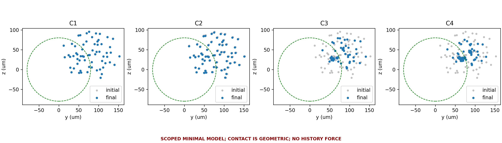

# Stage 3 — Minimal Validated PZT–Microbubble Simulator

## 1. Executive summary

**MINIMAL_SIMULATOR_VALIDATED_WITH_SCOPE**. Criteria A–O passed. The production chain is operational and its tested numerical identities and qualitative trends are accepted. Translation has a **WARNING**, not a claim of quantitative experimental accuracy. No patient/skull/BraVa computation or stopped historical job was resumed.

## 2. Why simulator physics was simplified

The research target is PZT-controlled migration/aggregation with vascular flow. Existing APECSS and k-Wave components are reused; complex pair/contact/history physics is kept outside production. Simplicity does not remove uncertainty: diagnostics and reference sensitivities remain visible.

## 3. Deprecated Zhang branch

Zhang 2011 was investigated but was not used as a validation basis because a key published trend could not be independently reproduced.

[Logical archive](../validation/deprecated/zhang2011/README.md) preserves the original failed HDF5, matrix, figures, notes and two-implementation investigation. No sign, shell parameter or averaging-window tuning was performed. Archived literature assertions run separately from production CI.

## 4. Production physics

[Methods](METHODS_MODEL_DESCRIPTION.md): cached linear field → adaptive APECSS lipid response → cycle-averaged primary and unregularized classical secondary → equilibrium-radius Stokes + FlowField → geometric no-penetration. Production has no hydrodynamic-history dependency. Every run saves a PHYSICS_BANNER.json and the enabled-force flags. The six prerequisites are hashed and scoped; no override was used.

## 5. Acoustic validation

The old bases use a different medium. One water/2.5 MHz basis was therefore generated, and reused for C1–C4. Direct superposition relative L2=2.36672e-07; phase RMS=6.96896e-07 rad. Amplitude/phase changes did not rerun propagation.

100 versus 80 μm grids at common initial cloud points differ by 4.787% in complex pressure, 9.769% in gradient, and 13.186% in actual nonlinear-table primary force. These are retained numerical uncertainties, not proof of grid independence.

## 6. APECSS radial-response validation

The formal Stage2.5 table is unchanged: 790 validated adaptive cells, 256 independent holdouts, R0=1.6–1.96 μm, 2.3–2.7 MHz and 5–40 kPa. Existing deterministic cache, resume, multiprocessing and strict rejection are retained. The actual cylinder trajectories stayed inside this box. No production table expansion was necessary. New direct radial cases serve weak-field and history validation only; H3 at 150 kPa does not expand the production table.

## 7. Primary-force validation

The retained formula −½ Re[V1 conj(gradP)] agrees with independent full-cycle integration to relative error 6.72e-15. Passing this identity does not remove acoustic discretization or radial constitutive uncertainty.

## 8. Secondary-force physical acceptance

SB1–SB6 passed: same-phase attraction, opposite-phase repulsion, five-distance slope -2.000000000, four actual APECSS weak-pressure points (100/200/400/800 Pa) with slope 1.999996941, reciprocal force and zero response. **ACCEPTED_FOR_SIMULATOR** refers to these basic properties, not near-contact validation.

## 9. Hydrodynamic-history sensitivity study

[Full twelve-section report](HISTORY_FORCE_SENSITIVITY.md) compares three conditions (1.78 μm; 2.5 MHz; 5, 20 and 150 kPa), at 8 μs and 0.1 ms. Aresolved/B/C have matched instantaneous inputs; Aprod separately represents actual production cycle averaging. Only B–C is termed history-only error. The study is independently implemented in validation/ and never imported by ParticleTracker.

| Case | Short Aprod–C error (%) | Long Aprod–C error (%) | Long history-only B–C (%) |
|---|---:|---:|---:|
| H1 | 44.55 | 112.78 | 109.96 |
| H2 | 162.99 | 128.58 | 117.35 |
| H3 | 142.93 | 21.74 | 49.10 |

The maximum final timestep-refinement endpoint change is 0.330%. All tested total errors exceed 20%; transient displacement and arrival times require explicit limitations. No empirical correction or automatic production upgrade was introduced. Signed H3 displacement is retained, not flipped to match a preferred direction.

## 10. Clustering trend validation

Eight initially separated bubbles, uniform field, no flow, identical initial cube. Acceptance uses the same first 0.1 ms for every pressure and a fixed ≥80% classical-policy pair fraction. The original 20 kPa attempt failed this fraction (about 77.5%) and remains in the result tree. A subsequent 5/10/15 kPa experiment preserves the threshold and time window and passes.

| Pressure (kPa) | Early NN slope (mm/s) | Early policy-valid pair fraction | Time to 5% NN contraction (ms) |
|---|---:|---:|---:|---:|
| 5 | -1.547314 | 0.857143 | 0.620 |
| 10 | -6.316925 | 0.857143 | 0.160 |
| 15 | -14.817959 | 0.857143 | 0.070 |

Secondary OFF remains stationary. Pressure increases early attraction; timestep refinement passes 2%. [Lazarus 2017](https://pubmed.ncbi.nlm.nih.gov/29195473/) supports the qualitative pressure/clustering direction: **trend benchmark, not parameter-identical reproduction**. Late dense configurations are geometric approximations.

## 11. Contact approximation

Sorted cKDTree candidates match brute force. The full C3 repeated trajectory has bitwise-equal positions and times (maximum position difference 0 m). A separate N=10000 cloud contains 469 candidates with zero missed/extra contacts. Original projection/NNLS physics is unchanged. FAR_FIELD/TRANSITION/NEAR_CONTACT/CONTACT boundaries use d/(Ri+Rj)=5,2,1 (small classification tolerance at contact); they are configurable warning policies informed by Stage2.5, not universal boundaries. Near-contact results carry NEAR_CONTACT_PHYSICS_APPROXIMATED. Contact ≠ fusion, adhesion or coalescence.

## 12. CPU/GPU performance

The existing measured crossover at N=256 is retained for this server. New NumPy/CuPy agreement is around floating-point precision; that is an implementation check only.

| N | NumPy median (ms) | CuPy median including transfers (ms) |
|---|---:|---:|
| 64 | 0.3826 | 1.0196 |
| 256 | 3.7360 | 1.1618 |
| 1024 | 97.6345 | 0.9200 |

Contact candidate search at N=10000: brute 1.6472 s, cKDTree 0.0187 s. C3 response queries take 4.087 s versus pair-force 0.672 s and contact search 0.965 s. Integration timing includes these nested operations and must not be added to them. Basis-loading and VTK-interpolation timings are separately saved in every relevant result.

## 13. VTK/FlowField validation

The same tracker switches through flow.backend=zero/poiseuille/vtk. A space/time-linear analytic field was exported to two tetrahedral VTU snapshots and used to drive particles. Maximum trajectory discrepancy was 3.388e-21 m. No particle physics was modified for the imported flow. This establishes API/interpolation equivalence, not correctness of a future SimVascular solution.

## 14. Cylinder demo

The existing 20 mm long, 1.5 mm radius cylinder and four disc sources use water, 2.5 MHz, maximum Poiseuille speed 5 mm/s, 64 monodisperse 1.78 μm bubbles and 2 ms exposure. C1 acoustic OFF; C2 primary only; C3 primary+secondary; C4 identical to C3 with one source phase changed by π/2.

| Case | Mean lateral displacement (μm) | Final mean NN (μm) | Target fraction | Largest cluster fraction | Near-contact bubble fraction |
|---|---:|---:|---:|---:|---:|
| C1 | 0.0000 | 23.6644 | 0.390625 | 0.015625 | 0.000000 |
| C2 | 1.8404 | 23.4362 | 0.390625 | 0.015625 | 0.000000 |
| C3 | 18.6618 | 10.5022 | 0.500000 | 0.234375 | 0.531250 |
| C4 | 22.8772 | 8.0823 | 0.453125 | 0.203125 | 0.687500 |

C1 analytic error is 8.67e-19 m. Halving C3 nominal dt changes early displacement by 0.000216% and final positions by RMS 0.1078 μm. Saved outputs include pressure/phase, force vectors, flow, trajectories, contact events, percentiles, acoustic-drift/flow ratio, 2D projected counts/areal concentration (particles/m²), and validity. The fixed target is transverse radius <80 μm; no bulk-injection concentration is inferred.

## 15. PZT phase-control demonstration

C3 and C4 have bitwise-identical initial positions and the same source amplitudes. Changing only phases changes mean corresponding-particle final position by 8.9477 μm and cross-sectional centroid by 1.5048 μm. The observed change exceeds the tested time-discretization difference, but acoustic-grid and model uncertainty still limit quantitative interpretation.

## 16. Model scope

[PHYSICS_ACCEPTANCE.json](../PHYSICS_ACCEPTANCE.json) declares PASS/PASS_WITH_SCOPE/WARNING per component, with SHA-256 evidence and source. Six gate names replace the old high-fidelity blockers. Acoustic basis identity, table medium/domain and invalid numerical states still reject. Operational pair/wall/retardation warnings permit scoped engineering studies; wide pair separations in the cylinder frequently exceed the kd policy.

## 17. Known limitations

[Known limitations](KNOWN_LIMITATIONS.md) include significant translation sensitivity, acoustic discretization, fixed shell parameters, no dissolution/nonsphericity, unvalidated close-pair/wall dynamics, no history/streaming/two-way feedback in production, and no patient calibration. A smooth trajectory, CPU/GPU agreement or conserved global quantity is not evidence of local physical accuracy.

## 18. Readiness for bifurcation / SimVascular

The FlowField interface is operational. Regression audited 219,039 historical result-file entries with no missing/changed contents; the old 150-particle migration repeated with zero coordinate difference. Production tests and separate archived-reference checks pass; details and counts are in [software evidence](../results/stage3/software_checks/20261002T123410213400Z/SUMMARY.json). See [quickstart](STAGE3_QUICKSTART.md) for repeatable commands.

## 19. Recommended next stage

Stop adding fundamental bubble models for this stage. Next use a simple bifurcation and an independently checked SimVascular flow field, retaining response bounds, contact labels and quantitative transport limitations. No new patient-specific or BraVa batch was started here.

Accepted run identities:

- acoustic: `results/stage3/acoustic/20261002T114813_234502Z_water_2p5MHz`
- history: `results/stage3/history/20261002T120701030569Z`
- secondary: `results/stage3/secondary/20261002T120545237935Z`
- clustering: `results/stage3/clustering/20261002T121217608469Z`
- flow: `results/stage3/flow/20261002T120545853506Z`
- cylinder: `results/stage3/cylinder/20261002T121713774073Z`
- postchecks: `results/stage3/postchecks/20261002T123410313466Z`
- performance: `results/stage3/performance/20261002T122028662249Z`

The first history draft used cyclewise startup forcing in the production-style control; the accepted history run uses the actual steady-cycle production approximation and separates matched instantaneous comparisons. Both records remain. Runtime source snapshots and hashes distinguish drafts from accepted evidence.
