# Stage 5A-R2 figures and actual motion

[Final measured report](../final/REPORT.md) · [Separated gates](../final/MOTION_SOLVER_R2_GATE.json)

All coordinates and statistics use actual accepted states. Raw sources and SHA256 are linked for each figure; source/run identities are not inferred from visual appearance.

## R1_PROGRESS

[PNG](R1_PROGRESS.png) · [PDF](R1_PROGRESS.pdf) · [raw sources and definitions](R1_PROGRESS_SOURCES.json) · [generator](../../../../scripts/stage5a_r2/validation_figures.py)

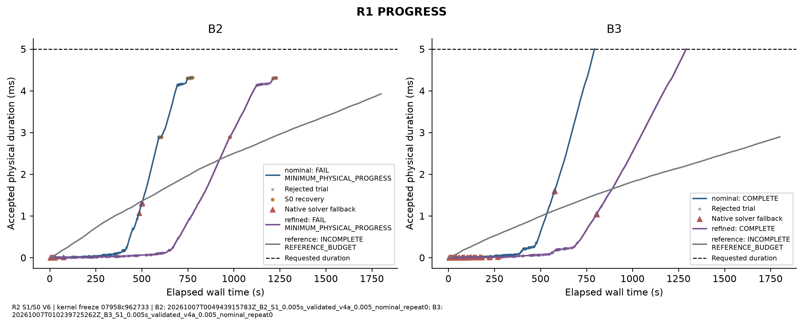

## R2_TIMESTEP_ERROR

[PNG](R2_TIMESTEP_ERROR.png) · [PDF](R2_TIMESTEP_ERROR.pdf) · [raw sources and definitions](R2_TIMESTEP_ERROR_SOURCES.json) · [generator](../../../../scripts/stage5a_r2/validation_figures.py)

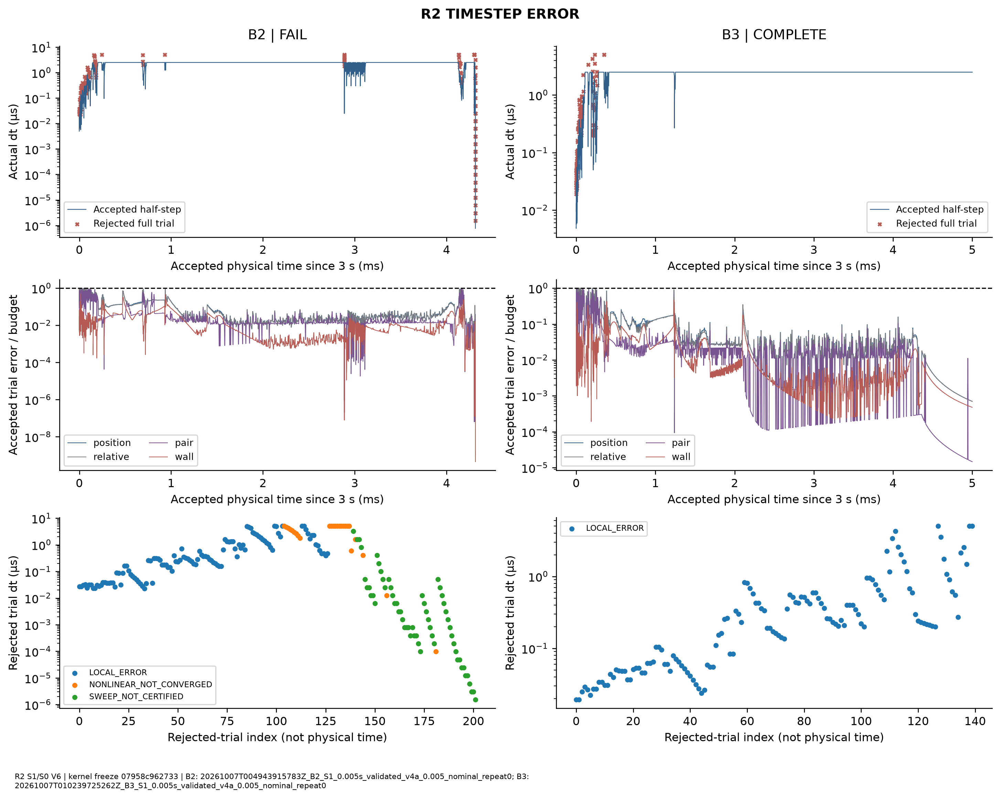

## R2b_REJECTED_TRIALS

[PNG](R2b_REJECTED_TRIALS.png) · [PDF](R2b_REJECTED_TRIALS.pdf) · [raw sources and definitions](R2b_REJECTED_TRIALS_SOURCES.json) · [generator](../../../../scripts/stage5a_r2/validation_figures.py)

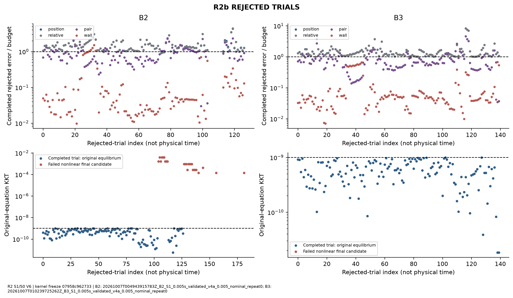

## R3_QP_DIAGNOSTIC

[PNG](R3_QP_DIAGNOSTIC.png) · [PDF](R3_QP_DIAGNOSTIC.pdf) · [raw sources and definitions](R3_DATA_SOURCES.json) · [generator](../../../../scripts/stage5a_r2/diagnostic_figures.py)

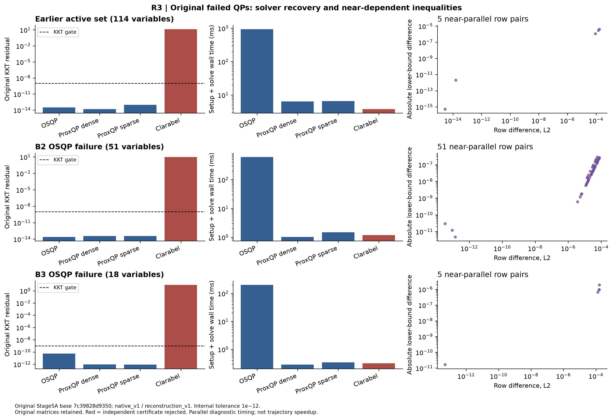

## R3b_KKT_TERMS

[PNG](R3b_KKT_TERMS.png) · [PDF](R3b_KKT_TERMS.pdf) · [raw sources and definitions](R3_DATA_SOURCES.json) · [generator](../../../../scripts/stage5a_r2/diagnostic_figures.py)

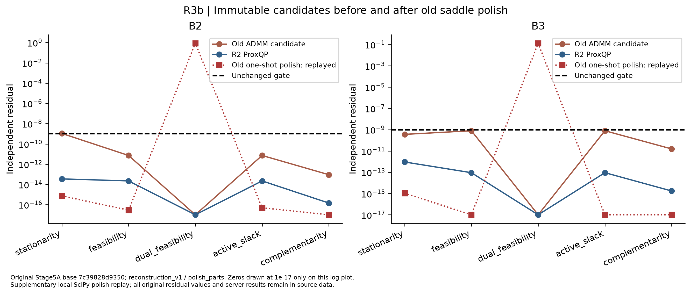

## R3c_NATIVE_ITERATIONS

[PNG](R3c_NATIVE_ITERATIONS.png) · [PDF](R3c_NATIVE_ITERATIONS.pdf) · [raw sources and definitions](R3_DATA_SOURCES.json) · [generator](../../../../scripts/stage5a_r2/diagnostic_figures.py)

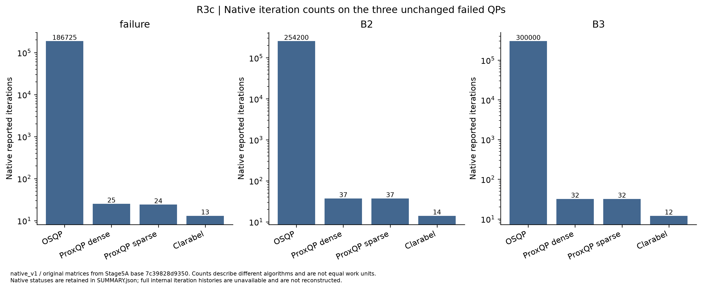

## R4_CONVERGENCE

[PNG](R4_CONVERGENCE.png) · [PDF](R4_CONVERGENCE.pdf) · [raw sources and definitions](R4_DATA_SOURCES.json) · [generator](../../../../scripts/stage5a_r2/diagnostic_figures.py)

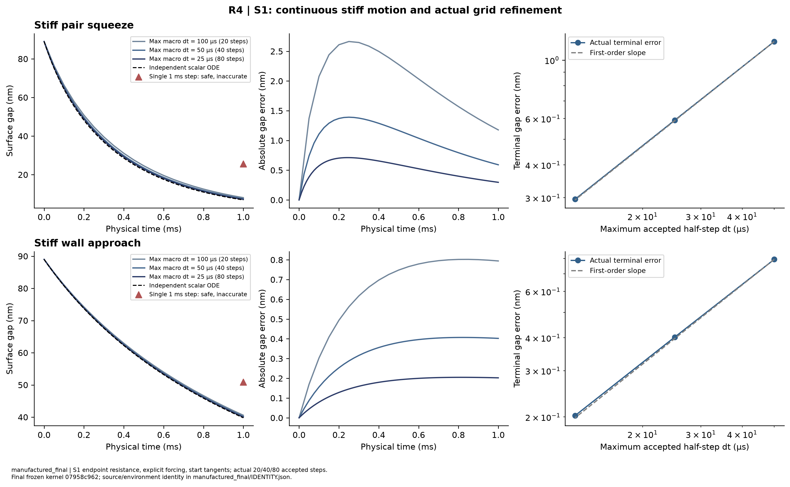

## R5_GEOMETRY_SAFETY

[PNG](R5_GEOMETRY_SAFETY.png) · [PDF](R5_GEOMETRY_SAFETY.pdf) · [raw sources and definitions](R5_GEOMETRY_SAFETY_SOURCES.json) · [generator](../../../../scripts/stage5a_r2/validation_figures.py)

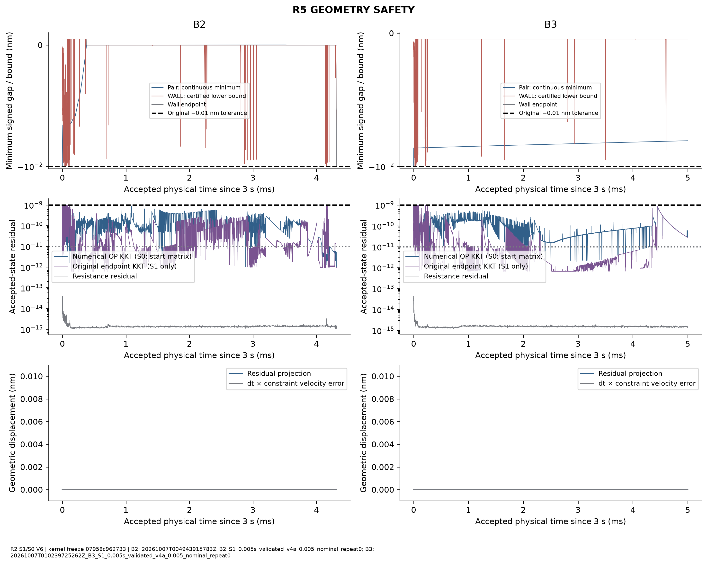

## R6_MOTION_METRICS_B2_0.001_legacy

[PNG](R6_MOTION_METRICS_B2_0.001_legacy.png) · [PDF](R6_MOTION_METRICS_B2_0.001_legacy.pdf) · [raw sources and definitions](R6_MOTION_METRICS_B2_0.001_legacy_SOURCES.json) · [generator](../../../../scripts/stage5a_r2/validation_figures.py)

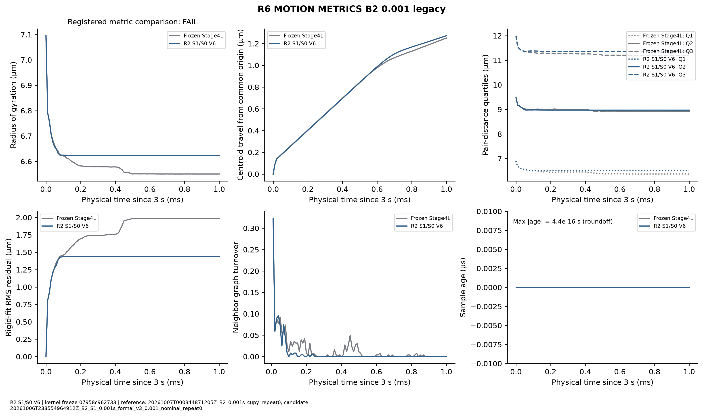

## R6_MOTION_METRICS_B2_0.001_v4_legacy

[PNG](R6_MOTION_METRICS_B2_0.001_v4_legacy.png) · [PDF](R6_MOTION_METRICS_B2_0.001_v4_legacy.pdf) · [raw sources and definitions](R6_MOTION_METRICS_B2_0.001_v4_legacy_SOURCES.json) · [generator](../../../../scripts/stage5a_r2/validation_figures.py)

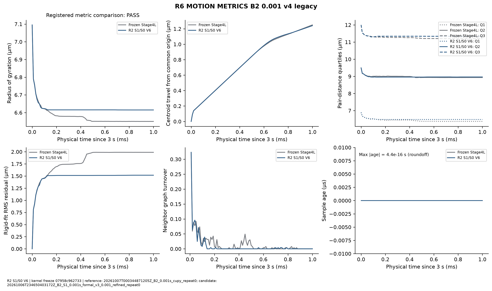

## R6_MOTION_METRICS_B2_0.001_v4a_legacy

[PNG](R6_MOTION_METRICS_B2_0.001_v4a_legacy.png) · [PDF](R6_MOTION_METRICS_B2_0.001_v4a_legacy.pdf) · [raw sources and definitions](R6_MOTION_METRICS_B2_0.001_v4a_legacy_SOURCES.json) · [generator](../../../../scripts/stage5a_r2/validation_figures.py)

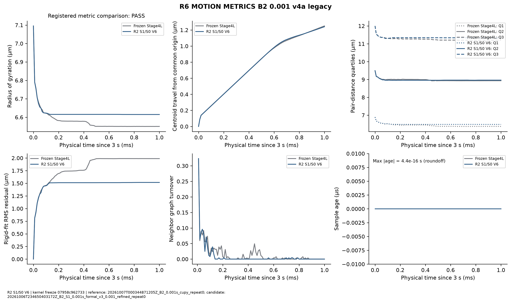

## R6_MOTION_METRICS_B2_0.005_v4a_partial_legacy

[PNG](R6_MOTION_METRICS_B2_0.005_v4a_partial_legacy.png) · [PDF](R6_MOTION_METRICS_B2_0.005_v4a_partial_legacy.pdf) · [raw sources and definitions](R6_MOTION_METRICS_B2_0.005_v4a_partial_legacy_SOURCES.json) · [generator](../../../../scripts/stage5a_r2/validation_figures.py)

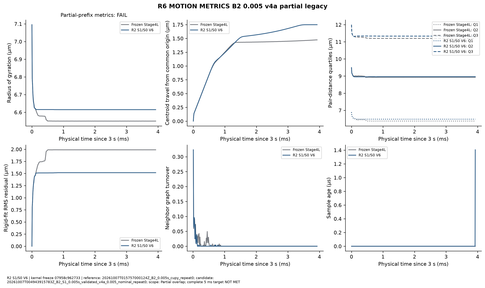

## R6_MOTION_METRICS_B3_0.001_legacy

[PNG](R6_MOTION_METRICS_B3_0.001_legacy.png) · [PDF](R6_MOTION_METRICS_B3_0.001_legacy.pdf) · [raw sources and definitions](R6_MOTION_METRICS_B3_0.001_legacy_SOURCES.json) · [generator](../../../../scripts/stage5a_r2/validation_figures.py)

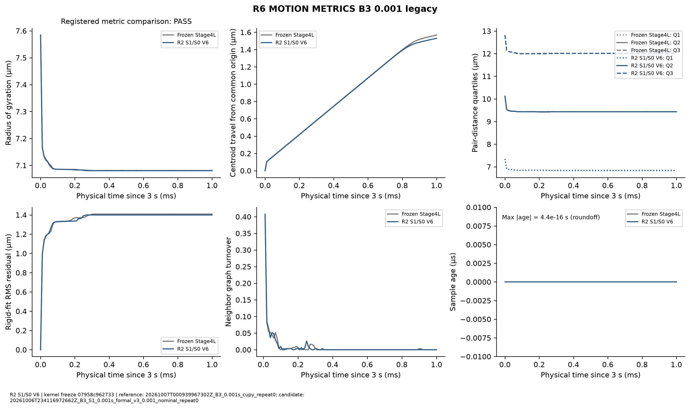

## R6_MOTION_METRICS_B3_0.001_v4_legacy

[PNG](R6_MOTION_METRICS_B3_0.001_v4_legacy.png) · [PDF](R6_MOTION_METRICS_B3_0.001_v4_legacy.pdf) · [raw sources and definitions](R6_MOTION_METRICS_B3_0.001_v4_legacy_SOURCES.json) · [generator](../../../../scripts/stage5a_r2/validation_figures.py)

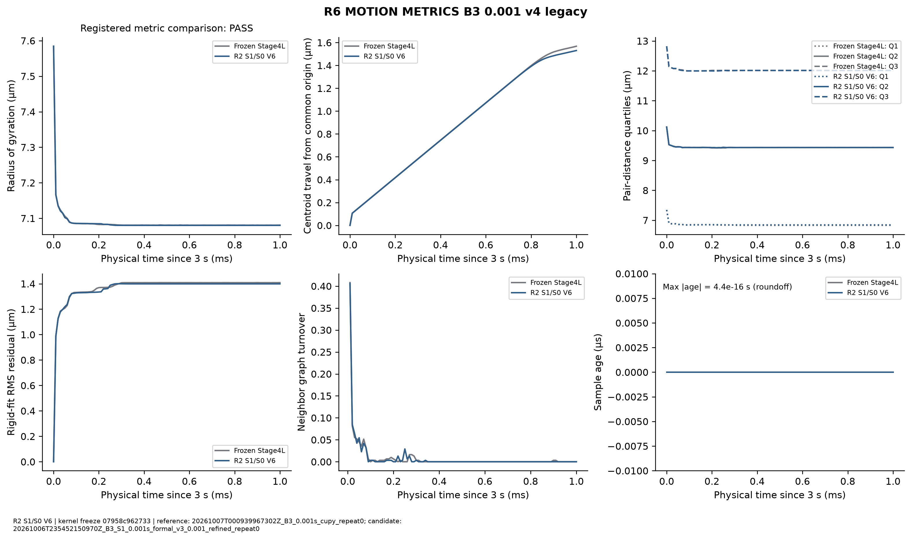

## R6_MOTION_METRICS_B3_0.001_v4a_legacy

[PNG](R6_MOTION_METRICS_B3_0.001_v4a_legacy.png) · [PDF](R6_MOTION_METRICS_B3_0.001_v4a_legacy.pdf) · [raw sources and definitions](R6_MOTION_METRICS_B3_0.001_v4a_legacy_SOURCES.json) · [generator](../../../../scripts/stage5a_r2/validation_figures.py)

## R6_MOTION_METRICS_B3_0.005_v4a_archived_legacy

[PNG](R6_MOTION_METRICS_B3_0.005_v4a_archived_legacy.png) · [PDF](R6_MOTION_METRICS_B3_0.005_v4a_archived_legacy.pdf) · [raw sources and definitions](R6_MOTION_METRICS_B3_0.005_v4a_archived_legacy_SOURCES.json) · [generator](../../../../scripts/stage5a_r2/validation_figures.py)

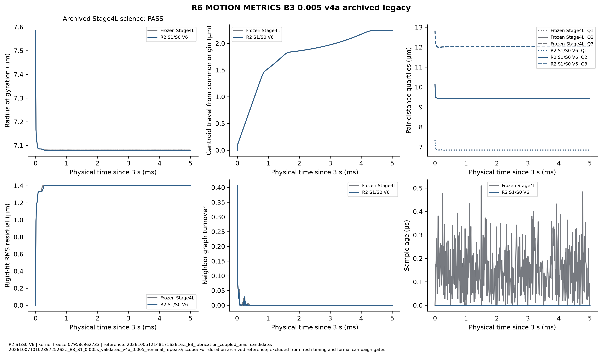

## R6_MOTION_METRICS_B3_0.005_v4a_partial_legacy

[PNG](R6_MOTION_METRICS_B3_0.005_v4a_partial_legacy.png) · [PDF](R6_MOTION_METRICS_B3_0.005_v4a_partial_legacy.pdf) · [raw sources and definitions](R6_MOTION_METRICS_B3_0.005_v4a_partial_legacy_SOURCES.json) · [generator](../../../../scripts/stage5a_r2/validation_figures.py)

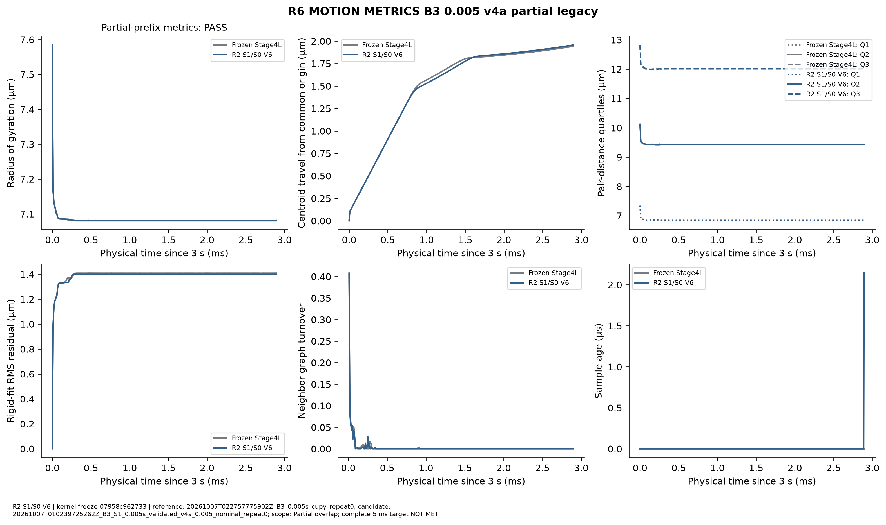

## R7_ACTUAL_MOTION_B2

[PNG](R7_ACTUAL_MOTION_B2.png) · [PDF](R7_ACTUAL_MOTION_B2.pdf) · [raw sources and definitions](R7_DATA_SOURCES.json) · [generator](../../../../scripts/stage5a_r2/motion_visuals.py)

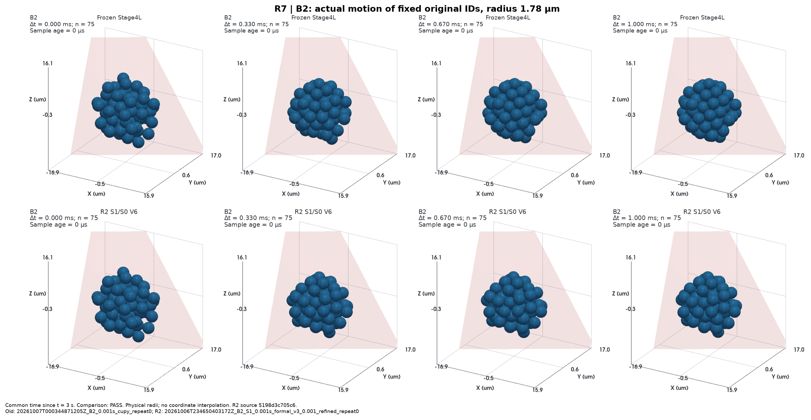

## R7_ACTUAL_MOTION_B3

[PNG](R7_ACTUAL_MOTION_B3.png) · [PDF](R7_ACTUAL_MOTION_B3.pdf) · [raw sources and definitions](R7_DATA_SOURCES.json) · [generator](../../../../scripts/stage5a_r2/motion_visuals.py)

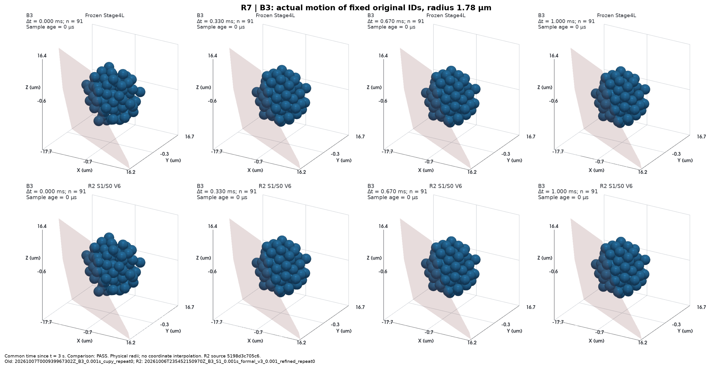

## R8_PERFORMANCE_RESOURCES

[PNG](R8_PERFORMANCE_RESOURCES.png) · [PDF](R8_PERFORMANCE_RESOURCES.pdf) · [raw sources and definitions](R8_PERFORMANCE_RESOURCES_SOURCES.json) · [generator](../../../../scripts/stage5a_r2/validation_figures.py)

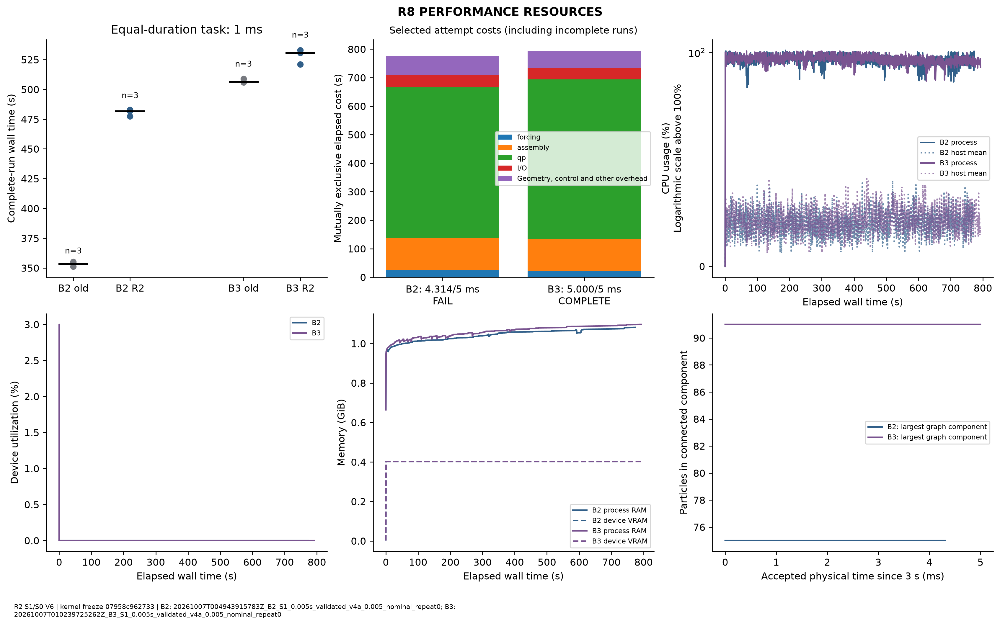

## R8b_PER_CORE_RESOURCES

[PNG](R8b_PER_CORE_RESOURCES.png) · [PDF](R8b_PER_CORE_RESOURCES.pdf) · [raw sources and definitions](R8b_PER_CORE_RESOURCES_SOURCES.json) · [generator](../../../../scripts/stage5a_r2/validation_figures.py)

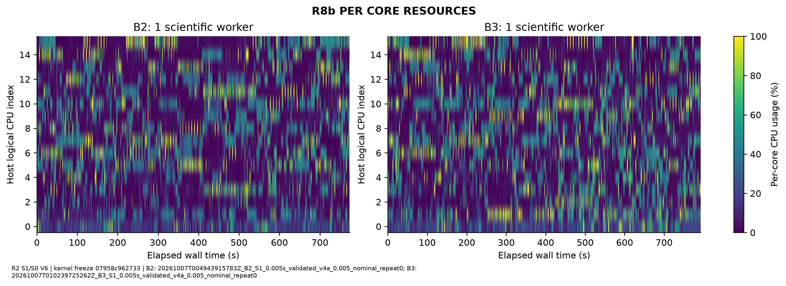

## Same-clock actual motion

[60 fps MP4](R7_OLD_NEW_ACTUAL_MOTION_60fps.mp4) · [actual frame data](R7_VIDEO_ACTUAL_FRAMES.npz) · [sampling and camera provenance](R7_DATA_SOURCES.json)

[Decoded-frame and coordinate audit](R7_VIDEO_VALIDATION.json). The MP4 and full frame archive are external exports when excluded by the size policy; local links work in the complete export folder. For GitHub readers, retrieve the actual paths, sizes and SHA256 from the [artifact manifest](../final/ARTIFACT_MANIFEST.json).
