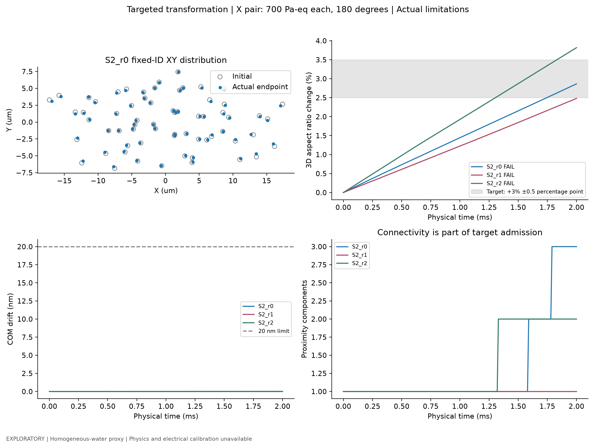

# F10AB：真实形变证据、有限可控性与目标失败

在当前 2.5 MHz 均匀水代理及已测试初态/时间窗内，存在经过数值验证、动作可区分的有限形状响应自由度；局部两参数分析仅支持一个可辨识形状方向，尚未证明多个独立形变方向、跨初态稳健的完整连通团目标变换或可逆控制。

本轮完成 147 条实际尝试，142 条完成预定物理窗口，5 条按原接触门槛停止。固定状态诊断 105 组；物理计算阶段合计 669.99 s。所有通过轨迹均保留每一步原始数组和独立力学复核。没有仪器操作、AI训练或新PDMS模型。

- [完整中文科研报告](F10AB_DEVELOPMENT_REPORT.md)
- [逐动作实际结果](SHAPE_RESPONSE_MATRIX.md) · [独立初态](REPLICATION_AND_GENERALIZATION.md)
- [数值误差](NUMERICAL_CONVERGENCE.md) · [目标试验](TARGETED_SHAPE_TRANSFORMATION.md)
- [机器准入](FINAL_GATE.json) · [自包含数据接口](DATASET_AND_F10Y_INTERFACE.md)
- [图表清单](figures/MANIFEST.json) · [视频清单](videos/MANIFEST.json)

[实际动作响应视频](videos/Video_F10AB_1_collective_shape_responses.mp4) · [去刚体运动视频](videos/Video_F10AB_2_rigid_motion_vs_deformation.mp4) · [真实目标试验视频](videos/Video_F10AB_3_shape_control_or_limitations.mp4)

适用范围：`EXPLORATORY` · `HOMOGENEOUS_WATER_CONTROL_PROXY` · `PHYSICS_UNCALIBRATED` · `ELECTRICAL_TO_ACOUSTIC_UNCALIBRATED` · `training_ready=false`。Y 与四源静态结果另加 `HOMOGENEOUS_WATER_PROXY_SPECIFIC`。
