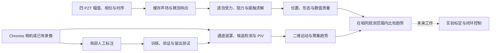

# 微泡声学控制与视觉观测：项目运行总览

更新：2026-10-19。本文按当前实际运行流程整理；阶段性的参数扫描、调试经过和完整日志请查文末链接，不再逐轮堆叠。

项目要回答的是：**能否用四枚 PZT 使微泡靠近、移动和改变群体形状，并用 Chronos 显微录像可靠地观测这些变化？** 当前已有可运行的逐泡仿真、人工标注和实时视觉观测系统。仿真与观测能够分别工作，实验中的自动闭环控制尚未完成。

## 1. 整体流程与当前入口



日常操作只需先选对应入口，以下命令在 **WSL 终端**执行：

| 现在想做什么 | 入口 |
|---|---|
| 先用已有录像熟悉界面 | `bash /home/lzy/projects/external_connect/vision_tracking_research/realtime_collective_observation_v1/start_replay.sh` |
| 连接 Chronos，观察并录制实验 | `bash /home/lzy/projects/external_connect/vision_tracking_research/realtime_collective_observation_v1/start_live.sh` |
| 补充或修改人工标注 | `bash /home/lzy/projects/external_connect/vision_tracking_research/smart_online_tracking_v2/start_annotation.sh` |
| 查看最新仿真代码及结果 | [F10AF 工程][sim-root]；[可观测尺度研究报告][af-report] |
| 查看正式全通道离线分析 | [F10X 离线工程][offline]；[结果说明][offline-readme] |

**当前仿真工程根目录：**

```text
/home/lzy/projects/computation_examples/_archives/mevo_observable_f10af_20261019/computation_examples/mevo_acoustic_microbubbles
```

当前分支为 `dev/f10af-observable-multifidelity-20261019`，基于已核查的 F10AE `306d899fa4a9be18b8a926688a6e25d389193138`；每条实验的实际执行提交见对应 `EXECUTION.json`。声学聚集历史依据来自 F10Z，完整数值引擎沿用 F10AA；F10AF 新增受限慢时间积分及大范围空间指标。旧的 `computation_examples/mevo_acoustic_microbubbles` 目录不能直接当作最新基线。

视觉启动入口仍使用上表路径，其中实时工程指向 F10Y 工作树；当前界面还包含后续本地修复，不能仅靠 F10Y 最初的提交重现最新版。各工程使用独立环境，启动脚本会选择自己的 Python，无需将所有依赖装入同一个环境。

## 2. 仿真：从 PZT 参数到微泡运动

### 2.1 当前模拟的装置与假设


*已有 F10M-R3 装置几何图。箭头表示声源朝向；顶部孔的 5.4 mm 定位参考仍保留原记录中的假设，图示不是实测声场。*

| 项目 | 当前设置 |
|---|---|
| PDMS 外形 | 32.5 × 9 × 9 mm |
| 水平通道 | 直径 1.6 mm，沿 X 方向；X 两端封闭 |
| 顶部开口 | 两个直径 1.5 mm 的镜像开口，连通中心通道 |
| PZT | 四枚直径 7 mm 圆片，位于 X±、Y± 外表面中心，朝装置内部 |
| 微泡运动环境 | 腔体按充水处理；背景流严格为零 |
| 当前声场 | 均匀水圆片声源代理，2.5 MHz 主研究；2.4/2.6 MHz 对照各用匹配缓存与响应 |
| 本批逐泡参数 | 半径 1.78 µm；32、64、128、200 泡均有有限窗口测试，具体准入按算例区分 |
| 当前时间尺度 | F10AF 最长完成 50 ms 完整逐泡参考；128/200 泡本轮限 2 ms，未完成秒级仿真 |

当前控制研究不求解注射、液滴、自由液面、声流或完整 PDMS 弹性反射。早期 Y 管有流算例与此处的无流直管是不同实验，不能混用结果身份。

### 2.2 一条仿真的执行顺序

1. **登记初态与动作。** 固定每个泡的 ID、位置、半径、目标、运行时长及停止条件。分散初态与人为预置的近接触团分开记录；预置团不能算作声学聚集成果。
2. **组合四 PZT 声场。** 各路独立设置启停、幅值、相位和持续时间；控制改变时组合已有基场，不重复运行整套 k-Wave。当前圆片代理的压力及梯度来自一致的场表达式。
3. **查询微泡响应和声力。** 按泡所在位置的实际声压查询已有 APECSS 响应，计算一次 Bjerknes 力及泡间二次 Bjerknes 相互作用。超出频率、压力或缓存空间范围的输入会拒绝，不能静默裁剪或外推。
4. **求解平移与接触。** 结合阻力、水动力耦合和局部润滑，用 Sequential QP 硬球约束限制穿透，再检查真实球面间隙与壁面条件。完整参考步长为 1 µs；F10AF 仅在已验证的适用范围内采用自适应慢时间积分，接近接触时返回完整求解器。
5. **保存接受步与失败证据。** 保存逐泡三维坐标、时间、压力、力、接触反力及质量状态；中止后的时间段不补造轨迹。
6. **做对照后再解释。** 比较 OFF、不同控制、半步长和更细声场缓存。分别评价质心位移与去质心形变，并检查接触事件；最后从保存数据生成图表和视频。

声场组合可简写为：`P(x) = Σ enabled_i × A_i × exp(jφ_i) × H_i(x)`。这里的 `A_i` 是 **Pa-equivalent 声源参数**，不是信号发生器的 Vpp，也不等于微泡所在处的声压；实际局部声压必须另行输出。硬件幅相与该参数的关系尚未标定。

### 2.3 当前结果应该怎样读

**整体移动**看质心；**内部聚集或形变**看去质心后的回转半径 Rg、粒子间距、形状张量、长短比与连通分量。Rg 下降说明分布收缩，但不足以单独证明形成稳定团；几何连边也不表示微泡物理融合。


*F10Z 实际 0–2 ms 计算。不同初态对同类 X 双源控制的响应不同，OFF 对照保持静止；不能将预置近接触初态与分散初态合并解读。*

[播放：分散微泡的 OFF、单源与双源对照](microbubble_aggregation_assets/simulated_dispersed_motion.mp4)。视频约 6.7 秒，展示的是 **2 ms 物理过程的慢放**，不是数秒仿真。

目前可确认的代表性结果：

- **32 泡中等分散态，X 双源、2 ms：** 质心 X 位移约 0.129 µm，Rg 减少约 0.594 µm；邻近图分量由 32 降至 28，最大局部组为 3 泡。这说明出现内部收缩和局部靠近，尚不是全部微泡形成一个稳定团。
- **同类 32 泡场景延长至 5 ms：** 质心 X 位移约 0.324 µm，Rg 缩小约 8.54%。没有秒级完整求解依据。
- **F10AA 的 128 泡优化版，2 ms：** Rg 缩小约 3.74%，完成半步长与细缓存对照；原始慢版本在 1.659 ms 达到预算而停止，因此没有完整 2 ms 的原实现对照。

F10AA 对标准窗口的实测完整墙钟如下。它是计算耗时，不是物理时长，也不是本机运行保证。

| 微泡数 / 物理窗口 | 原 CPU 单线程 | 优化 CPU 单线程 | 加速 |
|---|---:|---:|---:|
| 32 / 2 ms | 7.787 s | 2.646 s | 2.94 倍 |
| 64 / 2 ms | 34.632 s | 5.760 s | 6.01 倍 |
| 128 / 1 ms | 44.374 s | 6.561 s | 6.76 倍 |

本轮 CPU 接触求解优化更有收益，声学和壁面仍复用既有 GPU 路径；CuPy 线性求解通过数值检查但更慢，因此没有将“全 GPU”设成默认。256 泡仅做了短步预检。详细配置、失败和适用范围见 [F10AA 推荐方案][aa-recommendation]。

### 2.4 开发和复现入口

仿真目前采用科研脚本流水线，没有与相机界面合并的“一键导航”按钮。

| 环节 | F10AA 工程内位置 |
|---|---|
| 协议与预算 | `configs/straight_tube_exp1/f10aa/protocol.json` |
| 冻结初态与预登记 | `results/straight_tube_exp1/f10aa/PREREGISTRATION.json`、`STATES.h5` |
| 完整逐泡运行 | `scripts/straight_tube_exp1/f10aa/trajectory.py` 中的 `Campaign`；正式调度为 `full.py` |
| 远端执行 | 同目录 `remote.py`：不可变 Git 快照、独立 Supervisor 标签和超时 |
| 原始轨迹与失败 | `results/straight_tube_exp1/f10aa/` 下的 `full/`、`extension/` 等 |
| 分析与展示 | 同目录脚本 `analyze.py`、`figures.py`、`videos.py`；输出到结果目录 |

在上述工程根目录，开发者可用 `bash scripts/straight_tube_exp1/f10aa/python.sh -m pytest -q tests/f10aa` 检查软件接口。新科研任务应先冻结输入、指定新的输出目录和有限预算，再提交；已有 `prepare/full` 面向冻结实验，不能直接当成覆盖旧结果的启动器。当前加速后端需要显式选择，旧入口不会自动切换。

服务器连接为 `ssh -p 15283 root@95.3.33.46`。F10AA 独立目录位于 `/workspace/mevo_acoustic_microbubbles/f10aa_simulation_20261018`，使用其独立 `.venv`；通用 mevo 环境入口仍为 `source /workspace/mevo_acoustic_microbubbles/activate.sh`。远程结果回传后核对 SHA-256，执行源码身份以各任务的 `EXECUTION.json` 为准，不能用最终文档提交替代。

### 2.5 群体形状研究的历史基线（F10AB）

沿用 F10AA 完整逐泡引擎，新增固定 ID 的三维/XY形状分析，依次去除平移、刚体旋转和统一缩放。147 条尝试中，142 条完成、5 条被原数值门槛拒绝；45 组完整窗口数值比较全部通过。

180° X 双源在三个 X 向细长初态上都增大了长宽比，变化超过数值差异；210° 动作的方向则依赖初始排列。局部幅值/相位分析只支持一个可辨识形状方向。预登记的“长宽比增加3%且保持连通”目标未通过：部分群体裂为多个邻近分量。因此，目前证明的是有限的固定粒子集合形变能力，尚未证明稳健、可逆的完整泡团形状控制。

[完整报告与十组科研图][ab-report] · [去刚体运动后的真实视频][ab-video]。服务器独立目录为 `/workspace/mevo_acoustic_microbubbles/f10ab_shape_20261018`；完整每步原始数据保留在那里，本地另有可独立读取的逐轨迹查阅数据。均匀水近似、物理未校准和 `training_ready=false` 保持不变。

### 2.6 多频率与有限形变搜索（F10AC + F10AD）

在原 F10AA 逐泡引擎上，新增 pyribs 官方 BOP-Elites、CMA-MAE 与 SciPy Sobol 比较。每种方法同为 32 次计费评价；本次 CMA-MAE 得到 6 个档案格、用时 89.0 s，Sobol 为 5 格/111.9 s，BOP 为 4 格/301.0 s。这是单次有限预算结果，档案格数不等于独立物理模式数。

2.4、2.5、2.6 MHz 的声场和 APECSS 响应分别生成并核查；历史 2.5 MHz 生产路径保持不变。相同 Y 双源动作下，2 ms 内 Rg 分别约降低 7.59%、0.0057%、10.83%，对应九条频率/动作轨迹的 18 个半步长与细缓存对照全部通过。Y 结果仍仅适用于均匀水代理，不能直接外推到 PDMS 实验。

366 次逐泡尝试中 363 条完整，3 条因历史响应表低压下限中止。三个档案候选通过独立初态与数值复核，但仍只确认“收缩、长宽比增加”这一类同向响应，没有证实新的独立控制模式或绝对主轴伸长。另一个强收缩候选在三个新初态的步长差异达 105–319 nm，超过原 50 nm 门槛，保留为失败证据。已记录科学计算和后处理约 30.5 分钟，不含开发及回传时间。

![相同动作在三个频率下的形变差异][acad-figure]

[27 项中文结论与限制][acad-report] · [多频率真实逐泡视频][acad-video] · [开发与复现入口][acad-code]。12 组 PNG/PDF、3 段 MP4 和全部失败索引已经生成；服务器独立目录为 `/workspace/mevo_acoustic_microbubbles/f10ac_ad_20261018`。完整逐步原始数据和全部便携数据保留在服务器，本地保留报告、媒体、关键输入轨迹与校验清单。没有操作真实 PZT，也未开展世界模型或强化学习训练，`training_ready=false`。

### 2.7 指定形态、恢复与鲁棒性（F10AE）

继续复用 F10AA 逐泡引擎，限定 64 泡、无流、均匀水代理，先登记目标再搜索幅相。官方 APECSS 支持将历史 2.5 MHz、原壳参数和半径 1.78 µm 的低压范围有限扩展至 **0.001 Pa**；0.0001 Pa 的精细求解超时，未准入。历史表与轨迹不变，搜索比较全程保留原压力域，新的低压扩展单独验证。

Ax/BoTorch 与 Sobol 各有 32 次观察，包含 8 个共同起点；本次 Ax 首次达到发现集目标需 10 次观察，Sobol 为 26 次。这是单次有限预算比较。选定 T1 动作使发现初态长宽比增加约 **2.997%**、质心移动 **2.132 nm**，但独立验证及最终测试均只命中 **2/3**；较小形变目标 T2 的独立验证为 **2/3**、最终测试为 **3/3**。两者都未达到预登记的跨初态完整确认条件。

不能将长宽比增加直接称为拉伸。两个验证初态出现超过数值差异的全局主轴增长 **1.186 / 2.218 nm**，但已分成 3 / 2 个邻近分量，其最大 62 泡子群仍收缩。另一个最终测试初态出现连通态约 **7.808 nm** 主轴增长，未对该留出初态追加数值复核，保留为未确认观察。第二段主动控制也没有实现恢复：选定案例的 Rg 误差由约 **0.694%** 增至 **0.746%**，固定 ID 内部结构误差同样增加，不能称为可逆形状控制。

本轮 **230 次逐泡尝试，227 条完整、3 条中止**；630,000 个完整轨迹时间步完成独立审计，66 组半步长/缓存比较通过。核心科学计算与审计约 **18.24 分钟**，图和视频生成另计约 1 分钟，不含安装、开发与回传。12 组 PNG/PDF、3 段真实逐泡 MP4、失败记录和输入哈希均已保存。频率和壳参数变化会使目标值偏离；目前仍是短窗口、未校准的均匀水代理，`training_ready=false`。

![实际主轴变化与初态敏感性][ae-figure]

[25 项中文结论与完整限制][ae-report] · [两段动作与未恢复的真实视频][ae-video] · [开发和复现入口][ae-code]。服务器独立目录为 `/workspace/mevo_acoustic_microbubbles/f10ae_target_20261019`，大型逐步原始数据保留在该目录。下一步应在多个发现初态上优化，再用独立测试判断能否可靠控制；恢复研究应先寻找可重复的反向形变机制，并补做切换瞬态和真实四源声场标定。

### 2.8 可观测尺度的空间排列与慢时间积分（F10AF）

研究对象从紧凑泡团扩展到约 1.0 × 0.8 mm 的分散微泡云，并复用 F10Y 的二维群体指标。X 双源在 2.5 MHz 下存在约 **304.49 µm** 间距的 X 向稳定位置，但静态周期不等于微泡已形成条带。最长 X 双源试验完成 **50 ms**，最大逐泡位移约 **13.238 µm**；尚未确认条带、二维阵列或持续整体旋转，也未证明这些变化能被真实 Chronos 可靠观测。

新增受限 SciPy 慢时间积分，保留原 F1/F2；远离接触时利用原阻力矩阵等于单位阵的性质，接近接触时返回原完整求解。短窗口可明显加速，50 ms 接触增多后优势缩小；紧凑初态在约92 µs触发的原反力平衡失败被如实复现，未放宽门槛。100 ms 的必要精细复算因预测成本超过单条预算而未运行。

本轮 **78 次完整物理尝试、77 条完成**；科学计算阶段墙钟合计约 **34.19 分钟**，审计、分析和媒体生成另计。SMAC3 与 BoTorch 官方接口已通过冻结实测数据回放验证；由于没有高保真阳性模式，正式多保真筛选未准入。另完成8条有界全物理Sobol对照，不能据此宣称AI方法优于历史CMA-MAE。


[28项中文结论与完整报告][af-report] · [实际条带尝试视频](microbubble_aggregation_assets/f10af_pattern_attempt.mp4) · [代码与复现入口][af-code]。12组PNG/PDF和3段60 fps真实数据视频已保存；视频是毫秒物理过程的慢放。声流、自旋、真实PDMS声场及电压—声压映射未校准，`training_ready=false`。下一步优先测量真实声场与群体运动机制，再建立可重复的阳性模式和观测标定。

## 3. 人工标注：少量可靠区域支持检测开发

标注的作用是提供真实显微图像上的参考，帮助评价和改进检测。**不要求每次标完一整帧。** 当前推荐每次完整检查一小块，而不是零散标几个泡后把整帧标成审核完成。

启动上表中的 `start_annotation.sh`，然后按右侧“逐张标注”的步骤操作：

1. **框选小区域并放大。** 选择一块能完整检查的区域。
2. **可选生成批量候选。** Cellpose 提供待修正的起点；直径范围默认只是参考，不要求所有泡一样大。
3. **删错、补漏。** 候选橡皮擦修剪后，点击“纳入草稿”；再用画笔补全漏泡。画一只泡后按 **N**，开始下一只独立泡。
4. **确认已检查区域。** 框内对象、漏检和背景都查完后才确认；未检查的框外区域不会作为训练背景。
5. **保存并下一张。** 可在“已保存标注”中继续编辑或删除；无法判断的对象使用不确定类别。


*已有局部候选操作截图。彩色覆盖是未审核候选，仍须人工删错、补漏；当前工作台另有“已保存标注”栏目。*

常用快捷键：**N** 新增单泡；**P / E** 标签画笔 / 橡皮擦；**R** 候选橡皮擦；**Ctrl + 滚轮** 调整笔刷；**Ctrl+Z** 撤销；**Ctrl+S** 保存。完整图示与恢复操作见 [ANNOTATION_READY.md][annotation-guide]。

默认后台微调更新的是 **SAM 单泡掩码解码器**，并非自动训练 Cellpose 批量检测模型。只有通过独立验证的候选模型才替换当前模型；保存草稿不等于产生合格训练真值。训练、验证和测试按源视频时间块分开，不能把相邻帧随机混进不同集合。

第 49、50 张的已确认区域已用于固定参数留出测试，无需为了这次测试重标。OpenCV 中心检测 F1 约 0.862，但掩码 F1 仅约 0.195，说明“找到中心”与“恢复准确轮廓”仍有差距；这是同录像的局部测试，不代表新实验泛化。详细结果见 [留出测试报告][heldout]。

## 4. 离线录像：先确认检测与运动观测是否可信

已有测试视频保存在 [sample_videos][sample-videos]。**只想看分析效果时，直接使用 `start_replay.sh`**：默认会自动开始回放，不需要连接相机或 AFG。

处理顺序为：**读取图像与时间戳 → 限定通道遮罩 → 检测候选 → 计算有效 PIV → 质量筛选 → 汇总群体趋势 → 保存图像、向量和事件。** PIV 估计的是相邻画面的局部图案位移，不要求为每只泡维持长期 ID。

当前分工：

- **F10X** 保存全通道离线分析与后端比较。正式完整录像结果为 `collective_motion_v4/results/full_video_verified_v5/results/offline_regular/`；失败的加速试验另存，不应替代正式结果。
- **F10Y** 将同一观测流程用于实时回放和 LIVE。实时模式优先处理最新图像，分析可能跳过中间帧；因此“收到的视频帧率”与“有效观测更新率”要分开看。

离线评价需要同时看误检、漏检、时间匹配和质量拒判。画面中的箭头平滑、软件运行顺畅，都不能替代这些检查。

## 5. 实验现场：连接、画区域、观察、记录

### 5.1 开始一次观测

1. **连接并开启 Chronos。** 原 Windows 接收项目在 `F:\CHRONOS_control`，WSL 对应 `/mnt/f/CHRONOS_control`；当前程序复用该接收链路。避免同时开启多个争用同一预览流的窗口。
2. **运行 `start_live.sh`。** 确认输入为 **LIVE_CAMERA**，点击 **Start**。收到首帧后自动录制，无需另开录像开关。
3. **点击 Draw LIVE mask。** 沿通道内部描点，双击、按 Enter 或点回起点完成，立即生效并自动保存。Backspace 撤回一点，Esc 取消绘制。**Clear current mask** 清除当前区域与旧分析；重新画即可。
4. **查看 Candidates、PIV 和趋势。** 默认显示候选、PIV 与 mask；**Regions、Shape 默认关闭**，需要时再打开。
5. **按实际实验记录 PZT 事件。** 选择对应 PZT，在备注填写实际条件，操作硬件时使用 **Mark ON / Mark OFF** 留下人工事件时间。
6. **点击 Stop。** 等待录像完成保存，再点 **Open records**，Windows 文件资源管理器会打开本次会话目录。


*最新界面在真实 Chronos 录像上的回放截图。此图不是本次相机在线连接证据；图中的事件选择也属于回放模式。LIVE 界面使用人工事件记录，并隐藏回放专用控件。*

[观看：自动保存的图像与识别叠加视频样例][overlay-video]。该文件只包含接收图像及标记，不含整个软件窗口；来自约 10 秒的真实录像回放验证。

### 5.2 如何理解界面

| 界面内容 | 含义与使用方法 |
|---|---|
| Candidates | 当前可见候选位置；数量会受失焦、遮挡和漏检影响，不等于真实泡总数 |
| PIV | 二维表观运动方向与速度，当前单位为 **px/s**；光学标定前不能当作 mm/s |
| Smooth PIV | 默认开启，仅平滑显示箭头，原始速度向量与科学统计不变；关闭可看 raw |
| Measured frame | 查看与观测结果对应的图像，便于检查图像和标记的对应关系 |
| Overlay delay | 当前图像与所用过去分析结果的时间差；过期结果会撤下，不继续显示旧运动 |
| Group radius / Radial motion | 候选分布的尺度与去平移后的径向运动，需结合候选数和质量状态解读 |
| Trend: Not observable | 当前证据不足，不能据此判定在聚集或分散 |

PIV 当前采用细黄色开放箭头，固定网格与因果平滑减少跳动。平滑带来一定响应延迟，只改善显示，不提高测量精度。新画的 mask 默认使用图像坐标，未校正相机晃动；因此应保持镜头和装置稳定。

**PZT 事件按钮只记时间，不控制输出。** 实际信号发生器仍使用独立的 `F:\Tektronix_control\start_gui.cmd`，设置频率、输入 Vpp、相位及启停，具体见 [AFG 控制说明][afg-guide]。硬件 PZT1–4 与空间 X±、Y± 的关系需要根据实际接线记录；不能将仿真的 Pa 数值直接填入 Vpp。

### 5.3 Stop 后保存了什么

每次 Start 建立一个新的会话，位于实时工程的 `runtime/<运行编号>/session_*`，不会覆盖上次录像。

| 文件 | 内容 |
|---|---|
| `experiment_raw.mp4` | 无标记的接收图像，H.264 压缩 |
| `experiment_overlay.mp4` | 同批图像与当前启用的检测、PIV、mask 等叠加结果 |
| `video_frames.jsonl` | 逐帧时间戳、源帧与分析帧对应、叠加延迟、mask 版本 |
| `video_manifest.json` | 帧数、编码、漏录与保存状态 |
| `states.jsonl.gz` | 原始候选位置、有效速度向量和质量状态 |
| `pzt_events.json` 等 | 人工 PZT 事件、区域修改及会话汇总 |

录像依据本机实际接收间隔保存；接收时间不是未经提供的相机曝光时间，预览录像也不是 Chronos 内部的高速原片。相机内部高速原片需另行保存。查看实验视频时一并检查 manifest 中的漏录与错误记录，不只看能否播放。

详细故障排查和操作说明见 [实时界面 README][live-readme] 与 [实验室连接指南][lab-guide]。

## 6. 从实验记录得到可比较的结论

一次有用的实验至少要保留：**原始视频、通道区域、实际驱动条件、ON/OFF 时间、观测质量与时间戳**。先记录 OFF 段，再记录实际控制段；镜头、照明、焦面与分析区域尽量保持一致。

对比时分开回答三个问题：

1. **整体有没有移动？** 看候选中心和局部运动，不把整个视野漂移当作微泡受控平移。
2. **内部是否靠近或伸展？** 结合去平移后的径向运动、Rg、最近邻与局部密度；候选数量突然减少时，不能直接宣称聚集。
3. **变化是否可靠、是否与控制有关？** 查看时间对齐、OFF 对照、检测质量和重复实验。视觉趋势本身不能单独证明声学因果。

仿真提供固定 ID 的三维坐标与受力，视觉提供可能漏检的二维投影。只有在视野、时间尺度、投影与单位一致后才能比较趋势，不能直接把二者的 Rg 或泡数当成相同物理量。群体观测减少了逐泡长期 ID 标注需求，但不消除人工质量核查的作用。

## 7. 当前边界与下一步

当前已具备四路声场参数接口、逐泡有限窗口仿真、32–128 泡数值对照、局部标注、全通道离线分析，以及 LIVE/回放共用的观测和录像界面。

还未完成真实装置的电压—声压标定、复杂边界声场校准、接触/融合物理标定、任意三维位置与形态控制，以及相机驱动 PZT 的自动闭环。尤其 Y 向结果受均匀水近场结构影响，必须保留 `HOMOGENEOUS_WATER_PROXY_SPECIFIC` 范围，不能外推为真实 PDMS 装置性能。

下一步优先顺序是：**先取得带可靠时间和驱动记录的真实 OFF/ON 数据 → 用少量独立人工区域核查检测 → 完成像素尺度及驱动标定 → 与通过收敛检查的仿真趋势对照 → 再研究闭环与动作条件模型。** 当前没有准入的神经世界模型，也没有真实实验闭环控制验证。

继续保留项目状态：`EXPLORATORY`、`PHYSICS_UNCALIBRATED`、`HOMOGENEOUS_WATER_CONTROL_PROXY`、`ELECTRICAL_TO_ACOUSTIC_UNCALIBRATED`、`training_ready=false`、`scientific_control_admitted=false`。

## 8. 深入查看时再打开这些资料

- 仿真：[F10AA 完整报告][aa-report]、[活动代码索引][aa-code]、[数值准入记录][aa-gate]；声学聚集结论见 [F10Z 报告][z-report]。
- 标注：[详细操作指南][annotation-guide]、[第 49/50 张测试结果][heldout]。
- 视觉：[F10X 离线结果][offline-readme]、[当前实时界面说明][live-readme]、[现场指南][lab-guide]。
- 本文配图与短视频为现有产物的原样副本，来源和 SHA-256 见 [媒体来源清单](microbubble_aggregation_assets/media_sources.json)。完整科研数据、失败记录和历史报告仍保存在各阶段目录。

[sim-root]: /home/lzy/projects/computation_examples/_archives/mevo_observable_f10af_20261019/computation_examples/mevo_acoustic_microbubbles
[aa-report]: /home/lzy/projects/computation_examples/_archives/mevo_simulation_f10aa_20261018/computation_examples/mevo_acoustic_microbubbles/results/straight_tube_exp1/f10aa/reports/F10AA_DEVELOPMENT_REPORT.md
[aa-code]: /home/lzy/projects/computation_examples/_archives/mevo_simulation_f10aa_20261018/computation_examples/mevo_acoustic_microbubbles/results/straight_tube_exp1/f10aa/reports/ACTIVE_CODE_INDEX.md
[aa-gate]: /home/lzy/projects/computation_examples/_archives/mevo_simulation_f10aa_20261018/computation_examples/mevo_acoustic_microbubbles/results/straight_tube_exp1/f10aa/FINAL_GATE.json
[aa-recommendation]: /home/lzy/projects/computation_examples/_archives/mevo_simulation_f10aa_20261018/computation_examples/mevo_acoustic_microbubbles/results/straight_tube_exp1/f10aa/reports/FINAL_RECOMMENDATION.md
[z-report]: /home/lzy/projects/computation_examples/_archives/mevo_simulation_f10z_20261018/computation_examples/mevo_acoustic_microbubbles/results/straight_tube_exp1/f10z/F10Z_DEVELOPMENT_REPORT.md
[annotation-guide]: /home/lzy/projects/external_connect/vision_tracking_research/smart_online_tracking_v2/ANNOTATION_READY.md
[heldout]: /home/lzy/projects/external_connect/vision_tracking_research/smart_online_tracking_v2/results/heldout_49_50_20261016_v1/REPORT.md
[offline]: /home/lzy/projects/external_connect/vision_tracking_research/collective_motion_v4
[offline-readme]: /home/lzy/projects/external_connect/vision_tracking_research/collective_motion_v4/README.md
[sample-videos]: /home/lzy/projects/external_connect/sample_videos
[live-readme]: /home/lzy/projects/external_connect/vision_tracking_research/realtime_collective_observation_v1/README.md
[lab-guide]: /home/lzy/projects/external_connect/vision_tracking_research/realtime_collective_observation_v1/LAB_CAMERA_INTEGRATION_GUIDE.md
[afg-guide]: /mnt/f/Tektronix_control/README.txt
[overlay-video]: /home/lzy/projects/external_connect/vision_tracking_research/realtime_collective_observation_v1/runtime/piv_refinement_20261018/ui_replay_final/session_1792333728802166535/experiment_overlay.mp4

[ab-report]: /home/lzy/projects/computation_examples/_archives/mevo_shape_f10ab_20261018/computation_examples/mevo_acoustic_microbubbles/results/straight_tube_exp1/f10ab/F10AB_DEVELOPMENT_REPORT.md
[ab-video]: /home/lzy/projects/computation_examples/_archives/mevo_shape_f10ab_20261018/computation_examples/mevo_acoustic_microbubbles/results/straight_tube_exp1/f10ab/videos/Video_F10AB_2_rigid_motion_vs_deformation.mp4

[acad-report]: /home/lzy/projects/computation_examples/_archives/mevo_qd_f10ac_ad_20261018/computation_examples/mevo_acoustic_microbubbles/results/straight_tube_exp1/f10ac_qd/FINAL_CHINESE_REPORT.md
[acad-code]: /home/lzy/projects/computation_examples/_archives/mevo_qd_f10ac_ad_20261018/computation_examples/mevo_acoustic_microbubbles/scripts/straight_tube_exp1/f10ac_qd/README.md
[acad-figure]: /home/lzy/projects/computation_examples/_archives/mevo_qd_f10ac_ad_20261018/computation_examples/mevo_acoustic_microbubbles/results/straight_tube_exp1/f10ac_qd/figures/Fig_10_frequency_dependent_shape_response.png
[acad-video]: /home/lzy/projects/computation_examples/_archives/mevo_qd_f10ac_ad_20261018/computation_examples/mevo_acoustic_microbubbles/results/straight_tube_exp1/f10ac_qd/videos/Video_F10AD_3_frequency_dependent_dynamics.mp4

[ae-report]: /home/lzy/projects/computation_examples/_archives/mevo_target_f10ae_20261019/computation_examples/mevo_acoustic_microbubbles/results/straight_tube_exp1/f10ae/FINAL_CHINESE_REPORT.md
[ae-figure]: /home/lzy/projects/computation_examples/_archives/mevo_target_f10ae_20261019/computation_examples/mevo_acoustic_microbubbles/results/straight_tube_exp1/f10ae/figures/Fig_F10AE_06_absolute_principal_axis_extension.png
[ae-video]: /home/lzy/projects/computation_examples/_archives/mevo_target_f10ae_20261019/computation_examples/mevo_acoustic_microbubbles/results/straight_tube_exp1/f10ae/videos/Video_F10AE_2_deformation_and_recovery.mp4
[ae-code]: /home/lzy/projects/computation_examples/_archives/mevo_target_f10ae_20261019/computation_examples/mevo_acoustic_microbubbles/results/straight_tube_exp1/f10ae/EXECUTION_AND_REPRODUCTION.md

[af-report]: /home/lzy/projects/computation_examples/_archives/mevo_observable_f10af_20261019/computation_examples/mevo_acoustic_microbubbles/results/straight_tube_exp1/f10af/F10AF_OBSERVABLE_DEVELOPMENT_REPORT.md
[af-code]: /home/lzy/projects/computation_examples/_archives/mevo_observable_f10af_20261019/computation_examples/mevo_acoustic_microbubbles/results/straight_tube_exp1/f10af/ACTIVE_CODE_INDEX.md
