# Future interface and architecture — DESIGN, not deployed control

The only executed transport is local Python → ZeroMQ → a mock Python consumer inside WSL. The mock does not import Tektronix, send SCPI, or turn anything OFF/ON. A true physical stop requires a separate authorized integration.

```mermaid
flowchart LR
    C[Chronos 1.4 live RTSP\nWindows reception verified] -. future integration .-> R[Existing LatestFrameStream\nsnapshot tuple]
    V[Real saved microscopy video\nCAUSAL_REPLAY_TEST] --> P[PyAV paced producer\noriginal Chronos latest slot]
    P --> D[OpenCV detector\nfixed ROI and background mask]
    R -. future .-> D
    D --> T[Norfair association\nOBSERVED / LOST / UNKNOWN]
    D --> F[Optional sparse LK\nimage motion only]
    T --> Q[Image quality and age checks\nshape unavailable when unreliable]
    F --> Q
    Q --> Z[Bounded ZeroMQ messages\nno hardware permissions]
    Z --> M[Mock receiver\nstale/repeat/discontinuity rejection]
    M -. DESIGN ONLY .-> A[AI policy and action proposal]
    A -. future explicit enable .-> G[Existing Tektronix Rig\nlimits / readback / emergency OFF]
```



## Observation schema

The executable example is in `results/full_cc_target_roi/states.jsonl`; `results/*/mock_received.json` contains what the mock actually received. Unit is **px / encoded replay second**. Camera exposure timestamp is null. Replay PTS is not a substitute for exposure timing.

```json
{
  "schema_version": 1,
  "test_kind": "CAUSAL_REPLAY_TEST",
  "frame_id": 138,
  "image_source": "original video path",
  "capture_timestamp": null,
  "source_pts_s": 4.5954,
  "time_unit": "ENCODED_REPLAY_SECONDS",
  "receive_monotonic_s": "number, host clock domain",
  "receive_utc": "ISO 8601",
  "process_done_monotonic_s": "number",
  "send_monotonic_s": "number",
  "timestamp_discontinuity": false,
  "stale": false,
  "targets": [
    {
      "id": "integer, temporary software identity",
      "status": "OBSERVED | LOST | UNKNOWN",
      "new": false,
      "lost": false,
      "xy_px": "[x,y] or null",
      "predicted_xy_px": "[x,y] or null for lost state, never an observation",
      "velocity_px_per_replay_s": "[vx,vy] or null",
      "visual_valid": false,
      "confidence_semantics": "uncalibrated deterministic quality gate",
      "classification": "VISIBLE_SINGLE_CANDIDATE | BLUR_OR_OVERLAP_UNKNOWN | FIXED_OR_SLOW_VISUAL_FEATURE | UNKNOWN",
      "bubble_identity_verified": false,
      "shape": "current visual-region area, contour, tensor, aspect, axis; or null",
      "prediction": "PREDICTED crossing position/time or null",
      "uncertainty": "causal residual-based position/time uncertainty, not calibrated probability",
      "target_crossing": "OBSERVED | PREDICTED | LOST | NOT_CROSSED | UNKNOWN"
    }
  ],
  "group_shape": null,
  "group_shape_status": "UNKNOWN_UNVALIDATED_SEGMENTATION",
  "control_permission": false
}
```

This is a field guide, not a literal runnable JSON message (type descriptions intentionally replace measured numbers). Actual messages are numeric and validated with `allow_nan=False`. The mock accepts a **visual** state only for new frame ID, age ≤100 ms, continuous PTS, and at least one quality-screened observed candidate. **Bubble-control admission is always false**, even when a visual state is accepted. One confidently detected image feature is insufficient evidence that the intended bubble group is followed.

The present gate is conservative about age/blur/near neighbors, but does not establish physical identity. The short-track audit documents identity fragmentation. Do not treat its `visual_valid` flag as a calibrated confidence probability. A displacement below 2 px over the short history is labeled fixed-or-slow, not scientifically proven background; this can reject a truly stationary bubble. The mask of the long fixed stripe also hides any real bubble crossing it. These are explicit costs of a minimal baseline.

No small/large aggregate class is assigned on area alone. The sample does not supply trusted aggregate labels. Their future schema values can be `SMALL_AGGREGATE`, `LARGE_AGGREGATE` only after verified segmentation; until then overlapping/blurred regions remain unknown and `group_shape=null`. Measured component moments describe the threshold mask, not the group’s physical shape or fusion.

## Target region and event semantics

Predeclared image target: horizontal line y=600 px, positive-y crossing direction, nominal ±5 px tolerance, within the selected ROI. Current prototype detects sign changes for OBSERVED crossing and makes a ≤0.25 s linear forecast using only past observations. Uncertainty is residual-based with a 1 px floor; it has not been calibrated. The ±5 px tolerance is documented but not used to claim an event accuracy score. No annotated crossing event set exists; crossing precision/recall remains **NOT_EVALUATED**. New/changed IDs cannot support retrospective interpolation across an uncertain gap.

## Future action envelope (DESIGN ONLY)

An action proposal should carry `observation_session_id`, `frame_id`, `target_id`, `created_utc`, `deadline`, a calibrated time-domain mapping, `control_enabled`, four requested `ChannelSettings`, reason and model/version identity. A separate authorized executor uses existing `Rig` validation/readback and logs correlation IDs. Reject proposals based on stale/unknown/LOST state. User emergency stop has priority over the proposal queue. A watchdog should handle loss of fresh vision; no hard-real-time stop or cross-device phase simultaneity is claimed by this design.

For Windows/WSL, a named session and explicit clock-offset/uncertainty handshake are mandatory. The local monotonic timestamps in these tests share one OS clock and cannot be subtracted from arbitrary Windows monotonic readings. Message rates are not AFG update rates; hardware USB latency must be measured separately.
