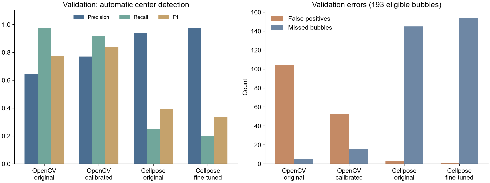
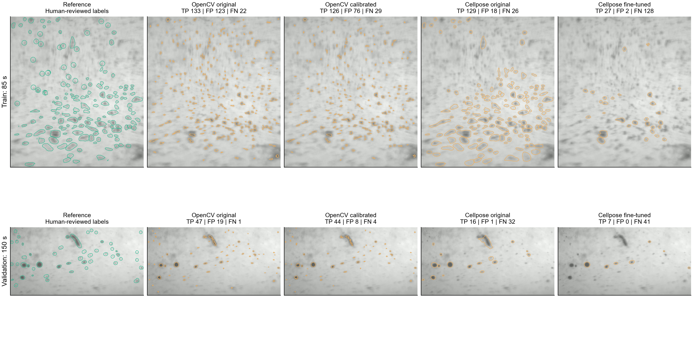

# 新显微镜检测适配：首轮结果

本轮已完成 Cellpose 微调、OpenCV 小范围参数校准和保留测试评价；两个更新候选均未通过预登记替换条件，默认检测和原始权重保持原样。已实现新权重和独立显微镜检测配置的加载接口。

## 数据与评价范围

- 已确认训练：3 张 / 198 个单泡；验证：5 张 / 203 个；测试：第 19、22 张 / 87 个。
- 第 8 张仍为草稿，排除；只使用已确认区域。排除截断和边缘对象后，训练 197 个、验证 193 个、测试 87 个用于中心检测评价。
- 所有数据来自同一段压缩录像，结果不能称跨实验验证。自动检测不使用人工提示点。
- 中心匹配半径 6 px；轮廓匹配 IoU ≥ 0.5。不同方法共用相同标签和评分规则，大面积错误预测不静默排除。
- 微调只用训练裁片，100 epochs，最终权重一次评价；验证决定选择，选择 JSON 保存之后才评价测试图。测试图不参与优化。

## 验证结果

| 方法 | 精确率 | 召回率 | 中心 F1 | 误检 | 漏检 |
|---|---:|---:|---:|---:|---:|
| OpenCV original | 64.4% | 97.4% | 77.5% | 104 | 5 |
| OpenCV calibrated | 77.0% | 91.7% | 83.7% | 53 | 16 |
| Cellpose original | 94.1% | 24.9% | 39.3% | 3 | 145 |
| Cellpose fine-tuned | 97.5% | 20.2% | 33.5% | 1 | 154 |

OpenCV 的候选把阈值从 10 改为 12，误检下降，但漏检增加，不满足本轮“召回率不得下降”的预登记要求。精度和召回率的取舍是真实存在的，不能在看完测试图后放宽门槛以宣布成功。

Cellpose 微调候选在训练集和验证集的召回率均降低。本轮证据只能确定未改善自动候选质量，不能仅凭训练损失下降归因为已适应；少量场景、增强/尺度和优化设置的影响尚未分离。

## 保留测试

候选未通过验证，所以保留测试只评估已选择的原版，不评价后再重新选择。

- opencv_original: TP 81，FP 33，FN 6；精确率 71.1%，召回率 93.1%，F1 80.6%。
- cellpose_original: TP 8，FP 0，FN 79；精确率 100.0%，召回率 9.2%，F1 16.8%。

原版 Cellpose 在这两张测试图上漏检很多，不能称已适配。OpenCV 的中心检测表现不等于准确的泡轮廓或真实粒子身份。

## 耗时及恢复

Cellpose 训练 9.16 s；恢复后的本次计算进程 56.50 s。异常终止前的完整进程耗时没有可靠记录，未补造总耗时。复用先前保存的 OpenCV 搜索和 17 份预测，未重新训练已完成模型。

1280×984 图像上的 OpenCV 检测核 p95 为 5.34 ms；仅检测核，不包含相机传输、PIV、界面和录像，不能换算成真实相机整套系统帧率。

## 当前可用状态与后续

- SAM 保留前一轮已验证模型；这与自动 Cellpose 检测分别评价。
- 新显微镜工作台保留原版 cyto3。没有把失败候选写入活动模型配置。
- 实时检测接口支持独立配置、相机分辨率检查和逐帧配置身份；无配置时沿用历史行为。当前未启用此次候选。
- 整条管腔未绘制：全通道回放和真实相机精度验证均为 NOT_RUN。启动实时界面后仍需 Draw LIVE mask；没有推断或代画人工确认掩码。
- 下一轮先比较训练区域中的小/淡泡与大/深泡的漏检分布，在训练/验证集上定位 Cellpose 失败原因，再决定有限的优化设置调整。第 19、22 张已作为本轮保留测试使用，后续若反复根据它们修改方案，就不能再称它们为未见测试集。
- 原始标签、失败权重、输入快照、源码、日志和 SHA-256 均保留。
