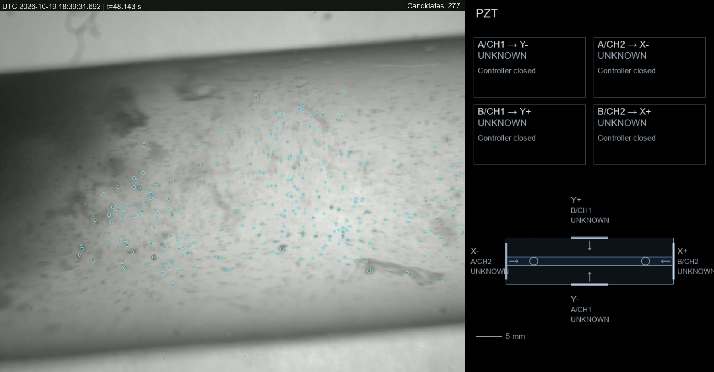
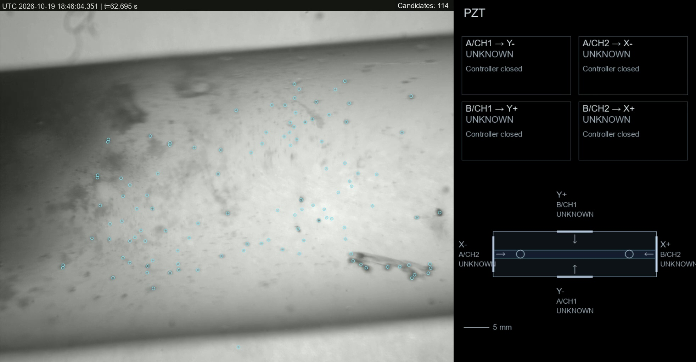

# v2 录像：最新 OpenCV 校准候选参数离线可视化

已完成两段完整视频；源文件未修改。保留原有相机画面、时间戳和 PZT 面板，新增青色候选中心小圆圈与 Arial 候选数。

| 视频 | 时长 | 完整帧数 | 输出 |
|---|---:|---:|---|
| experiment_overlay_v1 | 7.6463643 s | 293 | [打开视频](experiment_overlay_v1_final/experiment_overlay_v1_opencv_calibrated.mp4) |
| experiment_overlay_v2 | 86.3961843 s | 3588 | [打开视频](experiment_overlay_v2_final/experiment_overlay_v2_opencv_calibrated.mp4) |

两段视频均通过全部帧解码、逐帧 PTS 和总时长检查，最大时间戳误差为 0；未跳过输入帧。输出保留源视频的可变帧时间，未强制转为固定帧率。PZT 区域在有损编码前与输入逐像素一致。

采用 `detector_adaptation_20261019_v1/opencv_candidate_profile.json`：sigma=4 px，threshold=12，面积 8–450 px²，最大长宽比 2.8，边缘排除 2 px。本候选此前未通过实时默认替换门槛（验证召回率下降），本次按用户要求仅用于离线视频处理；实时默认参数未改变。

尚未绘制并确认管腔 mask；分析范围是相机区域（x=0, y=40, w=1280, h=984），不包含右侧 PZT 图和顶部原有文字，但包含未审核的管壁/管外区域。`Candidates` 是图像候选数量，不是人工确认的管内微泡数量；圆圈表示检测中心，不是泡径或精确轮廓。本次没有新增 PIV、物理轨迹或 PZT 实测参数。原视频中的 UNKNOWN 状态原样保留。

长视频初次输出在第 2751 帧发现抗锯齿圆圈越过相机边缘，改变了 PZT 区域的 3 个像素，因此验收拒绝。修复为相机 ROI 内绘图后重新输出，3588 帧的检测记录与修复前逐条相同。初次失败文件在 `experiment_overlay_v2/`，正式交付为上表的两个 `*_final` 目录。

每段正式输出目录中保存 `manifest.json`（源文件、参数、代码、字体和结果 SHA-256、执行 Git HEAD、耗时）与 `detections.jsonl.gz`（每帧时间戳、候选中心、面积和数量）。汇总验证见 `delivery.json`；修复证据见 `timing_fix_evidence/long_validation_failure_and_repair.json`；最终脚本快照见 `source_snapshot_final/`。`finalize_delivery.py` 可使用项目 `.venv/bin/python` 重新核对文件身份和提取解码预览，采用逐帧读取。

视觉抽查：已查看短视频第 146 帧、长视频第 1794 和 2751 帧的最终解码图像；中心标记可见，Arial 计数清晰，原有时间戳和 PZT 布局保留。原图已有的模糊、PZT UNKNOWN 状态以及侧栏边缘文字裁切未作推断性修补。

